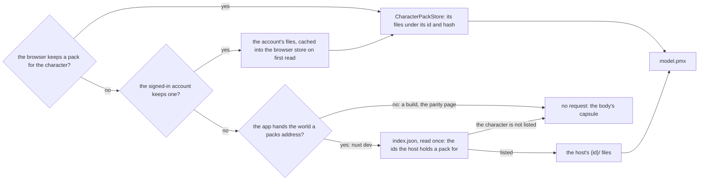

# Characters

A character is drawn from the official MMD model pack HoYoverse publishes for it. Every pack's bundled terms forbid redistributing it, so the app never hosts one: nothing of a pack is committed, uploaded to Blob Storage or served from a public address ([hosting the official packs](../../../rejected/genshin/hosting-official-character-packs/design.md)). A pack reaches the world only from a copy its reader holds, and a character with no such copy is drawn as its body's capsule, with no request for a pack.

The copies are a player's own download, read in their browser and kept there, then kept with their account and read back on any device they sign in on ([a player's own pack](player-packs/design.md)), and, under `nuxt dev` only, the developer's extracted packs served from disk ([development packs](development-packs/design.md)). The account's copy is readable by its owner alone. The engine reads the model itself ([reading a PMX](pmx-reader/design.md)), and the world draws it ([drawing it](drawing/design.md)). Lumine's own shading, as the game draws it, is recorded in [Lumine's shading](shading/design.md).

## The pack's layout

Both copies answer one layout, so the world asks for the same files whichever it reads:

- **One folder per character, named by its id in the game's data**, under the base URL the app hands the world (`GENSHIN_CHARACTER_PACK_BASE_URL`, `/data/genshin/characters`, in `apps/web/shared/services/genshin/constants.ts`). Beside the folders, `index.json` (`CHARACTER_PACK_INDEX_PATH`) lists the ids the host holds a pack for.
- **Each folder serves `model.pmx`**, the character's model whatever its own file is called; `terms.txt`, the terms bundled with it, as UTF-8; and the textures at the paths the model names them by, relative to it.
- **`readCharacterPackFile` reads every file through `getCharacterPackFileUrl`**, so the three kinds share one path. `getCharacterPackFilePath` cuts that path from a model's own spelling: it reads MMD's backslashes as slashes, drops an empty or `.` part and resolves a `..` against the folder before it. A path that climbs out of the pack is kept, so its texture is reported missing. Each part is encoded on its own, since a model's paths hold letters of any script.

## How the world picks a reader

`useCharacterPacks` reads the index of the packs the browser keeps as the world opens. `useCharacterPackIds` reads the host's index once. `chooseCharacterPackReader` then reads a character's pack from the browser's copy where it keeps one, else from the account's copy, else from the host's where the host's index lists the character. A character none of them lists is drawn as the body's capsule. The account's copy is cached in the browser the first time it is read, so it is read once per device.

With no address, or an index that fails to load (which is logged), the host has none. A model that fails to read is logged and emitted, and the body's capsule is drawn in its place. A texture the release does not ship is logged once and its material drawn untextured.

## Decisions

- **The world holds no account of where packs live.** It takes the packs' address from the app and reads any host laid out the same way. The rules that read an official release's folder are the world package's, with no Node import, so the browser applies them to a player's release as the development server applies them to a folder on its disk.
- **An index lists the packs a host holds, read once.** Without it the world could tell an absent pack from a failed one only by asking for its model, and a character without a pack would cost a request.
- **A pack is drawn whole or not at all.** Only the textures a material draws with are read. A texture the release does not hold draws its material untextured, since the release itself lacks it; a file the pack lists that fails to arrive fails the whole model, so a character never draws partly.
- **The terms are shown from whichever copy draws the model.** They carry the credit the release asks for, so the terms of a development pack and of a player's pack appear the same way.

## Key files

| File                                                                                    | Role                                                                                      |
| :-------------------------------------------------------------------------------------- | :---------------------------------------------------------------------------------------- |
| `apps/web/shared/services/genshin/constants.ts`                                         | `GENSHIN_CHARACTER_PACK_BASE_URL`, where the world reads the packs from                   |
| `apps/web/app/components/Genshin/World.vue`                                             | Hands the world the packs' address in development alone                                   |
| `apps/web/server/services/genshin/accountCharacterPack/readAccountCharacterPackFile.ts` | One file of the signed-in player's kept packs, by hash, else none                         |
| `packages/genshin-world/src/characterPack.ts`                                           | The rules and readers the app's server imports, with none of the world's components       |
| `packages/genshin-world/src/composables/useCharacterPacks.ts`                           | The browser's kept packs and the host's, the reader of the character on the field         |
| `packages/genshin-world/src/composables/useCharacterPackIds.ts`                         | The ids the host's index lists, read once                                                 |
| `packages/genshin-world/src/services/character/chooseCharacterPackReader.ts`            | A character's pack read from the browser's copy, else the host's, else none               |
| `packages/genshin-world/src/services/character/readCharacterPackFile.ts`                | Reads any file of a host's pack by its path                                               |
| `packages/genshin-world/src/services/character/getCharacterPackFileUrl.ts`              | Where a file of a pack is served, by the character's id and the file's path               |
| `packages/genshin-world/src/services/character/getCharacterPackFilePath.ts`             | A model's path cut into the path a pack serves the file at                                |
| `packages/genshin-world/src/services/character/readCharacterTerms.ts`                   | A pack's terms, as a Result                                                               |
| `packages/genshin-world/src/services/character/constants.ts`                            | A pack's index and file names, the store's names, the terms' encodings, and a read's wait |

## Notes

- **Within what the terms allow.** No redistribution, which is why the app serves a pack only to the developer whose copy it is, from their own disk, and a player's pack is read back only by that player, from their own browser or their own account. No commercial use of the models, and none of the uses the terms list (adult, extreme religious, gore, personal attacks), which the platform's own rules already forbid.

## Sources

- The terms bundled with each official model, read from each release's own file: 「请勿二次配布」 or 「请勿二配」, "do not redistribute", the releases whose terms are a readme adding 「以及拆取部件以用于改造其他模型」, "nor take parts to modify other models", beside the uses they forbid and miHoYo's copyright. The credit they carry is shown as part of their text.
