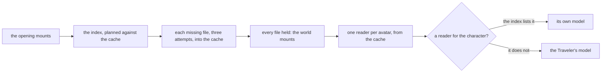

# Characters

A character is drawn from the official MMD model pack HoYoverse publishes for it. The app publishes each official pack to the public game data container, under the owner's stated permission from HoYoverse ([published packs](published-packs/design.md)), and the world downloads them into the browser as it opens and draws each character from its own pack, with no stand-in. Every pack's bundled terms still say not to redistribute it (`{data-root}/character-packs/extracted/10000006/丽莎/使用规则.txt`, and the same term in the other extracted packs' files), so each pack's terms folder is published beside its model. No `.pmx` is committed to the repository. The engine reads the model itself ([reading a PMX](pmx-reader/design.md)), and the world draws it ([drawing it](drawing/design.md)) (`packages/genshin-engine/src/character/createPmxMesh.ts`, `packages/genshin-world/src/components/Character/Model/Index.vue`). Lumine's own shading, as the game draws it, is recorded in [Lumine's shading](shading/design.md). A player's own release is read as [a player's own pack](player-packs/design.md), and a development server's packs as [development packs](development-packs/design.md).

## The pack's files

The packs are one folder per character, named by its id in the game's data, each file published under `characterPacks/<id>/<path>` beside the pack's own `manifest.json`. The hosted index record lists each avatar with its name and each file's path, bytes and sha256, so the world plans its download and names its files from the index alone (`packages/genshin-world/src/models/character/CharacterPackIndex.ts`, `packages/genshin-world/src/services/character/readCharacterPackIndex.ts`).

A pack keeps the file names its folder gave them, and the world finds its parts by the pack's own rules:

- **The model** is the folder's one `.pmx`, or of several the one named as its character, the names read from the game's text (`packages/genshin-world/src/services/character/chooseCharacterPackModel.ts`).
- **The terms** are the text file whose name holds the earliest of the terms' names (`packages/genshin-world/src/services/character/chooseCharacterTermsFile.ts`), decoded as the file's own encoding reads (`packages/genshin-world/src/services/character/decodeCharacterTerms.ts`).
- **The textures** are the paths the model names them by, relative to the model's folder, cut to the path a pack keeps each file under (`packages/genshin-world/src/services/character/getCharacterPackFilePath.ts`), matched without regard to case or Unicode form (`packages/genshin-world/src/services/character/resolveCharacterPackTextures.ts`).

## How the world reads a pack

The opening downloads the packs when it mounts. Each file is kept in the browser's Cache Storage under its url with the first sixteen hex characters of its sha256 as a version, so a republished file is a key of its own and the older copy is no longer read. A file gets three attempts, and the world mounts only once every file is held (`packages/genshin-world/src/composables/useCharacterPackPreload.ts`, `packages/genshin-world/src/services/character/planCharacterPackDownload.ts`, `packages/genshin-world/src/services/character/downloadCharacterPackFiles.ts`).

The world's gate reads one reader per avatar from that cache, each choosing its model and its terms by the rules above (`packages/genshin-world/src/services/character/readCharacterPackReaders.ts`, `packages/genshin-world/src/services/character/createCharacterPackReader.ts`). The character on the field is drawn from the reader of its own id, and a character the index lists no pack for is drawn from the Traveler's (`packages/genshin-world/src/services/character/getCharacterPackReader.ts`, `packages/genshin-world/src/components/World/Windrise/Index.vue`).

A model that fails to read is logged by the model component and draws nothing for the character. A texture the release does not ship is logged once, and its material drawn untextured (`packages/genshin-world/src/services/character/readCharacterMesh.ts`).

## Decisions

- **The index is the one list of the packs.** The world reads it through the game data's lock like every other dataset, so the packs a build draws are the packs the publish wrote (`packages/genshin-world/src/services/character/readCharacterPackIndex.ts`).
- **A pack is drawn whole or not at all.** (`packages/genshin-world/src/services/shared/readFileResponse.ts` throws on a failed file.) Only the textures a material draws with are read (`packages/genshin-world/src/services/character/resolveCharacterPackTextures.ts`, which matches only the textures a model names). A texture the release does not hold draws its material untextured, since the release itself lacks it; a file the pack lists that fails to arrive fails the whole model, so a character never draws partly.
- **No stand-in is drawn for a character.** A character whose model is not held draws nothing, and the world does not mount until every pack is held, so the case is a model that fails to parse alone.
- **The terms are shown from the model's own pack** (`packages/genshin-world/src/components/Character/Terms/Index.vue`, which reads `readCharacterTerms` from the reader of the character the Character screen shows). They carry the credit the release asks for, so each pack's terms appear the same way.

## Key files

| File                                                                           | Role                                                                                                        |
| :----------------------------------------------------------------------------- | :---------------------------------------------------------------------------------------------------------- |
| `scripts/src/services/genshinAssets/characterPacks/buildCharacterPackIndex.ts` | Builds the index record from the packs' manifests                                                           |
| `packages/genshin-world/src/models/character/CharacterPackIndex.ts`            | The index record's model and schema                                                                         |
| `packages/genshin-world/src/services/character/readCharacterPackIndex.ts`      | Reads the index through the hosted game data                                                                |
| `packages/genshin-world/src/services/character/planCharacterPackDownload.ts`   | The files and bytes the cache lacks                                                                         |
| `packages/genshin-world/src/services/character/downloadCharacterPackFiles.ts`  | Fetches the missing files with progress and retries into the cache                                          |
| `packages/genshin-world/src/composables/useCharacterPackPreload.ts`            | The preload's state: bytes loaded, bytes pending, failure and retry, and the report that the packs are held |
| `packages/genshin-world/src/services/character/readCharacterPackReaders.ts`    | One reader per avatar, read from the cache when the world opens                                             |
| `packages/genshin-world/src/services/character/createCharacterPackReader.ts`   | A pack's reader: its model, its terms and its textures, each by the pack's own rules                        |
| `packages/genshin-world/src/services/character/getCharacterPackReader.ts`      | The reader of a character, or the Traveler's where the index lists none                                     |
| `packages/genshin-world/src/services/shared/readFileResponse.ts`               | A host's file fetched under a timeout, its status checked                                                   |
| `packages/genshin-world/src/services/character/getCharacterPackCacheUrl.ts`    | A file's url as the cache keeps it, with its hash as the version                                            |
| `packages/genshin-world/src/services/character/getCharacterPackFilePath.ts`    | A model's path cut into the path a pack keeps the file at                                                   |
| `packages/genshin-world/src/services/character/readCharacterTerms.ts`          | A pack's terms, decoded, as a Result                                                                        |
| `packages/genshin-world/src/services/character/constants.ts`                   | A pack's cache, file and index names, the terms' encodings, and a read's wait                               |

## Notes

- **Within what the terms allow.** No commercial use of the models, and none of the uses the terms list (adult, extreme religious, gore, personal attacks) (`{data-root}/character-packs/extracted/10000030/readme【一定要看】.txt`), which the platform's own rules already forbid.

## Sources

- The terms bundled with each official model, read from each release's own file: 「请勿二次配布」 or 「请勿二配」, "do not redistribute", the releases whose terms are a readme adding 「以及拆取部件以用于改造其他模型」, "nor take parts to modify other models", beside the uses they forbid and miHoYo as the model's provider and holder of its final interpretation (`{data-root}/character-packs/extracted/10000030/readme【一定要看】.txt`, "模型提供：miHoYo", "最终解释权归属：miHoYo"), and miHoYo's copyright in 丽莎's file (`{data-root}/character-packs/extracted/10000006/丽莎/使用规则.txt`, "模型版权所属miHoYo"). The credit they carry is shown as part of their text (`{data-root}/character-packs/extracted/10000030/readme【一定要看】.txt`, `{data-root}/character-packs/extracted/10000031/菲谢尔/readme【一定要看】.txt`, `{data-root}/character-packs/extracted/10000036/readme【一定要看】.txt`).
