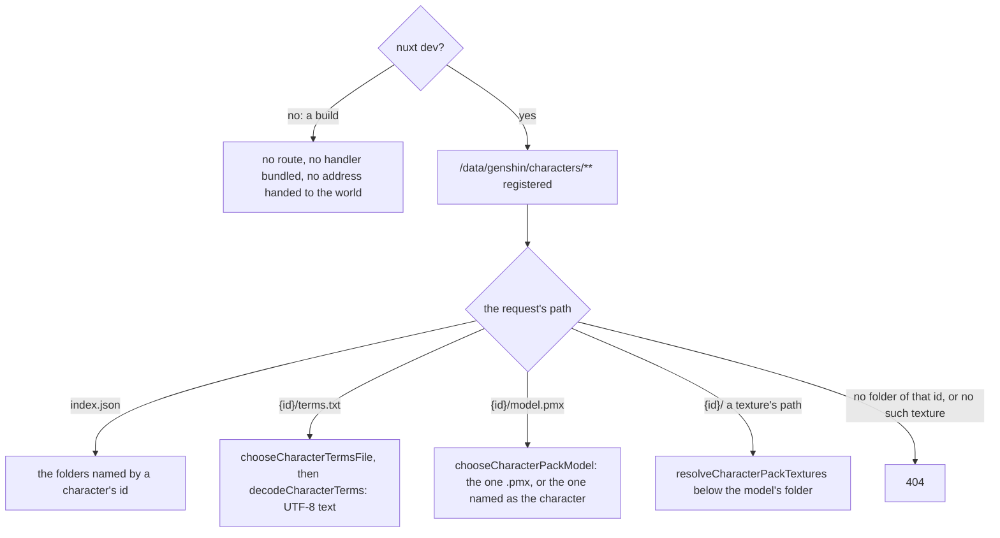

# Development packs

Under `nuxt dev`, the app's module `apps/web/modules/serveGenshinExtractions.ts` registers a route at `GENSHIN_CHARACTER_PACK_BASE_URL`, and the app's world component hands the world that address. A build registers no route, bundles neither the route's handler nor the readers it imports, and hands the world no address. The module returns before registering anything unless Nuxt runs under `nuxt dev`, since a route that refused outside development would still be bundled into the production server with the readers it imports. The same module registers the route the world reads the developer's own exports of the game's scenes from ([development exports](../../derived-assets/development-exports/design.md)).

The route reads the folder `GENSHIN_CHARACTER_PACKS_DIRECTORY` names, by default `~/Esposter/character-packs/extracted`. That folder holds one subfolder per character, named by its id, each an official release extracted as it shipped. `serveGenshinCharacterPack` answers the [pack layout](../README.md) from it. The server reaches the world's rules through the package's `genshin-world/characterPack` entry, which reaches none of its components.

The folder rules, the model's, the textures' and the terms', are the same ones a player's extracted release is read by ([a player's own pack](../player-packs/design.md)).

Only a folder named by a character's id is read, and only a file the folder's own listing holds is served, so no request reaches outside the directory. Nothing is cached: an edited pack is read again on the next request.

## Key files

| File                                                                           | Role                                                                              |
| :----------------------------------------------------------------------------- | :-------------------------------------------------------------------------------- |
| `apps/web/modules/serveGenshinExtractions.ts`                                  | Registers the packs' and the scene exports' routes under `nuxt dev` alone         |
| `apps/web/server/development/genshinCharacterPacks.ts`                         | The route: the packs' directory and the game data's address handed to the service |
| `apps/web/server/services/genshin/characterPack/serveGenshinCharacterPack.ts`  | Answers the pack layout from an extracted release's folder                        |
| `apps/web/server/services/genshin/characterPack/readCharacterPackModelPath.ts` | The folder's model, its several models' names read from their headers             |
| `apps/web/server/services/genshin/characterPack/listCharacterPackIds.ts`       | The index: the folders named by a character's id                                  |
| `apps/web/server/services/genshin/characterPack/listCharacterPackFiles.ts`     | A folder's files by their paths in it                                             |
| `apps/web/server/services/genshin/characterPack/constants.ts`                  | The packs' default directory, and the folder names read                           |

## Decisions

- **The development server serves the packs, and no build holds the route.** The route is the only way a folder on the developer's disk reaches the world, so a production build carries neither it nor a request to it.
- **A host's files are served at their character's id, read as they stand.** The developer's folder is edited in place, so each request reads it fresh, as the [player's kept packs](../player-packs/design.md) are stored under their hash instead.
