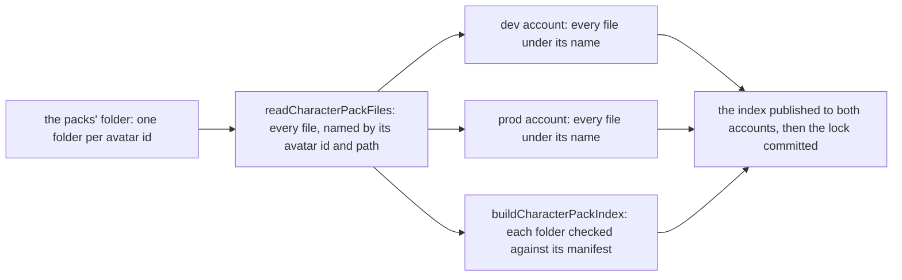

# Published character packs

## Decision

The owner has stated that HoYoverse permits redistributing the official character packs. The app therefore publishes each pack to the public game data bucket, so a browser reads a character's model from the public bucket. No written grant is in the repository, so the basis is the owner's statement, cited under Sources.

The packs' bundled terms still say not to redistribute (「请勿二次配布」, or 「请勿二配」 in one model's terms), and they name miHoYo as the model's copyright holder or provider. The publish carries each pack's terms files unchanged, so the credit and the terms reach a reader with the model. The decision rests on the owner's permission, not on those terms.

## Layout

Each file of an avatar folder publishes to `public-genshin-assets` under `characterPacks/<avatar id>/<path>`, with the path kept inside the folder and written with forward slashes. That covers the model, its textures, its `sph` files, its terms files, and the pack's own `manifest.json`, which publishes unchanged. Both environments' buckets hold the same names. `genshin:data prune` reaches only the game data datasets, so it never deletes a pack.

## Publish

The command is `pnpm -C scripts genshin:assets character-packs`, with `--directory` naming the packs' folder and `--dry-run` reporting the counts and writing to neither account.

Both accounts upload in parallel, and each file replaces the account's copy under the same name. Before any upload, the index is built from the same listing, and a folder whose files disagree with its manifest stops the publish there. Once both accounts hold every file, the index is published to both through the game data publish step, which commits the lock, so no account lists a file it does not hold.

## The world reads the packs

How the world reads the packs, from the index through the cache to each pack's reader, is set out in [the characters index](../README.md#how-the-world-reads-a-pack).

## Not built

- An upload does not compare content first, so an unchanged file uploads again on a rerun.
- A file a pack drops is not unpublished: a rerun replaces only the names the packs still hold.
- Nothing removes a held file, so a republished file's older copy stays in the browser's cache, unread.

## Rejected

- **Hosting the official packs in the app's own storage, served to every visitor.** Each pack's bundled terms forbid redistributing it, so the app held no pack and each copy stayed one a player or a developer already had. The owner's permission overturned this, and the Decision above publishes the packs on it.

## Key files

| File                                                                           | Role                                                                                       |
| :----------------------------------------------------------------------------- | :----------------------------------------------------------------------------------------- |
| `scripts/src/services/genshinAssets/commands/characterPacksCommand.ts`         | The `character-packs` command: the dry run, the counts and the publish                     |
| `scripts/src/services/genshinAssets/characterPacks/readCharacterPackFiles.ts`  | Every file of every avatar folder, named by its object key                                 |
| `scripts/src/services/genshinAssets/characterPacks/publishCharacterPacks.ts`   | Uploads every file to both accounts under its name                                         |
| `scripts/src/services/genshinAssets/characterPacks/constants.ts`               | The packs' default folder and the key prefix they publish under                            |
| `scripts/src/services/genshinAssets/characterPacks/buildCharacterPackIndex.ts` | The index of every avatar, built from the same listing the upload publishes                |
| `scripts/src/services/genshinAssets/characterPacks/toCharacterPackAvatar.ts`   | One avatar's entry, refused unless its files match its manifest's bytes and sha256         |
| `scripts/src/services/gameData/publishGameDataStep.ts`                         | Publishes the index to both accounts, then commits the lock                                |
| `packages/genshin-world/src/services/character/readCharacterPackReaders.ts`    | Each avatar's reader, read from the cache when the world opens                             |
| `packages/genshin-world/src/services/character/createCharacterPackReader.ts`   | A pack's model, terms and textures, each found by the pack's own names                     |
| `scripts/src/models/genshinAssets/characterPacks/CharacterPackFile.ts`         | One file read from disk, with its object key and size                                      |
| `scripts/src/services/gameData/createGameDataBucketClientMap.ts`               | The bucket client each environment is published through, shared with the game data publish |
| `packages/genshin-text/src/models/GameTextKey.ts`                              | The startup loading screen's download and failure lines, by their text ids                 |

## Sources

- The owner's statement that HoYoverse permits redistributing the packs. No written grant is in the repository.
- The bundled terms, read from each release's own file: `{data-root}/character-packs/extracted/10000006/丽莎/使用规则.txt`, which names miHoYo as copyright holder, and `{data-root}/character-packs/extracted/10000030/readme【一定要看】.txt`, which names miHoYo as provider.
