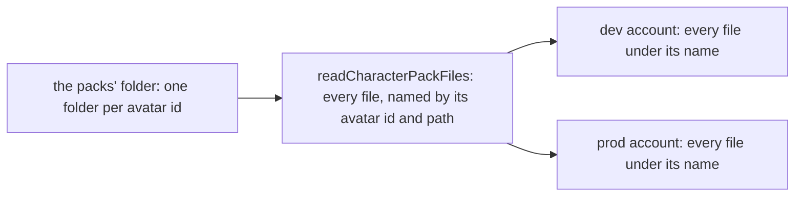

# Published character packs

## Decision

The owner has stated that HoYoverse permits redistributing the official character packs. The app therefore publishes each pack to the public game data container, so a browser reads a character's model from the app's storage. This reverses the earlier decision against hosting them, which is no longer on record. No written grant is in the repository, so the basis is the owner's statement, cited under Sources.

The packs' bundled terms still say 「请勿二次配布」, do not redistribute, and miHoYo is named as the model's copyright holder. The publish carries each pack's terms folder unchanged, so the credit and the terms reach a reader with the model. The decision rests on the owner's permission, not on those terms.

## Layout

Each file of an avatar folder publishes to `public-genshin-assets` under `characterPacks/<avatar id>/<path>`, with the path kept inside the folder and written with forward slashes. That covers the model, its textures, its `sph` files, its `terms` folder, and the pack's own `manifest.json`, which publishes unchanged. Both storage accounts hold the same names. `genshin:data prune` reaches only the game data datasets, so it never deletes a pack.

## Publish

The command is `pnpm genshin:assets character-packs`, with `--directory` naming the packs' folder and `--dry-run` reporting the counts without a request.

Both accounts upload in parallel, and each file replaces the account's copy under the same name.

## Not built

- The world does not read the published packs yet. `GENSHIN_CHARACTER_PACK_BASE_URL` still names the development server alone, and pointing the world at `characterPacks/` is a later change.
- An upload does not compare content first, so an unchanged file uploads again on a rerun.
- A file a pack drops is not unpublished: a rerun replaces only the names the packs still hold.

## Key files

| File                                                                          | Role                                                                     |
| :---------------------------------------------------------------------------- | :----------------------------------------------------------------------- |
| `scripts/src/services/genshinAssets/commands/characterPacksCommand.ts`        | The `character-packs` command: the dry run, the counts and the publish   |
| `scripts/src/services/genshinAssets/characterPacks/readCharacterPackFiles.ts` | Every file of every avatar folder, named by its blob name                |
| `scripts/src/services/genshinAssets/characterPacks/publishCharacterPacks.ts`  | Uploads every file to both accounts under its name                       |
| `scripts/src/services/genshinAssets/characterPacks/constants.ts`              | The packs' default folder and the blob prefix they publish under         |
| `scripts/src/models/genshinAssets/characterPacks/CharacterPackFile.ts`        | One file read from disk, with its blob name and size                     |
| `scripts/src/services/gameData/createGameDataContainerClient.ts`              | The container client for each account, shared with the game data publish |

## Sources

- The owner's statement in the session of 2026-10-28 that HoYoverse permits redistributing the packs. No written grant is in the repository.
- The bundled terms, read from each release's own file: `{data-root}/character-packs/extracted/10000006/丽莎/使用规则.txt`, which names miHoYo as copyright holder, and `{data-root}/character-packs/extracted/10000030/readme【一定要看】.txt`, which names miHoYo as provider.
