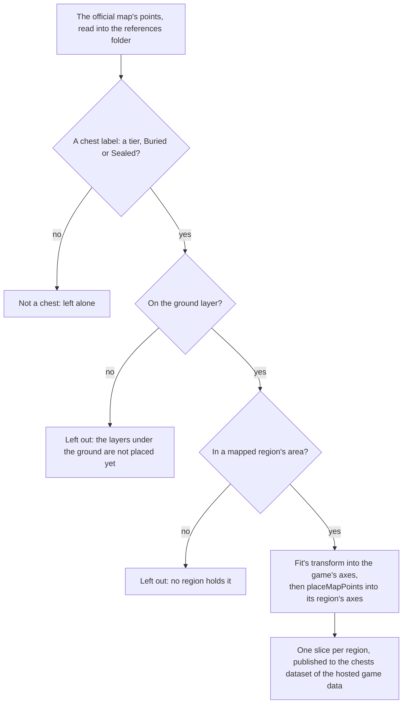

# Chests

The servers' chests are not in the client's data, so the official map's public points stand in for them, as the [spawned places](../spawned-places/design.md) page describes. This page is the first half of the [chests](../../../changes/genshin-chests/design.md) proposal: each chest the map marks on the ground is carried into the scene by the fit's transform and published into its region's slice, with its kind (`scripts/src/services/genshinAssets/chests/buildChestPlaces.ts`, `scripts/src/services/genshinAssets/points/placeMapPoints.ts`). Opening one is the second half, below.

## How it works

## The kinds

`ChestKind` names the map's own tier labels, Common to Remarkable, one per chest (`packages/genshin-world/src/models/chest/ChestKind.ts`, and the labels 17, 44, 45, 46 and 269 of `~/Esposter/genshin-parity/references/interactive-map/label-tree.json`). Buried and Sealed are places the map marks with no tier (labels 69 and 75 of the same tree): a Buried chest is dug up where it stands and a Sealed one is freed of its seal first. A dug or freed place's contents are not yet settled, since the map gives no tier for it and the buried and sealed points stand well apart from every tiered chest, so none can be read off a neighbour.

## Opening

In the world, each unopened Common, Exquisite, Luxurious, Precious or Remarkable chest of Mondstadt is a row on the ground beneath its point, named by its kind and opened on F. `useWorldChests` offers the rows and opens the chest through `openChest`, which rolls the kind's Primogems and Mora within their ranges into the wallet and keeps the chest as opened, so a second opening pays nothing (`packages/genshin-world/src/composables/useWorldChests.ts`, `packages/genshin-world/src/services/chest/openChest.ts`). The chest's drops are poured out where it stands for the player to pick up (`packages/genshin-world/src/services/chest/openChest.ts`). The opened chests are the save's `openedChests` slice, and the account's copy keeps them on a merge (`packages/genshin-world/src/services/save/mergeGenshinSave.ts`). The ranges are provisional, one per tier and not banded by Adventure Rank, with no source held for them yet (see Open). `ChestKindRewardMap` holds them (`packages/genshin-world/src/services/chest/ChestKindRewardMap.ts`).

A kind with no reward entry stays unopened, and a buried or sealed place stays unopened until it is dug or freed, since the map gives it no tier (`packages/genshin-world/src/services/chest/computeChestInteractables.ts`, line 30). Luxurious's Mora is recorded as zero, where the wiki leaves it unstated, and Remarkable pays five Primogems and no drop, its blueprints not being built (`packages/genshin-world/src/services/chest/ChestKindRewardMap.ts`). Each roll is uniform within its range, a provisional draw until a recording of openings reads its spread. Opening also pours out what the wiki lists for the tier, as provisional pools: one weapon picked from the one-star weapons Common and Exquisite chests name, and the Character EXP materials by star with their counts (Wanderer's Advice, Adventurer's Experience, Hero's Wit), and one artifact of the sets the tier's pool names, rolled as a drop rolls one: a set drawn evenly among those the reliquary tables hold, its slot evenly among the five, its stars one or two for a low set and three for a high one, and its starting minor affix count by the wiki's domain distribution, all provisional. Its main affix and minor affixes roll from the game's tables (`~/Esposter/genshin-parity/text/ExcelBinOutput/ReliquaryMainPropExcelConfigData.json`, `~/Esposter/genshin-parity/text/ExcelBinOutput/ReliquaryAffixExcelConfigData.json`, rolled in `packages/genshin-world/src/services/chest/rollChestDrops.ts`). The bag holds the artifact with the stats it rolled, each one an individual that keeps them. The high zone-level areas (Dragonspine, the Stormbearer Mountains, Guyun Stone Forest, Lisha and the Chasm) give more Primogems than the default, which the places cannot yet tell, since they name no area.

## The builder

`pnpm -C scripts genshin:assets chests` reads the points and the fit, and publishes one slice per region to the chests dataset of the [hosted game data](../hosted-game-data/design.md): a list of places laid out as the [spawned places](../spawned-places/design.md) page's Oculi slices are, each in its region's axes. A publish replaces the whole chests dataset, and the notes count each region's chests and what it left out. With `--dry-run` it prints `unchanged, no request made` when the published slices already match, and it needs no credential. It does not read the game's tables, the wiki or the installed game (`scripts/src/services/genshinAssets/commands/chestsCommand.ts`, `scripts/src/services/gameData/publishGameDataStep.ts` for the `unchanged, no request made` line).

- **The ground only.** Underground chests are counted and left out for the reason the [Oculi](../spawned-places/design.md#the-oculi) section gives (`scripts/src/services/genshinAssets/points/placeMapPoints.ts`).
- **Mapped areas only.** A point in an area no region is mapped to has no region to join, so it is counted and left out (`scripts/src/services/genshinAssets/points/placeMapPoints.ts`). The current run leaves none out.
- **Mora chests are not chests of these kinds.** The map's Mora chests are not among the seven, so the builder does not place them (labels 129 and 359 of `~/Esposter/genshin-parity/references/interactive-map/label-tree.json` name Mora chests; `scripts/src/services/genshinAssets/chests/ChestKindLabelIdMap.ts` names only the seven).
- **Not landmarks.** A landmark is built by a region kit, and a chest is acted on, so the [spawned places](../spawned-places/design.md#the-oculi) rule keeps it out of `LandmarkKind` (`packages/genshin-world/src/models/world/LandmarkKind.ts`).
- **Catalogue areas by outline.** Each slice is a region, and a place does not name its catalogue area. An opened chest counts toward the catalogue area whose outline holds its point (`placeExplorationDoings`), which the [exploration progress](../exploration-progress/design.md) reads, and a point in no outline counts toward none (`packages/genshin-world/src/services/exploration/placeExplorationDoings.ts`).
- **The chest achievement counts a region alone (provisional).** `TRIGGER_OPEN_WORLD_CHEST` names the game's chest ids in its first slot and a region in its second. A placed chest carries no game chest id, so the trigger's target is region-only: the id is not matched, the doing's region alone decides, and each placed chest counts once. The chest-opened event carries no region yet, and the game's region numbers in the chest rows name no catalogue area, so no row matches until those numbers are mapped. Until then the achievement does not move in play.
- **Region axes.** The fit carries a point into the game's axes, so `placeMapPoints` carries each place round the Windrise origin into its region's axes, x less the origin's x and z the origin's less the place's, as the landmarks and residents are. Every builder of a map point takes the same step through it, so no slice is left in the game's axes (`scripts/src/services/genshinAssets/shared/toRegionAxesPosition.ts`).
- **No height is published.** A place stands on the ground at its point, and that height is read where the place is stood on, which the runtime step does when it lands (`packages/genshin-world/src/models/chest/ChestPlace.ts`).

## Key files

| File                                                                     | Role                                                                                                             |
| :----------------------------------------------------------------------- | :--------------------------------------------------------------------------------------------------------------- |
| `scripts/src/services/genshinAssets/points/placeMapPoints.ts`            | Carries each kind's points into its region's axes, the ground and mapped areas, shared with the other map points |
| `scripts/src/services/genshinAssets/chests/buildChestPlaces.ts`          | Builds each region's slice from the points and the fit                                                           |
| `scripts/src/services/genshinAssets/chests/ChestKindLabelIdMap.ts`       | Each chest kind's label on the official map                                                                      |
| `scripts/src/services/genshinAssets/commands/chestsCommand.ts`           | `genshin:assets chests`                                                                                          |
| `packages/genshin-world/src/models/chest/ChestKind.ts`                   | The five tiers, and the buried and sealed places                                                                 |
| `packages/genshin-world/src/models/chest/ChestPlace.ts`                  | A placed chest: its id, kind and ground position                                                                 |
| `packages/genshin-world/src/services/chest/openChest.ts`                 | Opens a chest once and rolls its Primogems and Mora into the wallet                                              |
| `packages/genshin-world/src/services/chest/computeChestInteractables.ts` | Each unopened rewarded chest, offered as an Open row beneath its point                                           |
| `packages/genshin-world/src/composables/useWorldChests.ts`               | Loads Mondstadt's chests and opens one on F                                                                      |
| `packages/genshin-world/src/services/chest/ChestKindRewardMap.ts`        | Each tier's Primogem and Mora ranges, from the wiki's chest reward table                                         |

## Sources

- [Chest](https://genshin-impact.fandom.com/wiki/Chest), Genshin Impact Wiki: the chest reward table's ranges per tier.
- [Chest](https://genshin-impact.fandom.com/wiki/Chest), Genshin Impact Wiki: the highest Zone Level areas of Mondstadt and Liyue (Dragonspine, the Stormbearer Mountains, Guyun Stone Forest, Lisha and The Chasm).
- [Teyvat Interactive Map](https://act.hoyolab.com/ys/app/interactive-map/index.html), HoYoLAB: the official map, whose public label tree and point list the builder reads as references.
- [Common Chest Windrise, Mondstadt](https://www.youtube.com/watch?v=JQEikGg8Nvk), OAT_OA, 30 to 42 seconds: a Common chest in Windrise's area opened from standing in reach, its rewards (Adventure EXP, Anemo Sigil, Enhancement Ore, Traveling Doctor's Medicine Pot and Mora) in the wallet's list. Read at 1080 high and 30 frames a second, with the interaction key shown as Enter rather than F, so its opening's timing is measured to a frame at 30 a second.

## Reference

- `chest-dig.mkv` — found on YouTube at https://www.youtube.com/watch?v=j5ggVp4ffyc at 0–33 s (`~/Esposter.noindex/genshin-parity/captures/yt-j5ggVp4ffyc-chest-dig.mp4`), cut to `chest-dig.mkv` at 10–30 s: 59.6 frames a second, at 1080p in English. The dig prompt, the dig and its rewards are shown.

## Open

- [ ] **The Primogem and Mora ranges per tier are the wiki's chest reward table** — no source yet: the cached Chest wiki page is not on disk, and the dump holds no chest reward table.
- [ ] **The wiki's table leaves Luxurious' Mora unstated** — no source yet: the cached Chest wiki page is not on disk.
- [ ] **The high zone-level areas give more Primogems than the default** — no source yet: the cached Chest wiki page is not on disk, and the dump holds no chest reward table for those zones.
- [ ] **Opening pours out the wiki's pools for the tier, and the artifact's domain distribution** — no source yet: the cached Chest wiki page is not on disk, which names the pools' weapons, Character EXP materials and sets.
- [ ] **A Buried chest is dug up where it stands, and a Sealed one is freed of its seal first** — no source yet: the `chest-dig` capture the Reference section names has not been read frame by frame, so the dig and seal are unchecked.
- [ ] **The current run leaves no mapped-area chest out** — no source yet: the published chests dataset is not in the cache, and `scripts/src/services/genshinAssets/points/placeMapPoints.ts` counts what it leaves out, but no run's notes are kept.
