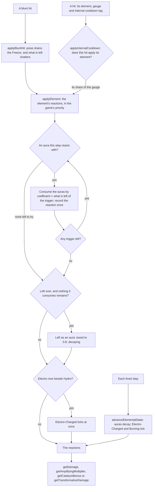
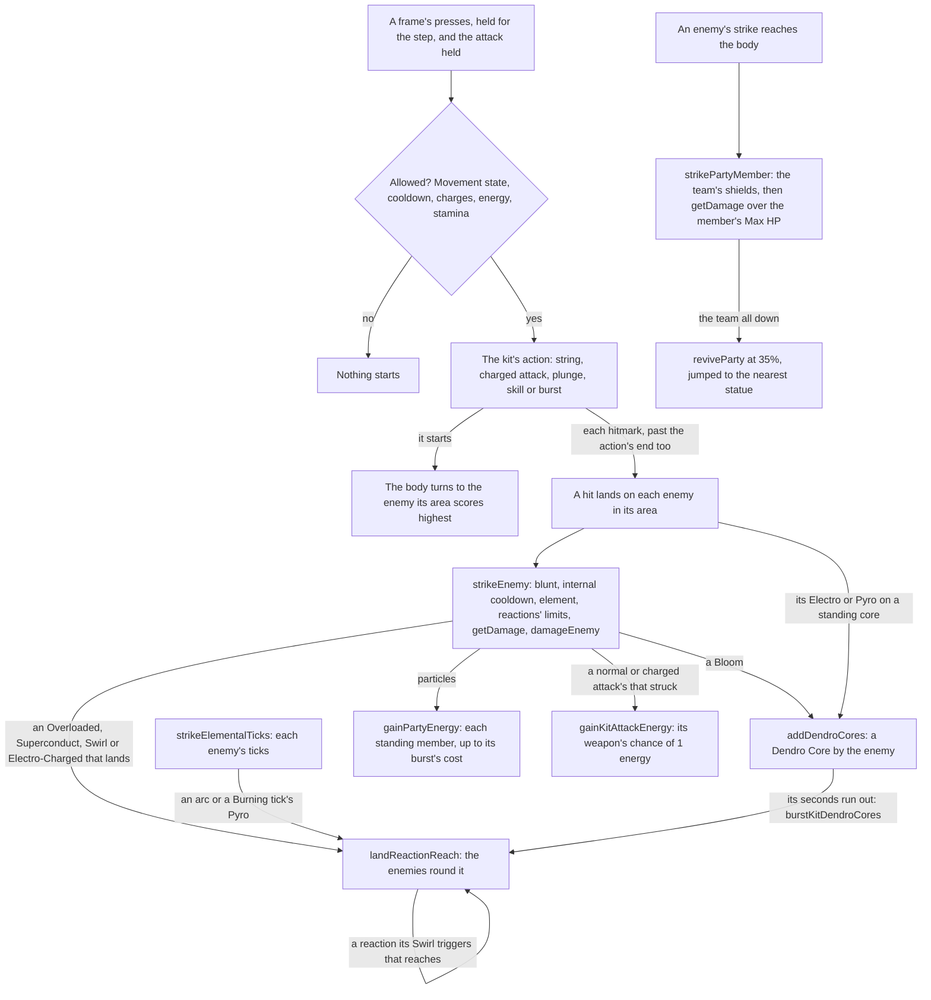

# Combat

The game's combat is one small set of rules every character and enemy shares, and its community has documented them to the decimal. They live in `genshin-world` under `services/combat`, as functions over plain state with no rendering, no input and no three.js, since the engine knows no rule of the game as it knows no place. The world calls into them from its fixed steps: the character on the field's kit prices each of its hits, and the [enemies](../enemies/design.md) age their elements and strike the party through them.

## How it works

Each target holds an `ElementalState`: its auras, its own clock, and when its Electro-Charged and Burning last ticked and it last crystallized. `createElementalState` makes an empty one.

### Auras

An attack applies a gauge of its element, in gauge units. Pyro, Hydro, Electro, Cryo and Dendro left as an aura are taxed to 0.8 of that gauge and decay evenly over 2.5 seconds a unit of the attack plus 7, so Bennett's 2U tap leaves 1.6U of Pyro for 12 seconds. Anemo and Geo leave no aura. A second attack of the same element keeps the larger gauge at the first aura's rate, except Pyro: a larger Pyro replaces the aura with its own rate.

Not every aura comes from an attack.

- **A self aura** is an element put on a target with no attack, as a slime's seeds or an enemy's elemental shield put one: `applyElement`'s last parameter, the seconds its source lasts. It reacts as an attack of its gauge would, but what is left of it is untaxed and decays at its source's gauge over those seconds, or not at all where they are `Infinity`, as most elemental shields' do. A Large Dendro Slime's Toxic Seeds leave 4U of Dendro losing 0.8U a second, and the Hydro Samachurl's 2U of Soothing Rain for 8 seconds keeps 1.6U after vaporizing 0.8U of Pyro, losing 0.25U a second.
- **An immutable aura** is an enemy's innate element, set on its state with `isImmutable`. Its gauge takes its share of a trigger as any aura's does, but it is never consumed, never decays and gives Electro-Charged's ticks nothing, so what is left of the trigger goes on to the auras beside it. A Cryo Slime's 2U of Cryo takes 2U of Beidou's 4U of Electro as Superconduct, and the 2U left quicken the Dendro beside it; a Cryo Hypostasis's 4U takes all of it. An attack of its own element leaves it as it is.

The Hilichurl Fighter, the one kind the world places yet, has neither: an enemy kind's innate element and its shield come with the kind.

### Reactions, in the game's priority

`ElementReactionStepsMap` holds, for each applied element, the reactions it tries in the order the game tries them. Each step names the auras it reacts with and the gauge of aura each unit of the trigger consumes. A step meeting several auras consumes them together, by the larger one's gauge. What is left of the trigger after a step goes on to the next, so 2U of Hydro on a Burning target vaporizes the Burning and its Pyro, then blooms the Dendro under them with the unit left over. A reaction is recorded once per application, however many auras it meets.

| Applied | Its reactions, in order                                                                                                |
| :------ | :--------------------------------------------------------------------------------------------------------------------- |
| Pyro    | Overloaded on Electro (1); Vaporize on Hydro (0.5); Melt on Cryo and Freeze (2); Burning on Dendro or Quicken          |
| Hydro   | Vaporize on Pyro and Burning (2); Frozen on Cryo (1); Bloom on Dendro and Quicken (0.5)                                |
| Electro | Aggravate on Quicken; Overloaded on Pyro and Burning (1); Superconduct on Cryo, then Freeze (1); Quicken on Dendro (1) |
| Cryo    | Superconduct on Electro (1); Melt on Pyro and Burning (0.5); Frozen on Hydro (1)                                       |
| Dendro  | Spread on Quicken; Quicken on Electro (1); Burning on Pyro or Burning; Bloom on Hydro (2)                              |
| Anemo   | Swirl on Electro, Pyro and Burning, Hydro, Cryo, then Freeze (0.5 each)                                                |
| Geo     | Shattered on Freeze; Crystallize on Electro, Pyro and Burning, Hydro, then Cryo (0.5 each)                             |

What is left once every step has run stays as an aura, if the element leaves one and no aura it consumes remains. A reaction with no coefficient consumes neither side, which is how auras come to coexist.

- **Electro-Charged** is no step: it is Electro and Hydro left on a target together. It ticks the moment they meet and each second after, every tick taking 0.4U from each aura that has more than that to give. Once one decays away it ends, ticking once more if half a second has passed since the last.
- **Quicken** consumes Dendro and Electro at 1 and leaves the gauge it consumed as its own aura, lasting 5 seconds a unit plus 6. Aggravate and Spread consume neither the Quicken nor their trigger, so the trigger goes on to its later steps and may lie beside the Quicken.
- **Burning** consumes nothing when it lights. It leaves a 2U Burning aura that never decays over the Pyro and Dendro beneath it, ticks every quarter second, and applies 1U of Pyro under Burning's internal cooldown. The Dendro and Quicken under it drain at twice their own decay, 0.4U a second at least, and it goes out once neither is left. Pyro or Dendro on a burning target refreshes it without triggering it again, and Dendro then replaces the Dendro whatever its gauge.
- **Frozen** leaves twice the gauge it consumed as a Freeze, which decays at 0.4U a second and faster by 0.1 every second it holds, so its gauge G lasts 2√(5G + 4) − 4 seconds. Hydro and Cryo lie under it. Pyro and Electro meet only the Freeze over a Hydro, and what is left of them stays as no aura. A Geo hit shatters it, at no gauge too, and `applyBluntHit` drains 0.006U of it per point of poise damage before shattering what is left. A Shatter takes 8U.
- **Swirl** records the gauge it spreads its element at, (G − 0.04) × 1.25 + 1, where G is the Anemo's gauge if the aura takes all of it and the aura's gauge if not. 1U of Anemo on 0.8U of Hydro spreads 2.2U.
- **Crystallize** triggers once a second on a target at most.
- **Bloom** leaves a Dendro Core by its target, which bursts on its own or as Electro or Pyro meets it: Electro on a core is Hyperbloom and Pyro is Burgeon (`DendroCoreReactionTypeMap`). The world places and bursts the cores, as its reach below describes.

Each recorded reaction carries the element its damage is dealt in, none for Shattered's physical damage or for a reaction that deals none.

### Damage

`getDamage` is the game's general formula. The talent's multiplier of its stat, plus any flat bonus, a hit's own additive base damage and a catalyze's, is multiplied by one plus the damage bonus (the element's or the physical, the all-damage bonus, the normal and charged attack bonus on a normal or charged attack, a hit's own, and an enemy's DMG taken) and by a crit's one plus critical damage. It is then cut by the enemy's defence against the attacker's level, (5 × attacker level + 500) / (enemy defence + 5 × attacker level + 500) before any reduction or ignoring, and by the enemy's resistance, less any RES a status on the enemy takes off it, its element's or its Physical RES, as Enduring Rock's Geo RES and the Jade Shield's every RES do. An enemy of level L has 5 × L + 500 defence, so a hit from its own level is halved. Last it is multiplied by an amplifying reaction's multiplier. `getResistanceMultiplier` adds half a negative resistance, takes off a resistance up to 75%, and leaves 1 / (4 × resistance + 1) past that.

- **Amplifying**: Vaporize and Melt multiply their hit by 2 where Hydro vaporizes or Pyro melts, and by 1.5 the other way round. Elemental mastery raises that by 2.78 × EM / (EM + 1400), plus any reaction bonus (`getAmplifyingMultiplier`).
- **Catalyze**: Aggravate adds 1.15 and Spread 1.25 times the character's level multiplier to the hit's flat bonus, raised by 5 × EM / (EM + 1200) (`getCatalyzeBonus`).
- **Transformative**: Overloaded, Superconduct, Electro-Charged, Swirl, Shattered, Bloom, Hyperbloom, Burgeon and Burning deal their own damage, from 0.25 to 3 times the level multiplier. That is raised by 16 × EM / (EM + 2000) and cut by resistance alone, less what the enemy's statuses take off it, since it ignores defence and cannot crit (`getTransformativeDamage`). A reaction's damage on one enemy is limited by its own internal cooldown, below, and an Overloaded, a Superconduct, a Swirl and Electro-Charged reach the enemies round it, as the section after it describes.
- **Superconduct's shred**: a Superconduct gives its enemy a status taking 40% off its Physical RES for 12 seconds, so every physical hit on it until then reads the lower RES.

`CharacterLevelMultiplierMap` is the wiki's level multiplier for characters at every level to 90, then 95 and 100.
`EnemyLevelMultiplierMap` is the wiki's level multiplier for enemies and the environment, to 100. It agrees with the characters' table to level 57 and parts from it at 58, so a reaction an enemy triggers takes its own table through `getTransformativeDamage`'s last parameter.

The deployed team's [elemental resonance](../party/design.md) adds to a kit hit's CRIT Rate, read in `strikeEnemy` before the hit's own reactions: Shattering Ice's 15% against an enemy Frozen or affected by Cryo, so a hit's critical roll is `random() < CRIT Rate + 0.15` on that enemy. The roll is drawn from the world's one seeded random source, the stream the kit's other rolls read, so a session's rolls repeat. The other resonances' stat effects are summed into each member's attributes, and reach the damage formula through them. Enduring Rock's DMG and Geo RES, and Sprawling Greenery's timed Elemental Mastery, are read as a strike lands, as the [party](../party/design.md) page describes.

### Internal cooldown

A hit applies its element under an internal cooldown, kept per attacker, target and tag. `applyInternalCooldown` counts a hit into one and returns the share its group's sequence holds for it, of its gauge here. A hit once the reset interval has passed restarts the timer and the count and takes the first share; any other is the next hit of the group's sequence. `DEFAULT_INTERNAL_COOLDOWN_GROUP` is the standard 2.5 seconds with every third hit applying, so Yoimiya's seven arrows melt on the first, fourth and seventh. `BURNING_INTERNAL_COOLDOWN_GROUP` applies once each two seconds. A tag gcsim gives a group of its own keeps that group in place of the standard one (`InternalCooldownTagGroupMap`), as Furina's Salon members' tags keep gcsim's one in two over 30 seconds.

A transformative reaction's damage is limited the same way, its sequence a share of the damage, kept on the enemy per source, reaction and element, so Swirls of each element count apart (`applyReactionInternalCooldown`). Swirl, Superconduct, Shattered, Bloom, Hyperbloom and Burgeon deal two instances each half second, Overloaded and Electro-Charged one, and Burning's damage has no limit (`TransformativeReactionInternalCooldownGroupMap`). A Swirl, Superconduct or Overloaded triggered within a tenth of a second of the last of its kind to land on the enemy does not land, whatever its source: it deals no damage and reaches nothing, so two characters swirling one element together deal one Swirl (`applySimultaneousReactionInternalCooldown`).

### Reach

A reaction that lands reaches every other standing enemy within its radius of the one it landed on, measured to the enemy's edge, once the strike that triggered it has landed on every enemy it reaches (`landReactionReach`). An Overloaded's and a Superconduct's explosion reach 3 metres and deal each enemy their damage, and a Superconduct's takes each one's Physical RES down as it does its own target's. An Overloaded's explosion is a blunt hit of 90 poise, gcsim's, on its own target and on each enemy it reaches: each takes the poise damage, and on an enemy it reaches it drains a Freeze and shatters what is left, as any blunt hit does (`TransformativeReactionPoiseDamageMap`). It strikes the ores within its 3 metres too ([gathering](../gathering/design.md)). A Swirl reaches 5 metres. It applies its element to each enemy at the gauge it spreads, and every Swirl but a Hydro one deals each its damage, which the reactions its element triggers there amplify or add to as the wiki's chain reactions do, so a Pyro Swirl on a Wet enemy is vaporized. The reactions it triggers deal their own damage, priced from the character that swirled, and an Overloaded or a Superconduct among them reaches on in turn. The damage on each enemy reached counts into the source's internal cooldown there, and the tenth of a second's limit is the triggering target's alone (`TransformativeReactionReachRadiusMap`).

Electro-Charged arcs from each tick to the one Wet enemy nearest it within 5 metres, the wiki's figure, dealing it Electro-Charged's damage and applying nothing, as the wiki has the arc consume none of its Hydro. The ticks are priced from the combatant whose Electro or Hydro last charged the enemy, as each application that charges or refreshes it takes it over in gcsim (`applyEnemyElement`). The enemies' fixed step leaves the reactions an enemy's elements bring on their own on the enemy (`elementalReactions`), and the step of the kit on the field strikes them: each Electro-Charged tick deals its damage, drops the enemy's energy to the team and arcs on, and a tick on an enemy no combatant charged deals nothing (`strikeElementalTicks`).

A Burning tick deals Burning's damage to its enemy and reaches every other standing enemy within a metre, gcsim's circle on its target, applying its Pyro to each under that enemy's own Burning internal cooldown (`applyBurningInternalCooldown`) and dealing each Burning's damage, which no internal cooldown limits. The ticks, and the reactions a tick's Pyro triggers on its own enemy, are priced from the combatant whose Pyro or Dendro last lit or fed the Burning, as gcsim prices Burning again from each application that feeds it (`applyEnemyElement`). A tick's Pyro that lands on a Dendro enemy beside it lights that one too, from the same combatant, so Burning spreads through a group standing close.

A Crystallize a kit's hit triggers drops a shard 23 frames on, half a metre out from the enemy's edge at a bearing drawn from the world's random source, holding the shield of its element the crystallizing character's level and Elemental Mastery price (`addCrystallizeShards`). The shard lies 15 seconds, and once more than three lie on the ground all but the newest three go within two seconds. The character on the field picks one up within 2 metres of it, 31 frames after it drops (`pickUpCrystallizeShards`), and the team takes its Crystallize shield for 15 seconds. That shield overwrites the last Crystallize shield and stands beside every character's own, and it is no character's own: it holds Enduring Rock up, but not a heal that wants its striker's own shield.

A Bloom on an enemy, struck by a kit's hit or reached by a Swirl's Hydro, leaves a Dendro Core among the team's effects, dropping where a shard does and standing half a second on, as gcsim drops it (`addDendroCores`, `getEnemyDropPoint`). Six seconds after it stands it bursts, dealing Bloom's damage to every enemy within 5 metres of it, the wiki's radius, priced from the character whose Bloom left it as the team's buffs then leave that character, and only while that character stands in the deployed team and is not down (`burstKitDendroCores`). At most five cores stand, and each core past the newest five bursts as the newest stands. A kit's hit whose Electro or Pyro reaches a standing core, as it would reach an enemy's capsule standing there, sets it off from the striker (`strikeKitDendroCores`): Pyro bursts it as Burgeon over 5 metres at the next step, and Electro sends it off as Hyperbloom, which a second on lands on the standing enemy nearest the core within 15 metres, gcsim's shot, dealing its damage to every enemy within a metre of that one. Each is a transformative reaction's damage of Dendro under its own internal cooldown, two instances every half second from each source, and each gives Sprawling Greenery's Elemental Mastery as it is triggered.

### Lunar reactions

A character whose kit holds a Moonsign Benediction turns some of the party's reactions Lunar (`KitMoonsignBenediction`). A strike reads the deployed team's Moonsign as it lands (`getPartyMoonsign`): its level, Nascent Gleam for one Moonsign character and Ascendant Gleam for two or more (`getMoonsignLevel`); the Lunar reactions its Benedictions name; and the Base DMG Bonus each Benediction gives its reactions from its holder's stats as the team's buffs leave them, two on one reaction adding up. Lauma's turns Bloom into Lunar-Bloom, and Ineffa's turns Electro-Charged into Lunar-Charged.

`applyElement` takes the Lunar reactions the Moonsign names, and a step one of them converts is recorded as its Lunar reaction, consuming the auras as the step it replaces does (`getLunarReactionType`). Lunar-Bloom deals no damage of its own, as the wiki has it. It leaves a Dendro Core as a Bloom does, whose burst is a Bloom's, gives Sprawling Greenery's 30 Elemental Mastery, and lets the party's Verdant Dew gather for 149 frames, a Dew in each 146 of them up to three, which a Lunar-Bloom triggered again restarts (`startPartyLunarReactions`, `stepVerdantDew`). The Dew is the party's, kept across swaps, and a kit spends it (`spendVerdantDew`).

Where the Moonsign turns Electro-Charged Lunar, each Electro or Hydro that leaves the two lying together, with no Freeze over them, triggers Lunar-Charged instead, and the two tick no Electro-Charged while they lie together so. Lunar-Charged forms the party's cloud for 5.5 seconds, or keeps the one standing for 5.5 seconds again (`startPartyLunarReactions`). A new cloud ticks 9 frames on and every 6 after, each tick striking every Lunar-Charged enemy within 8 metres of the character on the field, measured to its edge, once in 2 seconds on each (`strikeLunarChargedCloud`). An aura keeps each source's share of it, the share an enemy's own application leaves, which every reduction of the aura takes alike (`getAuraSourceIds`). Each member of the deployed team whose Electro or Hydro still stands in the enemy's auras contributes the Lunar formula's damage of Lunar-Charged at its own level and Elemental Mastery, with its own CRIT. The hit deals the largest at 60%, the next at 30% and two more at 5%, a fifth adding nothing (`sumLunarContributions`), against the enemy's Electro RES alone, and takes 0.4 units from its Electro and its Hydro (`strikeLunarCharged`). Its energy drops to the team as the element of the member who last charged the enemy.

Where the Moonsign turns Crystallize Lunar, Geo meeting Hydro triggers Lunar-Crystallize instead, under none of Crystallize's cooldown and dropping no shard, consuming the Hydro as Crystallize does and keeping the sources whose share stood in it (`getLunarReactionType`). Each counts toward the party's next Moondrift Harmony, up to 6, and its trigger and those sources join the Harmony's contributors. While fewer than three Moondrifts stand within 20 metres of the character on the field, it leaves as many more as make three, each a metre out from the enemy and lasting 9 seconds. With three standing and three counted, at most once in 37 frames, it spends the three to resonate a Harmony: three hits on their way to the enemy, landing 23, 35 and 47 frames on, the Moondrifts near kept standing for 9 seconds again and the contributors cleared (`addMoondrifts`, `stepMoondrifts`). Each hit is a Lunar-Crystallize hit from those contributors, priced as Lunar-Charged's is, against the enemy's Geo RES (`strikeMoondriftHarmonyHits`, `strikeLunarReaction`).

A kit's hit that carries a `lunarHit` is a direct Lunar hit, which `strikeEnemy` prices by the Lunar formula instead of the general one (`getDirectLunarDamage`). Its reaction's coefficient, 1 for Lunar-Bloom, 3 for Lunar-Charged and 1.6 for Lunar-Crystallize, multiplies the talent's multiplier of the stat it scales on, raised by the Moonsign's Base DMG Bonus for its reaction, then by 6 × EM / (EM + 2000) plus the reaction bonus (`getLunarDamage`). Its flat bonus is added after, the enemy's RES alone cuts it, and its own CRIT raises it. It ignores defence and takes no DMG Bonus.

At Ascendant Gleam, a skill or burst of a character outside the Moonsign lights Ascendant Gleam on that character for 20 seconds as it starts, replacing the one another lit (`lightAscendantGleam`). While it stands, every Lunar damage takes a reaction bonus from the lighter's own stats, by its element: 0.9% for every 100 ATK of an Electro, Pyro or Cryo character, 0.6% for every 1,000 Max HP of a Hydro one, 2.25% for every 100 Elemental Mastery of a Dendro or Anemo one, and 1% for every 100 DEF of a Geo one, at most 36% (`getAscendantGleamBonus`).

### Shields and energy

`absorbShieldDamage` takes damage on a shield. Each point of its health absorbs its absorption times one plus the character's shield strength: a Geo shield's 150% of any damage, an elemental shield's 250% of its own element, and 100% otherwise. What it cannot absorb passes to the character. `getCrystallizeShieldHealth` is the shard's shield: its base for the crystallizing character's level, raised by 4.44 × EM / (EM + 1400).

A normal or charged attack's hit that strikes an enemy has a chance to give its character 1 energy, which Energy Recharge does not raise. The chance starts at its weapon's base, a sword's 10% and every other's none, and rises with each such hit that gives none, by 5% for a sword and a bow, 10% for a claymore and a catalyst and 4% for a polearm, until one gives it and the chance falls back to the base (`WeaponTypeAttackEnergyChanceMap`). The roll is drawn from the world's random source, and the misses are counted on the kit's state, which a swap starts afresh (`rollKitAttackEnergy`). The strikes that struck an enemy roll once each, however many enemies they struck (`gainKitAttackEnergy`).

`getEnergyGain` is the energy a party member gains from a particle or an orb. A particle gives 3 of their own element, 1 of another and 2 of none, and an orb three times that. A member off the field takes 80%, 70% or 60% in a party of two, three or four, and their energy recharge multiplies it.

## Calling in

The rules hold no clock of their own past a target's state, so a caller drives them:

1. Each fixed step, `advanceElementalState` moves every target's state on and pushes the ticks it brings onto the caller's array, so a quiet step allocates nothing.
2. A hit runs its element's gauge through `applyInternalCooldown` with its tag's group, a blunt hit through `applyBluntHit` first, then `applyElement` with the share it applies.
3. Each reaction returned prices its damage through the damage functions, a transformative reaction's at the share `applyReactionInternalCooldown` leaves of it. A reaction that reaches past its target is landed on the targets round it by `landReactionReach`, and a Dendro Core's burst on the targets round the core.

The enemies' `damageEnemy` takes a hit's damage and poise damage, which is where these meet the enemies.

### The kit's hits

The character on the field runs its kit at the world's fixed step ([character controller](../character-controller/design.md)). Each step reads the frame's presses and the body's state, starts the action the kit allows, and turns the body to the enemy the action's area scores highest. Every hit that lands runs through the steps above on each enemy in its area, and every particle an enemy drops is handed to the party's energy.

The enemies' strikes go the other way: `strikePartyMember` prices an enemy's ATK through `getDamage` against the member on the field, takes it from the team's shields first, all at once, through `absorbKitShield`, and the world screen respawns the deployed team when all of it has fallen. A live taunt in aggro range takes the strike through `damageKitTaunt`.

## Decisions

- **The Traveler's kit is the first, at talent level 1.** Its five strikes, charged attack and plunges are the wiki's figures for Lumine's Foreign Ironwind, held in her record: strikes of 44.5%, 43.4%, 53.0%, 58.3% and 70.8% of ATK with poise 40.5, 39.6, 48.6, 54 and 64.8; a charged attack of 55.9% and 72.2% for 20 stamina, poise 50.6 each; a plunge's collision of 63.9% with poise 25; and a low and a high plunge of 128% and 160%, poise 100 and 150, both blunt. The normal and charged attacks share the Normal Attack tag, and the plunges apply under none. Until the Traveler resonates with a statue, its skill and burst are placeholders shaped as the Anemo Traveler's: Palm Vortex's one hit of 176% on a 5 second cooldown, and Gust Surge's one hit of 80.8% for 60 energy on a 15 second cooldown.
- **The elementless Traveler deals physical damage with them.** Their gauges are set, but combat applies an element only for a character that has one, so the skill and burst are physical until a statue gives the Traveler its element.
- **Actions are a state machine on the fixed step.** Pressing the attack advances the string while the last strike's window is open, which closes at the frame the next attack may start (gcsim v2.47.2's frames, at 60 fps), and the string starts again 0.5 seconds after a strike ends unpressed, provisional. Holding past 0.3 seconds, also provisional, makes the string's next strike the charged attack once that strike ends, if 20 stamina is left to spend it (`startNextKitAction`). A press in the air high enough above the ground is a plunge, a low one when it lands from 2.4 metres or less and a high one from higher. `E` is the skill, on its cooldown, and `Q` the burst, at full energy, which it empties. The step reads the body's movement state, so no attack starts while climbing, swimming or gliding, and the skill and burst also start in the air, falling or jumping.
- **An attack aims as the game's does.** At each action's start the body turns to the enemy its targeting area scores highest: 0.7 × (1 − distance ÷ radius) + 0.3 × (1 − angle ÷ 180°), a fifth of it while the body stands more than 2 metres above the ground the enemies stand on, and a dead enemy never scored. The swords' normal and charged attacks target within 5 metres and 6 high, Palm Vortex within 15 and 10. With none in the area the body keeps its facing (`selectAttackTarget`).
- **A hit reaches what its cylinder holds.** Each hit's area is a cylinder centred on the body's feet. It reaches an enemy within its radius plus the capsule's, within half its fan plus the capsule's angular half width as seen from the body, and overlapping in height (`checkIsInAttackArea`). Palm Vortex's area is the wiki's, 6 metres at 100 degrees and 2 high; the plunge's collision is 1 metre all round, as the wiki gives it; the rest are provisional until the attack clips and a recording measure them.
- **An action holds the body still.** While an action plays, the controller is given the frame's presses with no move, so the body stands where it is and only turns to its target. A jump or a dash ends the action at once, ahead of the attack-cancel frame its `seconds` gives, since the kit does not model the earlier cancels yet.
- **A hit lands at its hitmark, even past its action's end.** gcsim queues each attack at its hitmark as its action plays (its attack queue), whatever the character does next, so an arrow in flight or a burst's later strikes land after the cancel frame an action's `seconds` gives. An action that runs its course hands the hits whose hitmarks fall past its seconds to `queueKitHits`, which casts them as a summon at the body running on from the action's own clock. Each lands at its hitmark from where the action was played, priced by the combatant that played it and dealt as its action's kind of attack, an infusion on that character infuses it as it lands, and a normal attack's first sends `NormalAttackLanded` as it lands. A later action or a swap leaves them landing, as gcsim's queue does. A jump, a dash or a fall that ends the action before its `seconds` drops them with the rest of its hits, and a drown or a jump clears them with the team's effects. An action's `seconds` is therefore its gcsim cancel frame, never stretched to its last hit, and a hit's hitmark is gcsim's, never pulled inside the action.
- **The plunge strikes on its way down and as it lands.** Every 0.3 seconds while it falls, provisional, its collision hits what stands in its area, and the landing is the low or high plunge by the drop from its start.
- **A hit goes through combat as built.** A kit's hit is priced by `getDamage` from the attacker's attributes at the talent's multiplier. Its order is blunt first, then the internal cooldown and the element, then the damage with the reactions' bonuses and own damage as `priceEnemyReactions` prices them, and last `damageEnemy` (`strikeEnemy`). No kit computes damage of its own.
- **Each member's cooldowns run at the fixed step.** Every member of the deployed team's skill and burst cooldowns lower each step, off the field too, and stand still while a screen holds the world (`stepPartyCooldowns`).
- **Particles reach every member standing.** Each particle a struck enemy drops takes the striker's element, and gives each standing member of the deployed team `getEnergyGain`'s energy, more to a member of that element, up to its burst's cost. A member's element is its row of the roster's, none for the Traveler (`createCombatant`). A fallen member takes none (`gainPartyEnergy`).
- **An enemy's strike uses the same formula.** Its ATK times a provisional multiplier of 1, as physical damage through `getDamage` with the member on the field's DEF and physical resistance, its base 0%. The least overflow the team's shields leave, over the member's Max HP, is the share the member takes (`strikePartyMember`).
- **A normal attack rolls energy once per hit, not once per enemy it strikes.** gcsim rolls for each enemy after a fifth of a second's pause, its own guess; a sword's swing through a group should show no more energy than through one enemy.
- **A Dendro Core is struck where an enemy's capsule on the core's ground point would be reached.** No source gives the size a hit finds a core at, so `strikeKitDendroCores` reaches a core as it reaches that capsule.
- **A Crystallize shard flies in from within 2 metres.** `CRYSTALLIZE_SHARD_PICKUP_RADIUS` is gcsim's 2-metre radius, as no source gives the reach the game draws a shard from.

## Key files

| File                                                                                                       | Role                                                                                                                           |
| :--------------------------------------------------------------------------------------------------------- | :----------------------------------------------------------------------------------------------------------------------------- |
| `packages/genshin-world/src/services/combat/aura/applyElement.ts`                                          | An element applied to a target: its reactions in order, and its aura, an attack's or a self aura's                             |
| `packages/genshin-world/src/services/combat/aura/ElementReactionStepsMap.ts`                               | Each element's reactions in the game's priority, with their coefficient                                                        |
| `packages/genshin-world/src/services/combat/aura/advanceElementalState.ts`                                 | Decay, Electro-Charged's and Burning's ticks, at the fixed step                                                                |
| `packages/genshin-world/src/services/combat/aura/applyBurningInternalCooldown.ts`                          | The Pyro a Burning tick applies to a target, under the target's Burning internal cooldown                                      |
| `packages/genshin-world/src/services/combat/aura/applyReactionAura.ts`                                     | What Frozen, Quicken, Burning, Shattered and Crystallize leave or take                                                         |
| `packages/genshin-world/src/services/combat/aura/constants.ts`                                             | The aura tax and durations, and every reaction's documented number                                                             |
| `packages/genshin-world/src/services/combat/damage/getDamage.ts`                                           | The general damage formula                                                                                                     |
| `packages/genshin-world/src/services/combat/damage/getTransformativeDamage.ts`                             | A transformative reaction's own damage                                                                                         |
| `packages/genshin-world/src/services/combat/damage/getLunarDamage.ts`                                      | The Lunar formula, before RES and the CRIT hit                                                                                 |
| `packages/genshin-world/src/services/combat/aura/getLunarReactionType.ts`                                  | The Lunar reaction a step becomes where the Moonsign turns it Lunar                                                            |
| `packages/genshin-world/src/services/kit/getDirectLunarDamage.ts`                                          | A direct Lunar hit's damage                                                                                                    |
| `packages/genshin-world/src/services/party/getPartyMoonsign.ts`                                            | The deployed team's Moonsign: its level, Lunar reactions, Base DMG Bonuses and Ascendant Gleam's reaction bonus                |
| `packages/genshin-world/src/services/party/lightAscendantGleam.ts`                                         | Ascendant Gleam lit by a skill or burst outside the Moonsign                                                                   |
| `packages/genshin-world/src/services/party/stepVerdantDew.ts`                                              | The party's Verdant Dew gathering after a Lunar-Bloom                                                                          |
| `packages/genshin-world/src/services/party/startPartyLunarReactions.ts`                                    | The party's Verdant Dew and Lunar-Charged cloud, started by the Lunar reactions a strike triggered                             |
| `packages/genshin-world/src/services/kit/strikeLunarChargedCloud.ts`                                       | The party's Lunar-Charged cloud ticking, striking the Lunar-Charged enemies in its reach                                       |
| `packages/genshin-world/src/services/kit/strikeLunarCharged.ts`                                            | A Lunar-Charged hit, from the members whose Electro or Hydro stands in the enemy's auras                                       |
| `packages/genshin-world/src/services/kit/strikeLunarReaction.ts`                                           | A Lunar reaction's own hit, from its contributors' weighted damage against the RES to its element                              |
| `packages/genshin-world/src/services/kit/addMoondrifts.ts`                                                 | Each Lunar-Crystallize's Moondrifts, or the Moondrift Harmony it resonates                                                     |
| `packages/genshin-world/src/services/kit/strikeMoondriftHarmonyHits.ts`                                    | The Moondrift Harmony hits landing on the enemies as they fall due                                                             |
| `packages/genshin-world/src/services/party/stepMoondrifts.ts`                                              | The party's Moondrifts and the Harmony's cooldown running down                                                                 |
| `packages/genshin-world/src/services/combat/damage/sumLunarContributions.ts`                               | A Lunar reaction's hit from its contributors' damage, weighted by place                                                        |
| `packages/genshin-world/src/services/combat/aura/getAuraSourceIds.ts`                                      | The sources whose share of an aura is not yet spent, which `addAuraSource` keeps                                               |
| `packages/genshin-world/src/services/combat/damage/CharacterLevelMultiplierMap.ts`                         | The level multiplier by a character's level                                                                                    |
| `packages/genshin-world/src/services/combat/damage/EnemyLevelMultiplierMap.ts`                             | The level multiplier by an enemy's or the environment's level                                                                  |
| `packages/genshin-world/src/services/combat/internalCooldown/applyInternalCooldown.ts`                     | A hit counted into its internal cooldown                                                                                       |
| `packages/genshin-world/src/services/combat/internalCooldown/InternalCooldownTagGroupMap.ts`               | The internal cooldown group a tag keeps in place of the standard one                                                           |
| `packages/genshin-world/src/services/combat/internalCooldown/applyReactionInternalCooldown.ts`             | A transformative reaction's damage counted into its source's internal cooldown on a target                                     |
| `packages/genshin-world/src/services/combat/internalCooldown/applySimultaneousReactionInternalCooldown.ts` | Whether a Swirl, Superconduct or Overloaded lands, a tenth of a second after the last                                          |
| `packages/genshin-world/src/services/combat/shield/absorbShieldDamage.ts`                                  | Damage taken on a shield                                                                                                       |
| `packages/genshin-world/src/services/combat/energy/getEnergyGain.ts`                                       | Energy from a particle or an orb                                                                                               |
| `packages/genshin-world/src/services/combat/energy/WeaponTypeAttackEnergyChanceMap.ts`                     | Each weapon's chance of energy from an attack's hit                                                                            |
| `packages/genshin-world/src/models/combat/ReactionType.ts`                                                 | Every reaction, merged from the amplifying, catalyze and transformative                                                        |
| `packages/genshin-world/src/services/kit/stepKit.ts`                                                       | A kit's step: its action, its hits and what the presses start                                                                  |
| `packages/genshin-world/src/services/kit/queueKitHits.ts`                                                  | An ended action's hits past its seconds, queued as a summon to land at their hitmarks                                          |
| `packages/genshin-world/src/services/kit/stepActiveKit.ts`                                                 | The world's step of the kit on the field: aim, its stance, the kit events, and its strikes through `strikeKitEnemies`          |
| `packages/genshin-world/src/services/kit/strikeEnemy.ts`                                                   | A kit's hit on an enemy, priced and applied by combat                                                                          |
| `packages/genshin-world/src/services/kit/priceEnemyReactions.ts`                                           | The reactions on an enemy priced: amplified, catalyzed and transformative, their hits' poise, and those that reach             |
| `packages/genshin-world/src/services/kit/landReactionReach.ts`                                             | A landed reaction reaching the enemies round its own                                                                           |
| `packages/genshin-world/src/services/kit/landKitReactionReaches.ts`                                        | The reactions a strike or a tick landed with a reach, reached, an explosion's ores struck, and their energy and events sent on |
| `packages/genshin-world/src/services/kit/strikeElementalTicks.ts`                                          | The enemies' Electro-Charged and Burning ticks, struck from the combatant that owns each                                       |
| `packages/genshin-world/src/services/kit/applyEnemyElement.ts`                                             | An element applied to an enemy, its Electro-Charged or Burning taken over by the combatant that fed it                         |
| `packages/genshin-world/src/services/kit/addCrystallizeShards.ts`                                          | The shards a Crystallize drops by its enemy                                                                                    |
| `packages/genshin-world/src/services/kit/pickUpCrystallizeShards.ts`                                       | The shards in reach of the body picked up for the one Crystallize shield                                                       |
| `packages/genshin-world/src/services/kit/addDendroCores.ts`                                                | The Dendro Cores a Bloom leaves by its enemy, and the five that stand                                                          |
| `packages/genshin-world/src/services/kit/strikeKitDendroCores.ts`                                          | A hit's Electro or Pyro setting off the cores it reaches                                                                       |
| `packages/genshin-world/src/services/kit/burstKitDendroCores.ts`                                           | The cores whose seconds ran out bursting on the enemies round them                                                             |
| `packages/genshin-world/src/services/combat/reach/TransformativeReactionReachRadiusMap.ts`                 | How far each reaction that reaches past its target reaches                                                                     |
| `packages/genshin-world/src/services/combat/damage/TransformativeReactionPoiseDamageMap.ts`                | The poise a reaction's own hit deals, an Overloaded's 90, blunt                                                                |
| `packages/genshin-world/src/services/kit/strikePartyMember.ts`                                             | An enemy's strike on the member on the field                                                                                   |
| `packages/genshin-world/src/services/kit/selectAttackTarget.ts`                                            | The enemy an action turns the body to                                                                                          |
| `packages/genshin-world/src/services/kit/checkIsInAttackArea.ts`                                           | Whether a hit's cylinder reaches an enemy                                                                                      |
| `packages/genshin-world/src/services/kit/constants.ts`                                                     | The Traveler's kit, the kit's timings and its areas                                                                            |
| `packages/genshin-world/src/services/party/gainPartyEnergy.ts`                                             | Particle energy, as [party](../party/design.md) gives it                                                                       |
| `packages/genshin-world/src/services/kit/gainKitAttackEnergy.ts`                                           | The energy the normal and charged attacks that struck give, rolled by `rollKitAttackEnergy`                                    |

## Notes

- **What is left of a trigger stays at its own gauge.** An aura left over after a reaction is taxed and decays as an attack of the gauge left would, since the sources give no rate for a leftover.
- **A Freeze over a Freeze keeps the larger.** Frozen triggered again over a Freeze keeps the larger gauge at the Freeze's growing rate, as any aura reapplied keeps its rate. A new Freeze starts at 0.4U a second.
- **A Moondrift's place is gcsim's guess.** gcsim leaves the three a metre out from the enemy at even bearings and marks the place a guess; it matters only to whether three stand within 20 metres of the character on the field. The roadmap's manual verification has the question.
- **Every source's share of an aura falls with the aura.** A source's share is kept as how far the aura stands above it, so the aura's decay and each reaction's consumption take every share alike, and a source contributes to Lunar-Charged while the aura holds more than the others laid above its share. gcsim keeps each source's durability apart; one rate for all of them is the simplification.
- **Burning's first tick is a quarter second after it lights.** The library places its first Pyro between a quarter second and 0.42 seconds after the text, and the rules take the earliest.
- **Electro-Charged's last tick is seen at the step.** An aura decaying out between two steps ends it at the step after, so a target advanced at the world's fixed step ends within a sixtieth of a second of the game's.
- **Electro-Charged arcs to the nearest Wet enemy.** The wiki names a single other Wet enemy within 5 metres, marking the radius to verify, and says nothing of which one is taken when several stand there, so the nearest is a provisional choice.
- **An attack's hit rolls once for energy, however many enemies it strikes.** The wiki has a hit roll as it hits an enemy and does not say what several enemies do; gcsim rolls for each enemy, with a fifth of a second after a pass in which none rolls, which its own source calls a guess. One roll a hit is the provisional choice, and a swap starting the misses afresh is gcsim's assumption.
- **A Dendro Core is reached as an enemy's capsule is, and drawn by nothing yet.** No source gives the size a hit finds a core at, so a kit's hit sets one off where it would strike an enemy standing on the core's ground point, provisionally. The core stands unseen until the world draws it.
- **Only a kit's own hit sets a Dendro Core off.** A Swirl's spread, a Burning tick's Pyro and an explosion leave the cores be, and a core's burst, Burgeon and Hyperbloom deal the 2% the wiki gives the party nothing yet.
- **A Crystallize shard is picked up within 2 metres, and drawn by nothing yet.** No source gives the reach the game draws a shard to the character from, so it is gcsim's shard radius, provisionally. The shard lies unseen until the world draws it.
- **The wiki's mastery scales are taken as written.** Its 2.78 and 4.44 are rounded, and its tables of the bonus they give read them as written.

## Sources

- [Elemental Gauge Theory](https://genshin-impact.fandom.com/wiki/Elemental_Gauge_Theory), Genshin Impact Wiki: the aura tax, the aura's duration and decay, reapplication and Pyro's exception, and each reaction's coefficient.
- [Elemental Gauge Theory: Advanced Mechanics](https://genshin-impact.fandom.com/wiki/Elemental_Gauge_Theory/Advanced_Mechanics), Genshin Impact Wiki: Swirl's gauge, Freeze's gauge and duration, the blunt hit's poise cost and Shatter, Quicken's aura, Burning's aura, drain and refresh, and self and immutable auras with each source's gauge.
- [Simultaneous Reaction Priority](https://genshin-impact.fandom.com/wiki/Elemental_Gauge_Theory/Simultaneous_Reaction_Priority), Genshin Impact Wiki: the order an applied element tries its reactions in, and the scenarios with several auras.
- [Electro-Charged](https://genshin-impact.fandom.com/wiki/Electro-Charged), Genshin Impact Wiki: its ticks, the last tick as an aura decays out, and its arc to one other Wet enemy within 5 metres, consuming none of its Hydro.
- [Damage](https://genshin-impact.fandom.com/wiki/Damage), Genshin Impact Wiki: the general formula, defence, resistance, and the amplifying, catalyze and transformative formulas.
- [Elemental Reaction: Level Scaling](https://genshin-impact.fandom.com/wiki/Elemental_Reaction/Level_Scaling), Genshin Impact Wiki: the level multiplier and the Crystallize shield by level, and each reaction's base damage at each level.
- [Elemental Mastery](https://genshin-impact.fandom.com/wiki/Elemental_Mastery), Genshin Impact Wiki: the mastery bonus of each kind of reaction.
- [Internal Cooldown](https://genshin-impact.fandom.com/wiki/Internal_Cooldown) and [its data](https://genshin-impact.fandom.com/wiki/Internal_Cooldown/Data), Genshin Impact Wiki: the standard rule, the tag and group, and each group's reset interval and gauge sequence.
- [Swirl](https://genshin-impact.fandom.com/wiki/Swirl), [Overloaded](https://genshin-impact.fandom.com/wiki/Overloaded) and [Superconduct](https://genshin-impact.fandom.com/wiki/Superconduct), Genshin Impact Wiki: a Swirl's element spread to every target round its own, a Hydro Swirl's spread dealing no damage, and Overloaded's and Superconduct's area damage and shred. [Damage: Chain Reaction Damage](https://genshin-impact.fandom.com/wiki/Damage#Chain_Reaction_Damage): the reactions a Swirl's element triggers, priced from the character that swirled.
- [gcsim](https://github.com/genshinsim/gcsim)'s `pkg/reactable` (`swirl.go`, `overload.go`, `superconduct.go`): a Swirl's circle of 5 metres about its target and the explosions' of 3, the Overloaded explosion's blunt strike and 90 poise (`overload.go:53-54` at v2.47.2), which `pkg/enemy/attack.go` runs through its PoiseDMGCheck and ShatterCheck on each enemy it hits, the tenth of a second stopping a Swirl's spread too, and the spread applying under no internal cooldown; "electrocharged.go", Electro-Charged taken over by each Electro or Hydro that refreshes it; `burning.go`, Burning priced again from each Pyro or Dendro that feeds it, and its tick a circle of a metre about its target; `bloom.go` and `internal/template/dendrocore`, a core dropping half a metre past its target's edge 30 frames on, and Hyperbloom landing 60 frames on, on the nearest enemy within 15 metres of the core; and `internal/template/crystallize`, a shard dropping 23 frames on, half a metre past its target's edge, picked up no sooner than 31 frames after.
- [Damage Sequence](https://genshin-impact.fandom.com/wiki/Damage_Sequence), Genshin Impact Wiki: each transformative reaction's damage sequence and reset, counted per source and target and per element for Swirl, and the tenth of a second in which a Swirl, Superconduct or Overloaded deals damage once.
- [Bloom](https://genshin-impact.fandom.com/wiki/Bloom), Genshin Impact Wiki: the Dendro Core's 5-metre burst only while its character stands in the party, Burgeon's 5 metres, Hyperbloom homing on the nearest enemy and dealing its damage within a metre of it, the party's 2%, and two instances every half second from each source.
- [Lunar Reaction](https://genshin-impact.fandom.com/wiki/Lunar_Reaction), [Lunar-Bloom](https://genshin-impact.fandom.com/wiki/Lunar-Bloom), [Lunar-Crystallize](https://genshin-impact.fandom.com/wiki/Lunar-Crystallize), [Team Bonus: Moonsign](https://genshin-impact.fandom.com/wiki/Team_Bonus#Moonsign) and [Damage: Lunar and Stellar Glimmer Reactions](https://genshin-impact.fandom.com/wiki/Damage#Lunar_and_Stellar_Glimmer_Reactions), Genshin Impact Wiki: the Lunar formula and its coefficients, Lunar-Bloom dealing no damage of its own, Lunar-Crystallize's three Moondrifts and every third resonating, Verdant Dew's gathering and limit, and the Moonsign's two levels and Ascendant Gleam.
- [gcsim](https://github.com/genshinsim/gcsim)'s `pkg/simulation/setup.go`, `pkg/core/player/verdantdew.go`, `pkg/reactable/bloom.go`, `pkg/reactable/lunarcharged.go`, `pkg/reactable/reactable.go`, `pkg/enemy/damage.go` and `pkg/core/combat/reaction.go`, MIT: the Moonsign count, Ascendant Gleam's 20 seconds and its reaction bonus by element, capped at 36%, Verdant Dew's 149 and 146 frames, a Lunar-Bloom leaving a Dendro Core, the Lunar formula's mastery curve, Lunar-Charged's cloud, its 9- and 6-frame ticks, 8-metre reach and 2-second cooldown, its contributors' weights, its 0.4-unit consumption and each aura's durability kept by source, and, in `pkg/reactable/lunarcrystallize.go` and `pkg/reactable/crystallize.go`, Lunar-Crystallize replacing Hydro's Crystallize, its count, Moondrifts and Moondrift Harmony.
- [Shield](https://genshin-impact.fandom.com/wiki/Shield) and [Crystallize](https://genshin-impact.fandom.com/wiki/Crystallize), Genshin Impact Wiki: absorption by element and shield strength, the shard's shield and once-a-second limit, the shard's 15 seconds and the newest three kept, and the one Crystallize shield a new one overwrites.
- [Energy](https://genshin-impact.fandom.com/wiki/Energy), Genshin Impact Wiki: particles and orbs by element, the shares off the field, Energy Recharge, and each weapon's chance of energy from a normal or charged attack's hit, with the average hits each takes.
- [Foreign Ironwind](https://genshin-impact.fandom.com/wiki/Foreign_Ironwind), [Palm Vortex](https://genshin-impact.fandom.com/wiki/Palm_Vortex) and [Gust Surge](https://genshin-impact.fandom.com/wiki/Gust_Surge), Genshin Impact Wiki: the Traveler's multipliers, stamina, poise, tags and blunt plunges, and the Anemo skill's and burst's cooldowns and energy.
- [Normal Attack](https://genshin-impact.fandom.com/wiki/Normal_Attack), [Charged Attack](https://genshin-impact.fandom.com/wiki/Charged_Attack) and [Plunging Attack](https://genshin-impact.fandom.com/wiki/Plunging_Attack), Genshin Impact Wiki: a string of strikes, the stamina each charged attack costs, and the low and high plunge either side of 2.4 metres.
- [Area of Effect](https://genshin-impact.fandom.com/wiki/Area_of_Effect), [Targeting](https://genshin-impact.fandom.com/wiki/Targeting) and [Targeting/Data](https://genshin-impact.fandom.com/wiki/Targeting/Data), Genshin Impact Wiki: the hit cylinders, the targeting score and its altitude limit, and the swords' targeting zone.
- [Exploration](https://genshin-impact.fandom.com/wiki/Exploration), Genshin Impact Wiki: no combat while climbing, gliding or swimming.
- [Elemental Gauge Theory](https://library.keqingmains.com/combat-mechanics/elemental-effects/elemental-gauge-theory) and [Transformative Reactions](https://library.keqingmains.com/combat-mechanics/elemental-effects/transformative-reactions), KeqingMains Theorycrafting Library: the decay rate, Electro-Charged's ticks, Burning's tick, Superconduct's 40% Physical RES shred for 12 seconds, and the Dendro Core's lifetime and limit.
