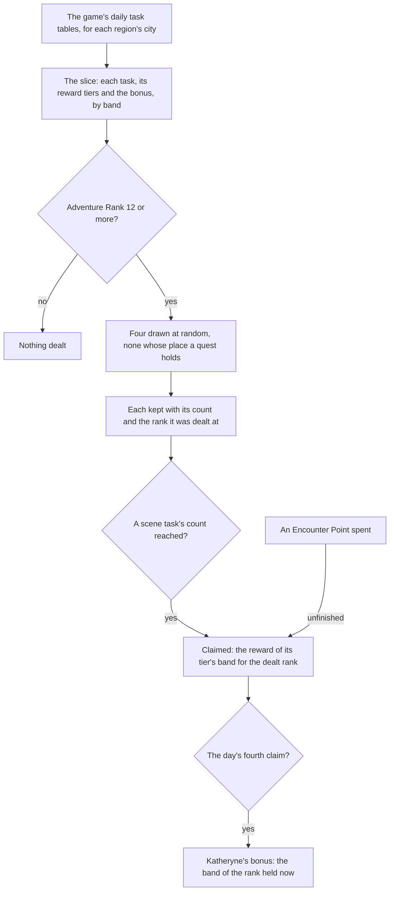

# Commissions

The game's daily commissions as the world holds them: the daily tasks of each region the game's own tables name, read from them, four dealt for the day, each finished one claimed for the reward of the Adventure Rank it was dealt at, and Katheryne's bonus on the day's fourth claim. This is the built part of the [commissions](../../../changes/genshin-commissions/design.md) proposal. Its scene swap, its handbook tab and its kept day are not built yet.

## How it works

## The daily tasks

A commission is one daily task of a region's city, read from the game's daily task table. It names its pool, the scene point it is set at, the radius it begins and ends in, what finishes it and how far, the groups a scene task swaps, the quest a quest task is, and the reward tier it pays from. A **scene task** puts its own camp or objects in place of its area's while it is open; a **quest task** is one of the quests the world carries. A scene task is finished by enemies defeated, gadgets used or a challenge cleared, and a quest task has no finish of its own, since its quest finishes it.

## Dealing

`dealCommissions` deals up to four tasks for the day. They are drawn at random without repeats from every task of the reached areas, skipping any whose place a quest in progress holds, and nothing is dealt before Adventure Rank 12, where commissions open. Each dealt commission keeps its count and the rank it was dealt at, because its reward is paid for that rank and not the rank the player later reaches.

## Claims and rewards

The game's Adventure Rank is cut into bands of `COMMISSION_RANK_BAND_SIZE` ranks, `COMMISSION_RANK_BAND_COUNT` bands in all (`services/commission/constants.ts`), and a rank past the last band stays in it. A reward tier holds the items of each band, and a claim draws each item's count from its range with the world's random source. A draw of zero gives nothing.

- `claimCommissionReward` claims a dealt scene task. A task whose count has reached its finish count is claimed free; an unfinished one is claimed for one Encounter Point, which it spends. Either way its reward is the tier's band for the rank it was dealt at, and a commission claimed cannot be claimed again.
- Claims stop at four a day. Each claim counts toward the four, whichever way it was made.

A claim returns the items drawn, Mora and the Adventure EXP and Companionship EXP items included. Routing those to the wallet, the bag, the Adventure Rank and the friendship is the caller's, and no caller of it is built yet.

## Katheryne's bonus

The fourth claim of the day also draws Katheryne's bonus, for the band the rank the player holds at that moment falls in. The bonus is the game's score preview for each band, read from its level table. Its Primogems and Adventure EXP are the same in every band, and its Mora and Companionship EXP rise with the band.

The Adventure Treasure Pack the wiki lists is not paid. The preview names its item at a count of zero in every band, so the reader leaves it out. Whether the game gives it on the bonus is a recording still owed on the [roadmap](../../../changes/genshin-roadmap/tasks.md).

## Data

`pnpm -C scripts genshin:assets commissions` builds every region's daily tasks from the game text dump outside the repository and publishes one record a region to the hosted game data, as `commissions/<region>`, each task filed under the region its city is named for. The run reads the daily task, reward and level tables and the reward previews, and refuses a level table that is not the game's twelve bands. `readCommissions` fetches a region's slice by its key from the hosted game data and checks it against its schema as it arrives.

The three daily task tables are fetched rather than read from the dump, as the [game data formats](../game-data-formats/design.md) page covers, and nothing from them is committed.

## Not built yet

- **The scene swap.** The [proposal](../../../changes/genshin-commissions/design.md) owns how a scene task's groups stand in for its area's. The region data holds only hand-placed camps, and the area's groups are not extracted, so the slice carries each task's old and new group ids for that page to read.
- **The handbook's Commissions tab and the commissions' words.** The tab lists the day's four, and the titles and descriptions are the game's text by their ids, in the reader's language. Neither has a consumer yet.
- **The kept day.** The four dealt, their counts and their claims are not in the [save](../save-data/design.md), so a reload does not keep them, and the daily reset is not read.
- **A quest task's finish.** Its quest's completion emits `finishQuest`, and `advanceCommissionForQuest` advances the dealt task by it, but no session holds a dealt day to hear the event yet.
- **Finishing counts.** `advanceCommission` counts a doing against a commission, but no defeat, gadget or challenge event is fed to it yet.
- **Regions' pools joining.** Each region's pool joins the deal once its quest is done. Three city opening quests (Liyue's, Inazuma's and Sumeru's) are carried by the [quests](../quests/design.md). Mondstadt's is not: its sub quest holds no words and no objective in the dump, so its pool has no opening to join behind yet. The carried openings wait on the prerequisites the wiki names that the world does not carry yet (Liyue's on quest 384, Inazuma's on 2013 and Sumeru's on 3012, through `OpeningParentTitleMap`), so they stay unstarted until those regions load. The wiki's Mondstadt unlock, Adventure Rank 12 with "Every Day a New Adventure" (main quest 20031), is not built, so the wiki's rank gate is not the other regions' gate. The dump names no opening for city 8, which has no region name yet, so the other regions wait on the dump.
- **Encounter Points' sources.** Quests, chests and certain items give them, and none of those give them yet.

## Key files

| File                                                                      | Role                                                                    |
| :------------------------------------------------------------------------ | :---------------------------------------------------------------------- |
| `packages/genshin-world/src/models/commission/Commission.ts`              | One daily task: its place, finish, groups and reward tier               |
| `packages/genshin-world/src/models/commission/CommissionSlice.ts`         | The slice's shape: the tasks, the reward tiers and the bonus by band    |
| `packages/genshin-world/src/services/commission/dealCommissions.ts`       | Deals four at random, none held and none before Adventure Rank 12       |
| `packages/genshin-world/src/services/commission/takeCommissionClaim.ts`   | Draws a claim's reward and, on the day's fourth, the bonus              |
| `packages/genshin-world/src/services/commission/claimCommissionReward.ts` | A dealt commission's claim: free when finished, one point when not      |
| `packages/genshin-world/src/services/commission/computeCommissionBand.ts` | The band an Adventure Rank falls in                                     |
| `packages/genshin-world/src/services/commission/readCommissions.ts`       | Fetches a region's slice by its key from the hosted game data           |
| `packages/genshin-world/src/models/reward/RewardItem.ts`                  | An item a reward gives, with the least and the most a claim may draw    |
| `scripts/src/services/genshinAssets/commissions/buildCommissions.ts`      | The builder: the dump's tables into one record a region, for publishing |
| `scripts/src/services/genshinAssets/commissions/toCommissionTask.ts`      | One dump task read into a commission                                    |
| `scripts/src/services/genshinAssets/rewards/toPreviewItems.ts`            | A reward preview's items, shared with the expeditions                   |

## Sources

- [AnimeGameData](https://github.com/DimbreathBot/AnimeGameData), the community's per-patch dump: `DailyTaskExcelConfigData`, `DailyTaskRewardExcelConfigData` and `DailyTaskLevelExcelConfigData`, the tasks, their reward tiers and the Adventure Rank bands, with `RewardPreviewExcelConfigData` for each reward's items.
- [Commission](https://genshin-impact.fandom.com/wiki/Commission), Genshin Impact Wiki: the four commissions a day, the unlock at Adventure Rank 12, and the bonus's items the dump's preview is checked against. Its figures are the dump's.
