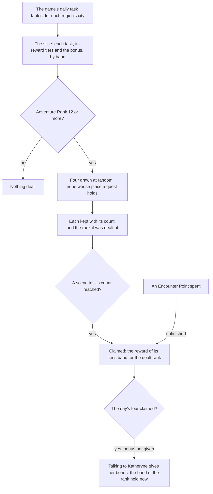

# Commissions

The game's daily commissions as the world holds them: the daily tasks of each region the game's own tables name, read from them, four dealt for the day, each finished one claimed for the reward of the Adventure Rank it was dealt at, and Katheryne's bonus once the day's four are claimed. This is the built part of the [commissions](../../../changes/genshin-commissions/design.md) proposal. Its scene swap is not built.

## How it works

## The daily tasks

A commission is one daily task of a region's city, read from the game's daily task table. It names its pool, the scene point it is set at, the radius it begins and ends in, what finishes it and how far, the groups a scene task swaps, the quest a quest task is, and the reward tier it pays from (`scripts/src/services/genshinAssets/commissions/toCommissionTask.ts`). A **scene task** puts its own camp or objects in place of its area's while it is open (task `10100` in `{data-root}/genshin-parity/text/ExcelBinOutput/DailyTaskExcelConfigData.json` swaps its `oldGroupVec` `133003170` for its `newGroupVec` `133003474`); a **quest task** is one of the quests the world carries (the rows of that table with a `questId`). A scene task is finished by enemies defeated, gadgets used or a challenge cleared (the table's `finishType` values `DAILY_FINISH_MONSTER_NUM`, `DAILY_FINISH_GADGET_ID_NUM` and `DAILY_FINISH_CHALLENGE`), and a quest task has no finish of its own, since its quest finishes it (its rows with a `questId` carry no `finishType`).

## Dealing

`dealCommissions` deals up to four tasks for the day (`packages/genshin-world/src/services/commission/dealCommissions.ts`; the game's four a day is in `{data-root}/genshin-parity/text/TextMap/TextMap_MediumEN.json`, key `1812726784`). They are drawn at random without repeats from every task of the reached areas, skipping any whose place a quest in progress holds, and nothing is dealt before Adventure Rank 12, where commissions open. Each dealt commission keeps its count and the rank it was dealt at, because its reward is paid for that rank and not the rank the player later reaches (`packages/genshin-world/src/services/commission/dealCommissions.ts`).

## Claims and rewards

The game's Adventure Rank is cut into bands of `COMMISSION_RANK_BAND_SIZE` ranks, `COMMISSION_RANK_BAND_COUNT` bands in all (`packages/genshin-world/src/services/commission/constants.ts`; the game's table holds one row a band, `{data-root}/genshin-parity/text/ExcelBinOutput/DailyTaskLevelExcelConfigData.json`), and a rank past the last band stays in it (`packages/genshin-world/src/services/commission/computeCommissionBand.ts`). A reward tier holds the items of each band (three tiers of twelve bands (`COMMISSION_RANK_BAND_COUNT`) in `{data-root}/genshin-parity/text/ExcelBinOutput/DailyTaskRewardExcelConfigData.json`), and a claim draws each item's count from its range with the world's random source (`packages/genshin-world/src/services/reward/drawRewardItems.ts`). A draw of zero gives nothing.

- `claimCommissionReward` claims a dealt scene task. A task whose count has reached its finish count is claimed free; an unfinished one is claimed for one Encounter Point, which it spends (`packages/genshin-world/src/services/commission/claimCommissionReward.ts`). Either way its reward is the tier's band for the rank it was dealt at (`packages/genshin-world/src/services/commission/takeCommissionClaim.ts`), and a commission claimed cannot be claimed again (`packages/genshin-world/src/services/commission/findDealtCommission.ts`).
- Claims stop at four a day. Each claim counts toward the four, whichever way it was made (`{data-root}/genshin-parity/text/TextMap/TextMap_MediumEN.json`, key `1812726784`: "Regardless of how you obtain them, you will not be able to obtain more than 4 Commission Rewards per day").

A claim returns the items drawn, Mora and the Adventure EXP and Companionship EXP items included (`packages/genshin-world/src/services/commission/takeCommissionClaim.ts`). Routing those to the wallet, the bag, the Adventure Rank and the friendship is the caller's, and no caller of it is built.

## Katheryne's bonus

Katheryne gives the day's bonus once its four commissions are claimed, when the player talks to her, for the band the rank the player holds at that moment falls in (the game's words, `{data-root}/genshin-parity/text/TextMap/TextMap_MediumEN.json`, key `1812726784`: "you will be able to go to Katheryne to collect your additional Daily Commission Reward"). The day records it as given, so a second talk gives nothing (`packages/genshin-world/src/services/commission/takeKatheryneBonus.ts`). The bonus is the game's score preview for each band, read from its level table, and its Primogems and Adventure EXP are the same in every band, while its Mora and Companionship EXP rise with the band (`{data-root}/genshin-parity/text/ExcelBinOutput/RewardPreviewExcelConfigData.json`, rows `2001` to `2012`, read through each band's `scorePreviewRewardId` in `{data-root}/genshin-parity/text/ExcelBinOutput/DailyTaskLevelExcelConfigData.json`: Primogem `201` at 20 and Adventure EXP `102` at 500 in every band, Mora `202` from 3875 to 13175 and Companionship EXP `105` from 35 to 100). The game's text gives the bonus once the four are obtained by any means (UI_ADVENTURE_INVESTIGATION_DAILY_ATTENDANCE_INFO_DESC), so the bonus is not paid on the fourth claim itself (`{data-root}/genshin-parity/text/ManualTextMapConfigData.json` maps that id to the hash `33283106`, and `{data-root}/genshin-parity/text/TextMap/TextMap_MediumEN.json` holds the text: "Once you have obtained these 4 rewards by any means ... you may go to Katheryne ... to obtain additional Daily Commission rewards"). The save holds the flag as a required field, and no read path tolerates its absence (`packages/genshin-world/src/models/commission/CommissionDaySave.ts`, `isBonusClaimed: z.boolean()` with no default).

The Adventure Treasure Pack the wiki lists is not paid. The preview names its item at a count of zero in every band, so the reader leaves it out (item `107004` is at count `0` in every one of the rows `2001` to `2012` of `{data-root}/genshin-parity/text/ExcelBinOutput/RewardPreviewExcelConfigData.json`, and its name, hash `837633052`, is in `{data-root}/genshin-parity/text/TextMap/TextMap_MediumEN.json`; `scripts/src/services/genshinAssets/rewards/toPreviewItems.ts` drops it). Whether the game gives it on the bonus is a recording owed on the [roadmap](../../../changes/genshin-roadmap/tasks.md).

## Data

`pnpm -C scripts genshin:assets commissions` builds every region's daily tasks from the game text dump outside the repository and publishes one record a region to the hosted game data, as `commissions/<region>`, each task filed under the region its city is named for (`scripts/src/services/genshinAssets/commissions/buildCommissions.ts`). The run reads the daily task, reward and level tables and the reward previews, and refuses a level table that is not the game's twelve bands (`COMMISSION_RANK_BAND_COUNT`) (`scripts/src/services/genshinAssets/commissions/checkLevelBands.ts`). `readCommissions` fetches a region's slice by its key from the hosted game data and checks it against its schema as it arrives (`packages/genshin-world/src/services/commission/readCommissions.ts`).

The three daily task tables are read from the dump (`scripts/src/services/genshinAssets/commissions/buildCommissions.ts`), where `genshin:text fetch` fills any table the dump lacks (`scripts/src/services/genshinText/fetchDump.ts`, as the [game data formats](../game-data-formats/design.md) page covers), and nothing from them is committed.

## Not built yet

- **The scene swap.** The [proposal](../../../changes/genshin-commissions/design.md) owns how a scene task's groups stand in for its area's. The region data holds only hand-placed camps, and the area's groups are not extracted, so the slice carries each task's old and new group ids for that page to read.
- **The commissions' descriptions.** The handbook's Commissions tab shows each day's commission by its title, the game's text by id in the reader's language, and its progress. No description is shown.
- **A quest task's finish.** Its quest's completion emits `finishQuest`, and the session's listener advances the dealt task by it through `advanceCommissionForQuest` once the slice is read.
- **Finishing counts.** `advanceCommission` counts a doing against a commission, but no defeat, gadget or challenge event is fed to it yet.
- **Regions' pools joining.** Each region's pool joins the deal once its quest is done. Three city opening quests (Liyue's, Inazuma's and Sumeru's) are carried by the [quests](../quests/design.md). Mondstadt's is not: its sub quest holds no words and no objective in the dump, so its pool has no opening to join behind. The carried openings wait on the prerequisites the wiki names that the world does not carry (Liyue's on quest 384, Inazuma's on 2013 and Sumeru's on 3012, through `OpeningParentTitleMap`), so they stay unstarted until those regions load. The wiki's Mondstadt unlock, Adventure Rank 12 with "Every Day a New Adventure" (main quest 20031, `{data-root}/genshin-parity/text/ExcelBinOutput/MainQuestExcelConfigData.json`), is not built, so the wiki's rank gate is not the other regions' gate. The dump names no opening for city 8, which has no region name, so the other regions wait on the dump.
- **Encounter Points' sources.** A finished Archon or Story quest gives four, held up to the storage of four less one for each daily commission finished, which `computeEncounterPointStorage` reads. Chests and certain items give none.

## Key files

| File                                                                      | Role                                                                    |
| :------------------------------------------------------------------------ | :---------------------------------------------------------------------- |
| `packages/genshin-world/src/models/commission/Commission.ts`              | One daily task: its place, finish, groups and reward tier               |
| `packages/genshin-world/src/models/commission/CommissionSlice.ts`         | The slice's shape: the tasks, the reward tiers and the bonus by band    |
| `packages/genshin-world/src/services/commission/dealCommissions.ts`       | Deals four at random, none held and none before Adventure Rank 12       |
| `packages/genshin-world/src/services/commission/takeCommissionClaim.ts`   | Draws a claim's reward for the rank it was dealt at                     |
| `packages/genshin-world/src/services/commission/takeKatheryneBonus.ts`    | Draws Katheryne's bonus once the four are claimed, and records it given |
| `packages/genshin-world/src/services/commission/claimCommissionReward.ts` | A dealt commission's claim: free when finished, one point when not      |
| `packages/genshin-world/src/services/commission/computeCommissionBand.ts` | The band an Adventure Rank falls in                                     |
| `packages/genshin-world/src/services/commission/readCommissions.ts`       | Fetches a region's slice by its key from the hosted game data           |
| `packages/genshin-world/src/models/reward/RewardItem.ts`                  | An item a reward gives, with the least and the most a claim may draw    |
| `scripts/src/services/genshinAssets/commissions/buildCommissions.ts`      | The builder: the dump's tables into one record a region, for publishing |
| `scripts/src/services/genshinAssets/commissions/toCommissionTask.ts`      | One dump task read into a commission                                    |
| `scripts/src/services/genshinAssets/rewards/toPreviewItems.ts`            | A reward preview's items, shared with the expeditions                   |

## Sources

- [AnimeGameData](https://github.com/DimbreathBot/AnimeGameData), the community's per-patch dump: `DailyTaskExcelConfigData`, `DailyTaskRewardExcelConfigData` and `DailyTaskLevelExcelConfigData`, the tasks, their reward tiers and the Adventure Rank bands, with `RewardPreviewExcelConfigData` for each reward's items.
- [Commission](https://genshin-impact.fandom.com/wiki/Commission), Genshin Impact Wiki: the four commissions a day, the unlock at Adventure Rank 12, and the bonus's items the dump's preview is checked against. Its figures are the dump's.
- `{data-root}/genshin-parity/text/TextMap/TextMap_MediumEN.json`, key `1812726784`: grounds the requirement "A player" and scenario "Katheryne's bonus is given once the day's four are claimed".
- `{data-root}/genshin-parity/text/ExcelBinOutput/RewardPreviewExcelConfigData.json`, rows `2001` to `2012`: Primogem `201` at 20 and Adventure EXP `102` at 500 in every band, Mora `202` from 3875 to 13175 and Companionship EXP `105` from 35 to 100; grounds the requirement "Katheryne's bonus".
- `{data-root}/genshin-parity/text/TextMap/TextMap_MediumEN.json`, key `33283106`: grounds scenario "A claim does not draw Katheryne's bonus".
- `{data-root}/genshin-parity/text/ExcelBinOutput/RewardPreviewExcelConfigData.json`, item `107004` is at count `0` in every band: grounds scenario "The Adventure Treasure Pack is not paid by the bonus".

## Reference

- `commission-bonus.mkv` — found on YouTube at https://www.youtube.com/watch?v=x_vRlUlTm8A, 0–29.9 s (`{data-root}/genshin-parity/captures/yt-x_vRlUlTm8A-commissions.mp4`), cut to `commission-bonus.mkv`: the English PC client at 1080p and 60 frames a second. It shows the fourth commission bonus.

## Open

- [ ] **Nothing is dealt before Adventure Rank 12, where commissions open** — no source yet: the wiki's Commission page is not in `{data-root}/cache/genshin-wiki/`, and no system open UI in `{data-root}/genshin-parity/text/ExcelBinOutput/SystemOpenUIConfigData.json` names the commissions.
- [ ] **An unfinished commission is claimed for one Encounter Point** — no source yet: the game's text gives Encounter Points' use in place of a commission but no per-commission cost, and its one-per-commission line (`{data-root}/genshin-parity/text/TextMap/TextMap_MediumEN.json`, key `2417337778`) is for Long-Term Encounter Points.
- [ ] **The stored saves written before the flag existed are backfilled once from outside the app** — no source yet: no backfill script or run record names `isBonusClaimed` in the repo or in the scratch folders under `{data-root}`.
- [ ] **The three daily task tables all come from the same pull** — no source yet: the level and reward tables are recorded as one fetch, while `{data-root}/genshin-parity/text/ExcelBinOutput/DailyTaskExcelConfigData.json` carries a different pull, and no manifest of the dump's pulls is kept.
- [ ] **A finished commission is claimed free** — no source yet: the game's side, the wiki's Adventure Encounters page, which is not in the cache.
- [ ] **The wiki's Mondstadt unlock is Adventure Rank 12 with "Every Day a New Adventure" (main quest 20031)** — no source yet: the wiki's Commission page, which is not on disk; the dump's main quest 20031 (`{data-root}/genshin-parity/text/ExcelBinOutput/MainQuestExcelConfigData.json`) carries that title and an unlock text for Mondstadt's commissions, with no rank.
- [ ] **Liyue's, Inazuma's and Sumeru's openings wait on the prerequisites the wiki names (quests 384, 2013 and 3012)** — no source yet: the wiki's Commission page, which is not on disk; the map that names them is marked provisional (`scripts/src/services/genshinText/OpeningParentTitleMap.ts`).
