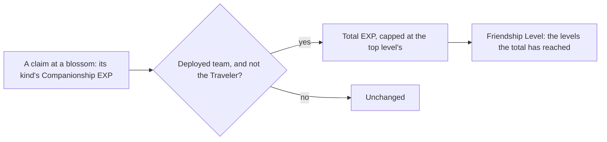

# Companionship

Every character but the Traveler keeps a total of Companionship EXP, and its Friendship Level is the count of the game's levels that total has reached (`{data-root}/genshin-parity/text/ExcelBinOutput/AvatarFettersLevelExcelConfigData.json`, `packages/genshin-world/src/services/shared/computeLevelReached.ts`). Only the total is stored (`packages/genshin-world/src/models/character/Character.ts`), so the level cannot disagree with it. The ley line claim is the first source that gives the EXP in play, through the outcrops' composable (`packages/genshin-world/src/composables/useWorldOutcrops.ts`). The boss claim, the realm's bounty and the commission claim route to the grant in their services, and give it once a screen calls them; no domain claim calls the grant yet, as `packages/genshin-world/src/composables/useWorldDomains.ts` shows (`packages/genshin-world/src/composables/useWorldTrounceBlossoms.ts`, `packages/genshin-world/src/services/home/claimHomeBounty.ts`, `packages/genshin-world/src/services/commission/routeCommissionClaim.ts`). The stories and voice-overs a level opens are on the [character profile](../character-profile/design.md) (`packages/genshin-world/src/services/profile/getProfileEntries.ts`), a character at level 10 holds its namecard, shown on the profile by its name (`packages/genshin-world/src/services/friendship/computeHeldNamecardItemIds.ts`, `packages/genshin-world/src/components/Character/Profile/Index.vue`), and the Serenitea Pot dialogue and the namecard's art and description are not drawn yet; the commissions and random events that also give EXP have no page built.

## How it works

## Data

- **The level table.** The dump's `AvatarFettersLevelExcelConfigData` rows give the EXP each level takes to leave (`{data-root}/genshin-parity/text/ExcelBinOutput/AvatarFettersLevelExcelConfigData.json`). `genshin:assets friendship` sums them into each level's total (`scripts/src/services/genshinAssets/friendship/toFriendshipLevels.ts`), so level 2 is 1,000 and level 10 is 29,100 (`{data-root}/genshin-parity/text/ExcelBinOutput/AvatarFettersLevelExcelConfigData.json`). The row past the top level is never summed in (`scripts/src/services/genshinAssets/friendship/toFriendshipLevels.ts`).
- **The namecards.** The dump's `FetterCharacterCardExcelConfigData` rows name each character's level 10 reward (`{data-root}/genshin-parity/text/ExcelBinOutput/FetterCharacterCardExcelConfigData.json`). `RewardExcelConfigData` gives its one item (`{data-root}/genshin-parity/text/ExcelBinOutput/RewardExcelConfigData.json`), and `MaterialExcelConfigData` names that item as a namecard, so Amber's is item 210003 under text id 273889772 (`{data-root}/genshin-parity/text/ExcelBinOutput/MaterialExcelConfigData.json`, `{data-root}/genshin-parity/text/TextMap/TextMap_MediumEN.json`). The namecards and the levels are one hosted record, `friendship/friendship` (`packages/genshin-world/src/generated/gameDataLock.json`).
- **The claim amounts.** `BlossomCompanionshipExpMap` holds one amount per blossom kind, provisional until a recording measures it (`packages/genshin-world/src/services/originalResin/BlossomCompanionshipExpMap.ts`).

## Notes

- **The grant is whole, not split.** Every deployed member but the Traveler gets the full amount, a fallen one included, since the grant reads the team rather than their health (`packages/genshin-world/src/services/friendship/gainCompanionshipExp.ts`).
- **Past the top, nothing is kept.** The total stops at the top level's, so a character there gains nothing and a claim that would pass it is cut short (`packages/genshin-world/src/services/friendship/gainCompanionshipExp.ts`).
- **Provisional amounts.** Each claim kind is given the low end of the wiki's range for it, and two clips on the roadmap's References sought list, one per pair of kinds, measure what a claim gives.
- **A namecard is held by its level.** A namecard is in the held list once its character's total EXP reaches level 10, read from the same levels, so no save keeps it (`packages/genshin-world/src/services/friendship/computeHeldNamecardItemIds.ts`), and the profile's held list adds each finished category's namecard beside it (`packages/genshin-world/src/services/profile/computeProfileNamecardItemIds.ts`). Its art is the game's texture and is never served, so the profile sets its name on a plate of its own (`packages/genshin-world/src/components/Character/Profile/Index.vue`), and its description is the [proposal](../../../changes/genshin-companionship/design.md)'s.
- **Not built.** The quest gate a friendship dialogue waits on, `checkIsFriendshipDialogueOpen`, is built and waits for the pot dialogue to call it (`packages/genshin-world/src/services/friendship/checkIsFriendshipDialogueOpen.ts`). No caller of it exists yet, and the ley line claim does not call it: its outcrops' composable grants Companionship EXP without the gate (`packages/genshin-world/src/composables/useWorldOutcrops.ts`, which calls `gainCompanionshipExp` and not the gate), and the domain and boss claims have no screen calling theirs yet.

## Key files

| File                                                                              | Role                                                                                                   |
| :-------------------------------------------------------------------------------- | :----------------------------------------------------------------------------------------------------- |
| `packages/genshin-world/src/services/friendship/gainCompanionshipExp.ts`          | The grant to the characters named but the Traveler, capped at the top level                            |
| `packages/genshin-world/src/composables/useWorldOutcrops.ts`                      | A ley line claim's Companionship EXP, given to the deployed team once the Friendship Levels are loaded |
| `packages/genshin-world/src/services/shared/computeLevelReached.ts`               | The level a total EXP has reached, read over any table of levels                                       |
| `packages/genshin-world/src/services/friendship/readFriendshipLevels.ts`          | The levels, fetched by their key from the friendship record and checked against their shape            |
| `packages/genshin-world/src/services/friendship/readFriendshipNamecards.ts`       | The namecards, fetched by their key from the same record and checked against their shape               |
| `packages/genshin-world/src/services/friendship/computeHeldNamecardItemIds.ts`    | The namecards whose character has reached level 10                                                     |
| `packages/genshin-world/src/models/friendship/FriendshipLevel.ts`                 | A level's number and total EXP, with its schema                                                        |
| `packages/genshin-world/src/models/friendship/FriendshipDialogue.ts`              | A dialogue's level and the quest it waits on, with `""` for none                                       |
| `packages/genshin-world/src/services/friendship/checkIsFriendshipDialogueOpen.ts` | Whether a dialogue is open at a level under the quests finished                                        |
| `packages/genshin-world/src/models/friendship/FriendshipNamecard.ts`              | A character's namecard item and its name text id, with its schema                                      |
| `packages/genshin-world/src/components/Character/Profile/Index.vue`               | Passes the namecard's name, from the hosted `nameText` record, to the profile panel                    |
| `packages/genshin-world/src/models/character/Character.ts`                        | Carries the total Companionship EXP of each character                                                  |
| `packages/genshin-world/src/services/originalResin/BlossomCompanionshipExpMap.ts` | Each blossom kind's Companionship EXP per claim, provisional                                           |
| `scripts/src/services/genshinText/buildNames.ts`                                  | Collects every name id, the namecards' among them, and publishes `nameText` per language               |
| `scripts/src/services/genshinAssets/friendship/buildFriendship.ts`                | Builds the friendship record from the dump's tables, for publishing                                    |
| `scripts/src/services/genshinAssets/friendship/toFriendshipNamecards.ts`          | Joins each level 10 card to its reward's namecard item and its name                                    |
| `scripts/src/services/genshinAssets/friendship/toFriendshipLevels.ts`             | Sums each level's rows into its total                                                                  |

## Sources

- [AnimeGameData](https://gitlab.com/Dimbreath/AnimeGameData), the community's per-patch dump: the `AvatarFettersLevelExcelConfigData` rows the level totals are summed from.
- [Companionship EXP](https://genshin-impact.fandom.com/wiki/Companionship_EXP), Genshin Impact Wiki: the per-claim ranges the provisional amounts take their low end from.
- `{data-root}/genshin-parity/text/ExcelBinOutput/AvatarFettersLevelExcelConfigData.json`: grounds the requirement "Each character's Friendship Level".

## Open

- [ ] **Each claim kind's amount is the low end of the wiki's range** — no source yet: the wiki's Companionship EXP page is not in `{data-root}/cache/genshin-wiki/`, so the ranges in the map's comment cannot be checked.
