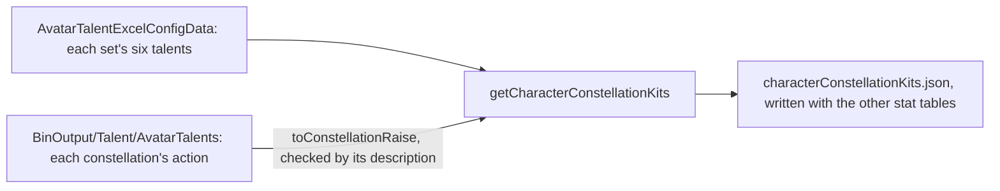
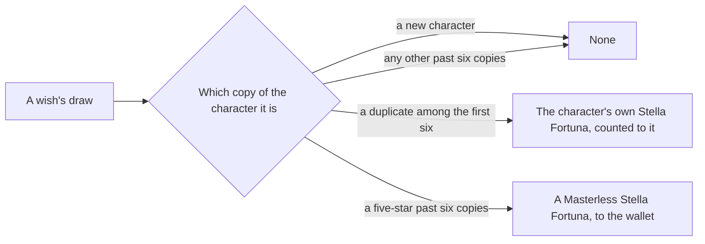

# Constellations

A character's six constellations are sequential upgrades, each activated with one Stella Fortuna of that character. What is built is the table side, which the stats run writes with the other stat tables, the activation as a pure rule over the character, the talent levels the active raises add, and the Stella Fortuna a wish counts to its character (`scripts/src/services/genshinAssets/stats/getCharacterConstellationKits.ts`, `packages/genshin-world/src/generated/gameDataLock.json`, `packages/genshin-world/src/services/character/activateConstellation.ts`, `packages/genshin-world/src/services/character/getConstellationTalentAdditions.ts`, `packages/genshin-world/src/services/wish/makeWishes.ts`). A constellation's effect is a kit module's and waits on the [character kits](../../../changes/genshin-character-kits/design.md), as the Traveler's element sets wait on their sources. The Constellation tab's press is built, and the wish screen shows on each result card the Stella Fortuna its draw brings: the character's own by its name, the Masterless one by its count (`packages/genshin-world/src/components/Character/Screen/Index.vue`, `packages/genshin-world/src/components/Wish/Screen/Index.vue`).

## The table

- **One depot for each skill set that holds constellations.** A set's `talents` lists its six constellations in the order the game activates them (`{data-root}/genshin-parity/text/ExcelBinOutput/AvatarSkillDepotExcelConfigData.json`, depot 201 with talents 21 to 26). A character has one such set, or one for each element form, as the Traveler does (`{data-root}/genshin-parity/text/ExcelBinOutput/AvatarExcelConfigData.json`, Traveler 10000005's `candSkillDepotIds` 502 to 508 beside its depot 501, whose talents are all zero); the Traveler's own form holds none (`scripts/src/services/genshinAssets/stats/getCharacterConstellationKits.ts`). Each depot is keyed by its skill set's id, the one the [character kits](../kits/README.md) table uses.
- **A third and fifth raise a talent by three.** (`{data-root}/genshin-parity/text/BinOutput/Talent/AvatarTalents/ConfigTalent_Ayaka.json`, `Ayaka_Constellation_3` and `Ayaka_Constellation_5`, each with `extraLevel` 3.) Each constellation's config names a skill action, in one of the two shapes the dump's configs take (`scripts/src/services/genshinAssets/stats/toConstellationRaise.ts`). Its slot is the last digit of the skill's proud skill group: 1 the normal attack, 2 the Elemental Skill, 9 the burst (`scripts/src/services/genshinAssets/stats/constants.ts`, `{data-root}/genshin-parity/text/ExcelBinOutput/AvatarSkillExcelConfigData.json`, proud skill groups 231, 232 and 239). The description names the same skill by its English name, and a disagreement refuses the table rather than raising the wrong talent (`scripts/src/services/genshinAssets/stats/toConstellationRaise.ts`). The other four are switches, carrying only their numbers (`scripts/src/services/genshinAssets/stats/getCharacterConstellationKits.ts`).
- **A set spends one item.** All six of a set spend one Stella Fortuna of one item, the character's own. The writer refuses a set whose six do not (`scripts/src/services/genshinAssets/stats/getCharacterConstellationKits.ts`). The set's kit records that item's id and the text id of its name, from the dump's material table, so the card names it through the name records.
- **A set with a constellation the dump names no config for is left out, with a note.** Aloy's six talents are unnamed placeholders, so her set is not written, which matches the game's rule that her constellations cannot be activated (`{data-root}/genshin-parity/text/ExcelBinOutput/AvatarSkillDepotExcelConfigData.json`, depot 6201 with talents 621 to 626; `{data-root}/genshin-parity/text/ExcelBinOutput/AvatarTalentExcelConfigData.json`, talent 621 with no `openConfig`). A newer character whose config the dump lacks is noted the same way, since its raised talent is unknown.
- **The configs the dump's folder lacks come from the repository's default branch (`scripts/src/services/genshinText/listDumpFiles.ts`, `scripts/src/services/genshinText/constants.ts`, `ANIME_GAME_DATA_BRANCH`).** Some of the dump's talent configs sit in files of their own, and a few are missing from the revision the talent table matches. Those are fetched beside the dump, as the talent table was, and each raise is checked against its description before it is written (`scripts/src/services/genshinAssets/stats/toConstellationRaise.ts`, `scripts/src/services/genshinAssets/stats/readTalentActions.ts`).

## Activation

- **The next constellation is activated, spending one Stella Fortuna.** `activateConstellation` takes the character and its set. The constellation after the last active is the one activated, and it costs one of the character's own Stella Fortuna (`packages/genshin-world/src/services/character/activateConstellation.ts`).
- **A refusal leaves the character as it was.** A set with every constellation active, a set with none, and a character holding no Stella Fortuna throw before anything is returned. Aloy's empty set refuses the same way (`packages/genshin-world/src/services/character/getConstellationActivationRefusal.ts`, `packages/genshin-world/src/services/character/activateConstellation.ts`).
- **The active raises are added to the talents a kit reads.** `getConstellationTalentAdditions` sums the levels each active constellation with a raise adds to its talent. A kit reads a talent at its own level plus these, which materials never pay for (`packages/genshin-world/src/services/character/getConstellationTalentAdditions.ts`, `packages/genshin-world/src/services/character/getPlayedTalentLevels.ts`).

## Stella Fortuna from wishes

- **A duplicate among the first six brings its character's Stella Fortuna.** `makeWishes` counts it to the character the wish drew, in `stellaFortunaCountMap`, for the caller to hand over, and onto its draw's result as `stellaFortunaCount`. A new character brings none, and the sixth duplicate is the last to bring one (`packages/genshin-world/src/services/wish/makeWishes.ts`).
- **A five-star past six copies brings a Masterless Stella Fortuna.** (`{data-root}/genshin-dump-backup-6.6/TextMap/TextMap_MediumEN.json`, text 1206078570, whose quantity is the 5-star characters with constellations exceeding the maximum) It goes to the wallet, once per copy, beside the Starglitter that a complete set returns, and onto its draw's result as `masterlessStellaFortunaCount`. It is counted in `makeWishes` rather than `getWishReturn`, since that returns one currency and a five-star past six brings two (`packages/genshin-world/src/services/wish/makeWishes.ts`).
- **A new character starts with none.** `createCharacter` sets the constellations active and the Stella Fortuna held to zero (`packages/genshin-world/src/services/character/createCharacter.ts`).

A non-raising constellation is a switch its character's kit module reads off the combatant's constellation count, through the [kit events](../kits/README.md) (`packages/genshin-world/src/services/kit/characters/ainoKit.ts`). A character with no module of its own has none until the [character kits](../../../changes/genshin-character-kits/design.md) page writes it. The statues pick which element's set the Traveler holds, until when the Traveler has no set chosen and the table holds all of them (`packages/genshin-world/src/services/character/getTravelerConstellations.ts`, `packages/genshin-world/src/services/character/getCharacterIdConstellationsMap.ts`).

## Key files

| File                                                                               | Role                                                                                                                             |
| :--------------------------------------------------------------------------------- | :------------------------------------------------------------------------------------------------------------------------------- |
| `packages/genshin-world/src/models/character/Constellation.ts`                     | One constellation: its names by text id, its numbers, and the talent it raises                                                   |
| `packages/genshin-world/src/models/character/ConstellationDepot.ts`                | A skill set's six constellations, in activation order, and the Stella Fortuna they spend                                         |
| `packages/genshin-world/src/models/character/CharacterConstellationKit.ts`         | A character's sets, one depot for each that holds constellations                                                                 |
| `packages/genshin-world/src/models/character/Character.ts`                         | Gains the constellations active and the Stella Fortuna held                                                                      |
| `packages/genshin-world/src/services/character/activateConstellation.ts`           | The activation rule: the next constellation, one Stella Fortuna spent                                                            |
| `packages/genshin-world/src/services/character/getConstellationTalentAdditions.ts` | The levels the active raises add to each combat talent                                                                           |
| `packages/genshin-world/src/services/character/readConstellationTables.ts`         | The table, fetched by its key from the hosted game data and checked against its shape                                            |
| `packages/genshin-world/src/services/wish/makeWishes.ts`                           | Counts a duplicate's Stella Fortuna to its character, reads each draw's onto its result, and counts a five-star's Masterless one |
| `scripts/src/services/genshinAssets/stats/getCharacterConstellationKits.ts`        | Each playable character's sets with their constellations and Stella Fortuna, from the dump                                       |
| `scripts/src/services/genshinAssets/stats/toConstellationRaise.ts`                 | The talent a constellation's action raises, checked against its description                                                      |
| `scripts/src/services/genshinAssets/stats/readTalentActions.ts`                    | Every talent config's actions in the dump, by the name a talent row gives                                                        |

## Sources

- [AnimeGameData](https://github.com/DimbreathBot/AnimeGameData), the community's per-patch dump: `AvatarTalentExcelConfigData` and the skill depots' `talents`, and the talent configs under `{data-root}/genshin-parity/text/BinOutput/Talent/AvatarTalents`.
- [Constellation](https://genshin-impact.fandom.com/wiki/Constellation), Genshin Impact Wiki: six levels per character, the third and fifth raising a combat talent by three, and one Stella Fortuna each.
- [Stella Fortuna](https://genshin-impact.fandom.com/wiki/Stella_Fortuna), Genshin Impact Wiki: a duplicate from a wish as the source of a character's own Stella Fortuna, six at most.
- [Masterless Stella Fortuna](https://genshin-impact.fandom.com/wiki/Masterless_Stella_Fortuna), Genshin Impact Wiki: one for a five-star drawn at its full constellations.
- `{data-root}/genshin-parity/text/BinOutput/Talent/AvatarTalents/ConfigTalent_Ayaka.json`, whose third and fifth actions raise by 3: grounds the requirement "The third and fifth constellations raise a combat talent by three levels".
- depot 6201 of `{data-root}/genshin-parity/text/ExcelBinOutput/AvatarSkillDepotExcelConfigData.json`, whose talents 621 to 626 name no config: grounds scenario "A set with an unnamed constellation is left out".

## Open

- [ ] **All six of a set spend one item, the character's own** — no source yet: a source that names each set's item as the character's own; `scripts/src/services/genshinAssets/stats/getCharacterConstellationKits.ts` checks that the six share one item, that each costs one, and that the item is in the materials table, but does not compare the item with the character.
- [ ] **Aloy's constellations cannot be activated, as the game's rule** — no source yet: the wiki's Aloy talent pages in the cache name no constellation rule. Checked the cached Aloy talent page Category_Aloy_Talents (titled Frozen Wilds, Aloy's Elemental Skill): it names no constellation and no activation rule.
- [ ] **A few talent configs are missing from the revision the talent table matches** — no source yet: no listing of the configs against the matched revision is kept; the fetch from the default branch is in `scripts/src/services/genshinText/listRemoteDirectory.ts`, which reads `ANIME_GAME_DATA_BRANCH` from `scripts/src/services/genshinText/constants.ts`.
- [ ] **A character has one set for each element form, and the Traveler's own form holds none** — no source yet: the other characters' `candSkillDepotIds` in `{data-root}/genshin-parity/text/ExcelBinOutput/AvatarExcelConfigData.json` were not counted (the Traveler's, 10000005, is checked above).
- [ ] **Every constellation in the dump's sets agrees with its description** — no source yet: `AvatarTalentExcelConfigData` in `{data-root}/genshin-parity/text/ExcelBinOutput/`, not yet read against the descriptions; the wiki's Constellation page, named in Sources, is not in the wiki cache. Checked the wiki cache by title: no page is titled Constellation, so nothing is read.
- [ ] **The next constellation is activated, spending one of the character's Stella Fortuna** — no source yet: the wiki's Stella Fortuna page, named in Sources, is not in the wiki cache. Checked the wiki cache by title: no page is titled Stella Fortuna, so nothing is read.
- [ ] **A duplicate among the first six brings its character's Stella Fortuna** — no source yet: the wiki's Stella Fortuna page, named in Sources, is not in the wiki cache.
- [ ] **The statues pick the Traveler's set, and the table holds all of them until one is chosen** — no source yet: the wiki's Constellation page, named in Sources, is not in the wiki cache.
