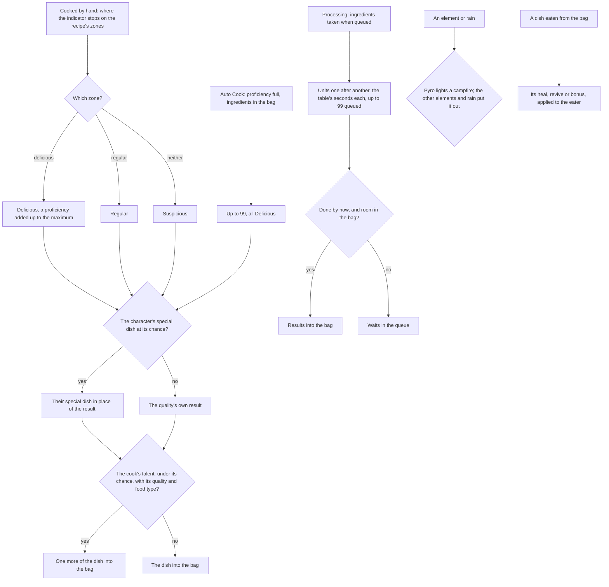

# Cooking

The dishes and processings of the game's cooking are rules over the game's own tables, a campfire's lit state follows the elements and the weather, and a dish's effect applies when it is eaten. This page is the as-built record of the [cooking](../../../changes/archive/2026-10-18-genshin-cooking/design.md) proposal, covering its recipes, cooking by hand, proficiency, Auto Cook, specialties, the cooking talents, processing, campfires, eating a dish, and the stove and cooking screen. The cooking and processing screens are built and a city's stove opens them; the indicator's pointer sweeps at a provisional speed, and its Stop cooks where the pointer stands at the press (see Notes).

## How it works

## The recipes

`pnpm -C scripts genshin:assets cooking` builds three records from the game text dump and publishes them to the hosted game data as `cooking/recipes`, `cooking/processing` and `cooking/talents`: the dishes, from the cook recipe table with each dish's specialties and the instruction items that teach it; the processings, from the compound table; and the talents, from the proud skill table. The cook recipe, cook bonus and compound tables are missing from the community dump, so they are fetched as the [game data formats](../game-data-formats/design.md) page describes.

- **Dishes.** A dish is written with its ingredients, the item each quality of its result is, its maximum proficiency, its rarity, its zone parameters, whether it is known from the start, its specialties, and the instruction items that teach it. Each result's quality is read off its item row's food quality, not its place in the table, and each specialty's chances are read in the order of the results. A recipe also carries its food type, one of the four the table gives.
- **Processings.** Only the rows of the cooking type are written. A random processing draws its result from a drop table the build does not read, so it is left out. Each keeps its ingredients, its one result, the seconds a unit takes, how many may be queued, and whether it is known from the start.
- **Cooking talents.** The cooking rows of the proud skill table are written keyed by the character whose passives open each row's group. A group several characters name goes to the lowest id, the base character rather than its variant forms. Each talent is its chance in percent, the effect it names (a perfect cook's double of a Delicious dish, or the talent that adds a Suspicious dish) and the food types it applies to. The build refuses a row that names no character, an unknown effect or an unknown food type.

## The rules

- **Known.** A dish is known from the start or once one of its instruction items is used, which takes the item from the bag and records the dish as learned.
- **Cooked by hand.** The indicator's stop on the recipe's zones decides the quality: the delicious zone makes a Delicious dish, the regular zone a Regular one, and anywhere else a Suspicious one. The dish's ingredients are taken and the dish put in the bag, all or nothing; leaving the minigame spends nothing. A Delicious dish adds one proficiency up to the dish's maximum, whatever the dish is, its special dish included.
- **Auto Cook.** Once a dish's proficiency is full, a batch makes as many dishes as the bag's ingredients allow, up to 99, every one Delicious. The batch is made whole or refused, so it is refused where the bag has no room for every dish. Each dish rolls its character's special dish once, at the Delicious chance, and its cook's talent once.
- **Specialties.** A character named in a dish's specialties may have its special dish made in place of the result: a roll under that character's chance for the quality cooked makes the special dish. Raiden Shogun is refused, so no dish is made with her, by hand or by Auto Cook.
- **Cooking talents.** A cook's talent adds one more of the dish made when its roll falls under its chance, where the dish's quality is the talent's (Delicious for a double, Suspicious for the talent that adds a Suspicious dish) and the dish's food type is one the talent names. The extra counts in the room the dish needs, so a dish whose extra the bag cannot hold is refused with the rest of the craft. A talent is the passive of its character that bonuses a kind of dish: a character with none cooks plainly.
- **Processing.** A processing is queued for up to its queue size of units, its ingredients for every unit taken from the bag when it is queued. Its units run one after another, each taking its seconds: a queue that is idle starts from the moment it is queued, and one still running is extended from when it began. The units done by a moment are taken into the bag together, and a unit whose result the bag has no room for waits in the queue, with the units behind it. A processing not known from the start is refused.
- **Campfires.** Pyro lights a campfire. Anemo, Cryo, Electro, Geo and Hydro put it out, and so do rain and thunderstorms in the open. Dendro leaves it as it was.
- **Eating.** Eating a dish takes one from the bag and applies its use to the character on the field: a revive lifts a fallen eater to the HP the dish restores, a heal raises its target by the share of Max HP and the flat amount over Max HP, never past full, and a bonus gives its attributes for the seconds its description states. The bag is changed only when the dish is in it and each target's Max HP is known.
- **The stove.** A city's stove always cooks, whether or not a fire is lit. `getCookingStovePlace` reads its place from the scene group record's building point named for the stove, and `computeCookingStoveInteractables` offers it as a prompt beneath that place. A city whose record names no stove offers none.

The quality weights the table gives each dish are all the Delicious weight in this patch, which is Auto Cook's always-Delicious rule, so they are not read. The zones are provisional, as below.

## Key files

| File                                                                              | Role                                                                                        |
| :-------------------------------------------------------------------------------- | :------------------------------------------------------------------------------------------ |
| `scripts/src/services/genshinAssets/cooking/buildCookingRecipes.ts`               | The dishes record built from the cook recipe table, for publishing                          |
| `scripts/src/services/genshinAssets/cooking/toCookingRecipe.ts`                   | One dish row as a recipe, its results' qualities read off their item rows                   |
| `scripts/src/services/genshinAssets/cooking/buildProcessingRecipes.ts`            | The processings record built from the compound table, for publishing                        |
| `scripts/src/services/genshinAssets/cooking/buildCookingTalents.ts`               | The cooking talents record, keyed by the character whose passives open each group           |
| `scripts/src/services/genshinAssets/cooking/toCookingTalent.ts`                   | One proud skill row as a cooking talent: its chance, effect and food types                  |
| `packages/genshin-world/src/models/cooking/CookingTalent.ts`                      | A cooking talent: its chance in percent, its effect and the food types it names             |
| `packages/genshin-world/src/services/cooking/cookRecipeByHand.ts`                 | A dish cooked by hand: its quality, a proficiency, the dish and any extra into the bag      |
| `packages/genshin-world/src/services/cooking/autoCookRecipe.ts`                   | Auto Cook's batch of up to 99 Delicious dishes, made whole or refused                       |
| `packages/genshin-world/src/services/cooking/rollCookingTalentExtra.ts`           | A cook's talent roll: one more dish where its quality, food type and chance match           |
| `packages/genshin-world/src/services/cooking/pickDishItemId.ts`                   | A character's special dish in place of a result, at its chance                              |
| `packages/genshin-world/src/services/cooking/getCookingQuality.ts`                | The quality of a stop on the zones                                                          |
| `packages/genshin-world/src/services/cooking/startProcessing.ts`                  | Units queued with their ingredients taken, the queue's size held                            |
| `packages/genshin-world/src/services/cooking/collectProcessing.ts`                | The units done by a moment taken into the bag, the rest queued                              |
| `packages/genshin-world/src/services/cooking/collectProcessingJobs.ts`            | Every processing's done units taken into the bag, its queue kept                            |
| `packages/genshin-world/src/services/cooking/getCookingPointerPosition.ts`        | The indicator's pointer along its bar at a moment, swinging end to end                      |
| `packages/genshin-world/src/services/cooking/applyCampfireElement.ts`             | Pyro lights a campfire, the elements that put it out do                                     |
| `packages/genshin-world/src/services/cooking/applyCampfireWeather.ts`             | Rain puts a campfire in the open out                                                        |
| `packages/genshin-world/src/services/cooking/eatDish.ts`                          | Applies a dish's revive, heal and bonus when it is eaten                                    |
| `packages/genshin-world/src/services/inventory/useInventoryEntry.ts`              | Routes a bag entry's use, a food to `eatDish` through its dish's use                        |
| `packages/genshin-world/src/services/cooking/getCookingStovePlace.ts`             | A city's stove place, read from its scene group record's building point                     |
| `packages/genshin-world/src/services/cooking/computeCookingStoveInteractables.ts` | The stove as a prompt beneath its place, named by the game's text                           |
| `packages/genshin-world/src/services/cooking/readCookingRecipes.ts`               | The dishes, fetched by their `cooking/recipes` key                                          |
| `packages/genshin-world/src/services/cooking/readProcessingRecipes.ts`            | The processings, fetched by their `cooking/processing` key                                  |
| `packages/genshin-world/src/services/cooking/readCookingTalents.ts`               | The cooking talents, fetched by their `cooking/talents` key                                 |
| `packages/genshin-world/src/services/cooking/readDishes.ts`                       | The dishes' uses, fetched by their `cooking/dishes` key                                     |
| `packages/genshin-world/src/components/Cooking/Screen/Index.vue`                  | The cooking screen in the reader's language, its indicator laid out from the recipe's zones |
| `packages/genshin-world/src/components/Cooking/Processing/Index.vue`              | The processing screen: the processings known from the start, queued and collected           |
| `packages/genshin-interface/src/components/CookingScreen/Index.vue`               | The cooking screen's view: the indicator, its zones and the Stop button                     |

## Notes

- **The zones are provisional.** `readCookingZones` reads a recipe's zone parameters as the centre and the width of the regular zone along the bar, and the delicious zone takes a provisional share of that width. Which parameter lays out which zone is measured off a recording of the cooking screen, owed on the roadmap. The indicator's speed is provisional, from one clip, and a second recording owes whether the pointer swings back or loops.
- **The special dish's order is read, not confirmed.** The chances are matched to the qualities in the order the table lists the results, the order its food qualities confirm. No public source confirms it yet, so a recording owed on the roadmap does.
- **Most processings are closed.** Most are not known from the start, and the table names no instruction that teaches them, all of them in one group. They stay closed until that source is read.
- **The cooking screen is built and a city's stove opens it.** Its indicator is laid out from each recipe's zone parameters and its Stop button emits, and the pointer sweeps from one end of the bar to the other and back, one sweep taking `COOKING_POINTER_SWEEP_SECONDS` (provisional: about three seconds a bar, measured off one PC clip of the cooking screen from February 2026 and extrapolated from partial sweeps; whether the pointer swings back or loops is not yet seen). Stop cooks one dish where the pointer stands at the press. The stove's second row, `COOKING_PROCESSING_INTERACTABLE_ID`, opens the processing screen, which queues the processings known from the start and collects their done units while it is open. A cook's talent is read by the character's id and drawn for each dish. Cooking progress and processing queues are held for the session and are not in the save yet. The stove opens on the first recipe the cook knows from the start, provisional until the game's recipe list is built. A dish eaten from the bag applies its heal, revive or bonus through the [inventory](../inventory/design.md)'s using and the character kits; a bonus is read for the attack, defence and critical dishes' stats, and a dish naming another stat gives none until that stat is modelled.
- **The stove's place is an estimate.** No birth or map label places a stove, so Mondstadt's is the scene's `Restaurant` building point, the scene's own mark of where the city cooks, and it is provisional until a recording confirms it.
- **The party branch heals no dish yet.** A dish the table gives the whole party heals every member, but the 7.1 table names the eater for every heal dish, so no dish reaches that branch yet. A dish's bonus is read for the attack, defence and critical dishes' stats, and a dish naming another stat, such as the stamina and treasure dishes', gives none until that stat is modelled.

## Sources

- [AnimeGameData](https://github.com/DimbreathBot/AnimeGameData), the community's per-patch dump: `CookRecipeExcelConfigData`, `CookBonusExcelConfigData` and `CompoundExcelConfigData`, the tables the slices are written from, `ProudSkillExcelConfigData`, whose cooking rows are the talents, and `MaterialExcelConfigData`, whose food qualities and instruction uses are read.
- [Cooking](https://genshin-impact.fandom.com/wiki/Cooking), Genshin Impact Wiki: the zones, proficiency, Auto Cook, special dishes, and stoves and campfires, the rules the proposal settles against. The claims it backs wait on the References sought.
