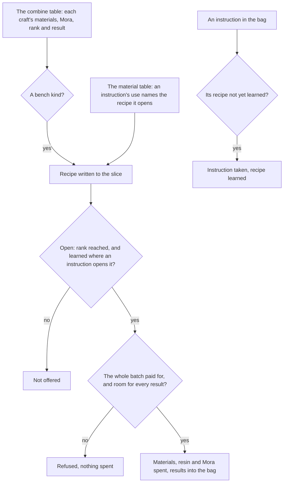
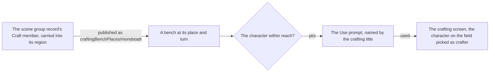

# Crafting

The bench's recipes are read from the game's combine table into the world's data, and the rules of crafting run over them: which recipes a player has open, how many of a recipe the bag and wallet pay for, a batch crafted whole or refused, and a recipe learned from its instruction. It covers the tiers, potions, baits, Condensed Resin, the gadgets and the conversions, the characters' crafting talents with their doubles, refunds and regional talent materials, and the bench in the world: Mondstadt's bench stands at its recorded place, is used by its prompt, and opens the crafting screen with the party's crafter picked. The [crafting](../../../changes/archive/2026-10-18-genshin-crafting/design.md) proposal that built the bench is archived beside this page, and the [converting](../../../changes/archive/2026-10-18-genshin-converting/design.md) change that added its conversions is archived beside it.

## How it works

## The recipes

`pnpm -C scripts genshin:assets crafting` builds the recipe record from the game text dump's combine and material tables and publishes it to the hosted game data as `crafting/recipes`. The combine table is fetched rather than read from the dump, as [game data formats](../game-data-formats/design.md) records (`scripts/src/services/genshinAssets/crafting/buildCraftingRecipes.ts`). A row is kept when it is a craft at the bench and of one of these kinds:

- **Tiers**, the combine types that make three of a material for one of the next. Every tier row takes exactly three of one material for one item, and a row that does not is an error (the rows of types 1, 2 and 3, and the tier rows of type 5, in `~/Esposter/genshin-parity/text/ExcelBinOutput/CombineExcelConfigData.json`; `scripts/src/services/genshinAssets/crafting/toCraftingRecipe.ts`).
- **Potions**, the combine types for Heatshield and Desiccant potions and for the formulas of Pure Water and Strength Tonic (`CombineExcelConfigData.json`: type 4 holds the Heatshield and Desiccant potions, type 12 the Pure Water and Strength Tonic rows).
- **Baits**, each making ten from its two ingredients (`CombineExcelConfigData.json`, type 10: twelve rows, each ten from two).
- **Condensed Resin**, the one recipe whose result is item 220007, from one crystal core and 60 Original Resin (`CombineExcelConfigData.json` row 220007, whose materials are Crystal Core 100085 and Original Resin 106, named in `MaterialExcelConfigData.json` and `TextMap_MediumEN.json`).
- **Gadgets**, the seven combine type 6 rows beside Condensed Resin: the Portable Waypoint and the six Resonance Stones. Each is opened by its instruction item, which the material table names, so an instruction is read from the dump (type 6 of `CombineExcelConfigData.json` holds the Portable Waypoint 220005 and the six Resonance Stones 220001, 220002, 220032, 220057, 220086 and 220103 beside Condensed Resin; `scripts/src/services/genshinAssets/items/readUnlockItemIdMap.ts`).
- **Conversions**, the convert rows of combine types five and nine: each takes one material and the catalyst the table names, and makes one item. Each is open from the start, costs no Mora and is listed under its own tab (`scripts/src/services/genshinAssets/crafting/constants.ts`, `CONVERT_COMBINE_TYPES` of 5 and 9; the convert rows of `CombineExcelConfigData.json` carry a Mora cost of 0).

Left out, each for its own reason: the disassembly rows of combine type eleven, which make drops rather than one item; the homeworld's rows, which belong to the Serenitea Pot (`CombineExcelConfigData.json` holds 14 rows of recipeType RECIPE_TYPE_COMBINE_HOMEWORLD); the essential oils, whose instructions the table does not name (`MaterialExcelConfigData.json`: no `itemUse` names an oil's combine row, and the diagrams that share the oils' combine ids unlock `ForgeExcelConfigData.json` rows); and the Xiao Lantern, left out as a quest's item, a reason the Open list records as contradicted (`scripts/src/services/genshinAssets/crafting/toRecipeKind.ts` holds only the types the bench lists; `toCraftingRecipe.ts` drops a hidden row that no instruction opens, which the essential oils are, as type 4 of `CombineExcelConfigData.json` shows).

A recipe the table shows from the start is open from the start. One it hides is written with the instruction items that open it, read off the material table's use of each instruction. A hidden recipe no instruction opens is an error, so a table change cannot hide a recipe silently (`scripts/src/services/genshinAssets/crafting/toCraftingRecipe.ts`).

## The rules

- **Open.** A recipe is offered once the player's Adventure Rank reaches its rank, and, for a recipe an instruction opens, once it is learned (`packages/genshin-world/src/services/crafting/checkIsRecipeOpen.ts`).
- **Count.** The times a recipe can be crafted is the least of what each material and the Mora pays for. Original Resin is paid from the wallet, regenerated to the moment of the craft; every other material from the bag (`packages/genshin-world/src/services/crafting/computeCraftableCount.ts`).
- **Tabs.** The open recipes are listed under one tab per combine type they fall under, in the table's order. A conversion is listed under a tab of its own, apart from the craft tab of its combine type. Each tab is named by the game's own text for its combine type (`COMBINE_TYPE_NAME1` to `COMBINE_TYPE_NAME12`), and the first tab shows until one is picked. Combine type 6 is named Consumable and type 12 Food by the game's medium English text map's `COMBINE_TYPE_NAME6` and `COMBINE_TYPE_NAME12`, whose hashes, from `~/Esposter/genshin-parity/text/ManualTextMapConfigData.json`, are 1573942517 and 2379122893, which read Consumable and Food in `~/Esposter/genshin-parity/text/TextMap/TextMap_MediumEN.json` (`packages/genshin-world/src/services/crafting/computeCraftingTabCells.ts`). From Adventure Rank 45 the Mystic Offering is listed as one more tab, last, and picking it takes the bench's screen with its panel, whose place is provisional until measured (`packages/genshin-world/src/services/crafting/checkIsMysticOfferingOpen.test.ts`, which holds 44 closed and 45 open).
- **Craft.** A batch is crafted whole or refused. Its materials, resin and Mora are spent and its results put in the bag, and a batch the bag has no stack room for every result of is refused. That is how Condensed Resin stops at the five it holds (`packages/genshin-world/src/services/crafting/craftRecipe.ts`; the game's text 953962629 in `~/Esposter/genshin-parity/text/TextMap/TextMap_MediumEN.json` says "You can hold no more than 5 Condensed Resin at a time").
- **Talent.** A character's crafting talent, from the wiki's Crafting Talents category, draws on each craft of a recipe of the combine types it names: a double of the result at 10%, or a refund of the recipe's first material at 25% (20% for potions), or, for a talent book, the same tier of another talent book series in its region at 25% (Yae Miko) or 10% (Prune). A craft's draw is taken from the world's seeded random source, and a character with no talent crafts plainly. A conversion draws none, as no talent names its combine types (`packages/genshin-world/src/services/crafting/CharacterIdCraftingTalentMap.ts` names only types 1, 2, 3 and the potion type; `packages/genshin-world/src/components/Crafting/Screen/Index.vue` makes the draw).
- **Learn.** Using an instruction takes one from the bag and records the recipe as learned. The instruction must be one the recipe names, held by the bag, and the recipe not learned already.
- **Bench.** The bench stands where the [scene group record](../scene-groups/design.md) places its Craft member, Mondstadt's first, and its place is published by `genshin:assets crafting` as `craftingBenchPlaces/mondstadt` (`packages/genshin-world/src/services/crafting/readMondstadtCraftingBenchPlace.ts`, `packages/genshin-world/src/models/data/GameDataset.ts`). Its prompt is offered within reach, and a city whose record holds no bench offers none. Using it opens the crafting screen (`packages/genshin-world/src/components/World/Session/Index.vue`, where a Use interactable sets `ScreenKind.Crafting`) with the character on the field picked as crafter, the learned recipes of each combine type listed with their crafted counts, which the save holds.

## Key files

| File                                                                              | Role                                                                                                                               |
| :-------------------------------------------------------------------------------- | :--------------------------------------------------------------------------------------------------------------------------------- |
| `scripts/src/services/genshinAssets/crafting/buildCraftingRecipes.ts`             | The recipe record built from the combine table, for publishing                                                                     |
| `scripts/src/services/genshinAssets/crafting/toCraftingRecipe.ts`                 | One row as a recipe, refusing a tier that is not three of one material or a conversion that is not one material and its catalyst   |
| `scripts/src/services/genshinAssets/items/readUnlockItemIdMap.ts`                 | Each recipe's instruction items, read off the material table                                                                       |
| `packages/genshin-world/src/services/crafting/CharacterIdCraftingTalentMap.ts`    | The thirteen characters' crafting talents, by avatar id                                                                            |
| `packages/genshin-world/src/services/crafting/CombineTypeGameTextKeyMap.ts`       | Each combine type's tab name, by the game's own text key                                                                           |
| `packages/genshin-world/src/services/crafting/TalentBookIdOtherSeriesIdsMap.ts`   | Each talent book craft's regional extra: the same tier of the region's other two series                                            |
| `packages/genshin-world/src/services/crafting/rollCraftingTalent.ts`              | The extra results, refunds and regional materials a character's talent adds to a batch                                             |
| `packages/genshin-world/src/services/crafting/craftRecipe.ts`                     | A batch crafted whole, or refused with nothing spent                                                                               |
| `packages/genshin-world/src/services/crafting/computeCraftableCount.ts`           | How many of a recipe the bag, wallet and regenerated resin pay for                                                                 |
| `packages/genshin-world/src/services/crafting/checkIsRecipeOpen.ts`               | Whether a recipe is open at a rank, and learned where an instruction opens it                                                      |
| `packages/genshin-world/src/services/crafting/learnCraftingRecipe.ts`             | A recipe learned from an instruction in the bag                                                                                    |
| `packages/genshin-world/src/services/crafting/readCraftingRecipes.ts`             | The recipes, fetched by their key from the hosted game data and checked against their shape                                        |
| `packages/genshin-world/src/models/crafting/CraftingSave.ts`                      | The save's crafting slice: the learned recipes and each recipe's crafted count                                                     |
| `packages/genshin-world/src/components/Crafting/Screen/Index.vue`                 | The bench's screen: the open recipes, the crafter, the count and the craft, and the Mystic Offering's panel once its tab is picked |
| `packages/genshin-interface/src/components/CraftingScreen/Index.vue`              | The bench's 2D screen over the recipe tabs, the recipe list, the crafter pick and the craft                                        |
| `scripts/src/services/genshinAssets/items/buildItems.ts`                          | The item table's rows, now with every crafting recipe's materials and result                                                       |
| `scripts/src/services/genshinAssets/crafting/buildCraftingBenchPlaces.ts`         | The bench's place in its region's axes, published as `craftingBenchPlaces/mondstadt`                                               |
| `scripts/src/services/genshinAssets/crafting/toCraftingKeeperPlace.ts`            | The keeper's place beside the bench, moved along x by the reckoned offset                                                          |
| `scripts/src/services/genshinAssets/crafting/findCraftingBenchMember.ts`          | The bench's NPC member of its scene group record, found by its group and NPC ids                                                   |
| `packages/genshin-world/src/models/crafting/CraftingBenchPlace.ts`                | The bench's ground point and turn in its region                                                                                    |
| `packages/genshin-world/src/services/crafting/readMondstadtCraftingBenchPlace.ts` | Mondstadt's bench place, fetched by its key from the hosted game data                                                              |
| `packages/genshin-world/src/services/interaction/computePlaceInteractables.ts`    | The bench as a Use prompt beneath its place, named by the crafting title                                                           |
| `packages/genshin-world/src/services/crafting/computeCraftingCrafters.ts`         | The party's characters who can craft, the character on the field picked as crafter                                                 |
| `packages/genshin-world/src/services/crafting/computeCraftingTabCells.ts`         | The bench's tab list: the recipe tabs, then the Mystic Offering from its Adventure Rank                                            |
| `packages/genshin-world/src/services/crafting/computeLearnedRecipeCells.ts`       | The learned recipes of one bench tab, in the game's order, with their crafted counts                                               |
| `packages/genshin-world/src/services/crafting/getCraftingTabId.ts`                | The bench tab a recipe is listed under: its combine type's, or a conversion's apart from the crafts                                |
| `packages/genshin-world/src/components/World/Session/Index.vue`                   | Offers the bench's prompt and opens the crafting screen from it                                                                    |
| `packages/genshin-world/src/services/interaction/computeInteractionPrompts.ts`    | The prompt list's rows: everything within reach, nearest first, the selection held while it stays in reach                         |

## Notes

- **Each recipe carries its result's name.** A recipe's `nameTextId` is the text id of the item it makes, read from the material table, and `genshin:text names` publishes it in the world's `nameText` record per language, so a bench screen can show it without a game text key (`scripts/src/services/genshinAssets/crafting/toCraftingRecipe.ts`, which names a recipe by the item it makes).
- **Only Mondstadt's bench is placed.** `findCraftingBenchMember` finds the bench by its scene group and NPC id, which names Mondstadt's alone, so the other cities' benches stand nowhere (`scripts/src/services/genshinAssets/crafting/findCraftingBenchMember.ts`; the dump-wide count is open, see Open). The keeper Timaeus, who stands beside Mondstadt's bench, is not traced to a birth in the scene group record (see Open), so `toCraftingKeeperPlace` places him two metres along x from the bench's place (`CRAFTING_KEEPER_BENCH_OFFSET_METRES` in `scripts/src/services/genshinAssets/crafting/constants.ts`), as a resident the residents write carries into Mondstadt's region data. The wiki gives him beside the bench with no distance, so the offset is provisional. His name is the game's own, read from his NPC row, and his talk is the standing talk the game's table gives him (6970601, `~/Esposter/genshin-parity/text/ExcelBinOutput/TalkExcelConfigData_1.json`), the rule every resident's talk follows. That talk is a Genius Invokation line in the dump, so whether it reads as a world talk is not confirmed.
- **The gadget instructions' sources are not read.** Each gadget's recipe is offered once its instruction is learned, but where the instruction is obtained in the world is left to the pages that place those sources.
- **The screen's look is not yet matched.** The recipe list, the crafter's pick, the count and the craft are the `CraftingScreen` unit under `genshin-interface`, wrapped by the world's `Crafting/Screen`, which the bench's prompt opens. Its words are the game's own text ids, and its look waits on the bench's passes against the clip.
- **A batch's talent extra with no room is left out.** The craft is checked whole first, so the bag's room goes to the craft's own results before a talent's extra is added, and an extra that finds no room is dropped rather than refusing the craft (`packages/genshin-world/src/components/Crafting/Screen/Index.vue`, which adds each talent item with `addInventoryItem(...).inventory`, keeping the bag and discarding its overflow, after `craftRecipe.ts` has accepted the craft).
- **Crafting Performed counts the save's crafts.** The save holds each recipe's crafted count by its id, beside the recipes learned, so the line counts every batch of that recipe since the player first crafted it, across visits. A merge keeps the account's counts, since a craft a guest made used materials from a bag the merge does not keep (`packages/genshin-world/src/services/save/mergeGenshinSave.ts`, `craftedCounts` from the account; `packages/genshin-world/src/models/crafting/CraftingSave.ts`).
- **The item table gains the crafting items.** `genshin:assets items` reads each recipe's materials and result from the material table, so every crafting item has its row and name, not only the drops' (`scripts/src/services/genshinAssets/items/buildItems.ts`, which reads `craftingRecipeSchema`).

## Sources

- [Timaeus](https://genshin-impact.fandom.com/wiki/Timaeus), Genshin Impact Wiki: stands next to the Crafting Bench at the fountain plaza in Mondstadt.
- [AnimeGameData](https://github.com/DimbreathBot/AnimeGameData), the community's per-patch dump: `CombineExcelConfigData`, each craft's materials, Mora, rank and result, and `MaterialExcelConfigData`, whose instructions' uses name the recipes they open.
- [Condensed Resin](https://genshin-impact.fandom.com/wiki/Condensed_Resin), Genshin Impact Wiki: the 60 resin a craft takes and the five a player can hold, the figures the proposal settles its decisions from.

## Open

- **Mystic Offering opens at Adventure Rank 45** — the wiki's page, `~/Esposter/cache/genshin-wiki/Mystic_Offering.json`, which is not on disk in this checkout, so its quoted line "available at Crafting Benches at Adventure Rank 45 to perform Alchemy" is unverified here. The code holds it as `MYSTIC_OFFERING_ADVENTURE_RANK = 45` (`packages/genshin-world/src/services/crafting/constants.ts`), and the dump's open-state row 1600 (`~/Esposter/genshin-parity/text/ExcelBinOutput/OpenStateConfigData.json`) gates a player level of 45 and names no system.
- [ ] **The talent draws of 10%, 25%, 20%, 25% and 10%** — no source yet: the named source does not hold this value, since `~/Esposter.noindex/genshin-dump-backup-6.6/ExcelBinOutput/AvatarTalentExcelConfigData.json` names no crafting talent (its 20 rows with a 0.25 parameter name none), and the cache holds no Crafting Talents category; the roll reads each talent's `chance` (`packages/genshin-world/src/services/crafting/rollCraftingTalent.ts`).
- [ ] **The Xiao Lantern is a quest's item, and the homeworld's rows belong to the Serenitea Pot** — contradicted in part by `~/Esposter/genshin-parity/text/ExcelBinOutput/MaterialExcelConfigData.json`, which is not on disk in this checkout, so the contradiction is unverified here: row 200004 is MATERIAL_SEA_LAMP, not MATERIAL_QUEST. The earlier reading that three `QuestExcelConfigData.json` rows name the lantern is not reconciled with the 2026-10-26 check that no quest row names it, so the lantern's quest link stays open. The wiki's Inventory page (`~/Esposter/cache/genshin-wiki/Inventory.json`, also not on disk here) files "Xiao Lanterns from the Lantern Rite event" under Consumables, which states no quest.
- [ ] **The bench stands where its scene group record places it, and its prompt opens the crafting screen** — checked against `packages/genshin-world/src/components/World/Session/Index.vue` lines 1886 to 1888 for the prompt, and the claim is not settled by it because the place's scene group record is not compared with `craftingBenchPlaces/mondstadt` here (the place is read by `packages/genshin-world/src/services/crafting/readMondstadtCraftingBenchPlace.ts`).
- [ ] **Mondstadt's is the only bench the scene group records place, and Timaeus has no birth in the scene group record** — no source yet: the dump's scene group records, counted for every city's Craft member, and Timaeus's row in his scene group record.
