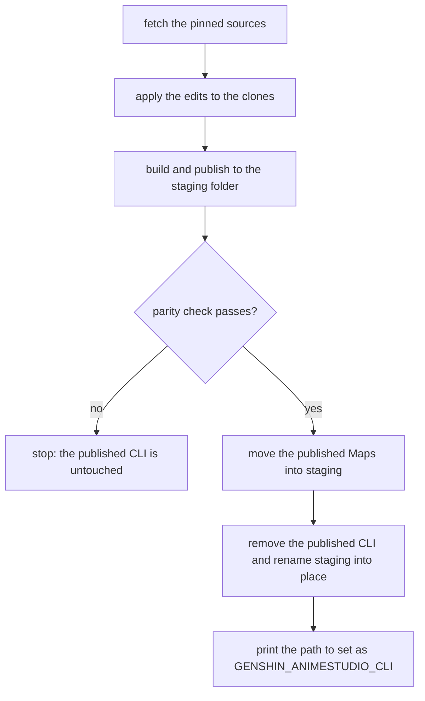

# AnimeStudio on macOS

`pnpm -C scripts genshin:animestudio:build` fetches AnimeStudio and Texture2DDecoder at their pinned commits, builds the CLI for `osx-arm64` and its natives as dylibs, and prints the path to set as `GENSHIN_ANIMESTUDIO_CLI`. The sources and builds stay under `~/Esposter/tools` (`--directory` to move them), outside the repository, and nothing it fetches is committed.

- **Pinned commits:** AnimeStudio `db860e1f9bf0e0314b892782304d44f3ac42c261` (the CLI, its Ooz and ACL sources), Texture2DDecoder `c974dbda1209a6af34cb03941fa0b999627c3623` (`KiruyaMomochi/Texture2DDecoder`, the native behind the `Kyaru.Texture2DDecoder` wrapper, the one whose macOS build the NuGet package does not ship).
- **Edits it applies to the clone:** every project retargets `net10.0`, and the `win-x64` runtime identifier is dropped. Ooz's match copy is replaced by one that copies a byte at a time when the match is closer than eight bytes: the stock copy reads bytes the decode has not yet written, so the output followed whatever the buffer held, and blocks lost assets that AnimeStudio logged without failing the run.
- **Staging:** the CLI is published to `~/Esposter/tools/animestudio-cli-staging` first, and replaces the published `animestudio-cli` only once the parity check passes, so failures before publication begins leave the published CLI, and the `GENSHIN_ANIMESTUDIO_CLI` naming it, as they were.
- **Maps:** a rebuild keeps the CAB map. AnimeStudio writes it to `Maps` beside the published CLI, so on a pass the build moves that folder into the staged CLI's before the staged folder replaces the published one. The parity runs pass no map, so the staged CLI is checked without it.
- **Acceptance:** before the staged CLI replaces the published one, the build exports each reference block in `PARITY_REFERENCE_BLOCKS` once per type with it, under `~/Esposter/tools/animestudio-parity`, and fails unless each type's file count matches Windows AnimeStudio's on game 7.1.0 and no run names an exception. All six blocks match on the current build. `--skip-parity` skips the check only when the game's blocks are absent, and prints why.
- **Leviathan:** the build makes the decoder's match offsets signed (`ptrdiff_t`) instead of `size_t`. As `size_t`, `dst + offset` overflowed for every backward match, and the optimizer could load a copy's source before the store of the copy before it, reading a stale byte. Windows' build does not.
- **Natives:** `Texture2DDecoderNative` and Ooz build and load; ACL's MHY library builds and loads. The other ACL libraries (SR, ZZZ, DB) fail to compile under clang, and ZZZV2 needs `windows.h`, so animation clips from those are not available.
- **Requirements:** .NET 10 and CMake to build. The CLI is published self-contained, so it runs with no `DOTNET_ROOT` however .NET was installed, and the game-running check, which reads Windows' process list, passes on macOS, where the game has no build.
- **Not on arm64:** FMOD audio, FBX export and HLSL shader decompilation ("AnimeStudio.HLSLDecompiler") are Windows-only or proprietary, so `genshin:assets` steps that need them do not run here.

The macOS default is this published CLI, so setting `GENSHIN_ANIMESTUDIO_CLI` to the printed path is needed only for a CLI kept elsewhere (the Windows default is `~/Downloads/AnimeStudio/AnimeStudio.CLI.exe`).

## Key files

| File                                                              | Role                                                                                                             |
| :---------------------------------------------------------------- | :--------------------------------------------------------------------------------------------------------------- |
| `scripts/src/animeStudio/index.ts`                                | The macOS build command, `genshin:animestudio:build`                                                             |
| `scripts/src/services/recreation/animeStudio/buildAnimeStudio.ts` | Fetches the pinned sources, builds the natives, publishes the CLI and copies the dylibs under their import names |
