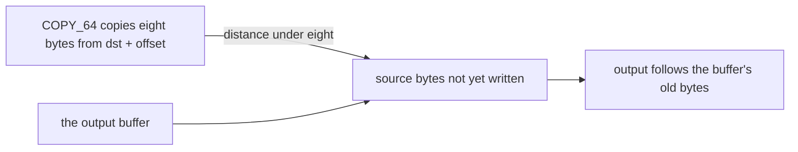

# AnimeStudio upstream defects and gaps

The Ooz source AnimeStudio vendors at the pinned commit, `{data-root}/cache/animestudio-db860e1f/AnimeStudio.Ooz/kraken.cpp`, has the defect below. This is drafted text for Escartem/AnimeStudio.

**Title:** Ooz: the 8-byte match copy reads output not yet written when the match distance is under 8

- `COPY_64` and `COPY_64_ADD` copy eight bytes at once from `dst + offset` `{data-root}/cache/animestudio-db860e1f/AnimeStudio.Ooz/kraken.cpp` (the `COPY_64` macro, line 472). When the distance is under eight, the source overlaps bytes this copy has not written yet, so the result depends on what the output buffer held before the call.
- Minimal repro: `AnimeStudio.CLI` on `00/10850306.blk` from game 7.1.0, `--types Texture2D`, names set to that block's `UI_NameCardPic_*` entries, `--logger_flags Warning Error`. Stock source: 398 exception lines ("EndOfStreamException", "OverflowException", and an `ArgumentOutOfRangeException` in `ProcessAssetData`) and no textures. With the copy changed to byte-wise when the distance is under eight: no exception lines and 91 textures.
- The stock decoder is also wrong with a zero-filled buffer: against the patched output, 226 of 466 Oodle calls in that block differ.
- Patch: when `dst - src < 8`, copy one byte at a time; otherwise keep the eight-byte copy `scripts/src/services/recreation/animeStudio/buildAnimeStudio.ts`.



```c
static inline void oozCopy64(void *destination, const void *source) {
  uint8_t *d = (uint8_t *)destination;
  const uint8_t *s = (const uint8_t *)source;
  if ((uintptr_t)(d - s) < 8) {
    for (int i = 0; i < 8; i++) d[i] = s[i];
  } else {
    uint64_t value;
    memcpy(&value, s, 8);
    memcpy(d, &value, 8);
  }
}
```

- Not established: why the Windows build of the same source is clean on `00/15508490`. An explanation based on x86 store-to-load forwarding is not verified and is not claimed here.
- The Leviathan defect is a separate issue, with its own text below.

**Title:** Ooz (Leviathan): `size_t` match offsets make `dst + offset` overflow, and the copy can read a stale byte

- "Leviathan_ProcessLz" `{data-root}/cache/animestudio-db860e1f/AnimeStudio.Ooz/kraken.cpp` takes each match's offset as a `size_t`, so `copyfrom = dst + offset` with a negative distance is pointer arithmetic that wraps. That is undefined behaviour, and the optimizer may move a copy's load ahead of the store of the copy before it when the two overlap at distance 8. The x64 build of the same source does not show it, and the arm64 build does.
- Repro: `AnimeStudio.CLI` on `00/06104869.blk` from game 7.1.0, `--group_assets ByType --game GI --types Texture2D`. That makes 604 Oodle calls. In call 601 (3022 compressed bytes, 20864 written) the first byte that differs from the x64 output is at offset 152. There the arm64 build reads 164 from byte 144, a stale value left by an earlier wild copy, where the x64 output has 0, and its output differs from x64 in 324 of 326 chunks. The build logs two exception lines and exports 483 textures where Windows exports 485.
- Patch: `size_t last_offset` becomes `ptrdiff_t last_offset` in the twelve Leviathan literal functions, and `size_t offset = -8` becomes `ptrdiff_t offset = -8` `scripts/src/services/recreation/animeStudio/buildAnimeStudio.ts` (the twelve `last_offset` replacements and the `offset` one, against `{data-root}/cache/animestudio-db860e1f/AnimeStudio.Ooz/kraken.cpp`, which holds twelve `size_t last_offset` and `size_t offset = -8` at line 3236).
- Result: nine calls 595 to 603 match the x64 fingerprints on input and output, call 601 matches in all 326 chunks, and the run logs no exception line.
- Inferred, not confirmed by reading generated code: the reordering of the load is the optimizer's use of the overflow. The stale read is observed.

**Title:** AnimatorController: the state machine is read into a local and dropped, so the JSON export holds only `m_TOS` and the animation clip list

- `{data-root}/cache/animestudio-db860e1f/AnimeStudio/Classes/AnimatorController.cs` reads the controller's state machine into a local, `var m_Controller = new ControllerConstant(reader)`, and keeps no field of it. The constructor ends with `// TODO add some more stuff maybe?`, and the class's only fields are `m_TOS` and the animation clip list.
- Repro: `AnimeStudio.CLI` on `00/11877482.blk` from game 7.1.0, `--names '^Monster_Hili_None_01$' --types AnimatorController --export_type JSON`, `--logger_flags Warning Error`. Stock source: the export's top-level keys are `m_TOS` (847 entries), the animation clip list (270 entries), `m_Name` and `Name`. It has no `m_Controller`, so which state plays which clip is not in it.
- Patch: keep the parsed controller on the object, as a public `m_Controller` field, so the JSON exporter writes its layers, state machines, states and blend trees beside the two fields it writes now. Drafted, not applied:

```csharp
public sealed class AnimatorController : RuntimeAnimatorController
{
    public Dictionary<uint, string> m_TOS;
    public List<PPtr<AnimationClip>> m_AnimationClips;
    public ControllerConstant m_Controller;

    public AnimatorController(ObjectReader reader) : base(reader)
    {
        var m_ControllerSize = reader.ReadUInt32();
        m_Controller = new ControllerConstant(reader);
        // the rest is read as before
    }
}
```

- Expected result: the patched export of the same object has an `m_Controller` key whose layers and state machines hold the states, transitions and blend trees the stock reader reads. The stock reader's branch choices stay as they are, so the patch changes what is kept, not what is read.
- Not established: whether the JSON exporter writes a nested class's lists without a further change, since the exporter is not read here; and whether the stock reader reads every monster controller's state machine correctly, since the stock reader selects some branches by the serialized type's hash and no export shows the states yet.

## Key files

| File                                                              | Role                                                                                                |
| :---------------------------------------------------------------- | :-------------------------------------------------------------------------------------------------- |
| `scripts/src/services/recreation/animeStudio/buildAnimeStudio.ts` | Applies the Ooz copy and Leviathan offset edits to the clone the two defects are found in, at build |

## Open

The open item that nothing is filed upstream is recorded with its requirement in [the spec](spec.md).

- [ ] **The stock Ooz copy on `00/10850306.blk` logs 398 exception lines and no textures, and the byte-wise copy logs none and exports 91** — no source yet: no run log or output of this repro is on disk under `{data-root}/tools` or the parity folder; the repro's own `AnimeStudio.CLI` run settles it.
- [ ] **The stock decoder with a zero-filled buffer differs from the patched output in 226 of 466 Oodle calls** — no source yet: no comparison output is on disk.
- [ ] **The stock Leviathan build on `00/06104869.blk` makes 604 Oodle calls, differs from x64 at offset 152 of call 601, and exports 483 textures where Windows exports 485** — no source yet: no run log or output of this repro is on disk; the stock run on `00/06104869.blk` settles it.
- [ ] **After the Leviathan patch, calls 595 to 603 match the x64 fingerprints and the run logs no exception** — no source yet: no patched run output is on disk; a run of the patched CLI on `00/06104869.blk` with `ANIMESTUDIO_OODLE_LOG` set settles it.
- [ ] **The x64 build of the Leviathan source does not show the defect, and the arm64 build does** — no source yet: no x64 run output is on disk to compare; an x64 build of that source run on the same block settles it.
- [ ] **The patched export writes the controller's state machine into `m_Controller`** — no source yet: the patch is drafted above and not applied; the patched CLI's JSON export of `00/11877482.blk` settles it (the genshin-assets-enemies change's task 4.0).
