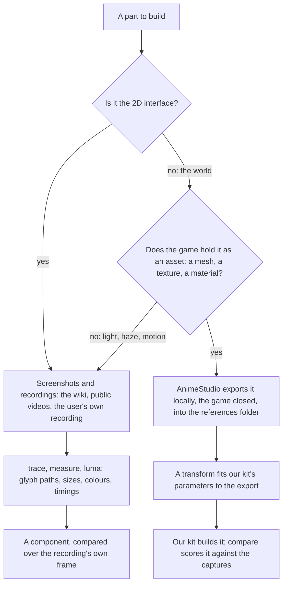
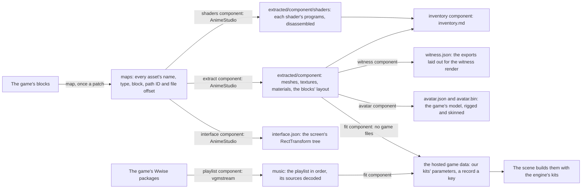
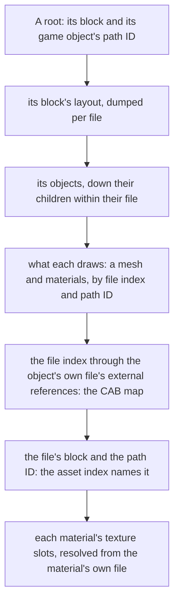

# Derived assets

Nothing the game draws ships. Every shape, colour and glyph the deployed recreation draws is ours, measured off the game and built by our own code, and the game's own files are references like any screenshot, drawn only on a developer's own machine under `nuxt dev` ([development exports](development-exports/design.md)). This page is which reference each part is measured from, how a measurement becomes ours, and how far each component has come. The game's words are the one thing of its own carried as they are, quoted as text the way the screen shows them ([game text](../game-text/design.md)).

## Which source a part is measured from

- **The interface comes from screenshots.** The game's interface is mostly drawn at run time from atlases whose names say little, while the wiki and recordings show every screen in every language. An interface component is compared over the recording's own frame, which holds it exactly ([parity](../parity/README.md)).
- **The world comes from the game's own assets.** A tower's profile, a door's outline and a stone's palette are read off the game's mesh, texture and material exports, and where each stands from the blocks' own layout, which pin a measure a picture can only estimate: a tower's depth, its true diameter, a moulding's height.
- **Only our parameters ship.** A transform reads an export and writes the numbers our kit takes, such as a lathe's section shares, a door's outline points or a palette. It publishes them as the world's data for the component that reads them, and never a vertex, a pixel or a converted file of the game's. The exports stay in `~/Esposter/genshin-parity/extracted` with every other reference and never enter the repository, a build or a deployment. So what ships has one render path, our kits. The development server draws the developer's own exports in place of the kits' stand-ins through the witness's own loader, so a local world shows the target the kits are fitted to rather than a second product to keep in step ([development exports](development-exports/design.md)). How a scene grows past its kits' few parameters, each loss priced against the exports before it is closed, is [proposed](../scene-derivation/design.md).

## The pipeline

`pnpm -C scripts genshin:assets <step>` runs AnimeStudio's command-line tool (by default the CLI `genshin:animestudio:build` publishes on macOS, or under `~/Downloads/AnimeStudio` on Windows; `GENSHIN_ANIMESTUDIO_CLI` names a CLI kept elsewhere) over the installed game's blocks, with the game closed. On macOS every AnimeStudio run starts under the utility QoS clamp (`taskpolicy -c utility`), so a sweep of the blocks yields to the foreground apps; on Windows `city-areas` runs it at below-normal priority and the other steps at normal priority. Each step reads what the one before it wrote:

1. **`map`** indexes every block the game loads into the asset map, about a gigabyte of JSON, and streams it into `index.tsv`, which a search reads in seconds: each asset's name, type, block and path ID, and the offset in its block of the file (the CAB) holding it, which the CAB map names that file by. `map --index` writes the index again from the asset map alone, in seconds, without mapping the blocks; an index written before it kept the offsets is refused until it is. The blocks it reads are the copies the game loads: each block's hotfix under `GenshinImpact_Data/Persistent` where the game downloaded one, else its StreamingAssets copy, linked under `maps/blocks` beside the map (`linkInstalledBlocks`). Every later step opens a block through those links, so the map and the exports read the same copy and a block only a hotfix ships is read at all. AnimeStudio reads one input folder at a time, so the blocks are cut into as many shards as there are performance cores (`--shards` sets the count), each a run of consecutive files of about equal bytes, and each run maps its shard over a folder of symlinks to those links; Windows makes symlinks only with Developer Mode on. The runs go at once, and their output is merged into what one run would have written: the CAB maps as one, a CAB two shards both hold keeping the earlier shard's record, and the asset maps concatenated with each source rebased to the installed blocks' folder. A run that logs an exception fails the map, as it fails any run. AnimeStudio writes each run's CAB map into its own folder, which the merge reads and clears.
2. **`extract <component>`** exports the component's closure: each of its roots' blocks has its Transforms, GameObjects, MeshFilters, MeshRenderers and SkinnedMeshRenderers dumped as JSON by the file (the CAB) each came from, then everything the roots reach down their children, the meshes and materials those draw and the textures each material samples, is exported from the block holding it by its exact name (`walkAssetClosure`), each mesh as an OBJ and beside it as JSON, which keeps the skin an OBJ drops. What no pointer from the roots reaches is exported by the component's name pattern, and every pointer that could not be resolved is printed. The extraction records the commit its producer code was at in a `producer.json` beside the exports (`writeProducerStamp`), and a read of a capital's derived world (`readWorldOptions`) lists the commits to that code since, once a process for each component, so a fixed extractor is visible as stale output (`readProducerStaleness`). No other reader of the exports checks the stamp yet.
3. **`shaders <component>`** exports every shader in the blocks holding the shaders its materials name, raw, since a shader is exported nameless and its block also holds the sky's and the post-processing's. The game keeps each compiled variant as a plain DXBC container, and `readShaderPrograms` names each one by the pass, stage and keyword set its shader's serialized form records (`parseSerializedShader`), falling back to carving it out by its own stated size (`parseDxbcPrograms`) and leaving it unnamed where that form is not read; Windows' own `d3dcompiler_47` disassembles each into its assembly (`disassembleDxbcDirectory`); elsewhere that step runs Wine's `vkd3d-compiler` (`-x dxbc-tpf -b d3d-asm`), found by the `VKD3D_COMPILER` variable or on `PATH`, and a program it cannot read is left without its assembly. The Shader:Export of the character uber shader has 1553 carved programs, of which 693 disassemble under `vkd3d-compiler`; the other 860 are DXIL (SM6, no SHDR/SHEX chunk), which neither disassembler reads, beside the property names the shader declares, which tell a nameless shader apart. 3Dmigoto's command-line decompiler writes each program as HLSL beside its assembly (`decompileDxbcDirectory`): its last release to ship it alone, 1.3.16, fetched and checked by SHA-256 as FFmpeg is (`resolvePinnedTool`), and both are headed by the constant names `annotateProgramConstants` recovers, so a shader is ported from readable code; where the decompiler cannot be had, the annotated assembly stands. Each is exported unparsed (`Shader:Export`), since AnimeStudio's parser refuses some of the game's shaders, the login stone's among them, and drops what it refuses from a raw export as well. Every step run through AnimeStudio or vgmstream reads the game — `map`, `extract`, this, `interface`, `clips` and `playlist`, and the `behaviours` and `timings` commands below — while `inventory`, `witness` and `fit` read only the exports.
4. **`inventory <component>`** writes `inventory.md` beside the exports: each material's shader, texture slots and values, each texture's size and what each channel spans, each mesh's vertices and the materials its renderers draw it with, and each shader's program count and properties. A scene's derivation starts from it ([scene derivation](../scene-derivation/design.md)).
5. **`interface <component>`** lays a screen's interface out as the game does: the block holding it is found through an indexed asset beside it (`DerivedAssetComponentMap`'s `interface`, since GameObjects are not in the asset index), its RectTransforms are dumped as JSON for their tree and raw for their layout, and the tree under the interface's root, each piece's anchors, pivot, position, size and components, is written beside the exports and printed (`extractComponentInterface`). A screen places each piece from it ([interface library](../interface-library/design.md)).
6. **`clips <component>`** decodes the animation clips the component's map names (`clipPattern`): each is exported as JSON, its streamed, dense and constant curves sampled at 60 frames a second, and each binding named where its CRC32 resolves, a property against Unity's names and a path against every sub-path of the component's interface tree, the empty path being the animator's own (`extractComponentClips`). A screen's motion is played from them rather than timed off a recording.
7. **`playlist <component>`** exports the component's music, the playlist its map names (`musicPlaylistId`): one pass of its tree resolved from the sound banks into its segments in order, each with its length and its clips, and every source those clips play decoded as WAV by vgmstream, all into the component's `music` folder (`extractComponentPlaylist`). The fit transcribes and fits from them ([music](../music/README.md)).
8. **`witness <component>`** lays the exports out as the witness render draws them (`writeWitnessLayout`): the component's placements at each part's finest level, in three's axes, with every material each submesh draws with, as a `SceneLayout`. A part of the open world is laid out round its origin's place, the frame our scene stands in, so a camera solved on the witness is our scene's camera and `view` draws ours and the exports at one place.
9. **`avatar <component>`** writes the component's game model beside its exports as `avatar.json` and `avatar.bin` (`writeAvatar`): its Avatar asset exported from its block, the rig's skeleton with each bone's rest pose and its Unity humanoid names, each LOD0 mesh of the model's own renderers, under its model root, drawn with the material each renderer names, its vertices and triangles as typed arrays skinned to that rig, and each material's colours, floats and texture files by slot. A renderer whose own dump switches it off is left out, and a dump that says nothing of the switch draws it, as Unity does by default: the layout's dumps carry no such switch, so every renderer under the root is drawn unless one of its materials has no main texture, which marks the effect system's shell that an effect fills at runtime and nothing draws at rest. Everything is in three's axes, mirrored across x as the exports are (`mirrorAvatarPoint`, `mirrorAvatarRotation`), with each triangle turned to keep its face. Each pointer a renderer holds is resolved through its own CAB's externals (a file index of N is that file's dependency N − 1), so a mesh is the one its renderer's pointer names, read from that CAB's own export: a name names a mesh only within its CAB. Materials resolve the same way: each is read from its own CAB's JSON and raw bytes, and each texture slot is the texture its pointer names through the material's file, so no name is looked up for a texture. Two different drawn materials under one name fail the write, since the manifest keys its materials by name. A mesh's joints are its renderer's own bones in order, each placed in the rig through the layout. A mesh whose bind poses do not match its renderer's bones, or a bone the layout cannot place, fails the write rather than being drawn at a guessed rest.
10. **`fit <component>`** (with `--only paving,towers`, those fits alone, each named for the record it publishes, the rest left as the lock has them) composes every object's world placement from the layout dumps, keeps the arrangements under the component's roots (`readComponentPlacements`), fits our kits' parameters to the meshes and textures, and publishes each as a record of the [hosted game data](../hosted-game-data/design.md) under its own key (`login/paving`), each key its own scope, so a fit run alone replaces only its own records. `--dry-run` fits and reports what would be published without a request. The fits run one after another, since each holds the thread while it computes. Windrise's landmarks are the one fit still written into the world package, into its region files and the regions' ground files people edit, and each ground it rewrites is published as well. A change of fit or selection reruns it alone.

A new component is its roots and the screen drawing it in `DerivedAssetComponentMap` and one fit in `DerivedAssetFitMap`; everything else is shared. Until its fit exists a component has no `DerivedAssetFitMap` entry, and `fit` names that rather than running nothing.

### Commands

From `scripts/`, as `pnpm genshin:assets <command> <component>`, each with its own `--help`:

| Command                                          | What it does                                                                                                                                                                                                                                                                                                                     |
| :----------------------------------------------- | :------------------------------------------------------------------------------------------------------------------------------------------------------------------------------------------------------------------------------------------------------------------------------------------------------------------------------- |
| `extract`                                        | The closure of the component's roots, exported by file and path ID; prints what it reached and every pointer it could not resolve                                                                                                                                                                                                |
| `clearance <component> [--at x,y]`               | Each part of the exports a straight path along +z pierces, and the depths it enters and leaves at: where a camera gliding along it passes through the game's own parts                                                                                                                                                           |
| `behaviours [--script <pattern>] [--at <times>]` | Every MonoBehaviour, animator, camera and light of the component's layout blocks exported raw, each named by the game object it sits on, its fields read by their shapes (a built-in's from past its game object and enabled flag), each pointer named by what it points at, and each curve and gradient read at the times given |
| `tree [--root <name>] [--block] [--depth]`       | The hierarchy the layout dumps hold, each object's block, place, scale in the world, drawing, named components and children, flagging what its arrangement turns on                                                                                                                                                              |
| `avatar <component>`                             | The game's model beside the exports as `avatar.json` and `avatar.bin`: its rig, its LOD0 meshes under its model root skinned to it, and their materials' values and texture files, in three's axes                                                                                                                               |
| `playlist`                                       | The component's music playlist in the order it plays, each segment's length and the sources its clips play and trim, with every source decoded                                                                                                                                                                                   |
| `music <recording>`                              | Which of the game's music sounds a recording plays, twenty seconds at a time by pitch classes, each sound's best three with where in it the window starts, and each leading sound's segments and playlists                                                                                                                       |
| `timings <pattern>`                              | The animation clips a name pattern matches, exported as JSON by block; prints each clip's seconds from its start to its stop and the second each event it fires fires at, with its function                                                                                                                                      |
| `points`                                         | The official Teyvat Interactive Map's label tree and point list, read into the references folder; no component, since the map is one                                                                                                                                                                                             |
| `points-fit`                                     | A similarity fit of the statues and waypoints onto the transport points of the scene, each region's residual and Oculi printed, and nothing written over the bar                                                                                                                                                                 |
| `namecards`                                      | The namecards' art and icons the asset index names, one PNG each in the `cards` and `icons` folders of the references folder; skipped while the folders already hold exactly those names                                                                                                                                         |

`namecards` is the one step not about a component: it reads the asset index for the namecards' textures, not a component's roots, and the game's tables, not the index, say which namecard a character is given (its friendship reward at level 10).

- **Check the arrangement before any pose.** Two widths measured where their parts meet (the door's dais and the walkway below it) give four ends on one line, and a projection keeps their cross-ratio, so the layout pass of `genshin:parity passes` compares it with the fitted data's at no pose; two centred widths in ratio r give (1 + r)² / 4r, so the walkway 2.5 times too wide read 1.23 against the recording's 1.00. Its reading of each family shows a fit drifting from the exports as metres, which is how data fitted on another arrangement shows.
- **Read the tree before the arrangement.** `tree` flags an empty anchor (no children, nothing drawn, no script: where a script spawns a prefab), a father or children no dump holds, a top at the origin (a root, or an object whose father no dump holds, whose whole subtree stands at the origin: a prefab a script spawns at run time, which no placement reaches, so it is dropped from the witness and counted on its own line), and a mesh laid out under several tops (only some of those arrangements are the scene's). `tree login --root SceneObj` shows the login's three empty anchors, one line each.

### Following a scene's pointers

A scene's parts are found from its roots, never by name: its sky, its effects and its prefab parts live under other names and blocks, and one name is shared across the game (`Cloud_LOD0`).

- **A path ID names an object only within its file.** The asset index repeats tens of thousands of path IDs across the game, so every object is held as its file and its path ID. A pointer with a file index of zero stays in its own file; any other is its file's external reference that many places down, less one, which the CAB map AnimeStudio builds with `map` lists in order (`parseCabMap`, `resolveObjectPointer`).
- **The asset index names an object by its block, not its file.** A block and path ID the index names more than once, or that several files of one block resolve to, is reported unresolved rather than given one of them. So is a material sharing its name with another, since both export to one `Material/<name>.json` and its textures could resolve through the wrong file.
- **The layout is dumped by source.** Grouped by type, a block's dumps are named by their objects' names, and each name keeps only its last object; grouped by the file each came from, the character select's block keeps about four times as many GameObjects, and every object's pointers resolve from its file.
- **A name pattern is only for what no pointer reaches.** A particle system's renderer exports without the fields that point at its materials, so the login's cloud emitters' materials and atlases stay in its pattern, named exactly.

### What the exports hold

- **Axes.** Unity is left-handed, and an OBJ export has its x negated back to Unity's mesh space, so a fit reads meshes and placements in the game's own axes throughout, then converts what it writes to three.js as `(x, y, -z)` (`toRightHanded`), a rotation as `(-x, -y, z, w)` (`toRightHandedRotation`).
- **Placements.** A path ID is 64-bit, so the layout is parsed with a `JSON.parse` reviver reading each number's source text. A root's parent is `0`. A GameObject is dumped under its name, so of the objects of one file sharing one (each level of detail under its group) only the last survives; the layout is read from the Transforms, each dumped under a number of its own, and a Transform whose GameObject was lost takes its ID from a child whose own is known (`toSceneObjects`). A level-of-detail group whose own GameObject and every level's were lost is given the levels of its part that name one father: two groups of one part hold the same levels, so either pairing places the same parts. An object whose parent sits in a block not read is dropped, never set down at the origin.
- **One set of meshes, several arrangements.** Blocks lay one set of meshes out several times, each under its own root, so a component names the roots it is (`DerivedAssetComponentMap`'s `roots`). The login screen is its own `LoginScene`, with the prefabs its `MonoLoginScene` spawns: `LoginScene_Build_All`'s towers, bridges and pillars, the walkway and the door; the character select's stage lays the same meshes out another way, at 0.4 scale.
- **A prefab a script spawns hangs from its anchor.** An empty anchor (the tree's flag) is where a script spawns a prefab at run time, and the script's raw bytes point at both (`behaviours`). A spawn in the component map (`spawns`) hangs the prefab's root from its anchor, so every placement read, the witness and the fits compose through the anchor's place, turn and scale, as Unity composes a Transform (`composeWorldMatrices`). The login's `SceneObj` holds its anchors at a tenth of its scale, so its towers, walkway and door stand at that scale; the walkway's parent, set by hand before as the door's 0.4 and 5 metres down, is `BridgeBeginNode`. Where a script also moves a spawned root at run time, the spawn's `position` is its local place under the anchor at the moment a reference shows, measured from it: the login's door stands on the walkway at the flight's end, placed by the door's pose and the walkway's on one frame of `login-door-recording`, while in the static layout its anchor stands 70 metres away. Where a script lays a prefab out several times end to end and scrolls the row past the camera, the spawn's `copies` are its record's count and the world step between them, along the camera's heading: the login's towers stand three times 200 metres apart and its walkway three times 16, one walkway's own length. The witness lays every copy out (`copySpawns`), the row running ahead from the prefab's own place as the scene scrolls it, while the fits read each prefab once and publish the rows beside them (the `login/scroll` record).
- **The open world places its prefabs itself.** A part of the open world (`world` in the component map) is laid out by the game's own placements rather than a scene's roots: a gadget's prefab where a scene point of the community's dump stands, read by the point's fields as the dump names them, and each prefab of a StreamGen blob by the world's id for it (the [game data formats](../game-data-formats/design.md) page reads both). Each place hangs the prefab's root from an anchor of its own (`placeWorldPrefabs`), so the witness and the fits compose through it as through a spawn's anchor. Its terrain tiles' TerrainData are exported beside the closure and each written as a mesh of its heightfield, drawn by the witness with its base map, and one prefab's first place is the origin every fitted value stands round: Windrise's oak's foot. The region data's landmarks the world places (`regionLandmarks`) are stood and turned where their prefabs' first places are, round that origin, in three's axes: x as the game's, z its mirror, and so each turn about the vertical reversed (`toRegionPlace`). A region's world is never written by hand: its `isCapitalWorld` flag derives it at the start of `extract` (`deriveCapitalWorld`) from its capital's catalogued place. The tiles its view and its 600-metre architecture radius cover, and the `Area_<code>_City` blob of every city area that radius reaches, are the StreamGen blobs read, the placements it keeps (those in view, and the architecture within the radius) give each prefab a name through the asset index, and a prefab grouped by level of detail its finest level's through the game's LOD table, as the [scene derivation](../scene-derivation/design.md) page describes, each prefab is rooted at the game object of its name, looked for in the blocks indexing a mesh of that name and, for a building, in those holding a file that depends on its mesh's and that the asset index lists nothing in, the prefab file of a level of detail (`readPrefabBlocks`), and the 2x2 of terrain tiles from the capital's own tile is exported with each TerrainData found by its name. The result is written to `world/world.json` beside the exports and read back by `readWorldOptions`. No region is rooted at its capital's `Area_<code>_City_Index`: that is its blob's chunk index, a MonoBehaviour with no game object, so the closure walks to nothing from it ([game data formats](../game-data-formats/design.md)).
- **A skinned renderer draws its own mesh.** A part whose pieces a clip moves, such as the door, has no filter: its mesh and materials are its `SkinnedMeshRenderer`'s, a mesh in another file named by its path ID through the asset index.
- **Renderers name their materials by path ID.** A MeshRenderer's materials are references into other files, with no name, so the index's path ID column names them. A mesh draws one material a submesh, and an OBJ export writes each submesh as a group named after the mesh with its index appended. A renderer carries no lightmap fields.
- **What a dump cannot hold.** A particle system exports without its fields, and a MonoBehaviour's fields survive only in its raw bytes, read by their shapes (`behaviours`). Where no shape names a setting, it is measured: the camera's path, the door's appearance, the cloud emitters' spread and every light's strength and colour live in scripts, so they are measured from the captures, and expressed over what the blocks do give: the camera's height as a share of the walkway's width, the lights' strengths over the stone's fitted albedo, the cloud bands over the cloud layer's height.
- **Packed textures.** A texture's channels are rarely colours: read what each holds before fitting it. The sky gradient's are three falloff curves over the sky's height, not the hour's colours, which are the sky profile's. A cloud atlas holds two columns of four painted clouds, alpha their silhouette and red the light the painter put on them. A diffuse texture is the part's albedo, which the light warms and cools.

### The fits

| Fit                                       | Reads                                            | Writes                                                                                                                                                                                                                                                                                                                                                                                                                                                                                                                                                                                                                                                                                       |
| :---------------------------------------- | :----------------------------------------------- | :------------------------------------------------------------------------------------------------------------------------------------------------------------------------------------------------------------------------------------------------------------------------------------------------------------------------------------------------------------------------------------------------------------------------------------------------------------------------------------------------------------------------------------------------------------------------------------------------------------------------------------------------------------------------------------------- |
| Lathe, `fitLatheProfile`                  | A round mesh's vertices                          | Its axis, its foot, and a section per two-metre band of its outer radius, merged within 3%                                                                                                                                                                                                                                                                                                                                                                                                                                                                                                                                                                                                   |
| Radial profile, `fitRadialProfile`        | A mesh's vertices, read at each of its angles    | Its axis, its foot, and a section per band of its radius at each angle merged within a share of it at every angle; the lathe is its one-angle case                                                                                                                                                                                                                                                                                                                                                                                                                                                                                                                                           |
| Statue stacks, `fitStatueComponent`       | One piece of a mesh, the triangles it joins into | The piece as one upright stack, a ring of its radii at 32 angles every five centimetres, each about its own section's centroid, or split by k-means into 1, 2, 4, 6 or 10 blades, each a stack along its own length at 12 angles: whichever lies nearer the piece's surface by the two-way distance between samples of each and the angle between their normals, each over what the shape pass holds a stand-in to, so it is chosen from no view. Kept to the millimetre, a leaf's blade being under a centimetre thick. Each ring's vertices carry the colour the piece's texture paints where they stand, under its material's tint: the mean of the six of its fitted points nearest each |
| Footprint, `fitFootprintOutline`          | The triangles of every piece, seen from above    | The outline they cover, traced on a five-centimetre grid with each slab's own ends, and simplified within two centimetres, so slabs laid end to end meet                                                                                                                                                                                                                                                                                                                                                                                                                                                                                                                                     |
| Silhouette, `fitSilhouette`               | Triangles in one plane (a cloud's painted cell)  | Every loop round what they cover, holes clockwise, traced on a grid and simplified by Douglas-Peucker                                                                                                                                                                                                                                                                                                                                                                                                                                                                                                                                                                                        |
| Visual hull, `fitVisualHull`              | A mesh's triangles (a bridge, a pillar)          | Boxes solid only where its three axis views all cover, a tenth of a metre a cell, so an arch or the space under a deck stays open from every side; `createBoxesGeometry` builds them. One view extruded through the depth filled them, and the camera glided into the solid                                                                                                                                                                                                                                                                                                                                                                                                                  |
| Relief, `fitLoginDoor`                    | One placed mesh                                  | Its foot, and its frame's and its panel's fronts as layers (`fitReliefLayers`): the depths enough of each front stands at, read from in front of it on a grid, each traced as loops whose walls lean down to the layer under them                                                                                                                                                                                                                                                                                                                                                                                                                                                            |
| Cloud sprites, `fitCloudSprites`          | A cloud atlas's alpha and red                    | Each cell's outline and lit crown as loops in its unit square; `createCloudAtlasTexture` paints them into an atlas of our own at run time                                                                                                                                                                                                                                                                                                                                                                                                                                                                                                                                                    |
| Sky gradient, `fitSkyGradient`            | The sky gradient's red and green                 | Each as evenly spaced samples across its width, its two rows averaged as the sky shader reads it at their middle; `createSkyGradientTexture` draws them back into a texture at run time                                                                                                                                                                                                                                                                                                                                                                                                                                                                                                      |
| Spectral noise, `fitSpectralNoiseChannel` | A texture's channel                              | Its spectrum's amplitude by radius and direction, and its values' quantiles by bands of rows; `synthesizeSpectralNoise` draws a tiling field under them                                                                                                                                                                                                                                                                                                                                                                                                                                                                                                                                      |
| Stone, `fitLoginStone`                    | Each family's materials and their textures       | The median albedo of their diffuse textures (`fitAlbedo`), the median smoothness of their masks' red, and their specular colour and glow with the length it is drawn from, per family, the glow scaled by its family's share the frame shows (`GLOW_SCALES`, an eighth for the door and the towers), each texture read through its material's slot and a material whose keywords compile no rim glow counted at none; the door's frame and its panel are families of their own, since each glows apart                                                                                                                                                                                       |
| Ground, `fitGaussianHills`                | A terrain's heightfields round an origin         | Gaussian hills over a base height by matching pursuit, widest first and weighted toward the origin, each width's heights re-solved together, with the error left by distance and the heights the ground stands between                                                                                                                                                                                                                                                                                                                                                                                                                                                                       |
| Ground layers, `fitGroundLayerField`      | A terrain's tiles' cells round an origin         | Each layer's share of the tiles' cells on a 32-metre grid over the terrain radius, which the paint reads as its layers' weights ([ground paint](../ground-paint/design.md))                                                                                                                                                                                                                                                                                                                                                                                                                                                                                                                  |
| Music, `fitLoginMusic`                    | The playlist and its decoded sources             | Each source's notes as pitch-transcription hears them, split into three registers by natural breaks, and each register's instrument measured at its clear notes (`fitInstrument`), the segments in the playlist's order                                                                                                                                                                                                                                                                                                                                                                                                                                                                      |

A grid of covered cells is traced by one `traceCoveredGrid`, whichever fit filled it (a mesh's triangles, a texture's thresholded channel), and a part drawn at several levels of detail is fitted from its finest by one `readLevelOfDetailParts`, save a level painted with other materials than its finest (every login tower's and most bridges' coarsest, the ground's stone alone), which the game stands where the part is far and is a part of its own, fitted from its own mesh. Each set of materials the finest level itself is drawn with is a part of its own too, so a placement painted otherwise fits its own facade. Every number is kept to the centimetre (`roundFitted`), and a statue's stacks to the millimetre.

Every step runs AnimeStudio through one runner, which fails a run that exits 0 yet logged an exception: AnimeStudio catches what an asset throws, logs it and carries on, so without that check a native that fails on a block reads as a clean run with its assets silently missing.

## AnimeStudio

The CLI that exports the game's blocks is built on macOS by its own page, [AnimeStudio on macOS](animestudio-macos/design.md), and the decoder defects that build found are drafted on [AnimeStudio upstream defects](animestudio-upstream/design.md). What the development server draws of the exports, and how it keeps them off every build, is [development exports](development-exports/design.md).

## Inventory

| Component                         | Source                                                         | Status                                                                                                                              |
| :-------------------------------- | :------------------------------------------------------------- | :---------------------------------------------------------------------------------------------------------------------------------- |
| `Splash/Publisher`                | Commons' vector logo, the recording's ring                     | Compared, approved                                                                                                                  |
| `Splash/Title`                    | The English phone video's logo                                 | Compared, approved                                                                                                                  |
| `Splash/HealthNotice`             | The English client's notice                                    | Compared, approved                                                                                                                  |
| `Loading/Startup`                 | The wiki's capture, the element marks' vectors                 | Compared, approved                                                                                                                  |
| `Login/Interface`                 | The English recording's frames                                 | Compared over its frames at each stage, approved                                                                                    |
| `genshin-interface` pieces        | The English and the 1440 high recordings                       | Measured, approved in their own suite                                                                                               |
| `Login/Scene` camera              | The door recording's walkway and door silhouettes              | Solved on the exports; held still while the world glides toward it                                                                  |
| `Login/Scene` towers              | The stage's `LoginScene_Build*` meshes, textures, places       | Lathes on their walls; their surfaces traced as loops, turned in place                                                              |
| `Login/Scene` walkway             | `LoginScene_Bridge01_*` meshes                                 | Fitted as a footprint and its two heights                                                                                           |
| `Login/Scene` paving              | The walkway's tops, their materials' textures and normals      | Each pocket's and groove's loop over one copy; the rims' slope, width                                                               |
| `Login/Scene` door                | The stage's `LoginScene_Door01_Vo` and its texture             | Its faces traced, its relief traced as loops; placed by its mesh                                                                    |
| `Login/Scene` bridges and pillars | The stage's `LoginScene_Bridge02`–`04`, `Pillar03` meshes      | Fitted as visual hulls, placed and turned where the game stands them                                                                |
| `Login/Scene` stone               | Each family's `LoginScene_*` materials and textures            | Fitted as a physically lit stone per family                                                                                         |
| `Login/Scene` clouds              | The three `Enviro_Clouds_*_Particle_Atlas` textures            | Fitted as sprites; each band's spread measured off the captures                                                                     |
| `Login/Scene` sky and haze        | `Enviro_Sky_Gradient`, each hour's reference's pixels          | Gradient fitted; colours and light strengths measured                                                                               |
| `Login/Scene` cloud layer         | `Cloud_LOD0`, `Enviro_Cloud_Layer_Mat`, `Enviro_Clouds_*`      | Dome fitted as profiles; textures as spectra and quantiles, synthesized                                                             |
| `Login/Scene` broken pieces       | `LoginScene_Broken_*` meshes                                   | Exported; no placement in the arrangements shown                                                                                    |
| `Login/Music`                     | Playlist `792932714` and its two decoded sources               | Transcribed, its instruments fitted; scored by `listen`, by ear owed                                                                |
| `World/Windrise` ground           | The `BigWorldTerrain_*` tiles round the oak                    | Fitted as Gaussian hills; its layers a field of their shares off the tiles' cells, each colour the mean of base-map texels          |
| `World/Windrise` water            | The tile's placement of its valley's water surface             | Its level exact; the ponds above it not drawn                                                                                       |
| `World/Windrise` statue and oak   | The statue's scene point, Windrise's own area's placement      | Placed and turned exact; the statue's shape stacks fitted piece by piece to its meshes, the oak's the tree kit fitted to its meshes |
| `World/Windrise` paving           | `Area_Common_Build_Ruin_H_06_Vo` and `_07_Vo`, every placement | Placed exact; each mesh's outline fitted as its hull's radii and its top and bottom                                                 |

## Key files

| File                                                                        | Role                                                                                                                                                                       |
| :-------------------------------------------------------------------------- | :------------------------------------------------------------------------------------------------------------------------------------------------------------------------- |
| `scripts/src/services/genshinAssets/blocks/buildAssetMap.ts`                | The `map` step: the shards, their runs, and the merge into the CAB map, asset map and index                                                                                |
| `scripts/src/services/genshinAssets/blocks/linkInstalledBlocks.ts`          | Links the copy of each block the game loads, its hotfix over its StreamingAssets copy, under `maps/blocks`                                                                 |
| `scripts/src/services/genshinAssets/blocks/partitionBlockFiles.ts`          | Cuts the block files into shards of consecutive files of about equal bytes                                                                                                 |
| `scripts/src/services/genshinAssets/blocks/mergeCabMaps.ts`                 | Merges the shards' CAB maps, first record of each name kept                                                                                                                |
| `scripts/src/services/genshinAssets/blocks/mergeAssetMapLines.ts`           | Concatenates the shards' asset maps, rebasing each source to the installed blocks                                                                                          |
| `scripts/src/services/genshinAssets/shared/constants.ts`                    | Where the exports are kept, and every fit's tolerance                                                                                                                      |
| `scripts/src/services/genshinAssets/shared/DerivedAssetComponentMap.ts`     | Each component's assets by name, and the roots it is                                                                                                                       |
| `scripts/src/services/genshinAssets/fit/DerivedAssetFitMap.ts`              | Each component's fit                                                                                                                                                       |
| `scripts/src/services/genshinAssets/fit/fitLoginScene.ts`                   | Every fit the login screen publishes                                                                                                                                       |
| `scripts/src/services/genshinAssets/fit/fitWindriseScene.ts`                | Every fit Windrise publishes: catalogue, ground, landmarks, oak, paving, plants, statue, surfaces, water                                                                   |
| `scripts/src/services/genshinAssets/fit/fitSurfaceColours.ts`               | Each family's colour and palette, and each part's, from its export's textures under their materials' tints, each texture's detail at the metres a texel spans on its faces |
| `scripts/src/services/genshinAssets/fit/tintTexture.ts`                     | A texture as its material draws it, multiplied by its main colour in linear light                                                                                          |
| `scripts/src/services/genshinAssets/fit/fitGroundLayerField.ts`             | Where a ground's layers lie, as a field of their shares off its tiles' cells                                                                                               |
| `scripts/src/services/genshinAssets/fit/fitWindrisePaving.ts`               | Windrise's paving stones: placements and outlines                                                                                                                          |
| `scripts/src/services/genshinAssets/fit/fitPavingStoneShape.ts`             | One stone's outline as its convex hull's radii                                                                                                                             |
| `scripts/src/services/genshinAssets/fit/fitRadialProfile.ts`                | A mesh's outermost radius at each angle and band, which a tower's lathe reads at one angle                                                                                 |
| `scripts/src/services/genshinAssets/fit/fitStatueComponent.ts`              | One piece of a statue mesh as an upright stack or as blades, whichever lies nearer its surface                                                                             |
| `scripts/src/services/genshinAssets/fit/createNearestColourReader.ts`       | The colour a surface takes at a point, the mean of its nearest coloured points, which colours each statue stack's vertices                                                 |
| `scripts/src/services/genshinAssets/fit/fitRegionLandmarks.ts`              | A region's landmarks where the world places them                                                                                                                           |
| `scripts/src/services/genshinAssets/namecards/exportNamecards.ts`           | The namecards' art and icons exported from the asset index's names, checked against the folders                                                                            |
| `scripts/src/services/genshinAssets/world/extractWorld.ts`                  | A part of the open world's streams and terrain                                                                                                                             |
| `scripts/src/services/genshinAssets/world/deriveCapitalWorld.ts`            | A region's open world, derived from its capital's place                                                                                                                    |
| `scripts/src/services/genshinAssets/world/readWorldOptions.ts`              | The open world block every reader of a component takes                                                                                                                     |
| `scripts/src/services/producerStamp/writeProducerStamp.ts`                  | The commit HEAD names, and whether the producer paths are dirty, stamped beside an extraction                                                                              |
| `scripts/src/services/producerStamp/readProducerStaleness.ts`               | The commits to the producer since an output's stamp, listed for a capital's derived world as it is read                                                                    |
| `scripts/src/services/genshinAssets/world/placeWorldPrefabs.ts`             | Each world prefab hung from an anchor at its place                                                                                                                         |
| `scripts/src/services/genshinAssets/fit/traceCoveredGrid.ts`                | The loops round a grid's covered cells                                                                                                                                     |
| `scripts/src/services/genshinAssets/materials/extractComponentShaders.ts`   | Each shader's programs carved out and disassembled                                                                                                                         |
| `scripts/src/services/genshinAssets/materials/writeComponentInventory.ts`   | The inventory report of everything an export holds                                                                                                                         |
| `scripts/src/services/genshinAssets/scene/writeWitnessLayout.ts`            | The exports laid out for the witness render                                                                                                                                |
| `scripts/src/services/genshinAssets/music/extractComponentPlaylist.ts`      | A component's music playlist exported and decoded                                                                                                                          |
| `scripts/src/services/genshinAssets/interface/extractComponentInterface.ts` | A screen's interface tree from its RectTransforms                                                                                                                          |
| `packages/genshin-world/src/data`                                           | The fitted parameters the scenes read                                                                                                                                      |
| `packages/genshin-engine/src/kits/architecture`                             | The kits the fitted shapes drive                                                                                                                                           |
| `packages/genshin-engine/src/kits/statue`                                   | The statue's stacks, each lofted through its sections' rings about their own centres and turned onto its own axis, each vertex in its colour                               |
| `packages/genshin-engine/src/atmosphere/placeCloudBand.ts`                  | A band of painted clouds scattered round a centre                                                                                                                          |

## Sources

- [AnimeStudio](https://github.com/Escartem/AnimeStudio): the exporter, and its command-line options.
