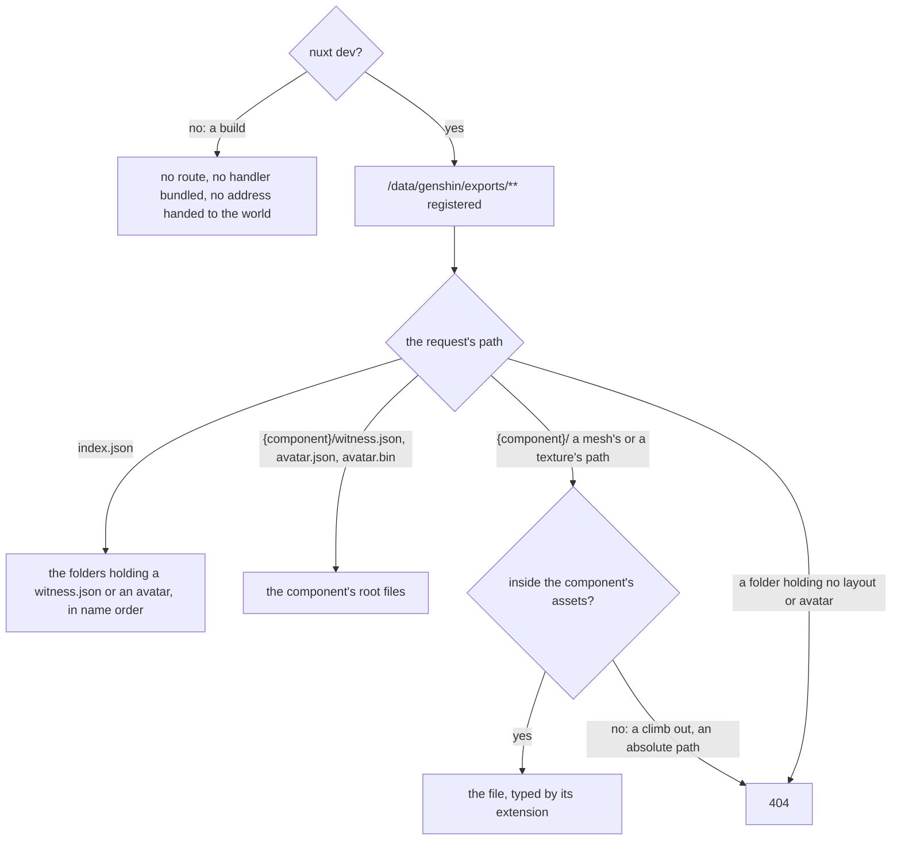
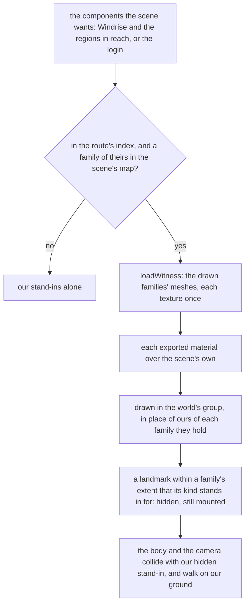

# Development exports

Under `nuxt dev`, the world draws the game's own exported meshes and textures in place of our stand-ins wherever the developer's own extraction holds them: Windrise's great oak, the paving round its statue and the statue itself, each capital's buildings, and the login screen's towers, bridges, walkway and door. Nothing of them is committed, built, uploaded or deployed. The development server reads them from the developer's disk at request time, and a production build registers no route, bundles no handler and hands the world no address, so the deployed world draws our stand-ins alone, re-derived from the same exports one object at a time ([scene derivation](../../scene-derivation/design.md)).

The exports are those `genshin:assets` writes ([derived assets](../design.md)): one folder per component under `~/Esposter/genshin-parity/extracted`, its layout `witness.json` in the folder's root, and the meshes and textures that layout names below the folder's `assets`, by their export folders. The parity page's witness render draws the same layout through the same loader ([parity witness](../../parity/witness/design.md)), so what the development world shows of a component is what its witness render prices our stand-ins against.

## The route

`apps/web/modules/serveGenshinExtractions.ts` registers the route at `GENSHIN_SCENE_EXPORT_BASE_URL` beside the [development packs'](../../characters/development-packs/design.md), and returns before registering either unless Nuxt runs under `nuxt dev`. The route reads the `extracted` folder of the directory `GENSHIN_PARITY_DIRECTORY` names, by default `~/Esposter/genshin-parity`, the folder the parity tooling reads and writes. The server reaches the layout's names through the world package's `genshin-world/sceneExport` entry, which reaches none of its components.

Only a folder the index lists is read, and only its root files (the layout, the avatar's manifest and binary) or a file inside its `assets` folder is served, so no request reaches outside the exports' directory, however its path is encoded. Nothing is cached: an export written again is read again on the next request.

## What the world draws

The app hands the world screen and the game's opening the route's address in development alone (`sceneExportBaseUrl`). Each scene asks `useSceneExports` for the components it wants: Windrise's scene for Windrise's own and each region's in reach, which come and go with the [region data](../../terrain/design.md), and the login scene for the login's. A component is loaded once the index lists it and the scene wants it, and its geometry, materials and textures are freed once it leaves reach or the scene goes; one still loading when it stops being wanted is freed as it arrives.

- **Only the families a scene names are drawn** (`WorldSceneExportFamilyMeshRegexMap`, `LoginPartFamilyMeshRegexMap`), the same families a witness render compares by name: Windrise's oak, paving and statue, each region's buildings, and every family of the login's. A capital's exports weigh over a gigabyte, mostly meshes that no family draws, and only the drawn families' meshes and textures are fetched.
- **A family's parts stand still, so they are drawn as instances.** Its placements of one submesh in one material are one instanced mesh, set once (`loadWitness`): a capital places tens of thousands of parts, and as one object each the renderer walked and projected them in every pass of every frame, holding a run through Windrise to about 39 frames a second where it now holds the display's 60. The login's walkway and door are the families kept a group per part (`MOVING_PART_FAMILIES`): the walkway's pieces sink one by one, and the door's mesh, skinned rigidly, is split into a group per piece its bones carry (`RIGID_PIECE_FAMILIES`, `splitRigidPieces`), its skin read from the JSON exported beside the mesh.
- **An export is lit as the stand-in it replaces.** Each exported material is laid over a material the scene makes (`createWitnessMaterial`): its texture and tint multiply the scene's colour and its emission adds to the scene's, and its rim glow is not drawn, the scene's glow being the one fitted to its frames, so the login's walkway and bridges draw none ([light](../../login-screen/light/design.md)). The world's are `createToonMaterial` over the world's ramp, with the wetness and the rim the environment takes, and the leaf shader's cards `createLeafMaterial`, swaying in the [one wind](../../vegetation/design.md); the login's are the stone's deferred pass from its one stone light ([rendering style](../../rendering-style/design.md)). A leaf card is cut where its texture's alpha falls under the material's cutoff by a mask node, so the sky shows through the gaps rather than a card's background. The cards are not outlined: the outline pass draws a double-sided card's back face inflated and unmasked, as a solid patch in the outline colour, so a leaf material clears both toon flags. Its "_VertexColorMul" is not applied: the export carries no vertex colours, and the multiplier would take the leaf to a dark brown. A part looks as the game draws it as far as our light allows, the game's own lighting being the [passes'](../../../../changes/genshin-recreation-passes/design.md) to re-derive.
- **The ground stays ours.** A terrain tile's export holds its far base map alone, none of the layers the game paints over it near, and the body walks on our heights and the grass grows on our tiles, so Windrise's and every region's ground is drawn from the terrain worker as in production ([terrain](../../terrain/design.md)). Windrise's exports place no grass, and Snezhnaya's no building of its capital yet, so both are drawn from our stand-ins alone.
- **A landmark an export stands in for is hidden, never removed.** The family each landmark kind stands for (`LandmarkKindSceneExportFamilyMap`) has its extent read once as it loads, and a landmark standing within it is hidden (`getExportedLandmarkIds`): the great oak within the exported oak's, a capital within its buildings'. It stays mounted, so the [landmark collider](../../character-controller/design.md) still holds it and the body collides as in production.
- **The login's exports ride the glide as a witness render's parts do**, each family moved with our row, the walkway sinking piece by piece and each of the door's pieces riding the lift of our piece its bone names (`rideLoginWitnessDoor`) ([the login scene](../../login-screen/README.md)). The OBJ holds the door only as it is bound, so drawn as it stands it would appear whole rather than form. The door keeps its own decisions over the export: its pieces cast no shadow, and its panel's material (`LOGIN_DOOR_PANEL_MATERIAL`) lights from the middle when the door is clicked, as ours does. A witness render's own parts are drawn in their place where the parity page provides them.
- **No scene waits on its exports.** A scene is ready on what it waits for in production, and each component's exports appear as they arrive, their load timed as the load step `scene-exports` ([load budget](../../load-budget/design.md)). An index or a component that fails to load is logged, and our stand-ins stay.

## Key files

| File                                                                              | Role                                                                           |
| :-------------------------------------------------------------------------------- | :----------------------------------------------------------------------------- |
| `apps/web/modules/serveGenshinExtractions.ts`                                     | Registers the exports' and the packs' routes under `nuxt dev` alone            |
| `apps/web/server/development/genshinSceneExports.ts`                              | The route: the exports' directory handed to the service                        |
| `apps/web/server/services/genshin/sceneExport/serveGenshinSceneExport.ts`         | Answers the index, a layout or a file inside a component's assets              |
| `apps/web/server/services/genshin/sceneExport/listSceneExportComponents.ts`       | The index: the folders holding a witness layout or an avatar                   |
| `apps/web/server/services/genshin/sceneExport/constants.ts`                       | The parity directory's default, and the folder names read                      |
| `packages/genshin-world/src/composables/useSceneExports.ts`                       | A scene's wanted components loaded, kept while wanted and freed                |
| `packages/genshin-world/src/services/scene/loadWitness.ts`                        | The witness's own loader, which the development world reuses                   |
| `packages/genshin-world/src/services/scene/createWitnessMaterial.ts`              | An exported material laid over the scene's own                                 |
| `packages/genshin-world/src/services/scene/splitRigidPieces.ts`                   | A rigidly skinned submesh split into the pieces its bones carry                |
| `packages/genshin-world/src/services/login/door/rideLoginWitnessDoor.ts`          | The exported door's pieces stood in ours, riding their lift                    |
| `packages/genshin-world/src/services/scene/loadSceneExport.ts`                    | A component's exports with each family's extent in the world's own coordinates |
| `packages/genshin-world/src/services/world/WorldSceneExportFamilyMeshRegexMap.ts` | The families of each component the world draws                                 |
| `packages/genshin-world/src/services/world/getExportedLandmarkIds.ts`             | The landmarks an export draws in place of ours                                 |
| `packages/genshin-world/src/services/world/LandmarkKindSceneExportFamilyMap.ts`   | The family each kind of landmark stands in for                                 |

## Decisions

- **The development world draws the developer's own extraction; nothing of it ships.** Decided by the user on 2026-10-12: under `nuxt dev` alone the world reads the game's exports from the developer's own extraction, as the development packs are read, while the compute queue keeps re-deriving each object for the deployed site. The line is the one the [scene derivation](../../scene-derivation/design.md) draws: nothing of the game's, file, format or data, is ever committed, built, uploaded or deployed. A developer's own copy read on their own machine crosses none of those.
- **The route is the scene layout the witness already reads.** The development world and the parity page's witness draw one layout through one loader, so a family the witness prices is the family the development world draws, and an export's fidelity in the browser is the witness's.
- **Collision and ground stay our data.** An export's meshes run to millions of triangles in a capital, and a collider built over them stalls the main thread; our hidden stand-ins and our ground answer the controller as in production, so nothing the body does differs between a development world and the deployed one.
