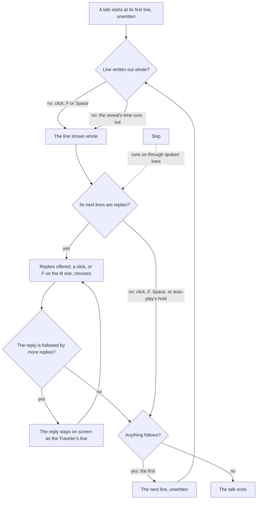
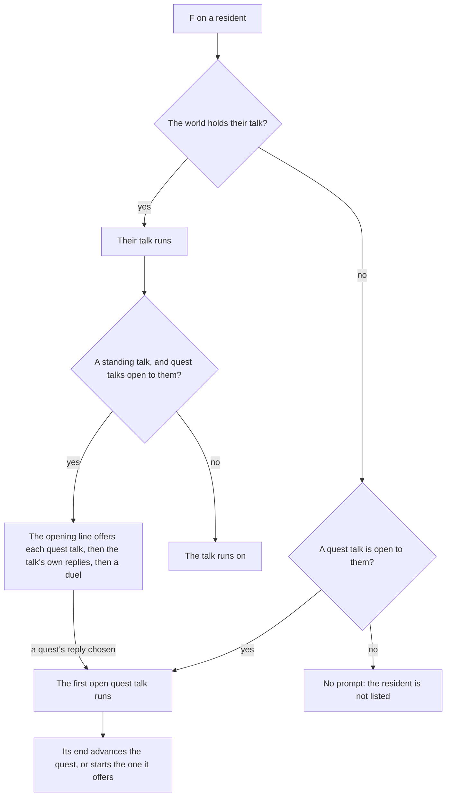

# Dialogue

In the game, a conversation is a run of lines on a band at the foot of the screen, each under its speaker's name and written out a character at a time. The Traveler never speaks a line aloud: their replies are offered down the right as choices, even when only one is on offer. The world holds a conversation the same way the game's data does, as a graph of lines, and runs it with a few pure functions. A screen draws it, and a host wires the clicks, keys and timers to it.

## How it works

### The talk graph

A `Talk` holds its lines and the id of the one it starts at. Each line has its own id, the ids of the lines that may follow it and its words' text id. There are two kinds of line:

- **A spoken line** names its speaker's name and title by text id, both empty for a narration and the title empty for a speaker without one, and the voice-over the game files it under, which is empty for an unvoiced line.
- **A choice** is one of the Traveler's replies. It carries the mark the game draws beside it: a plain reply or chat, a choice that starts a quest, or one that starts a story quest. These are the names the wiki's transcripts use for the game's marks.

A talk also names the characters the game begins it on, by their NPC id, none for a talk begun on no one. Both kinds of line have Zod schemas, so a talk that is fetched or generated is checked before it runs. The words are never in the graph. A host hands the screen the talk's text map, its words by text id in the reader's language, as [game text](../game-text/design.md) does for the interface's own words.

### Read from the dialog table

`genshin:text quests` reads each carried quest's talks from the community dump's dialog and talk tables (`readTalk`), as the [quests](../quests/design.md) page describes, and `genshin:text standing-talks` reads the residents' standing talks the same way. A talk's dialogs are the hundred numbered after its id, and the talk table ("TalkExcelConfigData") names the characters it is begun on. A dialog the Traveler speaks (`TALK_ROLE_PLAYER`) becomes a reply. Every other dialog becomes a spoken line, its speaker named by the character table's name for the dialog's role id, and titled by the manual text map's `NPC_TITLE_<id>` for that id where the map holds one. A black screen's dialog (`TALK_ROLE_BLACK_SCREEN`, "TALK_ROLE_NEED_CLICK_BLACK_SCREEN" and their `CONSEQUENT_` forms) has a role id the character table does not hold, so it has neither, and that empty speaker is what marks it a narration: the schema keeps no field of its own for one. The titles' words are published in every language with the quests' other words.

### The runner

Where a talk stands is a `TalkProgress`: the id of the line on screen, empty once the talk has ended, and whether its words are all written out. Four pure functions move it:

- **`advanceTalk`** is a click, F or Space. A line still being written out is shown whole. A whole line goes on to the first of its next lines, as the game would pick one by a quest's state. A line nothing follows ends the talk. A line that offers replies waits, and an ended talk stays ended.
- **`chooseTalkLine`** chooses one of the replies on offer, and refuses one that is not on offer. The talk goes on down the reply's branch, or ends where nothing follows it. A reply followed straight by more replies stays on screen as the Traveler's own line while the next ones are offered.
- **`skipTalk`** runs on to the next line that offers replies, written out whole, or to the end, so a skip never answers for the player. A talk whose spoken lines loop back without a reply between them is refused, since it would never get anywhere.
- **`getTalkChoices`** gives the replies a line offers: those of its next lines that are choices.

### On screen

`DialogueScreen` in `genshin-interface` draws a talk's state and nothing else. It shows the speaker's name over the line, their title between the two when they have one, and lays the line out whole with its unwritten tail held in place unseen, so the line never rewraps as it is written. A line with no speaker is a narration, drawn centred on a black screen. The replies run down the right, each beside its mark (`DialogueChoiceIconPathMap`, traced from the wiki's copies of the game's files), with the one F would choose lit once one is. A screen reader hears the whole line once, not its characters one by one.

`DialogueTalk` in `genshin-world` runs a talk over the world. The world screen mounts it while the talk screen is open, with the talk its resident began, the words of the quests and the standing talks, and the quest talks its opening line offers, and its end sets the world back. The talk screen hides the HUD and lets the pointer go for the replies, and holds nothing else ([screens](../screens/design.md)).

- **The player is filled into every word.** The line, each reply and the speaker's name and title pass through `fillLinePlaceholders`, the nickname being the game's own title for the Traveler, filled as the login fills it, and each word per gender the login's twin's (`LOGIN_TRAVELER_GENDER`). Both stand in until the world holds a player profile.
- **The line is written out** a character at a time, one each `TALK_REVEAL_MS_PER_CHARACTER`, over the filled line. A space or a line break takes no time of its own and shows with the character before it (`getTalkRevealedLength`), so the line is whole the moment its last character is written.
- **A click goes on, and so do F and Space.** These keys are read off the engine's own `InputActionBindingMap`, as its Interact and Jump, so they stay the game's default bindings. While replies are on offer, none is lit until the pointer passes over one or an arrow lights the first, F chooses the lit one, and the arrows move the light between them.
- **Auto-play** holds each whole line for `TALK_AUTO_PLAY_HOLD_MS` and then goes on, stopping at replies. Its button reads the game's own "Auto" and "Playing".
- **Skip** runs on to the next replies or to the end, an opening line's quest talks and duel among them. Its button reads the game's own "Skip".
- **A reply's speaker is the Traveler**, named with the game's own title for them.

### Residents

A region's data lists its residents beside its landmarks. Each resident has the game's own id, a name by text id, their day and night spots (either one absent for a resident the game shows at one time only), their catalogue area, and the talk F begins with them. The [resident schedules](../resident-schedules/design.md) page places them at the hour. The [quests](../quests/design.md) page's navigation finds a resident by their id or by their talk's id, and a talk-to objective's beam rises over the first character its talk is begun on.

### Standing talks

A resident's standing talk is the talk the game begins when the player presses F on them with no quest in the way: their greeting, and what they say about themselves. `mapNpcStandingTalkIds` picks it from the talk table alone. It is a talk begun by the player (`TALK_BEGIN_MANUAL`), that belongs to no quest, loads with no activity, waits on no condition and has a first dialog, and where an NPC has several, the lowest-numbered one is theirs. `genshin:assets residents` gives each resident that talk where the talk table holds one.

`genshin:text standing-talks` publishes every resident's standing talk as one record, `standingTalks/residents`, and their words in every language under `standingTalkText`. A dialog with no words in the English text map, which marks one that only plays an action, is skipped, and the talk goes on from the line before it to the line after it (`skipWordlessTalkLines`). A talk where that cannot be done is left out and counted: a reply with no words, a wordless line that branches, or a talk with no words at all. Its resident then holds no talk the world can begin.

The world reads both records as the session starts (`useWorldTalks`). It holds the talks of the quests in progress, the talks offering each quest not yet started, and the standing talks in one map by id, the quest's winning an id both share, and one text map of their words.

**The opening line offers the quest talks open to the resident.** `getTalkOffers` finds them: each talk offering a quest not yet started, and each talk-to objective of the step a quest in progress is on, not yet met, whose talk is begun on one of the characters the standing talk is begun on. Each is a reply with its quest's mark, a quest's or a story quest's, named by the quest's title. They are offered ahead of the talk's own replies and the card game's duel. Choosing one leaves the standing talk for the quest's, and its end advances the quest as any talk does, or starts the quest it offers ([quests](../quests/design.md)). A quest's own talk offers none. A resident whose standing talk the world does not hold begins the first quest talk open to them instead, and one with neither is not listed.

While the opening line offers a quest talk or a duel, auto-play and Skip stop there, as at any line offering replies. A click, F or Space waits there only for the talk's own replies, so a standing talk whose opening line has none goes on past the offers to its next line.

- **A black screen's narration sits at the screen's middle, with no speaker or title.** A line whose dialog names no speaker (`TALK_ROLE_BLACK_SCREEN` and its forms) is drawn at the middle, a best estimate no published frame has shown yet.
- **A quest reply's mark is traced as one disc, and a story quest's as one diamond.** Both are drawn in the reply's colour; the game's mark inside its gold ring, split from its outline, would replace them.
- **A resident's quest-title reply opens a quest talk ahead of their own replies.** Each quest talk is offered on the standing talk's opening line, named by its quest's title, a best estimate no published source shows.
- **The PC client writes at the PlayStation's rate.** `TALK_REVEAL_MS_PER_CHARACTER` is 30 milliseconds, from a public PlayStation recording writing a character every 1.8 frames at 60 frames a second, a space taking no time.
- **Auto-play's hold for a whole line is a best estimate.** `TALK_AUTO_PLAY_HOLD_MS` is about a second and a half, as no published clip shows a line with no voice-over under auto-play.

## Parity

Registered, not yet within the bar. Five references are cut from the English PC client's dialogue in `yt-nWBqOXWZuFg.mp4` (1280 by 720) and shot as `DialogueTalk`, which takes a `startProgress` naming the line the talk is held on, so each state is the reference's own props rather than the reveal's clock. Sara's line with the Traveler's two replies is scored three ways, the speaker, the line and the replies, at 19 seconds. Sara's line with no replies is at 23 seconds, and Paimon's line at 29 seconds.

The five are judged over their clean plate, the reference frame with its scored region filled from its surroundings (`isBackdrop`, see Parity above), so the overlay is scored against what the world shows there. The bare render is that plate with nothing drawn on it, so a state beats its bare render only by drawing the dialogue closer than the plate already is.

| Reference                  | Plate, component blurred | Plate, softened shot | Bare render |
| :------------------------- | :----------------------- | :------------------- | :---------- |
| `dialogue-choices-line`    | 8.66%, FLIP 0.2807       | 9.22%, FLIP 0.2912   | 9.64%       |
| `dialogue-choices-replies` | 15.08%, FLIP 0.4770      | 14.34%, FLIP 0.4678  | 17.80%      |
| `dialogue-choices-speaker` | 8.38%, FLIP 0.3228       | 7.79%, FLIP 0.3167   | 12.60%      |
| `dialogue-line`            | 10.47%, FLIP 0.3740      | 10.80%, FLIP 0.3844  | 11.65%      |
| `dialogue-paimon-line`     | 9.73%, FLIP 0.3121       | 9.98%, FLIP 0.3151   | 11.86%      |

Every state beats its bare render, by 0.4 to 4.8 points, which is not yet the roadmap's 2% bar. What moved each figure:

- **Position.** The line's first ascender lands on the reference's row, 591 of 720 for Sara's lines. The speaker's role line, `Waitress, Good Hunter`, sits between the name and the line and is drawn from the talk line's `speakerRoleTextId`. Paimon's line has no role, so its line sits a role's height higher, as the frame shows: scored at the role's place it was 21.93%, and at the frame's place 9.73%. The margin under the name is 13.5 units, so the line sits 30 units under the name with a role and 13.5 without.
- **Size and letter spacing.** The line is 26 units with 2.3 units of letter spacing, where it was 32 units. Its x-height and ascender then match the recording's, and its width matches within four pixels.
- **Softness.** The recording is soft and the game's face is not Signika, so a glyph a pixel off its place scores twice. The component is drawn crisp, and the comparison blurs our shot by the recording's own measured blur (`yt-nWBqOXWZuFg.mp4`, sigma 0.641, see the toolbox's Softness). A component blurred to the recording scored `dialogue-line` 0.33 points better (10.47%), but that blur is the video's and not the game's, so it is not shipped.
- **Colour.** The line stays white, the recording's peak. A paler white scored lower only by making up for the blur, so it was refused.
- **Band.** The band's gradient stays removed. Restored at 0.3 and 0.5, it scored worse on the three line states and on Paimon's line (`dialogue-line` 11.96% and 13.61%), and better only on the speaker.
- **Replies.** The pill's darkness is 0.22 of black, the best of 0.15 to 0.45 swept against the plate. The text starts 48 units in, past the mark's place, and moving the first pill up three pixels scored worse (23.78% against 22.03%), so its top stays where it was.

The reveal is timed off three lines of `yt-9I7XyJ2Z5RI-dialogue-npc-60.mp4` (Notes), and auto-play's hold waits on `dialogue-auto-skip.mkv`.

## Key files

| File                                                                    | Role                                                                           |
| :---------------------------------------------------------------------- | :----------------------------------------------------------------------------- |
| `packages/genshin-world/src/models/dialogue/Talk.ts`                    | A talk: its lines and where it starts, with its schema                         |
| `packages/genshin-world/src/models/dialogue/TalkLine.ts`                | A line: spoken, with its speaker and voice, or one of the replies              |
| `packages/genshin-world/src/services/dialogue/advanceTalk.ts`           | A click, F or Space: written out whole, on to the next, or the end             |
| `packages/genshin-world/src/services/dialogue/chooseTalkLine.ts`        | A reply chosen, and the branch it leads down                                   |
| `packages/genshin-world/src/services/dialogue/skipTalk.ts`              | On to the next replies or the end                                              |
| `packages/genshin-world/src/services/dialogue/constants.test.ts`        | The hand-written sample talk every runner suite walks                          |
| `packages/genshin-world/src/services/dialogue/constants.ts`             | The measured reveal and the provisional auto-play hold                         |
| `packages/genshin-world/src/services/dialogue/getTalkRevealedLength.ts` | How much of a line is written out, a space taking no time                      |
| `packages/genshin-world/src/components/Dialogue/Talk/Index.vue`         | A talk run over the world: the player filled in, reveal, keys, auto-play, skip |
| `packages/genshin-world/src/components/World/Session/Index.vue`         | Mounts the talk over the world while its screen is open                        |
| `packages/genshin-interface/src/components/DialogueScreen/Index.vue`    | The speaker's name and title, the line or a narration, and the replies         |
| `packages/genshin-interface/src/models/DialogueChoiceIcon.ts`           | The marks a reply is drawn beside                                              |
| `packages/genshin-interface/src/services/DialogueChoiceIconPathMap.ts`  | Each mark's traced path                                                        |
| `scripts/src/services/genshinText/readTalk.ts`                          | A talk read from the dialog table: replies, speakers, titles, narration        |
| `packages/genshin-world/src/models/world/Resident.ts`                   | A resident placed in a region's data, and the talk F begins with them          |
| `scripts/src/services/genshinText/mapNpcStandingTalkIds.ts`             | Each NPC's standing talk, picked from the talk table                           |
| `scripts/src/services/genshinText/skipWordlessTalkLines.ts`             | A talk with its wordless lines skipped, or none where that cannot be done      |
| `scripts/src/services/genshinText/buildStandingTalks.ts`                | `genshin:text standing-talks`: the residents' standing talks and their words   |
| `packages/genshin-world/src/services/resident/readStandingTalks.ts`     | The standing talks read from the hosted game data                              |
| `packages/genshin-world/src/composables/useWorldTalks.ts`               | The talks held by id, their words, a resident's prompt and the offers          |
| `packages/genshin-world/src/services/dialogue/getTalkOffers.ts`         | The quest talks open to a talk's characters, each with its quest's mark        |

## Notes

- **The reveal is timed word by word.** Three of Xinyan's lines in a public recording at 60 frames a second each write a character every 1.79 to 1.81 frames, 30 milliseconds. The time each word's first character appears fits a line through the characters it follows three times as closely when the spaces are left uncounted, so a space takes no time. Each character appears whole in one frame, with no fade of its own; the line's first word comes in under the band's own fade. The recording is the PlayStation client's, its prompts on the square and cross buttons, and the PC's rate is taken to be the same, which the roadmap's manual verification list asks. The 720 high recording the screen is placed by shows its lines whole in their first frame, so the reveal could not be read there.
- **The auto-play hold is a best estimate.** `TALK_AUTO_PLAY_HOLD_MS` waits on `dialogue-auto-skip.mkv`: the recording the reveal is timed off goes on at the player's press, with auto-play off, and the published clips with auto-play on hold voiced lines or are clicked through. It is on the roadmap's manual verification list.
- **The screen's place and colour are read off one frame.** The speaker's name is gold `#ffc700`, the brightest saturated pixel of its letters. The replies are dark pills 45 high and 15 apart, the first at 1275 by 698 of 1920 by 1080. The screen is drawn over the clean plate of its frame (Parity above), so the score covers the band's text and the pills over the game's own scene, and the band has no gradient, since the game's scene under its line is not darkened.
- **A title is the manual text map's, not the dialog's.** The dialog table's own "talkTitleTextMapHash" resolves to no text, while the manual text map's "NPC_TITLE_1419" and "NPC_TITLE_15241" both read "Waitress, Good Hunter", the title over Sara's line in the recording. So a speaker's title is looked up by their character id there, and a character with no such key, Paimon among them, has none.
- **Only a character's line names its speaker.** The dialog table also holds lines a gadget or the Traveler's twin speaks ("TALK_ROLE_GADGET", "TALK_ROLE_MATE_AVATAR"), whose role ids the character table does not hold either, so the reader would give such a line no speaker and the screen would draw it as a narration. None of the carried quests' talks holds one, so it waits until a carried quest's talk does.
- **A narration's place is a best estimate.** No published recording read so far shows a black screen's line, so its place at the screen's middle is provisional, on the roadmap's manual verification list.
- **The Confirm prompt is not drawn.** The frame shows a controller's X mark and the word Confirm bottom right. The keyboard client's key for it is the reader's call.
- **The selected reply's look is not settled.** Both replies in the frame are the same dark pill, and the first is marked by a controller's X prompt, which the keyboard client does not show. So the replies start unlit on every line, as the frame shows them, and the screen lights a reply white only once the pointer or an arrow selects it, a look no frame shows.
- **No voice plays.** A line carries the id of its voice-over, but nothing of the game's audio ships, so the voice-over is never played.
- **A standing talk is the talk table's alone.** The talk table names the characters each talk is begun on, so a resident's standing talk needs only their NPC id. The scene's groups decide only whether an NPC is placed at all, which [resident schedules](../resident-schedules/design.md) reads from their birth records, and no standing talk waits on one of their conditions.
- **An offer's words and place are best estimates.** No published source shows the words of a reply that begins a quest's talk, or where it sits among a resident's own replies. So it reads its quest's title and comes first, both on the roadmap's manual verification list.
- **Many residents hold no talk the world can begin.** The community dump has no words for many dialogs in any language, so a talk made only of those is left out of the record and its resident gets no prompt. Each run of `genshin:text standing-talks` reports how many it left out, and the words come with the install's own text, as the [quests proposal](../../../changes/genshin-quests/design.md) decides.
- **Two marks are silhouettes.** A trace keeps the ink's outline, so the wiki's `File:Icon Dialogue Quest.png` mark is one disc with no exclamation mark in it and `File:Icon Dialogue Story Quest.png`'s nested diamonds are one diamond, each drawn in the reply's own colour rather than the game's gold. Both are provisional until each inner mark is split from its outline; the plain reply's speech bubble keeps its three dots.

## Sources

- [Template:DIcon](https://genshin-impact.fandom.com/wiki/Template:DIcon), Genshin Impact Wiki: the marks the game draws beside a dialogue choice, a plain reply or chat, a quest and a story quest among them.
- [Controls](https://genshin-impact.fandom.com/wiki/Controls), Genshin Impact Wiki: F as Pick Up/Interact and Space as Jump, the keys a talk goes on with.
- [Genshin Impact dialogue choices](https://www.youtube.com/watch?v=nWBqOXWZuFg), an English-language public recording of the dialogue choices at 720 high, with controller prompts: the reply frame the screen is placed by. Its lines show whole in their first frame, so the reveal is not read off it.
- [Fischl island every NPC dialogue](https://www.youtube.com/watch?v=9I7XyJ2Z5RI), Nierly Good, 2022: a public recording of the English PlayStation client's talks at 1080 high and 60 frames a second, each line written out a character at a time, the reveal's rate read off it.
- [NPC](https://genshin-impact.fandom.com/wiki/NPC), Genshin Impact Wiki: the world's characters, those met in the open world and those met only in quests.
- [AnimeGameData](https://github.com/DimbreathBot/AnimeGameData), the community's per-patch dump: the talk table's talks, each with the characters it is begun on and what it waits on, the dialog table's lines, each naming the ones that follow it and its speaker's role, with the Traveler's lines offered as choices and a black screen's naming no speaker, and the manual text map's character titles.
- `world-dialogue.mkv` — talking to a resident through a line with replies to choose. Found 2026-10-11: https://www.youtube.com/watch?v=uGtyP02Ie2Q at 0–40 s (`captures/yt-uGtyP02Ie2Q-0-40.mp4`).
- `dialogue-reveal.mkv` — three lines of one talk at 60 frames a second, each from its first frame to the last, the scene held still: the line written out a character at a time, or shown whole if the game does not write it. Found 2026-10-11: https://www.youtube.com/watch?v=9I7XyJ2Z5RI at 0–30 s (`captures/yt-9I7XyJ2Z5RI-dialogue-npc-60.mp4`), the PlayStation client.

## Reference

- `dialogue-auto-skip.mkv` — a talk with auto-play switched on through three lines, then Skip pressed, with the Auto and Skip buttons in view, their look and their keys shown. Partly found 2026-10-11: https://www.youtube.com/watch?v=uGtyP02Ie2Q at 0–40 s (`captures/yt-uGtyP02Ie2Q-0-40.mp4`); still sought: skip being pressed, with its look and keys. No source in the clip shows the Skip button pressed. No still of a talk with Skip pressed: the Dialogue, Auto Play and Settings articles have no whole-screen image. Also still sought: a line with no voice-over held whole under auto-play until the next begins, for its hold. Searched 2026-10-11 on YouTube: PM26QZHjraQ's lines under auto-play are Katheryne's voiced ones, y53hoUs8MK0's are clicked through, each made whole and gone within a fifth of a second, and 7WzdUObSfII shows the mobile setting for talk bubbles.
