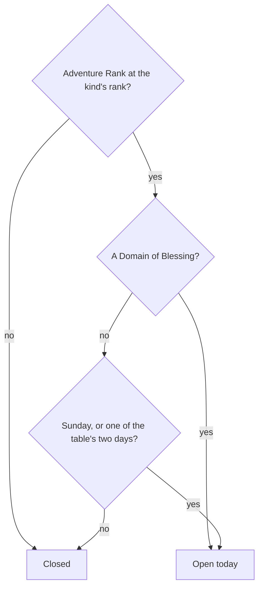

# Domains

A domain is an instance behind a temple-like entrance, challenged for a reward. The game opens each kind by [Adventure Rank](../adventure-rank/design.md) and, for Forgery and Mastery, by the day of the week. This page is those opening rules as pure checks in `genshin-world`, the first part of the [domains proposal](../../../changes/genshin-domains/design.md). Nothing enters a domain yet, so no screen reads them.

## Decisions

- **Each kind opens at its rank.** `DomainOpenRankMap` holds Forgery at 16, Blessing at 22 and Mastery at 27, the ranks the proposal states. `checkIsDomainKindOpenAtRank` is open from the rank on. The wiki's Domain page gives the same three ranks (see Sources).
- **A Domain of Blessing opens every day.** Its set days are not read.
- **A Domain of Forgery or Mastery opens every Sunday and on its two set days.** `checkIsDomainKindOpenOnDay` takes the moment checked and the two weekdays the table sets for the kind, and reads the moment's game day from the reset clock. A Sunday opens every kind, as the wiki's Domain page gives it for every stage (see Sources). Weekdays are Temporal's, Monday 1 to Sunday 7, with `SUNDAY_DAY_OF_WEEK` for Sunday.
- **The day is the game's day.** The moment checked is read on the reset clock, so its game day turns at 04:00 in UTC+8 as the game's server does and as [Original Resin](../original-resin/design.md) counts its Primogem refills. A moment before that reset is still the previous game day, and a Domain of Forgery's day turns at the reset, not at midnight. The wiki's Reset page rotates the Domains of Forgery at the daily reset (see Sources), but gives only the player's server time zone, so UTC+8 rests on the resin page's rule.

## How it works

## Not built yet

- **The entrances and their landmark.** Each entrance is placed from the streaming records, which the fit does not read yet. No `LandmarkKind` is added until a fit produces one.
- **The days each kind sets.** They sit in DailyDungeonConfigData, which the dump does not hold, so no caller passes them yet. DungeonExcelConfigData and DungeonEntryExcelConfigData are missing from the dump too, so the levels wait on the same reader.
- **The levels, challenges and scenes.** Waves, time limits, ley line disorders and the domain's own scene wait on those tables and on scene derivation.
- **The Petrified Tree's reward.** Its claim is already priced at 20 as a domain blossom ([Original Resin](../original-resin/design.md)). Its reward rows wait on BlossomChestExcelConfigData, which the dump does not hold.
- **One-time domains and the quests' unlocks.** The first-clear rewards come with their table rows. A kind opens by its rank alone here, and an unlock by a quest, apart from the rank checks, waits on the wiki's quest rows being read.

## Key files

| File                                                                         | Role                                                                                                |
| :--------------------------------------------------------------------------- | :-------------------------------------------------------------------------------------------------- |
| `packages/genshin-world/src/models/domains/DomainKind.ts`                    | The kinds that open by rank and by the day: Blessing, Forgery and Mastery                           |
| `packages/genshin-world/src/services/domains/DomainOpenRankMap.ts`           | Each kind's Adventure Rank of opening                                                               |
| `packages/genshin-world/src/services/domains/constants.ts`                   | The Sunday weekday, numbered as Temporal numbers it                                                 |
| `packages/genshin-world/src/services/domains/checkIsDomainKindOpenAtRank.ts` | Open at the kind's rank or above                                                                    |
| `packages/genshin-world/src/services/domains/checkIsDomainKindOpenOnDay.ts`  | Open on the game day of a moment: every day for Blessing, Sundays and the table's days for the rest |

## Sources

- [Domain](https://genshin-impact.fandom.com/wiki/Domain), Genshin Impact Wiki: the unlocking ranks, "Players must reach Adventure Rank 16 or complete For a Tomorrow Without Tears" for Forgery, and 22 and 27 for Blessing and Mastery. Its Challenge Domains give each stage three days a week, with "the third day, Sunday, being consistent for all stages". The quests it names are not built, and it does not name the set days.
- [Reset](https://genshin-impact.fandom.com/wiki/Reset), Genshin Impact Wiki (cached under Daily Reset): "The daily reset occurs at 04:00 (4 AM), based on the player's server's time zone." Under daily reset, "Domains of Forgery (Weapon Ascension Materials) and Domains of Mastery (Talent Level-Up Materials) rotate."

## Open

- [ ] **A Domain of Blessing opens every day** — no source yet: the Domain page, checked, gives each stage of the Challenge Domains three days each week, which does not state every day; the Domain of Blessing page is not in the cache, and `DailyDungeonConfigData` keys its day rows by obfuscated names with no weekday mapping read here.
- [ ] **Forgery and Mastery open on their two set days** — no source yet: the Domain page, checked, gives Sunday for every stage and two set days a stage without naming them, and the same `DailyDungeonConfigData` rows are unmapped to weekdays.
- [ ] **The day's 04:00 turn is in UTC+8** — no source yet: the wiki's Reset page, checked, gives the daily reset at 04:00 "based on the player's server's time zone", not in UTC+8.
