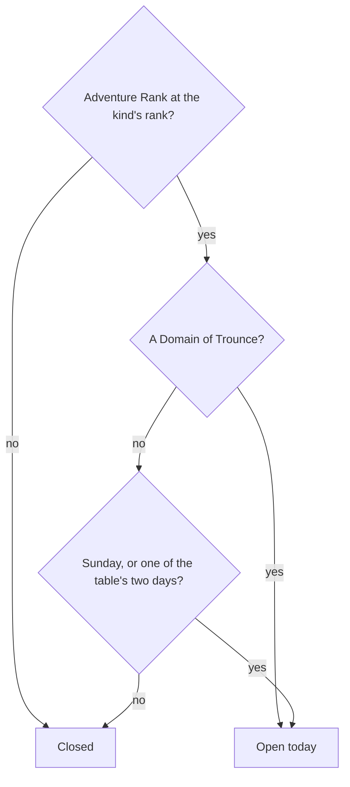

# Domains

A domain is an instance behind a temple-like entrance, challenged for a reward. The game opens each kind by [Adventure Rank](../adventure-rank/design.md) and, for Forgery and Mastery, by the day of the week. This page is those opening rules as pure checks in `genshin-world`, the first part of the [domains proposal](../../../changes/genshin-domains/design.md). Nothing enters a domain yet, so no screen reads them.

## Decisions

- **Each kind opens at its rank.** `DomainOpenRankMap` holds Forgery at 16, Blessing at 22 and Mastery at 27, the ranks the proposal states. `checkIsDomainKindOpenAtRank` is open from the rank on. The wiki's Domain page is not yet read for them (see Open).
- **A Domain of Blessing opens every day.** Its set days are not read: the builder gives every Blessing level all seven weekdays (`scripts/src/services/genshinAssets/domains/toDomainLevels.ts`), so a caller passing those seven weekdays to `checkIsDomainKindOpenOnDay` opens it every day.
- **A Domain of Forgery or Mastery opens every Sunday and on its two set days.** `checkIsDomainKindOpenOnDay` takes the moment checked and the two weekdays the table sets for the kind, and reads the moment's game day from the reset clock. A Sunday opens every kind. Weekdays are Temporal's, Monday 1 to Sunday 7, with `SUNDAY_DAY_OF_WEEK` for Sunday.
- **The day is the game's day.** The moment checked is read on the reset clock, so its game day turns at 04:00 in UTC+8 as the game's server does and as [Original Resin](../original-resin/design.md) counts its Primogem refills. A moment before that reset is still the previous game day, and a Domain of Forgery's day turns at the reset, not at midnight. This call is settled from the resin page's rule, not from a new source.

## How it works

## Not built yet

- **The entrances and their landmark.** Each entrance is placed from the streaming records, which the fit does not read yet. No `LandmarkKind` is added until a fit produces one.
- **The days each kind sets.** They sit in DailyDungeonConfigData, which the dump holds under obfuscated keys (`~/Esposter.noindex/genshin-parity/text/ExcelBinOutput/DailyDungeonConfigData.json`) and no builder reads, so no caller passes them yet. The builder reads DungeonExcelConfigData and DungeonEntryExcelConfigData (`scripts/src/services/genshinAssets/domains/buildDomainLevels.ts`).
- **The levels, challenges and scenes.** Waves, time limits, ley line disorders and the domain's own scene wait on those tables and on scene derivation.
- **The Petrified Tree's reward.** Its claim is already priced at 20 as a domain blossom ([Original Resin](../original-resin/design.md)). Its reward rows wait on BlossomChestExcelConfigData, which the dump holds (`~/Esposter.noindex/genshin-parity/text/ExcelBinOutput/BlossomChestExcelConfigData.json`) and no builder reads yet.
- **One-time domains and the quests' unlocks.** The first-clear rewards come with their table rows. A kind opens by its rank alone here, and an unlock by a quest, apart from the rank checks, waits on the wiki's quest rows being read.

## Key files

| File                                                                         | Role                                                                                                                |
| :--------------------------------------------------------------------------- | :------------------------------------------------------------------------------------------------------------------ |
| `packages/genshin-world/src/models/domains/DomainKind.ts`                    | The four kinds, each open from its rank; Blessing, Forgery and Mastery also by the day, Trounce every day           |
| `packages/genshin-world/src/services/domains/DomainOpenRankMap.ts`           | Each kind's Adventure Rank of opening                                                                               |
| `packages/genshin-world/src/services/domains/constants.ts`                   | The Sunday weekday, numbered as Temporal numbers it                                                                 |
| `packages/genshin-world/src/services/domains/checkIsDomainKindOpenAtRank.ts` | Open at the kind's rank or above                                                                                    |
| `packages/genshin-world/src/services/domains/checkIsDomainKindOpenOnDay.ts`  | Open on a moment's game day: every day for Trounce, else Sundays and the weekdays passed in, all seven for Blessing |

## Sources

- [Domains](https://genshin-impact.fandom.com/wiki/Domains), Genshin Impact Wiki: the unlocking ranks, not yet read: the page is not in the cache (see Open). The quest unlocks and the weekday schedule are not read yet.
- [Daily Reset](https://genshin-impact.fandom.com/wiki/Daily_Reset), Genshin Impact Wiki: the Domains of Forgery and Mastery turning at the reset. Not yet read, for the same reason.

## Open

- [ ] **Ranks 16, 22 and 27 open the three kinds** — no source yet: the wiki's Domain page is not in the cache, and no table read here ties 22 or 27 to a kind.
- [ ] **A Domain of Blessing opens every day** — no source yet: the wiki's Domain page is not in the cache, and `DailyDungeonConfigData` keys its day rows by obfuscated names with no weekday mapping read here.
- [ ] **Forgery and Mastery open on Sundays and their two set days** — no source yet: the same `DailyDungeonConfigData` rows are unmapped to weekdays, and the wiki's Domain page is not in the cache.
- [ ] **A Domain of Trounce opens every day** — no source yet: the wiki's Domain page is not in the cache.
- [ ] **The game's day turns at 04:00 in UTC+8** — no source yet: the wiki's Daily Reset page is not in the cache.
- [ ] **A Domain of Forgery's day turns at the reset, not at midnight** — no source yet: the wiki's Daily Reset page is not in the cache.
