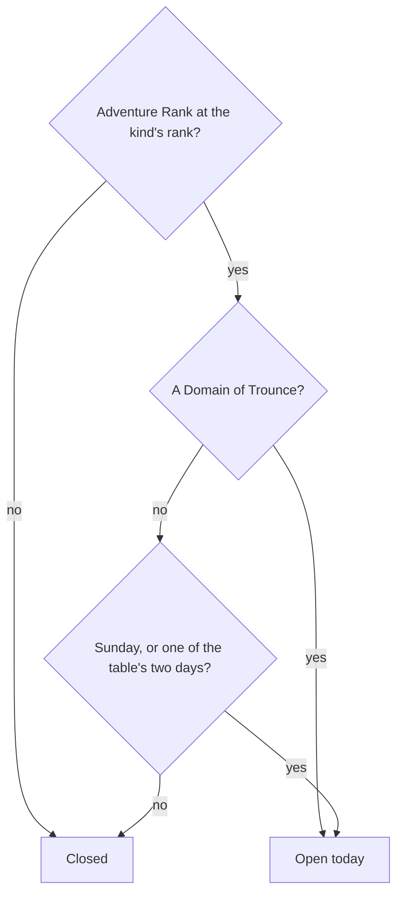

# Domains

A domain is an instance behind a temple-like entrance, challenged for a reward. The game opens each kind by [Adventure Rank](../adventure-rank/design.md) and, for Forgery and Mastery, by the day of the week. This page is those opening rules as pure checks in `genshin-world`, the first part of the [domains proposal](../../../changes/genshin-domains/design.md). The world session reads them through its domains composable.

## Decisions

- **Each kind opens at its rank.** `DomainOpenRankMap` holds Forgery at 16, Blessing at 22 and Mastery at 27, the ranks the proposal states. `checkIsDomainKindOpenAtRank` is open from the rank on. The wiki's Domain page gives the same ranks (`{data-root}/cache/genshin-wiki/Page_Domain.json` wikitext lines 29, 35 and 41), and says a Domain of Trounce opens on every day of the week (line 47).
- **A Domain of Blessing is open every day.** The game gives Blessing no set days: each Blessing entry's `descriptionCycleRewardList` holds four empty day lists (`{data-root}/genshin-parity/text/ExcelBinOutput/DungeonEntryExcelConfigData.json`, all 22 Blessing entries), and the daily dungeon table (`{data-root}/genshin-parity/text/ExcelBinOutput/DailyDungeonConfigData.json`) names only levels of Forgery and Mastery. The builder gives every Blessing level all seven weekdays (`scripts/src/services/genshinAssets/domains/toDomainLevels.ts`), so a caller passing those seven weekdays to `checkIsDomainKindOpenOnDay` finds it open every day. The wiki's Domain page says three days a week (`{data-root}/cache/genshin-wiki/Page_Domain.json` wikitext line 25), but that line describes the three stages of Forgery and Mastery, each with its own pair of days, and the wiki's Domain of Blessing page names no day (`{data-root}/cache/genshin-wiki/Page_Domain_of_Blessing.json`).
- **A Domain of Forgery or Mastery opens every Sunday and on its two set days.** `checkIsDomainKindOpenOnDay` takes the moment checked and the two weekdays the table sets for the kind, and reads the moment's game day from the reset clock. A Sunday opens every kind, as the wiki's Domain page gives it for each stage of Forgery and Mastery (`{data-root}/cache/genshin-wiki/Page_Domain.json` wikitext line 25). Weekdays are Temporal's, Monday 1 to Sunday 7, with `SUNDAY_DAY_OF_WEEK` for Sunday.
- **The day is the game's day.** The moment checked is read on the reset clock, so its game day turns at 04:00 in UTC+8 as the game's server does and as [Original Resin](../original-resin/design.md) counts its Primogem refills. A moment before that reset is still the previous game day, and a Domain of Forgery's day turns at the reset, not at midnight. The wiki's Reset page gives the 04:00 reset (`{data-root}/cache/genshin-wiki/Page_Reset.json` wikitext line 2) and names the Domains of Forgery and Mastery among what it rotates (line 15); the wiki's Escoffier talent page puts the Asia server's Monday 4:00 AM reset at GMT+8 (`{data-root}/cache/genshin-wiki/Category_Escoffier_Talents.json` wikitext line 5), the weekly reset the Reset page times at the same 04:00.
- **The Petrified Tree's reward comes from the level's own reward data.** Its claim is priced as a domain blossom in `packages/genshin-world/src/services/originalResin/BlossomClaimResinMap.ts` ([Original Resin](../original-resin/design.md)). Its items are the level's `treeRewards`, which the builder writes from the dungeon's reward preview and the day-cycle book rewards of its entry (`scripts/src/services/genshinAssets/domains/toDomainLevel.ts`), and `claimPetrifiedTree` draws and routes them (`packages/genshin-world/src/services/domains/claimPetrifiedTree.ts`). Rejected: reading them from the blossom chest table the dump holds (`{data-root}/genshin-parity/text/ExcelBinOutput/BlossomChestExcelConfigData.json`), since no builder reads that table and the reward preview already carries the tree's items.

## How it works

## Not built yet

- **The days Forgery and Mastery set.** They sit in DailyDungeonConfigData, which the dump holds under obfuscated keys (`{data-root}/genshin-parity/text/ExcelBinOutput/DailyDungeonConfigData.json`) and no builder reads, so no caller passes them yet. The builder reads DungeonExcelConfigData and DungeonEntryExcelConfigData (`scripts/src/services/genshinAssets/domains/buildDomainLevels.ts`).
- **The levels, challenges and scenes.** Waves, time limits, ley line disorders and the domain's own scene wait on those tables and on scene derivation.
- **One-time domains and the quests' unlocks.** The first-clear rewards come with their table rows. A kind opens by its rank alone here, and an unlock by a quest, apart from the rank checks, waits on the wiki's quest rows being read.

## Key files

| File                                                                         | Role                                                                                                                          |
| :--------------------------------------------------------------------------- | :---------------------------------------------------------------------------------------------------------------------------- |
| `packages/genshin-world/src/models/domains/DomainKind.ts`                    | The four kinds, each open from its rank; Forgery and Mastery also by the day, Blessing and Trounce every day                  |
| `packages/genshin-world/src/services/domains/DomainOpenRankMap.ts`           | Each kind's Adventure Rank of opening                                                                                         |
| `packages/genshin-world/src/services/domains/constants.ts`                   | The Sunday weekday, numbered as Temporal numbers it                                                                           |
| `packages/genshin-world/src/services/domains/checkIsDomainKindOpenAtRank.ts` | Open at the kind's rank or above                                                                                              |
| `packages/genshin-world/src/services/domains/checkIsDomainKindOpenOnDay.ts`  | Open on a moment's game day: every day for Trounce, else Sundays and the weekdays passed in, all seven for Blessing           |
| `scripts/src/services/genshinAssets/domains/writeDomainEntrances.ts`         | Writes each entrance, placed at its scene point, into its region's landmarks as a `DomainEntrance` (`genshin:assets domains`) |
| `packages/genshin-world/src/models/world/LandmarkKind.ts`                    | The landmark kinds, `DomainEntrance` among them                                                                               |
| `packages/genshin-world/src/components/World/Landmarks/Index.vue`            | Draws a region's landmarks, a `DomainEntrance` through its own component                                                      |

## Sources

- [Domains](https://genshin-impact.fandom.com/wiki/Domains), Genshin Impact Wiki: the unlocking ranks and the every-day Trounce, read from the cached page (see Decisions). The quest unlocks, and the weekday names of each Forgery and Mastery pair, are not read yet.
- [Daily Reset](https://genshin-impact.fandom.com/wiki/Daily_Reset), Genshin Impact Wiki: the Domains of Forgery and Mastery turning at the reset, read from the cached Reset page; the Asia offset is on the cached Escoffier talent page (see Decisions).
