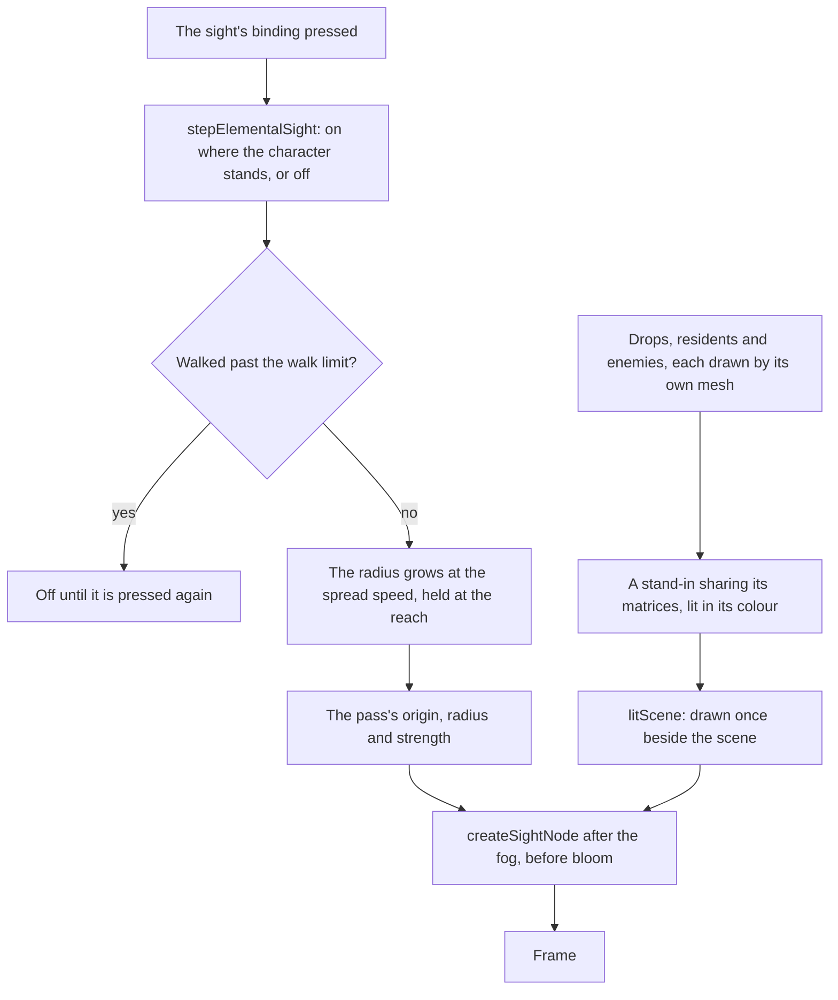

# Elemental Sight

Elemental Sight shows what can be acted on. Pressed, a range spreads out from the character, and inside it what cannot be acted on goes dark while the drops, the residents and the enemies stand lit. The [controls](../controls/design.md) read its binding, and the world answers it here. Trails are drawn for the Seelies, the bounties and the quests; the notes say what they wait on.

## How it works

- **The range is a circle on the ground.** Its centre is where the sight was turned on, not where the character stands now, so a walk moves the character out of it before the sight ends.
- **One pass, one shared material.** The stand-ins are one basic material per kind of thing, with each enemy's colour as its instance colour. No material the world draws changes for the sight. While the sight is off its strength is zero, so every pixel is left as it was.

## What a thing shows

- **Things that cannot be acted on go dark inside the range.** The scene keeps a quarter of its own brightness, with its colour gone. Outside the range nothing changes.
- **Interactables show white.** A drop and a resident are lit white.
- **Enemies show the element on them.** An enemy's colour is its strongest aura's element, else its innate element, else white. Burning counts as Pyro and Freeze as Cryo. Quicken names two elements, so it counts for none.
- **Enemies show their name.** A living enemy within the range has its name over its head, projected through the camera. An enemy whose name the game's text does not give shows no tag.
- **A thing behind a wall stays dark.** A stand-in is lit only where it is the nearest thing the scene draws, so the sight never shows through a wall.
- **A ring marks the reach.** A white ring sits at the range's edge while the sight is on.

## Ends and spreads

- **The range spreads, then holds.** The radius grows at the spread speed from where the sight was turned on, and stops at the reach.
- **A walk past the limit turns it off.** The check is on the ground from the point it was turned on. Standing still keeps it on.
- **A press turns it off** at once, wherever the character stands.
- **A screen over the world turns it off.** The menus, the map and a talk end the sight, which a press turns on again.

## Decisions

- **White is the colour of what no element affects.** The wiki's colour key gives white to things with no element on them, which covers interactables and an enemy with no element.

## Notes

- **The reach, the spread speed, the walk limit, the colours, the ring's width and the muting are provisional.** No published source gives a distance, and the colours are named only in hues. Each is a constant marked provisional, and a recording owed in the roadmap measures it.
- **The element colours are the game's interface colours.** They are the table the persona's nameplates keep, which the game's interface paints each element's name in. The highlight may differ from the interface, and the same recording settles that.
- **The middle mouse button is also Reset Camera.** The controls bind the middle button to both, and the follow camera resets on that press, so a press of the sight also resets the camera. Whether the game does both is the recording's question.
- **A name tag is not hidden by a wall.** The tag is drawn over the canvas from the enemy's projected head, and only the near and far planes cut it, so an enemy within the range behind a wall shows its name while its highlight stays muted. Hiding it needs either the scene's depth read back from the GPU, a frame late, or a ray from the camera through the landmarks and the ground for each enemy. Whether the game hides the tag at all is unmeasured, so the test waits on the sight's recording in the roadmap.
- **The Hilichurl's name has no text in the dump.** Its monster row names a text id that has no English text in the dump (`~/Esposter.noindex/genshin-parity/text/ExcelBinOutput/MonsterExcelConfigData.json`, row `21010101`, `nameTextMapHash` 2561869745, which `~/Esposter.noindex/genshin-parity/text/TextMap/TextMapEN.json` does not hold), so its tag stays blank until the game's text is found.
- **A Seelie's, a bounty's and a quest's trail are drawn.** While the sight is on, a ground trail runs from the character toward each resting Seelie's court, sampled every `SIGHT_TRAIL_STEP` metres on the world's height and cut at the reach. It is drawn white in the sight's lit scene, so the mute leaves it bright, and its width and fade are provisional until the recording measures them. A bounty's trail runs from the character to its target's spawn point while the target stands, drawn from the placed camps the [Reputation](../../../changes/genshin-reputation/design.md) bounty spawns, and none once it is defeated. A quest's clue trail runs from the character to the go-to place each quest in progress names at its current step, once the region data places that place, and none while it is unplaced. The go-to places are the ones the [quests](../../../changes/genshin-quests/design.md) page places in region data.

## Key files

| File                                                                        | Role                                                                            |
| :-------------------------------------------------------------------------- | :------------------------------------------------------------------------------ |
| `packages/genshin-engine/src/post/createSightNode.ts`                       | The mute, the highlight and the ring, over the scene's depth                    |
| `packages/genshin-engine/src/post/createSightUniforms.ts`                   | The origin, radius and strength the pass reads each frame                       |
| `packages/genshin-engine/src/post/createPostPipeline.ts`                    | The sight's pass, drawn after the fog and before the bloom                      |
| `packages/genshin-world/src/services/elementalSight/stepElementalSight.ts`  | The press, the spread and the walk that ends the sight                          |
| `packages/genshin-world/src/services/elementalSight/computeSightTrail.ts`   | The points a trail runs through from the character to its end, cut at the reach |
| `packages/genshin-world/src/services/elementalSight/writeSightTrails.ts`    | Each trail written as a white ribbon into the sight's scene                     |
| `packages/genshin-world/src/components/World/SightTrails/Index.vue`         | The ribbon mesh the trails are drawn on, in the sight's lit scene only          |
| `packages/genshin-world/src/services/elementalSight/computeSightElement.ts` | The element a target shows, from its aura or its innate element                 |
| `packages/genshin-world/src/models/combat/ElementalState.ts`                | The aura a lit thing or enemy shows                                             |
| `packages/genshin-world/src/models/enemy/EnemyKindTraits.ts`                | An enemy's innate element, from its kind's traits                               |
| `packages/genshin-world/src/services/elementalSight/createSightProxy.ts`    | A stand-in sharing an instanced mesh's matrices                                 |
| `packages/genshin-world/src/services/elementalSight/checkIsInSightReach.ts` | Whether a ground point lies within the range                                    |
| `packages/genshin-world/src/components/World/EnemyNameTags/Index.vue`       | The enemies' names over their heads, projected each frame                       |
| `packages/genshin-world/src/components/World/Windrise/Index.vue`            | The sight's scene and uniforms, written each frame from the screen              |
| `packages/genshin-world/src/components/World/Session/Index.vue`             | The binding that steps the sight, and the screens that end it                   |

## Sources

- [Elemental Sight](https://genshin-impact.fandom.com/wiki/Elemental_Sight), Genshin Impact Wiki: the binding, the white range that spreads from the character, the colour key of white for what no element affects and the element hues, the interactables it highlights and those it leaves unlit, and its end after a short walk.

## Open

- [ ] **things that cannot be acted on go dark, and interactables and residents show lit white** — no source yet: the wiki's Elemental Sight page, which the cache does not hold, or a recording of the sight.
- [ ] **an enemy shows its aura's element, with Burning as Pyro and Freeze as Cryo** — no source yet: the wiki's colour key, which the cache does not hold, or a recording of an aura on an enemy.
- [ ] **white is the colour of what no element affects** — no source yet: the wiki's colour key, which the cache does not hold.
- [ ] **a walk past the limit ends the sight, as the game does** — no source yet: the wiki's Elemental Sight page, which the cache does not hold, or a recording of the walk.
- [ ] **the element colours are the game's interface colours** — no source yet: the game's interface colour for each element, which no dump table holds (the repo keeps the table by hand in `genshin-text`).
- [ ] **Trails are drawn for the Seelies, the bounties and the quests** — no source yet: game data or a snapshot that holds this behaviour
- [ ] **The range is a circle centred where the sight was turned on, not where the character stands** — no source yet: game data or a snapshot that holds this behaviour
- [ ] **The stand-ins are one basic material per kind of thing, with each enemy's colour as its instance colour** — no source yet: game data or a snapshot that holds this behaviour
- [ ] **An enemy's colour is its strongest aura's element, else its innate element, else white** — no source yet: game data or a snapshot that holds this behaviour
- [ ] **Quicken counts for no element** — no source yet: game data or a snapshot that holds this behaviour
- [ ] **A living enemy within the range shows its name over its head, and an enemy with no game text shows none** — no source yet: game data or a snapshot that holds this behaviour
- [ ] **A stand-in is lit only where it is the nearest thing the scene draws** — no source yet: game data or a snapshot that holds this behaviour
- [ ] **A white ring sits at the range's edge while the sight is on** — no source yet: game data or a snapshot that holds this behaviour
- [ ] **The range spreads from where the sight was turned on, and holds at the reach** — no source yet: game data or a snapshot that holds this behaviour
- [ ] **The walk check is on the ground from where the sight was turned on, and standing still keeps the sight on** — no source yet: game data or a snapshot that holds this behaviour
- [ ] **A press turns the sight off at once, wherever the character stands** — no source yet: game data or a snapshot that holds this behaviour
- [ ] **A screen over the world turns the sight off** — no source yet: game data or a snapshot that holds this behaviour
- [ ] **The controls bind the middle button to both the sight and Reset Camera** — no source yet: game data or a snapshot that holds this behaviour
- [ ] **A name tag is drawn over the canvas and is not hidden by a wall** — no source yet: game data or a snapshot that holds this behaviour
- [ ] **A Seelie's trail runs from the character toward its court, sampled every `SIGHT_TRAIL_STEP` metres** — no source yet: game data or a snapshot that holds this behaviour
- [ ] **A bounty's trail runs from the character to its target's spawn point while the target stands** — no source yet: game data or a snapshot that holds this behaviour
- [ ] **A quest's clue trail runs to the go-to place each quest in progress names, once region data places it** — no source yet: game data or a snapshot that holds this behaviour
