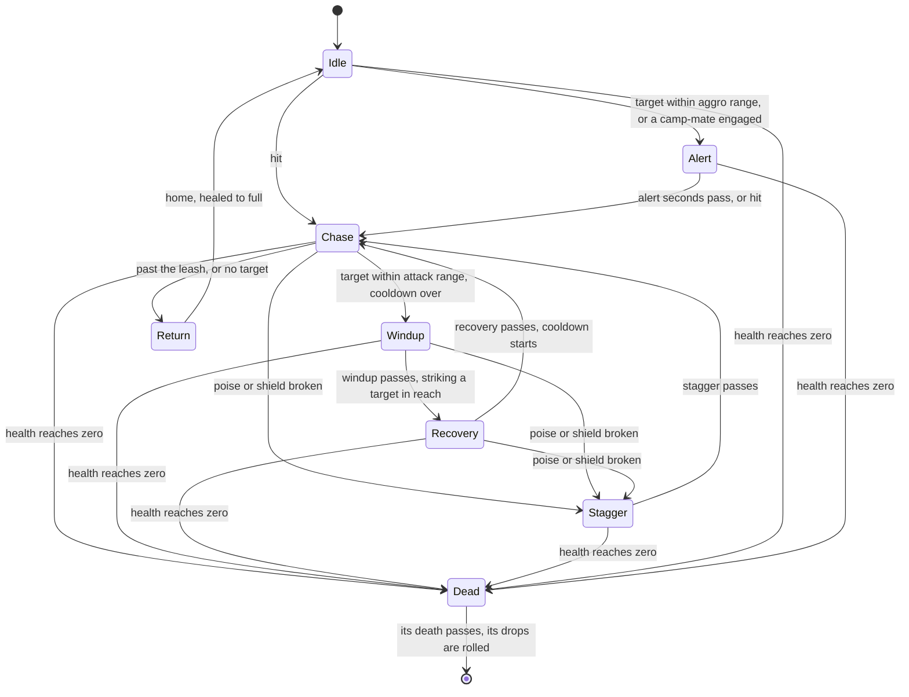

# Enemies

The world's enemies follow the rules the wiki documents for the game's open world. A camp placed in a region's data spawns when the region comes into reach. Its enemies notice whoever comes near, fight together, give up when led too far from home, and come back on the game's own timers once beaten. All of it is `genshin-world`'s, since it is the game's rules rather than the engine's. Until a model is built for each kind, an enemy is drawn as a capsule, tinted by its AI's state so the states can be watched (`packages/genshin-world/src/components/World/Enemies/Index.vue`).

## How it works

- **One deterministic step.** `stepEnemy` reads an enemy, the target on the ground (or none) and the step's seconds, and writes the enemy's next state, position, heading and poise in place (`packages/genshin-world/src/services/enemy/stepEnemy.ts`). It reads no clock and no random source, so a test steps it exactly as the world does. Idle is standing at its spawn, or walking its patrol's points in a loop.
- **A hit is combat's to compute.** `damageEnemy` takes the damage and poise damage combat's formula computes for a hit (`packages/genshin-world/src/services/enemy/damageEnemy.ts`). The enemy's health falls, and each energy threshold it falls to drops its energy, once for the enemy's life however it is healed. A shield it holds (Stormterror's, a fifth of its max HP, `packages/genshin-world/src/services/bosses/stormterror.ts`) takes the damage first and breaks once drained, staggering it until the stagger ends and it stands again at full shield. A hit on a broken poise, or one that breaks it, staggers the enemy and cancels its attack; any other hit sets an unengaged enemy on its attacker. A returning or dead enemy is immune.
- **Hit by the kit, striking back.** A kit's hit lands through `strikeEnemy`: a blunt hit shatters a Freeze first, an elemental hit applies its element under the internal cooldown kept on the enemy for each attacker and tag, and the damage is priced by combat before `damageEnemy` takes it (`packages/genshin-world/src/services/kit/strikeEnemy.ts`). A dead or returning enemy is passed by. An enemy's own strike lands on the member on the field through `strikePartyMember`, its ATK less what its statuses cut of it, as a Talisman of Qiqi's from four constellations does: the team's shields take the damage first, all at once, and what none of them absorbs takes the [party](../party/design.md)'s HP, by its share of Max HP (`packages/genshin-world/src/services/kit/strikePartyMember.ts`, `packages/genshin-world/src/services/kit/computeEnemyStrikeDamage.ts`). An enemy within aggro range of a live taunt strikes the nearest one instead, and the taunt's HP takes the damage (`packages/genshin-world/src/services/kit/selectEnemyTaunt.ts`, `packages/genshin-world/src/composables/useWorldCombat.ts`).
- **Elements it keeps.** Each enemy carries an `ElementalState` (`packages/genshin-world/src/models/enemy/Enemy.ts`), advanced at each of its fixed steps so its auras decay and its Electro-Charged and Burning tick between hits (`packages/genshin-world/src/services/combat/aura/advanceElementalState.ts`). The reactions an enemy's elements bring on their own wait on the enemy (`elementalReactions`), to be struck by the kit on the field, as [combat](../combat/design.md) describes. `hitSeconds` counts the seconds since the enemy was last hit, which is what draws a hit.
- **A launching hit throws a staggered enemy airborne.** The wiki's stagger levels run Mute, Shake, Light, Heavy and Air, each attack's set by its impulse type, and an Air hit knocks an enemy it leaves staggered airborne (`packages/genshin-world/src/services/kit/strikeEnemy.ts`). A kit marks such a hit `KitHit.isLaunching` (`packages/genshin-world/src/models/kit/KitHit.ts`), from impulse types 5 to 9, which the wiki's common impulse table gives the Air stagger level, as Skyward Sonnet's 7 does (`~/Esposter/cache/genshin-wiki/Category_Venti_Talents.json`, Skyward Sonnet's Advanced Properties, `impulse = 7`), and a launching hit that leaves the enemy staggered gives it the `ENEMY_LAUNCHED_STATUS_ID` status for the stagger's seconds (`packages/genshin-world/src/services/kit/strikeEnemy.ts`, and `ENEMY_LAUNCHED_STATUS_ID` in `packages/genshin-world/src/services/enemy/constants.ts`), which a kit reads as the enemy being airborne. gcsim models no launch: its Venti leaves Constellation 2's airborne cut as a TODO (`~/Esposter/cache/gcsim-v2.47.2/internal/characters/venti/cons.go`, line 37).
- **Camps wake together.** After every step, `wakeEnemyCamps` alerts each idle enemy whose camp has a member engaged, so a whole hilichurl camp turns at once (`packages/genshin-world/src/services/enemy/wakeEnemyCamps.ts`).
- **Leashed to home.** An enemy farther from its spawn than the leash distance, or one left with no target, walks home. It is immune on the way and arrives healed to full, with its shield and poise restored (`packages/genshin-world/src/services/enemy/stepEnemy.ts`, `packages/genshin-world/src/services/enemy/damageEnemy.ts`).

## Kinds and their stats

A kind is the game's own monster, named by the game's monster id (`EnemyKindId`). Its row of the game's table holds its type, its name's text id, its base HP, ATK and DEF with the level curve each grows by, and its resistance to each element and to physical damage (`~/Esposter/genshin-parity/text/ExcelBinOutput/MonsterExcelConfigData.json`, row 25010201, with `hpBase`, `propGrowCurves`, `elecSubHurt` and `physicalSubHurt`). `genshin:assets enemies` (`scripts/src/services/genshinAssets/enemies/buildEnemyKinds.ts`) publishes that row for every kind a region's camps place, and every curve they name, from the community's dump of the game's tables, to the [hosted game data](../hosted-game-data/design.md). The world reads both records as it opens (`packages/genshin-world/src/services/enemy/readEnemyTables.ts`), and every rule over a kind takes the tables as an argument: the spawn, the strikes both ways, the drops, the Archive's count and the sight's name tags. The family is the archive's group, the entry its describe id names (`scripts/src/services/genshinAssets/enemies/buildEnemyKinds.ts`), and the type is the table's `securityLevel`: elite or boss, and common where the row has none. Both are spelt as the game spells them, so the tables parse into the world's enums.

`computeEnemyStats` scales each base stat by its curve's multiplier at the enemy's level, as the wiki's formulas do: max HP and ATK by their curves, and DEF by one plus a hundredth of the level (`packages/genshin-world/src/services/enemy/computeEnemyStats.ts`; the defense curve's multipliers 1.01, 1.02 and 1.03 at levels 1 to 3 in `~/Esposter/genshin-parity/text/ExcelBinOutput/MonsterCurveExcelConfigData.json`).

What the game's table does not hold is authored from the wiki in `EnemyKindTraitsMap` (`packages/genshin-world/src/services/enemy/EnemyKindTraitsMap.ts`): the kind's poise type, the element its energy carries, its energy drops in falling order, and the family whose Mora and materials it drops. Each poise type's bar (its length, refill speed, endurance and reset time) is the wiki's table.

## Spawns and respawn

A region's data places its enemies in camps, each member with its kind, its level at World Level 0, its spawn and its patrol. The world spawns each member at the level its World Level raises it to, as the [Adventure Rank](../adventure-rank/design.md) page sets out, and a change of World Level spawns every camp anew. The world spawns a camp when its region's data arrives, and drops it when the region leaves reach (`packages/genshin-world/src/components/World/Enemies/Index.vue`). A member defeated earlier is spawned again only once its respawn time has passed (`packages/genshin-world/src/services/enemy/computeEnemyRespawnTime.ts`, `packages/genshin-world/src/services/enemy/checkIsEnemyRespawned.ts`), so an enemy never comes back in view:

| Camp                   | A defeated member comes back                                                                                                                     |
| :--------------------- | :----------------------------------------------------------------------------------------------------------------------------------------------- |
| Common enemies only    | 12 hours after its defeat (`packages/genshin-world/src/services/enemy/constants.ts`)                                                             |
| With an elite among it | at the next daily reset, 04:00 on the server's clock (`packages/genshin-world/src/services/enemy/computeEnemyRespawnTime.ts`)                    |
| With a boss among it   | 5 seconds (`BOSS_RESPAWN_AFTER_CLAIM_DURATION`) after its Trounce Blossom is claimed, and while unclaimed at the first teleport after its defeat |

The wiki's Reset page gives the first two rows' timers: a common enemy outside an elite's group comes back 12 hours after its defeat, and the commons of an elite's group come back with the elite at the daily reset, as the wiki gives for elites with limited spawn points per day. The boss row's five seconds is the build's `BOSS_RESPAWN_AFTER_CLAIM_DURATION` (`packages/genshin-world/src/services/bosses/constants.ts`), applied by `packages/genshin-world/src/services/enemy/computeEnemyRespawnTime.ts`; no page on disk gives it as the game's.

The daily reset is the server's 04:00, UTC+8, as the [reset clock](../reset-clock/design.md) sets out (`packages/genshin-world/src/services/time/constants.ts` for the hour and the zone, and the `REFRESH_DAILY` rows of `~/Esposter/genshin-parity/text/ExcelBinOutput/RefreshPolicyExcelConfigData.json` with `14400`, the 4:00 hour).

A common or elite member's return is saved as the [save data](../save-data/design.md) page keeps it (`packages/genshin-world/src/models/enemy/EnemyRespawnSave.ts`). A boss camp's defeat is saved as its moment of defeat (`packages/genshin-world/src/models/enemy/BossDefeatSave.ts`), beside the blossom it left and the last teleport, so a reload reads the same return.

The world keeps every spawned enemy in one map by its spawn key, the camp's id and the member's id (`packages/genshin-world/src/components/World/Enemies/Index.vue`). A camp's leaving removes its enemies from the map and a spawn's return adds it back, and the character's kit and the enemies' steps read the same map.

## Drops

A defeated enemy's drops are rolled by `computeEnemyDrops` from its level's band of five levels, the last band holding every level from 90 (`packages/genshin-world/src/services/enemy/computeEnemyDrops.ts`, `packages/genshin-world/src/services/enemy/constants.ts`). Its family's base Mora is scaled by the band's share: a random amount in the band's range for a common enemy, and the band's one share for an elite (`packages/genshin-world/src/services/enemy/constants.ts`). Character EXP is the band's, for common and elite enemies (`packages/genshin-world/src/services/enemy/constants.ts`). Each material drops its whole expected count and one more at the chance of its fraction (`packages/genshin-world/src/services/enemy/computeEnemyDrops.ts`), the second tier starting at level 40 and the third at 60. A boss drops nothing, since its reward is claimed from its blossom (`packages/genshin-world/src/services/enemy/computeEnemyDrops.ts`). Enemies give no Adventure EXP: the game awards it only for claiming a boss's reward. Where the Mora and the materials lie, and how the player picks them up, is the [interaction](../interaction/design.md) page's.

## The stand-in

The World Enemies component (`packages/genshin-world/src/components/World/Enemies/Index.vue`) steps every enemy in reach on the engine's fixed-step loop, and draws them all as one instanced capsule, stood on the ground, turned to its heading and tinted by its state. Its target is the character's feet, which the world screen hands down, so every enemy turns on the body wherever it goes. Where no character stands, as on a reference's held camera or a witness render, the enemies have no target. A screen holding the world holds its enemies too, and a witness render draws none, since the references it is judged against show none.

A capsule that a hit landed on is tinted white for 0.15 seconds (`ENEMY_HIT_TINT_SECONDS`) after the hit, and a flash of radius 0.3 metres (`ENEMY_HIT_FLASH_RADIUS`) stands at its middle for 0.1 seconds (`ENEMY_HIT_FLASH_SECONDS`), drawn as a second instanced mesh. Both timings, the flash's size and the tint's colour are provisional, as `packages/genshin-world/src/services/enemy/constants.ts` marks them.

## Cost

- **Two draws for all enemies.** The capsules are one instanced mesh and the hit flashes a second, their matrices and tints written each frame from scratch objects, so a frame allocates nothing for them (`packages/genshin-world/src/components/World/Enemies/Index.vue`, `packages/genshin-world/src/services/world/composeHeadingMatrix.ts`).
- **The AI costs what is in reach.** Only the camps of regions in reach (`packages/genshin-world/src/composables/useRegionData.ts`) are stepped (`packages/genshin-world/src/components/World/Enemies/Index.vue`), and waking a camp compares each idle enemy with its camp-mates, which a camp's handful keeps cheap.

## Key files

| File                                                                   | Role                                                                                                                           |
| :--------------------------------------------------------------------- | :----------------------------------------------------------------------------------------------------------------------------- |
| `packages/genshin-world/src/services/enemy/stepEnemy.ts`               | The AI: one fixed step of an enemy's state machine                                                                             |
| `packages/genshin-world/src/services/enemy/damageEnemy.ts`             | A hit: health, energy thresholds, poise and stagger                                                                            |
| `packages/genshin-world/src/services/enemy/wakeEnemyCamps.ts`          | Camps waking together                                                                                                          |
| `packages/genshin-world/src/services/enemy/computeEnemyStats.ts`       | A kind's stats at a level from its curves                                                                                      |
| `packages/genshin-world/src/services/enemy/computeEnemyRespawnTime.ts` | When a defeated spawn comes back, by its camp                                                                                  |
| `packages/genshin-world/src/models/enemy/EnemyRespawnSave.ts`          | Each defeated enemy's respawn instant by its spawn key, in the save                                                            |
| `packages/genshin-world/src/models/enemy/BossDefeatSave.ts`            | Each defeated boss's moment of defeat by its spawn key, in the save, until the boss comes back                                 |
| `packages/genshin-world/src/services/enemy/checkIsEnemyRespawned.ts`   | Whether a defeated camp member is back at a moment, on the respawn time its camp gives                                         |
| `packages/genshin-world/src/services/enemy/computeEnemyDrops.ts`       | Mora, Character EXP and materials by level band                                                                                |
| `packages/genshin-world/src/services/enemy/EnemyKindTraitsMap.ts`      | What the wiki gives of each kind: poise, energy and drop family                                                                |
| `packages/genshin-world/src/services/enemy/constants.ts`               | The AI's ranges, speeds and timings, the respawn timers, the hit's look, the combat's grace                                    |
| `packages/genshin-world/src/services/enemy/stepCombat.ts`              | The party's combat, entered once an enemy is aggravated on it and left after the grace period                                  |
| `packages/genshin-world/src/models/enemy/Enemy.ts`                     | One enemy: its state, health, elements and internal cooldowns                                                                  |
| `packages/genshin-world/src/services/kit/strikeEnemy.ts`               | A kit's hit landing on an enemy: its elements, damage and poise                                                                |
| `packages/genshin-world/src/services/kit/strikePartyMember.ts`         | An enemy's strike on the member on the field                                                                                   |
| `packages/genshin-world/src/services/kit/computeEnemyStrikeDamage.ts`  | An enemy's strike's damage to a combatant, its ATK cut by its statuses, through the combatant's defence, RES and DMG Reduction |
| `packages/genshin-world/src/services/kit/selectEnemyTaunt.ts`          | The nearest live taunt in an enemy's aggro range, which it strikes                                                             |
| `packages/genshin-world/src/services/enemy/readEnemyTables.ts`         | The kinds and their level curves, read as the world opens                                                                      |
| `packages/genshin-world/src/models/enemy/EnemyTables.ts`               | Each kind by its id, and the level curves its stats grow along                                                                 |
| `packages/genshin-world/src/data/regions/mondstadt.json`               | Windrise's hilichurl camp                                                                                                      |
| `packages/genshin-world/src/components/World/Enemies/Index.vue`        | Spawns, steps and draws the enemies in reach, at the body or a taunt, and emits the party's combat                             |
| `scripts/src/services/genshinAssets/enemies/buildEnemyKinds.ts`        | Builds the kinds and their level curves from the game's tables                                                                 |

## Notes

- **The published tables hold a partial dump.** The `enemies/kinds` record holds the Hilichurl Fighter as the game's table has it, and `enemies/levelCurves` its curves' first ten levels; `genshin:assets enemies` publishes every kind and curve from the dump when it is run over it.
- **The AI's numbers are provisional.** Its ranges, speeds and timings, the leash and the capsule's size are starting points marked in `packages/genshin-world/src/services/enemy/constants.ts`, each to be measured off a recording or the Hilichurl's own clips.
- **Character EXP is computed, not yet given.** The party's levels take it, since a quest's finish gives its Character EXP through `raiseCharacterByExp`, but nothing grants a defeat's roll yet, so a defeat's EXP is rolled and left. A defeat's drops are placed and picked up by the world's screen, and the component emits `strike` and `defeat` for it (`packages/genshin-world/src/components/World/Enemies/Index.vue`).
- **Windrise's camp stands where we put it.** Its place and level are ours until the game's own spawns are read (`packages/genshin-world/src/data/regions/mondstadt.json`).
- **A launch lasts the stagger, and every enemy can be launched.** The game's airtime follows the impulse's vertical force against the enemy's weight, and an Air hit on the ground falls to Heavy when its vertical force is under 5.5 times the enemy's weight, or does nothing for the kinds immune to Air staggers. Neither weight nor that immunity is built, so a launching hit launches every enemy it staggers (`packages/genshin-world/src/services/kit/strikeEnemy.ts`), for the provisional `ENEMY_STAGGER_SECONDS` (`packages/genshin-world/src/services/enemy/constants.ts`), and a hit on an enemy already in the air restarts its launched status rather than adding one (`packages/genshin-world/src/services/enemy/addEnemyStatus.ts`).
- **The party's combat leaves after a provisional grace.** The party is in combat while an enemy is in an engaged state on it, and leaves once none has been for `COMBAT_CLEAR_SECONDS` (`packages/genshin-world/src/services/enemy/constants.ts`), 5 seconds, provisional until a recording measures it (`packages/genshin-world/src/services/enemy/stepCombat.ts`): the wiki gives the clear timers but no figure.

## Sources

- [Enemy](https://genshin-impact.fandom.com/wiki/Enemy), Genshin Impact Wiki, not in the wiki cache: the enemy types and the archive's families.
- [Exploration](https://genshin-impact.fandom.com/wiki/Exploration), Genshin Impact Wiki, not in the wiki cache: aggravation, the alert an enemy takes from a nearby target.
- [Enemy/Level Scaling](https://genshin-impact.fandom.com/wiki/Enemy/Level_Scaling), Genshin Impact Wiki, not in the wiki cache: max HP and ATK as base value times a level multiplier, and DEF's multiplier of one plus a hundredth of the level.
- [Interruption Resistance/Poise](https://genshin-impact.fandom.com/wiki/Interruption_Resistance/Poise), Genshin Impact Wiki, not in the wiki cache: the poise bar, its refill and reset, and each poise type's values, from its Poise Type table.
- [Interruption Resistance/Stagger](https://genshin-impact.fandom.com/wiki/Interruption_Resistance/Stagger), Genshin Impact Wiki, not in the wiki cache: the stagger levels, the impulse types and their forces, the weight a launch must lift, and the kinds immune to Air staggers.
- [Energy/Data](https://genshin-impact.fandom.com/wiki/Energy/Data), Genshin Impact Wiki, not in the wiki cache: each enemy's energy at its HP thresholds and on death, each threshold once per enemy.
- [Normal Bosses](https://genshin-impact.fandom.com/wiki/Normal_Bosses), Genshin Impact Wiki, not in the wiki cache: "After claiming rewards from the Trounce Blossom, the boss will respawn in roughly 5 seconds", and "If the rewards from the blossom are not claimed, the boss will not respawn unless the player teleports out of the area." The Reset page says "immediately" for the same claim and gives no timing, so the roughly five seconds here is this page's figure, and the one built.
- [Reset](https://genshin-impact.fandom.com/wiki/Reset), Genshin Impact Wiki, not in the wiki cache: common enemies outside an elite's group back 12 hours after defeat, elites with limited spawn points per day and their groups' commons at the daily reset, and normal bosses immediately after claiming the Trounce Blossom.
- [Module:Drops Table/data](https://genshin-impact.fandom.com/wiki/Module:Drops_Table/data), Genshin Impact Wiki, not in the wiki cache: Mora and Character EXP by level band, each family's materials and the tiers' shares by band.
- [Module:Drops Table](https://genshin-impact.fandom.com/wiki/Module:Drops_Table), Genshin Impact Wiki, not in the wiki cache: the drops table's display code, which reads its rates, Mora and Character EXP from its data page.
- [Adventure EXP](https://genshin-impact.fandom.com/wiki/Adventure_EXP), Genshin Impact Wiki, not in the wiki cache: the Adventure EXP sources the open item below rests on.
- [AnimeGameData](https://github.com/DimbreathBot/AnimeGameData), the community's dump of the game's data: `MonsterExcelConfigData`, `MonsterCurveExcelConfigData` and `AnimalCodexExcelConfigData`, the tables the kinds are read from.
- `~/Esposter/genshin-parity/text/ExcelBinOutput/MonsterCurveExcelConfigData.json`, the defense curve's multipliers; grounds the requirement "Enemy stats grow by the game's level curves".
- `~/Esposter/genshin-parity/text/ExcelBinOutput/RefreshPolicyExcelConfigData.json`, the `REFRESH_DAILY` rows with `14400`, the 04:00 daily reset; grounds scenario "An elite camp member returns at the next daily reset".

## Reference

- world-camp.mkv (not on disk) — walking up to a Hilichurl camp until it wakes, then backing away until it returns home. On the wiki and YouTube, none found (searched 2026-10-11).

## Open

- [ ] **The enemies notice whoever comes near, fight together and leash home, as the wiki documents** — no source yet: the Exploration and Enemy wiki pages are not in the wiki cache, and the cache holds no page giving a fight-together or leash rule.
- [ ] **Stormterror's shield is a fifth of its max HP** — no source yet: the Stormterror wiki page and its Weekly Bosses entry are not in the wiki cache.
- [ ] **An enemy's strike splits its shields first, as Qiqi's Talisman from four constellations does** — no source yet: `~/Esposter.noindex/cache/genshin-wiki/Category_Qiqi_Talents.json` names constellation 4, Divine Suppression, and gives none of its text, so no Talisman rule is stated.
- [ ] **Launching hits are impulse types 5 to 9, the common impulse table's Air rows** — no source yet: the Interruption Resistance/Stagger wiki page is not in the wiki cache; `packages/genshin-world/src/models/kit/KitHit.ts` (`isLaunching`) names those rows.
- [ ] **Each poise type's bar is the wiki's table** — no source yet: the Poise Type table on the Interruption Resistance/Poise wiki page is not in the wiki cache, so `packages/genshin-world/src/services/enemy/PoiseTypeSettingsMap.ts` is not checked row for row against it.
- [ ] **An enemy drops its energy at each HP threshold, once for its life** — no source yet: the Energy/Data wiki page is not in the wiki cache; `packages/genshin-world/src/services/enemy/damageEnemy.ts` takes each threshold once through `droppedThresholdCount`.
- [ ] **The stagger levels run Mute, Shake, Light, Heavy and Air, each set by its attack's impulse type** — no source yet: the Interruption Resistance/Stagger wiki page is not in the wiki cache.
- [ ] **A hit falls to Heavy under 5.5 times the enemy's weight, and some kinds are immune to Air** — no source yet: the Interruption Resistance/Stagger wiki page, named in Sources, is not in the wiki cache.
- [ ] **An enemy's max HP and ATK are its base value times its curve's multiplier, and its DEF one plus a hundredth of the level** — no source yet: the Enemy/Level Scaling wiki page is not in the wiki cache.
- [ ] **The Mora shares and Character EXP by level band are the wiki's table** — no source yet: the Module:Drops Table/data wiki page is not in the wiki cache, and the Module:Drops Table page, which reads its values from it, is not either, so no band's share or Character EXP is stated.
- [ ] **The second and third material tiers start at levels 40 and 60** — no source yet: the Module:Drops Table/data wiki page, which holds the tiers' rates by level, is not in the wiki cache. The tier shares in `packages/genshin-world/src/services/enemy/constants.ts` are the repo's own table, not evidence of the game's.
- [ ] **Enemies give no Adventure EXP, the game awarding it only for a boss's reward** — no source yet: the wiki's Adventure EXP page, named in Sources, is not in the wiki cache.
- [ ] **The daily reset is read on the server's UTC+8 clock** — no source yet: no row of the game's exports names the zone; the export's daily refresh rows give the 04:00 hour (`~/Esposter.noindex/genshin-parity/text/ExcelBinOutput/RefreshPolicyExcelConfigData.json`, `REFRESH_DAILY`), and the Reset wiki page is not in the wiki cache.
- [ ] **The hosted `enemies/kinds` record holds the Hilichurl Fighter, and `enemies/levelCurves` its first ten levels** — no source yet: `packages/genshin-world/src/generated/gameDataLock.json` records only each record's hash (lines 115 and 116), and the record is in Blob storage, not on disk; reading it there settles this.
- [ ] **An elite's camp comes back whole at the next daily reset, for an elite with no limited daily spawn points** — no source yet: the Reset wiki page is not in the wiki cache, and it would give daily-reset respawn only for elites with limited spawn points per day and for the commons of their groups.
- [ ] **A camp with a normal boss among it comes back whole with the boss** — no source yet: the Normal Bosses wiki page is not in the wiki cache, and it would say nothing of the camp's other members or of Weekly Bosses.
- [ ] **A common enemy comes back 12 hours after its defeat** — no source yet: the Reset wiki page is not in the wiki cache; `packages/genshin-world/src/services/enemy/computeEnemyRespawnTime.ts` builds the 12 hours.
- [ ] **A camp with a normal boss among it comes back five seconds after its reward is claimed** — no source yet: the Normal Bosses wiki page is not in the wiki cache; `packages/genshin-world/src/services/enemy/computeEnemyRespawnTime.ts` waits five seconds after the claim.
- [ ] **An enemy's strike lands on the field member, its ATK cut by its statuses, the rest on the party's HP** — no source yet: the Enemy wiki page is not in the wiki cache, and it gives no strike, shield or taunt rule. Settling it needs a wiki page giving an enemy strike's target, or a recording of a strike on a field member.
- [ ] **An enemy in aggro range of a live taunt strikes the nearest one, the taunt's HP taking the damage** — no source yet: the Enemy wiki page is not in the wiki cache, and it gives no taunt rule. Settling it needs a wiki page giving a taunt's effect on enemies, or a recording of an enemy inside a live taunt's range.
- [ ] **An enemy's auras decay and its Electro-Charged and Burning tick between hits** — no source yet: a recording of an enemy's auras decaying between two hits, not yet captured.
- [ ] **A launching hit that leaves an enemy staggered gives it the launched status for the stagger's seconds** — no source yet: the Interruption Resistance/Stagger wiki page is not in the wiki cache, and it gives no duration for the airborne state. Settling it needs a page or a recording that gives the airborne time.
- [ ] **A launching hit launches every enemy it staggers** — no source yet: the Interruption Resistance/Stagger wiki page is not in the wiki cache, so its Stagger Immunity table cannot show which kinds take Air staggers. Whether a hit on an airborne enemy restarts its launched status, as built above, or leaves it alone is unsourced.
- [ ] **Each kind's poise type, energy and drop family hold the wiki's values** — no source yet: the Energy/Data wiki page is not in the wiki cache, so `packages/genshin-world/src/services/enemy/EnemyKindTraitsMap.ts` is not compared kind by kind with each enemy's energy; the drop family is not compared at all.
- [ ] **Each fixed material set drops its expected count, plus one at the chance of its fraction** — no source yet: the Module:Drops Table wiki page is not in the wiki cache; the page is said to give each rate-based material a whole count and a chance for the fraction, and to write a fixed set with no rate.
- [ ] **A boss drops nothing, its reward being claimed from its blossom** — no source yet: the Module:Drops Table/data, Reset and Normal Bosses wiki pages are not in the wiki cache. The Normal Bosses page is said to give a Normal Boss's Trounce Blossom reward as Adventure EXP, then Mora and Companionship EXP, and nothing of drops.
- [ ] **A reload keeps an unclaimed boss down until the first teleport** — no source yet: the Normal Bosses wiki page is not in the wiki cache; `packages/genshin-world/src/services/enemy/computeEnemyRespawnTime.ts` reads that rule from the saved defeat and the saved last teleport.
- [ ] **A boss's reward is claimed from its Trounce Blossom** — no source yet: the Normal Bosses wiki page is not in the wiki cache; `packages/genshin-world/src/services/bosses/claimTrounceBlossom.ts` leaves the boss's Adventure EXP to the rank's caller.
- [ ] **the wiki gives the clear timers but no figure** — no source yet: the Combat wiki page, where the clear timers are, is not in the wiki cache.
