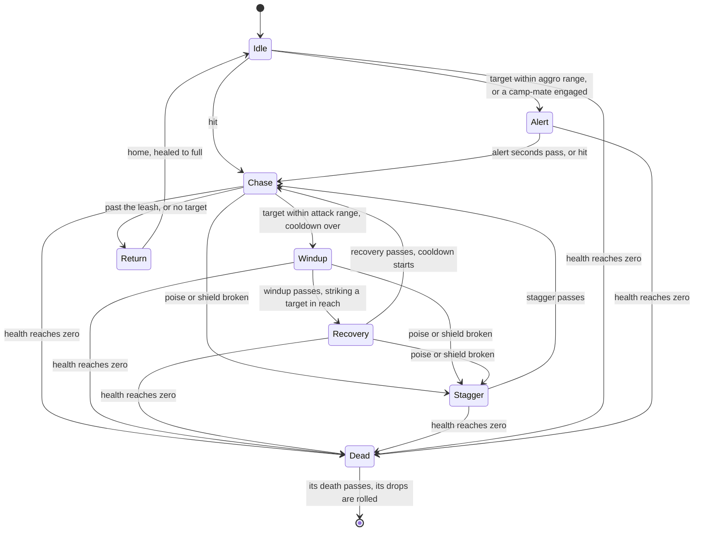

# Enemies

The world's enemies follow the rules the wiki documents for the game's open world. A camp placed in a region's data spawns when the region comes into reach. Its enemies notice whoever comes near, fight together, give up when led too far from home, and come back on the game's own timers once beaten. All of it is `genshin-world`'s, since it is the game's rules rather than the engine's. Until a model is built for each kind, an enemy is drawn as a capsule, tinted by its AI's state so the states can be watched (`packages/genshin-world/src/components/World/Enemies/Index.vue`).

## How it works

- **One deterministic step.** `stepEnemy` reads an enemy, the target on the ground (or none) and the step's seconds, and writes the enemy's next state, position, heading and poise in place (`packages/genshin-world/src/services/enemy/stepEnemy.ts`). It reads no clock and no random source, so a test steps it exactly as the world does. Idle is standing at its spawn, or walking its patrol's points in a loop.
- **A hit is combat's to compute.** `damageEnemy` takes the damage and poise damage combat's formula computes for a hit (`packages/genshin-world/src/services/enemy/damageEnemy.ts`). The enemy's health falls, and each energy threshold it falls to drops its energy, once for the enemy's life however it is healed. A shield it holds (Stormterror's, a fifth of its max HP, `packages/genshin-world/src/services/bosses/stormterror.ts`) takes the damage first and breaks once drained, staggering it until the stagger ends and it stands again at full shield. A hit on a broken poise, or one that breaks it, staggers the enemy and cancels its attack; any other hit sets an unengaged enemy on its attacker. A returning or dead enemy is immune.
- **Hit by the kit, striking back.** A kit's hit lands through `strikeEnemy`: a blunt hit shatters a Freeze first, an elemental hit applies its element under the internal cooldown kept on the enemy for each attacker and tag, and the damage is priced by combat before `damageEnemy` takes it (`packages/genshin-world/src/services/kit/strikeEnemy.ts`). A dead or returning enemy is passed by. An enemy's own strike lands on the member on the field through `strikePartyMember`, its ATK less what its statuses cut of it. The team's shields take the damage first, all at once, a rule the Open list records as unconfirmed, and what none of them absorbs takes the [party](../party/design.md)'s HP, by its share of Max HP (`packages/genshin-world/src/services/kit/strikePartyMember.ts`, `packages/genshin-world/src/services/kit/computeEnemyStrikeDamage.ts`). An enemy within aggro range of a live taunt strikes the nearest one instead, and the taunt's HP takes the damage (`packages/genshin-world/src/services/kit/selectEnemyTaunt.ts`, `packages/genshin-world/src/composables/useWorldCombat.ts`).
- **Elements it keeps.** Each enemy carries an `ElementalState` (`packages/genshin-world/src/models/enemy/Enemy.ts`), advanced at each of its fixed steps so its auras decay and its Electro-Charged and Burning tick between hits (`packages/genshin-world/src/services/combat/aura/advanceElementalState.ts`). The reactions an enemy's elements bring on their own wait on the enemy (`elementalReactions`), to be struck by the kit on the field, as [combat](../combat/design.md) describes. `hitSeconds` counts the seconds since the enemy was last hit, which is what draws a hit.
- **A launching hit throws a staggered enemy airborne.** The wiki's stagger levels run Mute, Shake, Light, Heavy and Air, each attack's set by its impulse type (`{data-root}/cache/genshin-wiki/Page_Interruption_Resistance%2FStagger.json`, its Stagger Level and Common Impulse Type tables), and an Air hit knocks an enemy it leaves staggered airborne (`packages/genshin-world/src/services/kit/strikeEnemy.ts`). A kit marks such a hit `KitHit.isLaunching` (`packages/genshin-world/src/models/kit/KitHit.ts`), from impulse types 5 to 9, which the wiki's common impulse table gives the Air stagger level, as Skyward Sonnet's 7 does (`{data-root}/cache/genshin-wiki/Category_Venti_Talents.json`, Skyward Sonnet's Advanced Properties, `impulse = 7`), and a launching hit that leaves the enemy staggered gives it the `ENEMY_LAUNCHED_STATUS_ID` status for the stagger's seconds (`packages/genshin-world/src/services/kit/strikeEnemy.ts`, and `ENEMY_LAUNCHED_STATUS_ID` in `packages/genshin-world/src/services/enemy/constants.ts`), which a kit reads as the enemy being airborne. gcsim models no launch: its Venti leaves Constellation 2's airborne cut as a TODO (`{data-root}/cache/gcsim-v2.47.2/internal/characters/venti/cons.go`, line 37).
- **Camps wake together.** After every step, `wakeEnemyCamps` alerts each idle enemy whose camp has a member engaged, so a whole hilichurl camp turns at once (`packages/genshin-world/src/services/enemy/wakeEnemyCamps.ts`).
- **Leashed to home.** An enemy farther from its spawn than the leash distance, or one left with no target, walks home. It is immune on the way and arrives healed to full, with its shield and poise restored (`packages/genshin-world/src/services/enemy/stepEnemy.ts`, `packages/genshin-world/src/services/enemy/damageEnemy.ts`).

## Kinds and their stats

A kind is the game's own monster, named by the game's monster id (`EnemyKindId`). Its row of the game's table holds its type, its name's text id, its base HP, ATK and DEF with the level curve each grows by, and its resistance to each element and to physical damage (`{data-root}/genshin-parity/text/ExcelBinOutput/MonsterExcelConfigData.json`, row 25010201, with `hpBase`, `propGrowCurves`, `elecSubHurt` and `physicalSubHurt`). `genshin:assets enemies` (`scripts/src/services/genshinAssets/enemies/buildEnemyKinds.ts`) publishes that row for every kind a region's camps place, and every curve they name, from the community's dump of the game's tables, to the [hosted game data](../hosted-game-data/design.md). The world reads both records as it opens (`packages/genshin-world/src/services/enemy/readEnemyTables.ts`), and every rule over a kind takes the tables as an argument: the spawn, the strikes both ways, the drops, the Archive's count and the sight's name tags. The family is the archive's group, the entry its describe id names (`scripts/src/services/genshinAssets/enemies/buildEnemyKinds.ts`), and the type is the table's `securityLevel`: elite or boss, and common where the row has none. Both are spelt as the game spells them, so the tables parse into the world's enums.

`computeEnemyStats` scales each base stat by its curve's multiplier at the enemy's level, as gcsim's HP does (`{data-root}/cache/gcsim-v2.47.2/pkg/enemy/types.go`, line 42): max HP and ATK by their curves, and DEF by one plus a hundredth of the level (`packages/genshin-world/src/services/enemy/computeEnemyStats.ts`; the defense curve is one plus a hundredth of the level at all 200 levels of `{data-root}/genshin-parity/text/ExcelBinOutput/MonsterCurveExcelConfigData.json`, 1.01 at level 1).

What the game's table does not hold is authored from the wiki in `EnemyKindTraitsMap` (`packages/genshin-world/src/services/enemy/EnemyKindTraitsMap.ts`): the kind's poise type, the element its energy carries, its energy drops in falling order, and the family whose Mora and materials it drops. Each poise type's bar (its length, refill speed, endurance and reset time) is the wiki's table: the nine enemy rows of `packages/genshin-world/src/services/enemy/PoiseTypeSettingsMap.ts` match its Poise Type table (`{data-root}/cache/genshin-wiki/Page_Interruption_Resistance%2FPoise.json`) row for row.

## Spawns and respawn

A region's data places its enemies in camps, each member with its kind, its level at World Level 0, its spawn and its patrol. The world spawns each member at the level its World Level raises it to, as the [Adventure Rank](../adventure-rank/design.md) page sets out, and a change of World Level spawns every camp anew. The world spawns a camp when its region's data arrives, and drops it when the region leaves reach (`packages/genshin-world/src/components/World/Enemies/Index.vue`). A member defeated earlier is spawned again only once its respawn time has passed (`packages/genshin-world/src/services/enemy/computeEnemyRespawnTime.ts`, `packages/genshin-world/src/services/enemy/checkIsEnemyRespawned.ts`), so an enemy never comes back in view:

| Camp                   | A defeated member comes back                                                                                                                     |
| :--------------------- | :----------------------------------------------------------------------------------------------------------------------------------------------- |
| Common enemies only    | 12 hours after its defeat (`packages/genshin-world/src/services/enemy/constants.ts`)                                                             |
| With an elite among it | at the next daily reset, 04:00 on the server's clock (`packages/genshin-world/src/services/enemy/computeEnemyRespawnTime.ts`)                    |
| With a boss among it   | 5 seconds (`BOSS_RESPAWN_AFTER_CLAIM_DURATION`) after its Trounce Blossom is claimed, and while unclaimed at the first teleport after its defeat |

The wiki's Reset page (`{data-root}/cache/genshin-wiki/Page_Reset.json`, its Other Resets section) gives the first two rows' timers: a common enemy outside an elite's group comes back 12 hours after its defeat, and the commons of an elite's group come back with the elite at the daily reset, as the wiki gives for elites with limited spawn points per day. The boss row's five seconds is the build's `BOSS_RESPAWN_AFTER_CLAIM_DURATION` (`packages/genshin-world/src/services/bosses/constants.ts`), applied by `packages/genshin-world/src/services/enemy/computeEnemyRespawnTime.ts`; the Normal Boss page gives the game's figure as roughly five seconds after the claim of the Trounce Blossom that a defeated boss leaves (`{data-root}/cache/genshin-wiki/Page_Normal_Boss.json`, its description and the paragraph after it), so the build uses that page's figure without its "roughly".

The daily reset is the server's 04:00, UTC+8, as the [reset clock](../reset-clock/design.md) sets out (`packages/genshin-world/src/services/time/constants.ts` for the hour and the zone, and the "REFRESH_DAILY" rows of `{data-root}/genshin-parity/text/ExcelBinOutput/RefreshPolicyExcelConfigData.json` with `14400`, the 4:00 hour).

A common or elite member's return is saved as the [save data](../save-data/design.md) page keeps it (`packages/genshin-world/src/models/enemy/EnemyRespawnSave.ts`). A boss camp's defeat is saved as its moment of defeat (`packages/genshin-world/src/models/enemy/BossDefeatSave.ts`), beside the blossom it left and the last teleport, so a reload reads the same return.

The world keeps every spawned enemy in one map by its spawn key, the camp's id and the member's id (`packages/genshin-world/src/components/World/Enemies/Index.vue`). A camp's leaving removes its enemies from the map and a spawn's return adds it back, and the character's kit and the enemies' steps read the same map.

## Drops

A defeated enemy's drops are rolled by `computeEnemyDrops` from its level's band of five levels, the last band holding every level from 90 (`packages/genshin-world/src/services/enemy/computeEnemyDrops.ts`, `packages/genshin-world/src/services/enemy/constants.ts`). Its family's base Mora is scaled by the band's share: a random amount in the band's range for a common enemy, and the band's one share for an elite (`packages/genshin-world/src/services/enemy/constants.ts`). Character EXP is the band's, for common and elite enemies (`packages/genshin-world/src/services/enemy/constants.ts`). Each material drops its whole expected count and one more at the chance of its fraction (`packages/genshin-world/src/services/enemy/computeEnemyDrops.ts`), the second tier starting at level 40 and the third at 60; the wiki's drops data writes a fixed set as a whole count and a chance, such as "4 + 20.00%" for Raw Meat, and its material tier rates start the second and third tiers at the bands 40 to 44 and 60 to 64 (`{data-root}/cache/genshin-wiki/Page_Module:Drops_Table%2Fdata.json`). A boss drops nothing, since its reward is claimed from its blossom (`packages/genshin-world/src/services/enemy/computeEnemyDrops.ts`). Enemies give no Adventure EXP: the game awards it only for claiming a boss's reward. Where the Mora and the materials lie, and how the player picks them up, is the [interaction](../interaction/design.md) page's.

## The stand-in

The World Enemies component (`packages/genshin-world/src/components/World/Enemies/Index.vue`) steps every enemy in reach on the engine's fixed-step loop, and draws them all as one instanced capsule, stood on the ground, turned to its heading and tinted by its state. Its target is the character's feet, which the world screen hands down, so every enemy turns on the body wherever it goes. Where no character stands, as on a reference's held camera or a witness render, the enemies have no target. A screen holding the world holds its enemies too, and a witness render draws none, since the references it is judged against show none.

A capsule that a hit landed on is tinted white for 0.15 seconds (`ENEMY_HIT_TINT_SECONDS`) after the hit, and a flash of radius 0.3 metres (`ENEMY_HIT_FLASH_RADIUS`) stands at its middle for 0.1 seconds (`ENEMY_HIT_FLASH_SECONDS`), drawn as a second instanced mesh. Both timings, the flash's size and the tint's colour are provisional, as `packages/genshin-world/src/services/enemy/constants.ts` marks them.

## Cost

- **Two draws for all enemies.** The capsules are one instanced mesh and the hit flashes a second, their matrices and tints written each frame from scratch objects, so a frame allocates nothing for them (`packages/genshin-world/src/components/World/Enemies/Index.vue`, `packages/genshin-world/src/services/world/composeHeadingMatrix.ts`).
- **The AI costs what is in reach.** Only the camps of regions in reach (`packages/genshin-world/src/composables/useRegionData.ts`) are stepped (`packages/genshin-world/src/components/World/Enemies/Index.vue`), and waking a camp compares each idle enemy with its camp-mates, which a camp's handful keeps cheap.

## Key files

| File                                                                   | Role                                                                                                                           |
| :--------------------------------------------------------------------- | :----------------------------------------------------------------------------------------------------------------------------- |
| `packages/genshin-world/src/services/enemy/stepEnemy.ts`               | The AI: one fixed step of an enemy's state machine                                                                             |
| `packages/genshin-world/src/services/enemy/damageEnemy.ts`             | A hit: health, energy thresholds, poise and stagger                                                                            |
| `packages/genshin-world/src/services/enemy/wakeEnemyCamps.ts`          | Camps waking together                                                                                                          |
| `packages/genshin-world/src/services/enemy/computeEnemyStats.ts`       | A kind's stats at a level from its curves                                                                                      |
| `packages/genshin-world/src/services/enemy/computeEnemyRespawnTime.ts` | When a defeated spawn comes back, by its camp                                                                                  |
| `packages/genshin-world/src/models/enemy/EnemyRespawnSave.ts`          | Each defeated enemy's respawn instant by its spawn key, in the save                                                            |
| `packages/genshin-world/src/models/enemy/BossDefeatSave.ts`            | Each defeated boss's moment of defeat by its spawn key, in the save, until the boss comes back                                 |
| `packages/genshin-world/src/services/enemy/checkIsEnemyRespawned.ts`   | Whether a defeated camp member is back at a moment, on the respawn time its camp gives                                         |
| `packages/genshin-world/src/services/enemy/computeEnemyDrops.ts`       | Mora, Character EXP and materials by level band                                                                                |
| `packages/genshin-world/src/services/enemy/EnemyKindTraitsMap.ts`      | What the wiki gives of each kind: poise, energy and drop family                                                                |
| `packages/genshin-world/src/services/enemy/constants.ts`               | The AI's ranges, speeds and timings, the respawn timers, the hit's look, the combat's grace                                    |
| `packages/genshin-world/src/services/enemy/stepCombat.ts`              | The party's combat, entered once an enemy is aggravated on it and left after the grace period                                  |
| `packages/genshin-world/src/models/enemy/Enemy.ts`                     | One enemy: its state, health, elements and internal cooldowns                                                                  |
| `packages/genshin-world/src/services/kit/strikeEnemy.ts`               | A kit's hit landing on an enemy: its elements, damage and poise                                                                |
| `packages/genshin-world/src/services/kit/strikePartyMember.ts`         | An enemy's strike on the member on the field                                                                                   |
| `packages/genshin-world/src/services/kit/computeEnemyStrikeDamage.ts`  | An enemy's strike's damage to a combatant, its ATK cut by its statuses, through the combatant's defence, RES and DMG Reduction |
| `packages/genshin-world/src/services/kit/selectEnemyTaunt.ts`          | The nearest live taunt in an enemy's aggro range, which it strikes                                                             |
| `packages/genshin-world/src/services/enemy/readEnemyTables.ts`         | The kinds and their level curves, read as the world opens                                                                      |
| `packages/genshin-world/src/models/enemy/EnemyTables.ts`               | Each kind by its id, and the level curves its stats grow along                                                                 |
| `packages/genshin-world/src/data/regions/mondstadt.json`               | Windrise's hilichurl camp                                                                                                      |
| `packages/genshin-world/src/components/World/Enemies/Index.vue`        | Spawns, steps and draws the enemies in reach, at the body or a taunt, and emits the party's combat                             |
| `scripts/src/services/genshinAssets/enemies/buildEnemyKinds.ts`        | Builds the kinds and their level curves from the game's tables                                                                 |

## Notes

- **The published tables hold a partial dump.** The `enemies/kinds` record holds the Hilichurl Fighter as the game's table has it, and `enemies/levelCurves` every level of each curve they name (`scripts/src/services/genshinAssets/enemies/buildEnemyKinds.ts`, lines 97 to 107), which `packages/genshin-world/src/models/enemy/EnemyLevelCurves.ts` reads from level 1.
- **The AI's numbers are provisional.** Its ranges, speeds and timings, the leash and the capsule's size are starting points marked in `packages/genshin-world/src/services/enemy/constants.ts`, each to be measured off a recording or the Hilichurl's own clips.
- **Character EXP is computed, not yet given.** The party's levels take it, since a quest's finish gives its Character EXP through `raiseCharacterByExp`, but nothing grants a defeat's roll yet, so a defeat's EXP is rolled and left. A defeat's drops are placed and picked up by the world's screen, and the component emits `strike` and `defeat` for it (`packages/genshin-world/src/components/World/Enemies/Index.vue`).
- **Windrise's camp stands where we put it.** Its place and level are ours until the game's own spawns are read (`packages/genshin-world/src/data/regions/mondstadt.json`).
- **A launch lasts the stagger, and every enemy can be launched.** The game's airtime follows the impulse's vertical force against the enemy's weight, and an Air hit on the ground falls to Heavy when its vertical force is under 5.5 times the defender's real weight (`{data-root}/cache/genshin-wiki/Page_Interruption_Resistance%2FStagger.json`, its Real Stagger Level table), or does nothing for the kinds immune to Air staggers. Neither weight nor that immunity is built, so a launching hit launches every enemy it staggers, an open gap the Open list carries (`packages/genshin-world/src/services/kit/strikeEnemy.ts`), for the provisional `ENEMY_STAGGER_SECONDS` (`packages/genshin-world/src/services/enemy/constants.ts`), and a hit on an enemy already in the air restarts its launched status rather than adding one (`packages/genshin-world/src/services/enemy/addEnemyStatus.ts`).
- **The party's combat leaves after a provisional grace.** The party is in combat while an enemy is in an engaged state on it, and leaves once none has been for `COMBAT_CLEAR_SECONDS` (`packages/genshin-world/src/services/enemy/constants.ts`), 5 seconds, provisional until a recording measures it (`packages/genshin-world/src/services/enemy/stepCombat.ts`): the wiki gives the clear timers but no figure.

## Sources

- [Enemy](https://genshin-impact.fandom.com/wiki/Enemy), Genshin Impact Wiki, in the wiki cache as `{data-root}/cache/genshin-wiki/Page_Enemy.json`: the enemy types and the archive's families.
- [Exploration](https://genshin-impact.fandom.com/wiki/Exploration), Genshin Impact Wiki, in the wiki cache as `{data-root}/cache/genshin-wiki/Page_Exploration.json`: aggravation by distance and line of sight, the alert an enemy takes from a nearby target.
- [Enemy/Level Scaling](https://genshin-impact.fandom.com/wiki/Enemy/Level_Scaling), Genshin Impact Wiki, not in the wiki cache: max HP and ATK as base value times a level multiplier, and DEF's multiplier of one plus a hundredth of the level.
- [Interruption Resistance/Poise](https://genshin-impact.fandom.com/wiki/Interruption_Resistance/Poise), Genshin Impact Wiki, in the wiki cache as `{data-root}/cache/genshin-wiki/Page_Interruption_Resistance%2FPoise.json`: the poise bar, its refill and reset, and each poise type's values, from its Poise Type table.
- [Interruption Resistance/Stagger](https://genshin-impact.fandom.com/wiki/Interruption_Resistance/Stagger), Genshin Impact Wiki, in the wiki cache as `{data-root}/cache/genshin-wiki/Page_Interruption_Resistance%2FStagger.json`: the stagger levels, the impulse types and their forces, the weight a launch must lift, and the kinds immune to Air staggers.
- [Energy/Data](https://genshin-impact.fandom.com/wiki/Energy/Data), Genshin Impact Wiki, in the wiki cache as `{data-root}/cache/genshin-wiki/Page_Energy%2FData.json`: each enemy's energy at its HP thresholds and on death, each threshold once per enemy.
- [Normal Bosses](https://genshin-impact.fandom.com/wiki/Normal_Bosses), Genshin Impact Wiki, in the wiki cache as `{data-root}/cache/genshin-wiki/Page_Normal_Boss.json` (the redirect's target): "After claiming rewards from the Trounce Blossom, the boss will respawn in roughly 5 seconds", and "If the rewards from the blossom are not claimed, the boss will not respawn unless the player teleports out of the area." The Reset page says "immediately" for the same claim and gives no timing, so the roughly five seconds here is this page's figure, and the one built.
- [Reset](https://genshin-impact.fandom.com/wiki/Reset), Genshin Impact Wiki, in the wiki cache as `{data-root}/cache/genshin-wiki/Page_Reset.json`: common enemies outside an elite's group back 12 hours after defeat, elites with limited spawn points per day and their groups' commons at the daily reset, and normal bosses immediately after claiming the Trounce Blossom.
- [Module:Drops Table/data](https://genshin-impact.fandom.com/wiki/Module:Drops_Table/data), Genshin Impact Wiki, in the wiki cache as `{data-root}/cache/genshin-wiki/Page_Module:Drops_Table%2Fdata.json`: Mora and Character EXP by level band, each family's materials and the tiers' shares by band.
- [Module:Drops Table](https://genshin-impact.fandom.com/wiki/Module:Drops_Table), Genshin Impact Wiki, not in the wiki cache: the drops table's display code, which reads its rates, Mora and Character EXP from its data page.
- [Adventure EXP](https://genshin-impact.fandom.com/wiki/Adventure_EXP), Genshin Impact Wiki, not in the wiki cache: the Adventure EXP sources the open item rests on.
- [AnimeGameData](https://github.com/DimbreathBot/AnimeGameData), the community's dump of the game's data: `MonsterExcelConfigData`, `MonsterCurveExcelConfigData` and `AnimalCodexExcelConfigData`, the tables the kinds are read from.
- `{data-root}/genshin-parity/text/ExcelBinOutput/MonsterCurveExcelConfigData.json`, the defense curve's multipliers; grounds the requirement "Enemy stats grow by the game's level curves".
- `{data-root}/genshin-parity/text/ExcelBinOutput/RefreshPolicyExcelConfigData.json`, the "REFRESH_DAILY" rows with `14400`, the 04:00 daily reset; grounds scenario "An elite camp member returns at the next daily reset".

## Reference

- world-camp.mkv (not on disk) — walking up to a Hilichurl camp until it wakes, then backing away until it returns home. On the wiki and YouTube, none found.

## Open

The sources for the energy, the Mora and Character EXP, the Adventure EXP and the launch rule are recorded with their requirements in [the spec](spec.md).

- [ ] **The enemies notice whoever comes near, fight together and leash home, as the wiki documents** — the Exploration page (`{data-root}/cache/genshin-wiki/Page_Exploration.json`) names distance and line of sight as the factors of aggravation, and `packages/genshin-world/src/services/enemy/stepEnemy.ts` tests distance alone; the Enemy page (`{data-root}/cache/genshin-wiki/Page_Enemy.json`) gives no fight-together or leash rule. Settling those needs a wiki page giving a camp's alert or a leash, or a recording of a camp-mate joining a fight and an enemy walking home.
- [ ] **Stormterror's shield is a fifth of its max HP** — no source yet: the Stormterror page, which redirects to `{data-root}/cache/genshin-wiki/Page_Dvalin.json`, and the Weekly Boss page (`{data-root}/cache/genshin-wiki/Page_Weekly_Boss.json`) name no shield; a wiki page giving the shield's size, or a recording of the shield breaking, would settle it.
- [ ] **An enemy's strike lands on the team's shields first, all at once** — no source yet: Qiqi's Talisman, constellation 4 (Divine Suppression, `{data-root}/genshin-dump-backup-6.6/TextMap/TextMap_MediumEN.json` line 223548), cuts the ATK of marked targets by 20% and names no shield, so it neither confirms nor contradicts the rule. A wiki page giving an enemy strike's shield split, or a recording of a strike on a team holding shields, would settle it.
- [ ] **An enemy's ATK is its base value times its curve's multiplier** — no source yet: the Enemy/Level Scaling wiki page is not in the wiki cache, the Enemy page (`{data-root}/cache/genshin-wiki/Page_Enemy.json`) says "The ATK data are still under testing and not listed", and gcsim models no enemy ATK.
- [ ] **The daily reset is read on the server's UTC+8 clock** — the zone is open, as the [bosses page](../bosses/design.md) has it, with no source yet for it beyond the export's daily refresh rows, which give the 04:00 hour (`{data-root}/genshin-parity/text/ExcelBinOutput/RefreshPolicyExcelConfigData.json`, "REFRESH_DAILY"), and the Reset page, now in the wiki cache (`{data-root}/cache/genshin-wiki/Page_Reset.json`), gives 04:00 on the player's server time and no offset.
- [ ] **The hosted `enemies/kinds` record holds the Hilichurl Fighter** — no source yet: the record is in Blob storage, and `packages/genshin-world/src/generated/gameDataLock.json` line 116 records only its hash; `scripts/src/services/genshinAssets/enemies/buildEnemyKinds.ts` writes id 21010101 for the camps of `packages/genshin-world/src/data/regions/mondstadt.json` (line 405), so reading the record through `packages/genshin-world/src/services/data/readGameData.ts` by that hash and finding id 21010101 settles it.
- [ ] **An elite's camp comes back whole at the next daily reset, for an elite with no limited daily spawn points** — no source yet: the Reset page (`{data-root}/cache/genshin-wiki/Page_Reset.json`) gives daily-reset respawn only for elites with limited spawn points per day and for their groups' commons, and names no timer for other elites, while `packages/genshin-world/src/services/enemy/computeEnemyRespawnTime.ts` line 22 applies the daily reset to every elite camp.
- [ ] **A camp with a normal boss among it comes back whole with the boss** — no source yet: the Normal Boss page (`{data-root}/cache/genshin-wiki/Page_Normal_Boss.json`) gives the boss's respawn after its blossom is claimed and names multi-enemy fights such as the Coral Defenders, but says nothing of the camp's other members or of Weekly Bosses.
- [ ] **An enemy's strike lands on the field member, its ATK cut by its statuses, the rest on the party's HP** — no source yet: the Enemy page (`{data-root}/cache/genshin-wiki/Page_Enemy.json`) gives no strike, shield or taunt rule. Settling it needs a wiki page giving an enemy strike's target, or a recording of a strike on a field member.
- [ ] **An enemy in aggro range of a live taunt strikes the nearest one, the taunt's HP taking the damage** — no source yet: the Enemy page gives no taunt rule, and the Combat page (`{data-root}/cache/genshin-wiki/Page_Combat.json`) says only that enemies target players or Taunt. Settling it needs a wiki page giving a taunt's effect on enemies, or a recording of an enemy inside a live taunt's range.
- [ ] **An enemy's auras decay and its Electro-Charged and Burning tick between hits** — no source yet: a recording of an enemy's auras decaying between two hits, not yet captured; none is in `{data-root}/genshin-parity/captures/`.
- [ ] **A launching hit that leaves an enemy staggered gives it the launched status for the stagger's seconds** — no source yet: the Interruption Resistance/Stagger page (`{data-root}/cache/genshin-wiki/Page_Interruption_Resistance%2FStagger.json`) gives no duration for the airborne state. Settling it needs a recording of an enemy knocked airborne, timed from the hit to its landing; `{data-root}/genshin-parity/captures/` holds none.
- [ ] **A launching hit launches every enemy it staggers** — contradicted by `{data-root}/cache/genshin-wiki/Page_Interruption_Resistance%2FStagger.json`, its Stagger Immunity table: sixteen rows are immune to Air, such as Abyss Herald and Specter, and three to All, among them the Algorithm of Semi-Intransient Matrix of Overseer Network and La Signora. Whether a hit on an airborne enemy restarts its launched status or leaves it alone is unsourced.
- [ ] **Each kind's poise type, energy and drop family hold the wiki's values** — no kind-by-kind comparison yet: the Energy/Data page is now in the wiki cache (`{data-root}/cache/genshin-wiki/Page_Energy%2FData.json`), and no row of its Enemy HP Drops table is matched to `packages/genshin-world/src/services/enemy/EnemyKindTraitsMap.ts`; the drop family is not compared at all.
- [ ] **A boss drops nothing, its reward being claimed from its blossom** — contradicted by `{data-root}/cache/genshin-wiki/Page_Normal_Boss.json`, its description paragraph: a Normal Boss's rewards include a unique Character Level-Up Material, and "They also drop a small array of 3, 4 and 5-star artifacts".
- [ ] **A reload keeps an unclaimed boss down until the first teleport** — contradicted by `{data-root}/cache/genshin-wiki/Page_Normal_Boss.json`, the paragraph after its description: an unclaimed boss stays down "unless the player teleports out of the area", while `packages/genshin-world/src/services/enemy/computeEnemyRespawnTime.ts` line 21 takes any teleport after the defeat.
- [ ] **the wiki gives the clear timers but no figure** — no source yet: the Combat page (`{data-root}/cache/genshin-wiki/Page_Combat.json`) names Aggravation and gives no clear timer; `packages/genshin-world/src/services/enemy/constants.ts` lines 41 and 42 place the timers on an Aggravation page, which the cache does not hold.
