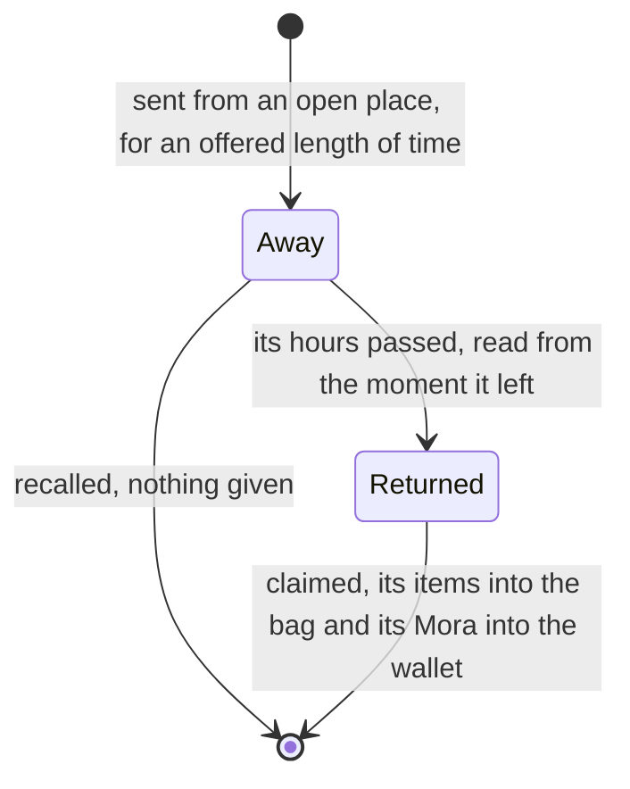

# Expeditions

The game sends characters out to gather while the player is away. Here the rules are pure services in `genshin-world`: a send, its return read from the moment it left, a claim that takes the rolled items into the bag and Mora into the wallet, and a recall that forfeits the reward. Mondstadt's places and the limit by rank come from the game's expedition tables (`~/Esposter.noindex/genshin-parity/text/ExcelBinOutput/ExpeditionDataExcelConfigData.json`, `~/Esposter.noindex/genshin-parity/text/ExcelBinOutput/PlayerLevelExcelConfigData.json`), each fetched by its key from the hosted game data. This page is what is built of [expeditions](../../../changes/archive/2026-10-22-genshin-expeditions/design.md). Katheryne's talk opens the screen (`~/Esposter.noindex/genshin-parity/captures/yt-fxIjhlV3vUA-expedition-screen.mp4`, at 18 seconds, where her talk lists the dispatch), so a player can send a character from the game, and the talents are applied (`packages/genshin-world/src/services/expedition/computeExpeditionPassives.test.ts`); the other nations' places are not built, and the bonus is its chance only.

## How it works

## Decisions

- **Sent for an offered length.** `sendExpedition` takes a character to a place for one of its durations, 4, 8, 12 or 20 hours (`~/Esposter.noindex/genshin-parity/text/ExcelBinOutput/ExpeditionDataExcelConfigData.json`, and the clip's 4h, 8h, 12h and 20h tabs at 40 seconds). It refuses the Traveler, a character who is down, a character already away, a place that is closed, and a send past the limit (`packages/genshin-world/src/services/expedition/sendExpedition.test.ts`). Expeditions open at Adventure Rank 14, the rank the wiki gives, which is also the lowest place's rank (`~/Esposter.noindex/genshin-parity/text/ExcelBinOutput/ExpeditionDataExcelConfigData.json`: places 101, 102, 201 and 202 name rank 14, and no place names a lower one).
- **Two at first, one more at 26, 31 and 36.** `computeExpeditionLimit` starts at two and adds each rank's `expeditionLimitAdd` from the player level table once the rank is reached (`~/Esposter.noindex/genshin-parity/text/ExcelBinOutput/PlayerLevelExcelConfigData.json`, the three rows with `expeditionLimitAdd` at levels 26, 31 and 36; `packages/genshin-world/src/services/expedition/computeExpeditionLimit.test.ts`).
- **A place opens by its conditions.** `checkIsExpeditionPlaceOpen` needs the place's Adventure Rank reached, its statue resonated with where it names one, and its quest finished where it names one (`packages/genshin-world/src/services/expedition/checkIsExpeditionPlaceOpen.test.ts`). The statue is named by its scene point: `computeUnlockedStatuePointIds` maps each unlocked landmark to its point through `LandmarkIdStatuePointIdMap`, which holds Windrise's statue as point 4 (`packages/genshin-world/src/services/statue/LandmarkIdStatuePointIdMap.ts`; the dump's place 102, Windrise, names point 4 in `~/Esposter.noindex/genshin-parity/text/ExcelBinOutput/ExpeditionDataExcelConfigData.json`), the only statue the region data holds (`packages/genshin-world/src/data/regions/mondstadt.json`, its one `StatueOfTheSeven`).
- **Returned from the moment it left.** `checkIsExpeditionReturned` moves the moment a send left on by its hours, so an expedition returns once its hours have passed, whether or not its screen is open, as the game's timer does. It returns at exactly that moment, not a nanosecond before (`packages/genshin-world/src/services/expedition/checkIsExpeditionReturned.test.ts`).
- **The reward is the place's preview.** A duration's reward is its reward preview's items, each with a count drawn from its least to its most by the caller's random source, as the wish pull takes its source. The game's reward ids for expeditions, 205010100 and its kin, are in no table the dump holds, so the preview is read as the reward (`~/Esposter.noindex/genshin-parity/text/ExcelBinOutput/ExpeditionDataExcelConfigData.json` names 205010100 as a duration's item, and no reward table holds it). Mora (item 202) goes to the wallet (`~/Esposter.noindex/genshin-parity/text/ExcelBinOutput/MaterialExcelConfigData.json`, record 202, `ITEM_VIRTUAL`, named 摩拉 in `~/Esposter.noindex/genshin-parity/text/TextMap/TextMap_MediumCHS.json`; its 625 count is in `~/Esposter.noindex/genshin-parity/text/ExcelBinOutput/RewardPreviewExcelConfigData.json`, preview 1021), every other item to the bag (`packages/genshin-world/src/services/expedition/claimExpedition.test.ts`).
- **A claim the bag cannot take whole is refused.** `claimExpedition` returns undefined where an item would overflow, and the expedition stays out, so no part of a reward is lost. The bag's full hint is the inventory's.
- **A recall forfeits the reward.** `recallExpedition` takes the character off the list and gives nothing, which is also what a claim does to the list.
- **Real time, held for the session.** An expedition is held as its character, place, hours and the moment it left, like the wallet's Original Resin moment. The [save](../save-data/design.md) does not hold the list, so it lasts for the session and a reload empties it.
- **Usable in the party while away.** The party reads no expedition state, so a character who is away is set into the party like one at home (`packages/genshin-world/src/services/party/setPartyTeamCharacters.test.ts`).
- **Settled calls from the data.** The table's `rankLevel` is zero for the expedition materials (`~/Esposter.noindex/genshin-parity/text/ExcelBinOutput/MaterialExcelConfigData.json`: records 101001, 101002, 101003, 100061 and 100064 carry no `rankLevel`), the game's unstarred items, so an item's rarity may be zero. The quest a place names, 39604 for Stormterror's Lair (`~/Esposter.noindex/genshin-parity/text/ExcelBinOutput/ExpeditionDataExcelConfigData.json`, place 106, named `Stormterror's Lair` in `~/Esposter.noindex/genshin-parity/text/TextMap/TextMapEN.json`), has no finished record to read, so a place that names one stays closed until quests keep one. The expedition's materials are game text keys in all fifteen languages (`~/Esposter.noindex/genshin-parity/text/TextMap/`: the name of item 101001, Iron Chunk, is held in all fifteen language maps), so their names read through `GameTextKey` as every other item's do.
- **Katheryne's talk opens the screen.** The game's menus hold no expedition entry (`~/Esposter.noindex/genshin-parity/comparisons/paimon-menu.png`, whose twelve entries hold none), so the screen opens from her talk: `checkIsExpeditionTalk` matches a talk to her NPC id once she is a resident of the region data (`packages/genshin-world/src/services/expedition/checkIsExpeditionTalk.test.ts`). She is placed at the Adventurers' building point by the lowest of her NPC rows, a provisional choice.
- **The expedition screen is an NPC screen kind.** It opens from a talk rather than the Paimon menu, so `ScreenKind.Expedition` joins `NPC_SCREEN_KINDS`, the screens that have no menu entry, no menu slot and no placeholder title, as the crafting and forge screens have none (`packages/genshin-world/src/services/screen/constants.ts`).
- **A character's expedition talent adds to a send or a reward.** A talent is a proud skill whose English description names an expedition (`~/Esposter.noindex/genshin-parity/text/ExcelBinOutput/ProudSkillExcelConfigData.json`, and the English text in `~/Esposter.noindex/genshin-parity/text/TextMap/`: fourteen groups, such as group 3223, "When dispatched on an expedition in Mondstadt, time consumed is reduced by 25%."), published as `expeditions/passives` (`packages/genshin-world/src/generated/gameDataLock.json`). Its percent and hours come from the description text, since `paramList` is zero on these rows (`~/Esposter.noindex/genshin-parity/text/ExcelBinOutput/ProudSkillExcelConfigData.json`, all fourteen), and it applies once its passive is unlocked at the character's ascension (`packages/genshin-world/src/components/World/Session/Index.vue`). A time talent shortens expeditions in its region by its percent, and a reward talent adds its percent to the rewards of expeditions in its region for its hours; the talents of the character sent are summed per effect. A region the text names that the model does not hold is an error (`packages/genshin-world/src/models/expedition/ExpeditionPassive.ts`), so a talent cannot silently never apply.
- **The bonus chance follows the sent character's level.** The table gives 20 percent from level 1, 40 from 21, 50 from 41, 60 from 51, 70 from 61, 80 from 71 and 90 from 81 (`~/Esposter.noindex/genshin-parity/text/ExcelBinOutput/ExpeditionBonusExcelConfigData.json`). `computeExpeditionBonusChance` takes the chance of the highest level the character has reached (`packages/genshin-world/src/services/expedition/computeExpeditionBonusChance.test.ts`). The table is read as the chance for a sent character who holds the bonus, which the dump does not state outright. The wiki's Exploration Talents page says such a bonus either shortens an expedition or adds materials to it. Neither source names those materials or their counts, so the chance is built and no item is paid until a source names one.

## Data

- **Read from the game's tables:** `ExpeditionDataExcelConfigData` for each place's nation, its rank and statue and quest conditions, and its durations and reward previews; `RewardPreviewExcelConfigData` for the items and their counts; `PlayerLevelExcelConfigData` for each rank's `expeditionLimitAdd`; `ExpeditionBonusExcelConfigData` for the bonus's chance by level; and `ProudSkillExcelConfigData`, whose English descriptions name the expedition talents (all five are in `~/Esposter.noindex/genshin-parity/text/ExcelBinOutput/`). The expedition tables, the reward preview table and the proud skill table are fetched from the community's dump into the game's text directory and not committed.
- **Published by** `pnpm -C scripts genshin:assets expeditions`, which publishes Mondstadt's places as the record `expeditions/mondstadt`, the limit's ranks as `expeditions/limits`, the bonus's chance as `expeditions/bonuses` and the talents as `expeditions/passives`, to the hosted game data (`packages/genshin-world/src/generated/gameDataLock.json`). `pnpm -C scripts genshin:assets items` writes the expedition materials into the items data beside the drops'.
- **Not read by this page:** "ExpeditionPathExcelConfigData" names the Adventurers' Guild's expedition missions, each with its team's elements (`~/Esposter.noindex/genshin-parity/text/ExcelBinOutput/ExpeditionPathExcelConfigData.json`, 27 rows, each with a `superElement`). A mission is not a place to send a character, so it is not read by this page.

## Not built yet

- **The other nations' places.** Only Mondstadt's places are published. A nation's places join when its statues are in the region data with their scene points.
- **Statues beyond Windrise's.** The places that name points 7 and 29 stay closed until those statues are in the region data.
- **The bonus's payload.** Its items and counts are in no table read, so no claim pays them. Its chance is read and computed by level, but no claim rolls it yet.

## Key files

| File                                                                              | Role                                                                                                                                           |
| :-------------------------------------------------------------------------------- | :--------------------------------------------------------------------------------------------------------------------------------------------- |
| `packages/genshin-world/src/models/expedition/Expedition.ts`                      | A character out: its place, its hours and the moment it left                                                                                   |
| `packages/genshin-world/src/models/expedition/ExpeditionPlace.ts`                 | A place: its rank, statue point, quest and durations with their items                                                                          |
| `packages/genshin-world/src/services/expedition/sendExpedition.ts`                | The rules a send is refused by                                                                                                                 |
| `packages/genshin-world/src/services/expedition/claimExpedition.ts`               | A claim: the rolled items into the bag, the Mora into the wallet                                                                               |
| `packages/genshin-world/src/services/expedition/recallExpedition.ts`              | A recall, forfeiting the reward                                                                                                                |
| `packages/genshin-world/src/services/expedition/checkIsExpeditionPlaceOpen.ts`    | A place open by its rank, statue and quest                                                                                                     |
| `packages/genshin-world/src/services/expedition/computeExpeditionLimit.ts`        | The most expeditions out at once at a rank                                                                                                     |
| `packages/genshin-world/src/services/statue/computeUnlockedStatuePointIds.ts`     | The scene points of the statues unlocked, the points a place names                                                                             |
| `packages/genshin-world/src/services/expedition/readMondstadtExpeditionPlaces.ts` | Mondstadt's places, fetched by key and checked on arrival                                                                                      |
| `scripts/src/services/genshinAssets/expeditions/buildMondstadtExpeditions.ts`     | The builder of the places record from the dump                                                                                                 |
| `scripts/src/services/genshinAssets/expeditions/buildExpeditionLimits.ts`         | The builder of the limit's ranks record from the dump                                                                                          |
| `packages/genshin-world/src/services/expedition/checkIsExpeditionTalk.ts`         | Whether a talk is Katheryne's, which opens the expedition screen                                                                               |
| `packages/genshin-world/src/services/expedition/computeExpeditionBonusChance.ts`  | The bonus chance at a character's level                                                                                                        |
| `packages/genshin-world/src/services/expedition/readExpeditionBonuses.ts`         | The bonus table, fetched by its key from the hosted game data                                                                                  |
| `packages/genshin-world/src/models/expedition/ExpeditionBonus.ts`                 | A bonus row: the level it names and its chance                                                                                                 |
| `packages/genshin-world/src/components/Expedition/Screen/Index.vue`               | The expedition screen's world wrapper over Mondstadt's slice                                                                                   |
| `packages/genshin-interface/src/components/ExpeditionScreen/Index.vue`            | The expedition screen's layout, drawn from the public clip (`~/Esposter.noindex/genshin-parity/captures/yt-fxIjhlV3vUA-expedition-screen.mp4`) |

## Notes

- **The statue map is one entry.** `LandmarkIdStatuePointIdMap` names Windrise's statue alone, since the component map holds its scene point and no other statue's point is in the region data. Each further statue adds its entry with its point.
- **The limit's ranks are read off the table.** The three ranks that raise it are the game's (`~/Esposter.noindex/genshin-parity/text/ExcelBinOutput/PlayerLevelExcelConfigData.json`); the base of two is the wiki's, as the proposal settles.

## Sources

- [Expedition](https://genshin-impact.fandom.com/wiki/Expedition), Genshin Impact Wiki: the unlock at rank 14 through Katheryne, any character but the Traveler for 4, 8, 12 or 20 hours, still usable while away, places opened by their statues, the timer running offline, recall forfeiting the reward, and two at once rising with rank.
- [Exploration Talents](https://genshin-impact.fandom.com/wiki/Exploration_Talents), Genshin Impact Wiki: the expedition bonus's kind, in its Expedition Bonuses section.
- [AnimeGameData](https://github.com/DimbreathBot/AnimeGameData), the community's per-patch dump: the expedition tables, the bonus table, the proud skills that carry the talents, the reward previews and the player level table's expedition limit.

## Open

- [ ] **The base limit of two** — no source yet: the wiki's Expedition page is not cached and the dump holds no base limit; the clip's "Expedition Limit: 1/2" does not show its player's Adventure Rank. The code starts `computeExpeditionLimit` at two (`packages/genshin-world/src/services/expedition/computeExpeditionLimit.ts`), which is the claim's source-less half.
- [ ] **The game's menus hold no expedition entry** — no source yet: no capture of the Paimon menu's entries shows that none is an expedition.
- [ ] **A talent applies once its passive is unlocked at the character's ascension** — no source yet: the dump's rows for these talents carry no `breakLevel`, and no test holds the ascension unlock.
- **The session keeps each character's passives at or below its ascension** — `packages/genshin-world/src/components/World/Session/Index.vue` filters them by `phase <= ascension`, and only those reach the expedition talents.
- **A talent's region the model does not hold is refused at the read** — `packages/genshin-world/src/models/expedition/ExpeditionPassive.ts` parses `region` as `z.enum(ExpeditionRegion)`, and `packages/genshin-world/src/services/data/readGameData.ts` (`schema.parse`) throws on a region outside it.
