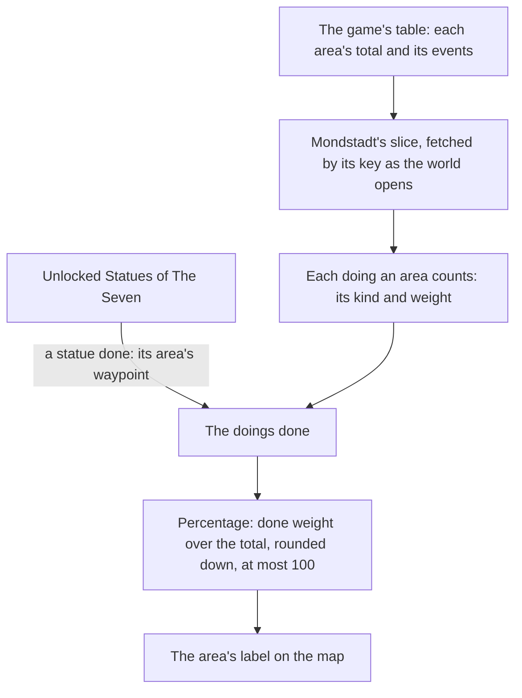

# Exploration progress

In the game the map shows how much of each area a player has explored, as a percentage. This page is what is built of [exploration progress](../../../changes/genshin-exploration-progress/design.md): the game's table gives Mondstadt's level-one areas their totals and the events each counts (`{data-root}/genshin-dump-backup-6.6/ExcelBinOutput/ExploreAreaTotalExpExcelConfigData.json`, `{data-root}/genshin-dump-backup-6.6/ExcelBinOutput/WorldAreaExploreEventConfigData.json`), and the map's label for an area shows its percentage once a statue in it is unlocked (in the [map page](../compute/map/design.md)'s recording, at 4.6 s). Windrise is a town of Galesong Hill (`{data-root}/genshin-dump-backup-6.6/ExcelBinOutput/WorldAreaConfigData.json`, row 1201), so Galesong Hill is the first area counted (`scripts/src/services/genshinAssets/exploration/ExploreAreaCatalogueIdMap.ts`). Only its statue's waypoint is done, since chests and camps have no record in the world (`packages/genshin-world/src/services/exploration/computeExploredDoingIds.ts`), and the percentage's scale waits on a recording of more than one step.

## How it works

- **Read from the table, for Mondstadt.** `pnpm -C scripts genshin:assets exploration` builds the slice from the dump's `ExploreAreaTotalExpExcelConfigData` and `WorldAreaExploreEventConfigData` and publishes it to the hosted game data as `exploration/mondstadt` (`scripts/src/services/genshinAssets/exploration/buildMondstadtExplorationAreas.ts`). The slice holds, for each of the level-one areas Mondstadt holds (Starfell Valley, Galesong Hill, Windwail Highland and Brightcrown Mountains), its total, its reputation ratio and its counted doings (the totals 273, 146, 218 and 211 of area IDs 1 to 4 in `{data-root}/genshin-dump-backup-6.6/ExcelBinOutput/ExploreAreaTotalExpExcelConfigData.json`, each named in `WorldAreaConfigData.json` as rows 1100, 1200, 1300 and 1400). The world fetches it by its key as the session starts (`readMondstadtExplorationAreas`, `packages/genshin-world/src/services/exploration/readMondstadtExplorationAreas.ts`), and checks it against its schema as it arrives.
- **Three kinds are counted.** A camp (`EXPLORE_EVENT_CLEAR_GROUP_MONSTER`), a chest (`EXPLORE_EVENT_OPEN_CHEST`) and a waypoint (`EXPLORE_EVENT_UNLOCK_POINT`) (`{data-root}/genshin-dump-backup-6.6/ExcelBinOutput/WorldAreaExploreEventConfigData.json`, `scripts/src/services/genshinAssets/exploration/ExploreEventKindMap.ts`). The table also lists gathered items (`EXPLORE_EVENT_ITEM_ADD`), which are the ingredients picked up from plants and ores, and a force entered ("EXPLORE_EVENT_ENTER_FORCE") (EventIDs 21 to 38 and 39 in the same file). Neither is one of the kinds the progress is read from, so both are left out. Whether a picked ingredient counts is one of the questions the recording settles.
- **A statue done is its area's waypoint done.** `computeExploredDoingIds` names an area's waypoint done once a Statue of The Seven in that area is unlocked. Each Mondstadt area holds one waypoint event, which is its statue's, so a statue completes exactly one doing (one `EXPLORE_EVENT_UNLOCK_POINT` each, EventIDs 1, 40, 77 and 78 in `{data-root}/genshin-dump-backup-6.6/ExcelBinOutput/WorldAreaExploreEventConfigData.json`). Chests and camps are never done, since the world keeps no record of opening or clearing them (`packages/genshin-world/src/services/exploration/computeExploredDoingIds.ts`).
- **The label shows the game's line.** Each area's label is drawn once a landmark in it is unlocked, and under its name it shows "Exploration Progress: 99%", the game's `UI_EXPLORE_COUNT` with the percentage filled in (`{data-root}/genshin-parity/text/ManualTextMapConfigData.json` names it, and `{data-root}/genshin-parity/text/TextMap/TextMap_MediumEN.json` gives its text), and no count: the English map over Galesong Hill (in the [map page](../compute/map/design.md)'s recording, at 4.6 s) shows only the percentage. At 100 the line is `UI_EXPLORE_COUNT_MAX`, whose percentage the game colours gold through its own colour tag (`{data-root}/genshin-parity/text/TextMap/TextMap_MediumEN.json`, and the capture at 10.5 s), drawn as a run of its own ([game text](../game-text/design.md)). `computeExplorationProgress` takes the done weight as a share of the area's total, rounds it down and holds it at 100, so a weight past the total never reads past the game's gold 100% (`packages/genshin-world/src/services/exploration/computeExplorationProgress.ts`).
- **Counted once.** The done doings are a set of ids, so a doing adds its weight a single time however it is reached (`packages/genshin-world/src/services/exploration/computeDoneWeight.ts`).
- **The scale is provisional.** The table gives every counted doing a weight of ten, and Galesong Hill's counted doings at ten each sum to 190 (`{data-root}/genshin-dump-backup-6.6/ExcelBinOutput/WorldAreaExploreEventConfigData.json`) against its total of 146 (`{data-root}/genshin-dump-backup-6.6/ExcelBinOutput/ExploreAreaTotalExpExcelConfigData.json`). So the table's weights cannot be shares of the total as read. The one recording of the map's steps shows Galesong Hill going from 99% to 100% (`{data-root}/genshin-parity/captures/yt-kgW2IgWKukg-exploration-steps.mp4`, the label at 99% from about 3.5 to 5 s and at 100% from about 10.5 s), a step nearly any chest's weight fits, so the percentage stays provisional until a recording shows more steps.

## Key files

| File                                                                               | Role                                                                                      |
| :--------------------------------------------------------------------------------- | :---------------------------------------------------------------------------------------- |
| `packages/genshin-world/src/services/exploration/computeExplorationProgress.ts`    | An area's percentage, the done weight over its total, rounded down and at most 100        |
| `packages/genshin-world/src/services/exploration/computeExploredDoingIds.ts`       | The doings an area's unlocked statue has done                                             |
| `packages/genshin-world/src/services/exploration/readMondstadtExplorationAreas.ts` | The Mondstadt slice, fetched from the hosted game data and parsed                         |
| `packages/genshin-world/src/composables/useExplorationAreas.ts`                    | Reads the slice as the world opens, logging a slice that fails                            |
| `packages/genshin-world/src/components/Map/Overlay/Index.vue`                      | Shows each filled area's progress line under its name, and lists them for a screen reader |
| `packages/genshin-world/src/models/exploration/ExplorationArea.ts`                 | An area's total, its reputation ratio and the doings its progress counts                  |
| `scripts/src/services/genshinAssets/exploration/buildMondstadtExplorationAreas.ts` | Builds the Mondstadt slice from the dump, for publishing                                  |
| `scripts/src/services/genshinAssets/exploration/ExploreEventKindMap.ts`            | The event types the progress counts, each as its kind                                     |
| `scripts/src/services/genshinAssets/exploration/ExploreAreaCatalogueIdMap.ts`      | Each level-one area the world holds, by its catalogue area                                |

## Notes

- **Windrise's area.** Windrise is a level-two area of Galesong Hill (`{data-root}/genshin-dump-backup-6.6/ExcelBinOutput/WorldAreaConfigData.json`, row 1201, its `areaID1` 2 and `areaID2` 201).
- **Not built.** Mondstadt's Reputation is kept in the [save](../save-data/design.md), but its thresholds are not paid: the [proposal](../../../changes/genshin-exploration-progress/design.md) records paying each one as the count reaches it.
- **The label's measures are the game's, its face is not.** The name's and the line's sizes and the line's place below the name are read off the English map over Galesong Hill at 4.6 seconds (in the [map page](../compute/map/design.md)'s recording): capitals 28.8 and 16.0 pixels high, their middles 45.9 apart, white with no outline. Signika stands in for the game's face, spaced out toward each line's width, and its strokes are the difference left: the label scores within the 2% bar of the [map](../map/design.md) over its glyphs' silhouettes (`scripts/src/services/genshinParity/shared/ParityReferenceMap.snapshot.md`, the `map-overlay-galesong` row).

## Sources

- [AnimeGameData](https://github.com/DimbreathBot/AnimeGameData), the community's per-patch dump: the explore total and event tables, read as the references folder's copies and never committed.
- Progress counts camps, chests and waypoints only, scenario "Gathered item adds no weight": (EventIDs 21 to 38, each `EXPLORE_EVENT_ITEM_ADD` in `{data-root}/genshin-parity/text/ExcelBinOutput/WorldAreaExploreEventConfigData.json`)
- Progress counts camps, chests and waypoints only, scenario "Force entered adds no weight": (EventID 39, "EXPLORE_EVENT_ENTER_FORCE" in `{data-root}/genshin-parity/text/ExcelBinOutput/WorldAreaExploreEventConfigData.json`)

## Open

- [ ] **The label appears once a statue in its area is unlocked, as the game does** — no source: the cached Map and Exploration wiki pages are not on disk, and the capture shows the label but not the unlock.
- [ ] **The Windrise statue is Galesong Hill's waypoint, the one doing its statue completes** — no source: event 40 of the table names point 4, and no row read ties that point to the statue at Windrise.
- [ ] **A single chest took Galesong Hill from 99% to 100%** — no source: the capture shows the step near 10 s, but no frame read shows the chest that caused it.
- [ ] **The label's capitals are 28.8 and 16.0 pixels high, their middles 45.9 apart** — no source: a file recording the label's capital heights and spacing, measured on the frame at 4.6 s.
- [ ] **The English map reads the fully explored area in gold 100%** — no source: a frame of the recording at 10.5 s read for its rendered gold, beyond the colour tag `#FFCC33` in `{data-root}/genshin-parity/text/TextMap/TextMap_MediumEN.json`.
