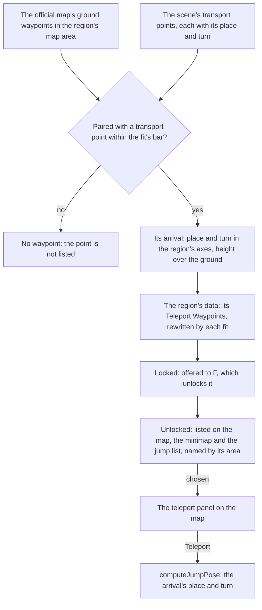

# Exploring

A Teleport Waypoint is a jump target, and every jump lands at the game's own arrival place, facing the turn the game gives there (`~/Esposter/genshin-parity/text/BinOutput/Scene/Point/scene3_point.json`, point 1865's `tranPos` and `tranRot`). This page is how the waypoints come to be in the world's data: each ground waypoint on the official map paired with the scene's transport point it stands at, the arrival each of them carries, and the jump that reads them. The [map](../map/design.md) page owns the map's drawing and the fade a jump makes, and [spawned places](../spawned-places/design.md) owns the fit the pairs are matched through.

## How it works

## The fit

Mondstadt is the first region fitted, and the regions the waypoints command writes are the ones `WAYPOINT_REGIONS` names (`scripts/src/services/genshinAssets/shared/constants.ts`, line 417, which holds `mondstadt` alone.

- **Only ground waypoints pair.** A waypoint is a point the official map labels as a Teleport Waypoint on the ground layer, within the region's own map area. Waypoints on a floor under the ground are never listed (`scripts/src/services/genshinAssets/fit/toWaypointLandmarks.ts`, lines 17 to 20). Each one is matched to a transport point of the scene under the fitted similarity, within the fit's bar (`INTERACTIVE_MAP_FIT_BAR`, 20 in `scripts/src/services/genshinAssets/points/constants.ts`, line 28, used at `scripts/src/services/genshinAssets/fit/toWaypointLandmarks.ts`, line 47), and a transport point no waypoint pairs with gives none.
- **Each waypoint carries its arrival.** `toLandmarkArrival` carries the transport point's place and turn round the world's origin into the region's axes, as every other place is, and takes its height over the world's ground at that place (`scripts/src/services/genshinAssets/shared/toLandmarkArrival.ts`). The waypoint's own position, rotation and height offset are that arrival's values, so the place it stands at and the place a jump lands are the same.
- **Its id and its area.** A waypoint's id is its region, the word `waypoint` and the transport point's id, the same id its first-unlock reward would be keyed by (Mondstadt's waypoints, which `packages/genshin-world/src/data/regions/mondstadt.json` holds, carry ids such as `mondstadt-waypoint-1865`). Its area is the catalogue area whose outline is nearest its arrival, so a waypoint standing outside every outline still names one (`scripts/src/services/genshinAssets/fit/findAreaId.ts`).
- **One command writes it.** `pnpm -C scripts genshin:assets waypoints` writes each region's waypoints into its region file, replacing the waypoints an earlier run wrote and keeping the region's other landmarks. Its `--dry-run` counts them and writes nothing, and a region whose file would not change is not written (`scripts/src/services/genshinAssets/commands/waypointsCommand.ts` for the flag; `scripts/src/services/genshinAssets/fit/fitRegionWaypoints.ts`, lines 43 and 46, for the replacement and the unchanged file).
- **Statues get their arrival from the same scene.** `fitRegionLandmarks` gives each Statue of The Seven the arrival of the transport point it stands at. A statue with no such point is an error rather than a statue a jump cannot reach (`scripts/src/services/genshinAssets/fit/fitRegionLandmarks.ts`, lines 44 to 48).

## The jump

- **Three kinds jump.** `JUMP_LANDMARK_KINDS` holds the Statue of The Seven, the Teleport Waypoint and the domain entrance (`packages/genshin-world/src/services/map/constants.ts`). A tree or a building is never a jump target.
- **A waypoint always has an arrival.** `WaypointLandmark` requires its `arrival` in its schema (`packages/genshin-world/src/models/world/WaypointLandmark.ts`, line 16). Every landmark's base allows one, and `computeJumpPose` treats a jump to a landmark without one as an error, since there is nowhere to land (`packages/genshin-world/src/services/map/computeJumpPose.ts`, line 9).
- **The landing is the arrival.** `computeJumpPose` puts the character at the arrival's place, at its height offset and facing its rotation (`packages/genshin-world/src/services/map/computeJumpPose.ts`, lines 11 to 14).
- **Only unlocked landmarks are offered.** `useWorldMap` gives the map, the minimap, the jump list and a revive the unlocked jump landmarks alone, whether they are statues, waypoints or domain entrances (`packages/genshin-world/src/composables/useWorldMap.ts`, line 22). A locked one is offered to F under its own title, a Teleport Waypoint's "Teleport Waypoint" and a statue's "Statue of The Seven" (`computeJumpLandmarkTextKey`; `packages/genshin-text/src/generated/text/English.json`, lines 499 and 500), and activating it unlocks it.
- **The jump list names by area.** It groups the jumps by region, and each is named by its area's name, so a waypoint and a statue in one area read alike (`packages/genshin-world/src/components/Map/JumpList/Index.vue`, lines 20 to 26).

## Data and measures

- **Read from the game:** the scene's transport points, each with its place, turn and height, read by `readSceneTransportPoints` from the scene points of the kind Windrise's statue holds (`scripts/src/services/genshinAssets/world/readSceneTransportPoints.ts`, lines 10 to 12). The official map's ground waypoints come from the map's references, as the [spawned places](../spawned-places/design.md) page reads them (`scripts/src/services/genshinAssets/fit/fitRegionWaypoints.ts`, line 19, through `readFittedRegions`).
- **Written into region data:** each waypoint's id, arrival, position, rotation, height offset and area, in the `TeleportWaypoint` kind (`scripts/src/services/genshinAssets/fit/toWaypointLandmarks.ts`, line 17, and `fitRegionWaypoints.ts`, line 43).
- **Measured:** nothing new. The pairing holds to the bar the statues' fit holds to (`INTERACTIVE_MAP_FIT_BAR`, `scripts/src/services/genshinAssets/points/constants.ts`, line 28, which `scripts/src/services/genshinAssets/fit/fitInteractiveMap.ts` and `toWaypointLandmarks.ts` both use).

## Key files

| File                                                                       | Role                                                                      |
| :------------------------------------------------------------------------- | :------------------------------------------------------------------------ |
| `packages/genshin-world/src/services/transPoint/computeLandmarkPointId.ts` | A landmark's scene point: a statue's by its map, a waypoint's by its id   |
| `scripts/src/services/genshinAssets/fit/toWaypointLandmarks.ts`            | Pairs each ground waypoint with a transport point and builds its landmark |
| `scripts/src/services/genshinAssets/fit/fitRegionWaypoints.ts`             | Writes each fitted region's waypoints into its region file                |
| `scripts/src/services/genshinAssets/commands/waypointsCommand.ts`          | The `waypoints` command of `genshin:assets`                               |
| `scripts/src/services/genshinAssets/shared/toLandmarkArrival.ts`           | A transport point as a landmark's arrival                                 |
| `scripts/src/services/genshinAssets/fit/fitRegionLandmarks.ts`             | Gives each statue its arrival from its scene point                        |
| `scripts/src/services/genshinAssets/world/readSceneTransportPoints.ts`     | Reads every transport point of the scene                                  |
| `scripts/src/services/genshinAssets/shared/constants.ts`                   | `WAYPOINT_REGIONS`, the regions whose waypoints are written               |
| `scripts/src/services/genshinAssets/points/constants.ts`                   | `INTERACTIVE_MAP_FIT_BAR` and the waypoint's label on the official map    |
| `packages/genshin-world/src/models/world/WaypointLandmark.ts`              | The Teleport Waypoint landmark, its arrival required                      |
| `packages/genshin-world/src/models/world/LandmarkArrival.ts`               | A landmark's arrival: place, turn and height                              |
| `packages/genshin-world/src/models/world/BaseLandmark.ts`                  | The fields every landmark has, and the optional arrival                   |
| `packages/genshin-world/src/services/map/constants.ts`                     | `JUMP_LANDMARK_KINDS`, the kinds a jump lands at                          |
| `packages/genshin-world/src/services/map/computeJumpPose.ts`               | Where a jump lands and which way it faces                                 |
| `packages/genshin-world/src/composables/useWorldMap.ts`                    | Unlocks landmarks and offers the unlocked jump landmarks                  |
| `packages/genshin-world/src/composables/useJumpLandmarks.ts`               | Every region's jump landmarks, read once                                  |
| `packages/genshin-world/src/data/regions/mondstadt.json`                   | Mondstadt's landmarks, its waypoints among them                           |

## Notes

- **A waypoint's first unlock pays its point's reward.** `computeLandmarkPointId` keys each waypoint by the point its id ends in (`packages/genshin-world/src/services/transPoint/computeLandmarkPointId.ts`), so its Primogems and Adventure EXP are the point's row, as the [map unlocking](../map-unlocking/design.md) page sets out, and the waypoints in points 1865 to 2051 pay nothing (`~/Esposter/genshin-parity/text/ExcelBinOutput/TransPointRewardConfigData.json` holds no row for those points, and `packages/genshin-world/src/data/regions/mondstadt.json` holds the waypoints in that range). The transport-point achievement counts only the statue `LandmarkIdStatuePointIdMap` names (`packages/genshin-world/src/services/statue/computeUnlockedStatuePointIds.ts`, line 12, over a map that holds only `windrise-statue-of-the-seven`), so a waypoint's unlock counts toward it not at all.
- **Only the regions in `WAYPOINT_REGIONS` have waypoints.** (`scripts/src/services/genshinAssets/shared/constants.ts`, line 417.) Each further region is added to that list once its map fit is checked.

## Sources

- [Teleport Waypoint](https://genshin-impact.fandom.com/wiki/Teleport_Waypoint), Genshin Impact Wiki: the fast-travel points a jump goes to.

## Open

- **Mondstadt's region data holds its waypoints, with ids such as `mondstadt-waypoint-1865`** — `packages/genshin-world/src/data/regions/mondstadt.json` holds that id, and eleven of its waypoints fall in points 1865 to 2051 by the number after each id's last hyphen.
- **Each scene transport point is read from the scene points Windrise's statue holds** — `scripts/src/services/genshinAssets/world/readSceneTransportPoints.ts` (lines 10 to 12), whose kind is the one the Windrise statue point names.
- **The official map's ground waypoints are read from the map's references** — `scripts/src/services/genshinAssets/points/readFittedMapPoints.ts` (lines 12 to 22) reads the official map's points with the fit's transform, and `scripts/src/services/genshinAssets/fit/fitRegionWaypoints.ts` (line 19) takes them through `readFittedRegions`.
- **Mondstadt has eleven of its waypoints in points 1865 to 2051** — counted from `packages/genshin-world/src/data/regions/mondstadt.json` by the number after each id's last hyphen.
