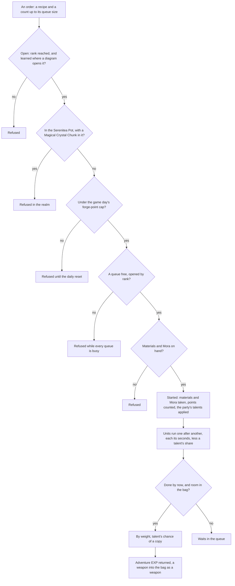

# Forging

The blacksmith's rules are over the game's own forge table: which recipes a player has open, how many queues they may run, what an order costs and when its units finish, what a unit yields, and how many forge points a game day may hold. This page is the build of the [forging](../../../changes/genshin-forging/design.md) proposal, covering its recipes, queues by rank, real-time orders, the daily cap, the weapons from billets, the drop-table Mystic, the forging talents and the Serenitea Pot's refusal. The blacksmith's place stays in the proposal.

## How it works

## The recipes

`pnpm -C scripts genshin:assets forging` builds one record, the blacksmith's recipes, from the game's forge table `ForgeExcelConfigData` and publishes it to the hosted game data as `forging/recipes`, with each recipe's diagrams read off the material table's uses. Each recipe's results come from its own row, or for a row with no fixed result from the forge random table `ForgeRandomExcelConfigData`, which the builder reads alongside it.

- **Enhancement ores.** The Normal, Fine and Mystic Enhancement Ores, each with its ingredients, its Mora, its seconds per item, the most one queue holds and its forge points (`{data-root}/genshin-dump-backup-6.6/ExcelBinOutput/ForgeExcelConfigData.json`, rows 11001 to 11003: `materialItems` 2 of `101001`, 3 of `101002` and 4 of `101003`; `scoinCost` 5, 10 and 50, the field that holds Mora, as the ascension rows' 20000 does; `forgeTime` 3, 6 and 180; `queueNum` 40, 20 and 10; `forgePoint` 400, 2000 and 10000).
- **The Mystic Enhancement Ore.** Three Magical Crystal Chunks and ten Original Resin (`{data-root}/genshin-dump-backup-6.6/ExcelBinOutput/ForgeExcelConfigData.json`, row 12001: 3 of `101004`, 10 of `106`), five seconds and one at a time, with no forge points (the same row: `forgeTime` 5, `forgePoint` 0), so it counts nothing toward the day's cap. Each unit yields one of two results at equal weight, six Mystic Enhancement Ores or one hundred Adventure EXP (`{data-root}/genshin-dump-backup-6.6/ExcelBinOutput/ForgeRandomExcelConfigData.json`, table 20001: 6 of `104013` and 100 of `102`, each at weight 10000; the names of `101004`, `106` and `102` are the hashes 2057452708, 3246419172 and 2333094364 in `{data-root}/genshin-parity/text/TextMap/TextMap_MediumEN.json`, through `MaterialExcelConfigData.json`).
- **Four-star weapons.** The swords, claymores, polearms, catalysts and bows, each forged from its region's billet with ores, one unit at a time, each yielding its weapon (`ForgeExcelConfigData.json`, rows 13001 to 19005: the weapon rows, each of rank four with `queueNum` 1, one billet from `101101` to `101105` or `101111` to `101120`, and 50 each of two ores, save that row 13013 takes 8 of `100619` for its second). Rows 13001 to 13010 open at Adventure Rank 5 with no diagram, and every later weapon row opens at rank 10 behind its diagram, each rank being the row's `playerLevel` under Open below. No diagram names one of rows 13001 to 13010: the first weapon row a diagram names is 13011 (`{data-root}/genshin-dump-backup-6.6/ExcelBinOutput/MaterialExcelConfigData.json`, row 221010, an `ITEM_USE_UNLOCK_FORGE` use), so the dump's rank of 5 is the only gate the game's data gives them, and the wiki's Forging page gives the queues' ranks, not a recipe's.
- **Left out.** The widget rows, the gadgets' own recipes, which the [gadgets](../../../changes/genshin-gadgets/design.md) proposal owns.

## The rules

- **Open.** Recipes open as the [crafting](../crafting/design.md) page sets out. A recipe opens at the rank its forge row's `playerLevel` gives, and, where a diagram opens it, once that diagram is learned: the diagrams are the material rows whose unlock use names the recipe (`{data-root}/genshin-dump-backup-6.6/ExcelBinOutput/ForgeExcelConfigData.json` line 469 for row 13001's rank of 5, and `{data-root}/genshin-dump-backup-6.6/ExcelBinOutput/MaterialExcelConfigData.json`). Every row the table hides has a diagram, and every row a diagram names is hidden, and the builder refuses a hidden row with none (`scripts/src/services/genshinAssets/forging/toForgeRecipe.ts`). The order is refused below the rank or without the diagram (`packages/genshin-world/src/services/forging/checkIsForgeRecipeOpen.ts` lines 7 to 8).
- **Queues by rank.** One queue opens at first, and each later queue opens at the rank `FORGE_QUEUE_PLAYER_LEVELS` declares for it, as the forge update table holds them (`{data-root}/genshin-dump-backup-6.6/ExcelBinOutput/ForgeUpdateExcelConfigData.json`: queues 1 to 4 at Adventure Rank 1, 5, 10 and 15). Splitting one recipe across queues forges it in parallel: each queue holds one order, of up to the recipe's queue size.
- **Orders.** An order takes its materials and Mora when it is started, every unit's at once, and starts at once in a free queue (`packages/genshin-world/src/services/forging/startForge.test.ts` lines 68 to 80). Original Resin is paid from the wallet as [crafting](../crafting/design.md) pays it, so the Mystic's ten are never taken from the bag. Its units then run and finish into the bag as [cooking](../cooking/design.md) describes. A queue whose order is fully collected is free again.
- **Results.** A unit's result is drawn by the weight each of its recipe's results holds. A recipe with one result always yields it. Adventure EXP is a virtual item, so the collection returns it rather than putting it in the bag. A weapon recipe's result is a weapon: the bag takes it as one entry of its own at level 1, filed in the weapons tab, with no rank of its own since the tab sorts it by level and quality (`packages/genshin-world/src/services/forging/collectForgeOrder.test.ts` lines 148 to 203).
- **Real time, at any blacksmith.** A queue is kept with when its order began and the seconds each unit takes, so it finishes on time whether or not the forge is open, and the forge is one state: what is forged is collected at any blacksmith. The [save](../save-data/design.md) does not hold the queues, so a reload empties them (`packages/genshin-world/src/composables/useWorldForging.ts` lines 55 to 60), and the game also treats its blacksmiths as one forge (`{data-root}/cache/genshin-wiki/Page_Forging.json`, wikitext line 13). A unit the bag has no room for waits in its queue (`packages/genshin-world/src/services/forging/collectForgeOrder.test.ts` lines 132 to 146), and the units done by a moment are taken in while the rest stay queued (`packages/genshin-world/src/services/forging/collectForgeOrder.test.ts` lines 60 to 71).
- **A daily cap.** An order's forge points count toward the game day's cap, `FORGE_DAILY_POINT_CAP`, when it is started, Normal, Fine and Mystic together. A forge point is one point of Weapon EXP: each enhancement ore's `forgePoint` (`{data-root}/genshin-dump-backup-6.6/ExcelBinOutput/ForgeExcelConfigData.json` lines 16, 70 and 124, at 400, 2000 and 10000) equals the Weapon EXP its use gives (`{data-root}/genshin-dump-backup-6.6/ExcelBinOutput/MaterialExcelConfigData.json` lines 150101, 150173 and 150245), and the wiki's cap is 400,000 Weapon EXP (`{data-root}/cache/genshin-wiki/Page_Forging.json`, wikitext line 25). An order that would pass the cap is refused until the game day turns at four in the morning in the game's time zone (`{data-root}/cache/genshin-wiki/Page_Reset.json`, wikitext line 2), and the day's points restart with it. A weapon counts none.
- **Forging talents.** The characters in the party give the blacksmith their talents, for the forge type each names. Venti's and Bennett's apply to the enhancement ores, Diluc's, Zhongli's and Ganyu's to the claymore, polearm and bow:
  - **Reduce time.** Venti: an enhancement ore's unit takes a fifth less time. Read when the order starts.
  - **Extra result.** Bennett: each enhancement ore unit has a one-in-five chance to yield an extra copy of its result. Read when the unit is collected.
  - **Refund ore.** Diluc, Zhongli and Ganyu: each weapon of their type refunds fifteen per cent of the ores its units take, the ores being the forge's own, Normal to Mystic inputs. The depots `{data-root}/genshin-dump-backup-6.6/ExcelBinOutput/AvatarSkillDepotExcelConfigData.json` tie them to proud groups 1623, 3023 and 3723, each described as refunding 15% of its weapon type's ore (`{data-root}/genshin-parity/text/TextMap/TextMap_MediumEN.json`). Refunded when the order starts, and a refund the bag has no room for is lost.
- **The Serenitea Pot's refusal.** In the Serenitea Pot's realm, a recipe that takes a Magical Crystal Chunk is refused, and it is forged anywhere else. The realm is not built, so the refusal waits on it.
- **Refusal words.** The three enhancement ores' refusals are the game's own lines, kept in `genshin-text` under one key for each ore, for the screen to show. The English text map holds each of the three lines under the hash its forge row names, as "forgePointNoticeTextMapHash" in `{data-root}/genshin-dump-backup-6.6/ExcelBinOutput/ForgeExcelConfigData.json` lines 17, 71 and 125 (`{data-root}/genshin-dump-backup-6.6/TextMap/TextMap_MediumEN.json` lines 136861, 204101 and 13500).

## Key files

| File                                                                              | Role                                                                        |
| :-------------------------------------------------------------------------------- | :-------------------------------------------------------------------------- |
| `scripts/src/services/genshinAssets/forging/buildForgingRecipes.ts`               | The recipes built from the forge table and its random table, for publishing |
| `scripts/src/services/genshinAssets/forging/toForgeRecipe.ts`                     | One forge row as a recipe, or left out                                      |
| `scripts/src/services/genshinAssets/forging/toForgeResults.ts`                    | A row's results: its fixed result, or the random table its drop names       |
| `scripts/src/services/genshinAssets/forging/constants.ts`                         | The drop id that names each random table                                    |
| `scripts/src/services/genshinAssets/items/readUnlockItemIdMap.ts`                 | Each recipe's diagrams, read off the material table's uses                  |
| `scripts/src/services/genshinAssets/items/buildItems.ts`                          | The forge's and the drops' items, published in the items slice              |
| `packages/genshin-world/src/models/forging/ForgeProgress.ts`                      | The learned recipes, the queues' orders and the day's forge points          |
| `packages/genshin-world/src/models/forging/ForgeResult.ts`                        | One result a unit yields, its count and its weight                          |
| `packages/genshin-world/src/models/forging/ForgeTalent.ts`                        | A forging talent: its kind, its forge type and its ratio                    |
| `packages/genshin-world/src/services/forging/constants.ts`                        | The daily cap, the queue ranks, the talents by character                    |
| `packages/genshin-world/src/services/forging/computeForgeTalents.ts`              | The talents the party's characters give                                     |
| `packages/genshin-world/src/services/forging/startForge.ts`                       | An order started in a free queue, its materials, Mora and talents           |
| `packages/genshin-world/src/services/forging/refundForgeOres.ts`                  | The ores a weapon's refund talent gives back into the bag                   |
| `packages/genshin-world/src/services/forging/obtainForgeOrder.ts`                 | A queue obtained: its results taken in, the Adventure EXP gained            |
| `packages/genshin-world/src/services/forging/collectForgeOrder.ts`                | Each finished unit's result taken in, the rest waiting                      |
| `packages/genshin-world/src/services/forging/drawForgeResult.ts`                  | One unit's result drawn by weight                                           |
| `packages/genshin-world/src/services/forging/checkIsForgeRecipeRefusedInRealm.ts` | Whether the Serenitea Pot refuses a recipe                                  |
| `packages/genshin-world/src/services/forging/checkIsForgeDailyCapReached.ts`      | Whether an order would pass the game day's forge points                     |
| `packages/genshin-world/src/services/forging/getBlacksmithPlace.ts`               | The blacksmith's place on the map                                           |
| `packages/genshin-world/src/services/forging/computeForgeQueueCount.ts`           | The queues an Adventure Rank opens                                          |
| `packages/genshin-world/src/services/forging/learnForgeRecipe.ts`                 | A recipe learned from a diagram in the bag                                  |
| `packages/genshin-world/src/services/forging/readForgeRecipes.ts`                 | The blacksmith's recipes, fetched by their `forging/recipes` key            |
| `packages/genshin-world/src/services/inventory/constants.ts`                      | The wallet's item ids, each currency's among them                           |
| `packages/genshin-text/src/models/GameTextKey.ts`                                 | The enhancement ores' refusal words                                         |

## Notes

- **The blacksmith's place is not on the map.** The official map has no blacksmith label, so the forge's place is the Mondstadt scene's own NPC rather than a spawned place. It waits on the region's placements. Every blacksmith is one forge, so the rules need no place. The place feeds only the world's own interaction prompt (`packages/genshin-world/src/composables/useWorldInteractables.ts` lines 146 to 151), and the map's store names neither the forge nor the blacksmith (`packages/genshin-world/src/store/map.ts`).
- **The screen shows the forge.** Its Materials and Forge Queues tabs read the forge state, and the refusal words show under their keys. The Required line's label is the crafting bench's key, `CraftingRequired`, which the dump files under `UI_COMMON_ITEM_NEED` (`{data-root}/genshin-parity/text/TextMap/TextMap_MediumEN.json`, hash 999265529); the English "Required" is filed under four other manual names as well (`{data-root}/genshin-parity/text/ExcelBinOutput/ManualTextMapConfigData.json`: `UI_RD_Require`, "UI_HOMEWORLD_FASTGET_NEED", "UI_BEYOND_BP_BUYXPPAGE_BUY_REQEUST" and "UI_BREAK_MATERIAL_PREVIEW_MOLA_NEED"), so the install's check confirms that id. The Materials tab's sort pill is drawn as its cream shell and its toggle with no word in it: its words are "Sort/All", and the dump names no id for the pill. "Sort" is "UI_BUTTON_SORT" (hash 1202066637 in the same Medium map), but "All" is one of many ids, so the pill's words wait for a text id the install names. Against the three forge stills (`{data-root}/genshin-parity/references/forge-screen.png`, `forge-screen-queues.png` and `forge-screen-ores-done.png`), the title, the coins, the recipe and queue names, the Forged line and the Start and Obtain labels are set at the game's cap height and letter-spaced to its widths, and the Start and Obtain pills stand 78 high (`packages/genshin-interface/src/components/ForgeScreen/Index.vue`). What is left is the game's art, which cannot ship: the item icons, the hammer, the coin and the Start ring, the queue's lock and the gear ornament behind the item, and the support character's portrait.
- **The cap's moment is read, not seen.** A refused order spends nothing. Whether the game counts a queued order at its start or as its units are collected is a recording owed on the roadmap.
- **The talents' parameters are read as the game's own.** Each talent's table row holds a first parameter, a second and a third, in an order that differs by effect. An extra-result talent's first is the forge type it applies to, one for the enhancement ores, and its second is the chance in ten thousandths for the extra result, two thousand (`ProudSkillExcelConfigData.json` row 32501: `1`, `2000`). A reduce-time talent's first is that type too, and its second is the ratio, a fifth (row 22501: `1`, `0.2`). A refund talent's first is its chance in ten thousandths, ten thousand, its second is the weapon's forge type and its third the ratio `0.15` (rows 162301, 302301 and 372301: `10000`, `5`, `0.15`; `10000`, `7`, `0.15`; `10000`, `4`, `0.15`). The types are read off the same field as the claymore, polearm and bow rows (5, 7 and 4: `ForgeExcelConfigData.json` rows 13005, 13009 and 15002 forge `WEAPON_CLAYMORE` 12406, `WEAPON_POLE` 13402 and `WEAPON_BOW` 15414 in `WeaponExcelConfigData.json`). A refund's chance of ten thousand is certain, so it is applied each time.
- **The Mystic's drop id names no table in the dump.** The row's drop id, 208001500, appears in the dump only as row 12001's own `mainRandomDropId` in `ForgeExcelConfigData.json`, and in no other repository table, so the writer maps it to the forge random table whose Mystic Enhancement Ore count is the row's own, six, which is the table 20001. The split between the two results is the table's weights. A game check of that split is not owed; it is read off the table.
- **The Adventure EXP is granted.** `obtainForgeOrder` takes a finished queue in and gains the EXP its units yield at the Adventure Rank, as an Original Resin claim does: the EXP past rank 60 is paid in Mora into the wallet, at ten Mora a point (`{data-root}/cache/genshin-wiki/Page_Adventure_Rank.json`, wikitext line 18; `packages/genshin-world/src/services/forging/obtainForgeOrder.ts` line 50). The forge screen's container calls it on Obtain (`packages/genshin-world/src/components/Forge/Screen/Index.vue`).
- The bag takes a material result by its item definition, so `pnpm -C scripts genshin:assets items` publishes every item a recipe takes or yields, the enhancement ores, the Mystic ore, the Magical Crystal Chunk and the weapons' billets and ores among them. A weapon is no item: it is in the weapon table and reaches the bag as a weapon, which the save reads back from that table as it loads, so a forged weapon is still a weapon after a reload ([inventory](../inventory/design.md)).
- **Names of the forge's items are the name-text chunks'.** The billets and ores the weapons need name their text ids, which the game text has no key for, so `genshin:text names` writes them into the name-text chunks like the other names the world cites. A weapon's name is the same chunk's, read by its weapon's text id, and the bag reads a material's name the same way, so every item of the forge is named by its text id.
- **The wallet's currencies are no items.** Mora, Primogems, the Genesis Crystal, the Fates and Stardust, Masterless Stella Fortuna and Original Resin are held by the wallet, and Adventure EXP is returned by the collection. The items writer leaves each of their ids out, so a result or a drop naming one is a wallet grant.
- **The enhancement ores are materials of their own type.** Their table type is the weapon exp stone, which the bag files among its Materials.

## Sources

- [AnimeGameData](https://github.com/DimbreathBot/AnimeGameData), the community's per-patch dump: `ForgeExcelConfigData` for the recipes and their forge points, "ForgeUpdateExcelConfigData" for the queues by rank, `ForgeRandomExcelConfigData` for each drop's random table, and `MaterialExcelConfigData`, whose `ITEM_USE_UNLOCK_FORGE` uses name the recipes each diagram opens.
- `ProudSkillExcelConfigData` for the five forging talents' effects, and `AvatarSkillDepotExcelConfigData` for the depot each character's talent is in: Venti's and Bennett's in the talents list, Diluc's, Zhongli's and Ganyu's in the inherent proud skill list.
- The English text map in the dump, searched for the three forge refusal lines by the hashes their forge rows name (see Refusal words).
- [Forging](https://genshin-impact.fandom.com/wiki/Forging), Genshin Impact Wiki, cached as `{data-root}/cache/genshin-wiki/Page_Forging.json`: the queues by rank, the cap in Weapon EXP and the blacksmiths as one forge.
- [Reset](https://genshin-impact.fandom.com/wiki/Reset), Genshin Impact Wiki, cached as `{data-root}/cache/genshin-wiki/Page_Reset.json`: the daily reset at four in the morning.
- [Adventure Rank](https://genshin-impact.fandom.com/wiki/Adventure_Rank), Genshin Impact Wiki, cached as `{data-root}/cache/genshin-wiki/Page_Adventure_Rank.json`: the Mora paid for Adventure EXP past rank 60.

## Open

- [ ] **Venti's reduce-time of a fifth and Bennett's one-in-five extra copy** — no source yet: `{data-root}/cache/genshin-wiki/Category_Venti_Talents.json` and `{data-root}/cache/genshin-wiki/Category_Bennett_Talents.json` name no forging talent and the dump's English text holds none, where the page gives Venti and Bennett one each from the proud skill and skill depot tables; the rows of avatars 10000022 and 10000032 in those tables, read with their text, would settle it.
- [ ] **The amount slider's ceiling** — no source yet for the rule: the Materials still reads 19 at the slider's far end with 38 of the ore in the bag and two taken per unit, where the screen's ceiling is the recipe's queue size, 40 for the Enhancement Ore (`packages/genshin-world/src/components/Forge/Screen/Index.vue`, `amountMaximum`). A bag-bound ceiling fits 38 over 2 but one still does not prove it; a second still of the slider at another bag count, from a public clip, would settle which the game uses.
