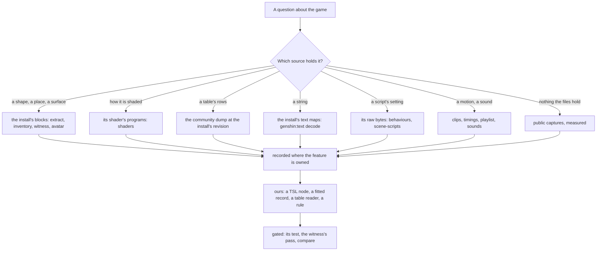

# Game reading

This page is the route a question about the game takes through the game's own files. It covers which source holds the answer and which machine reads it. It also covers how what is read becomes ours: a shader node, a fitted record, a table reader or a rule. Nothing of the game's goes into the repository.

Each step has its own owner:

- the formats: [game data formats](../game-data-formats/design.md);
- the extraction steps: [derived assets](../derived-assets/design.md);
- a scene's passes: [scene derivation](../scene-derivation/design.md);
- the tables: [hosted game data](../hosted-game-data/design.md);
- the strings: [game text](../game-text/design.md);
- the tool for each unknown: the `genshin-parity` skill's toolbox.

This page links them and does not restate them.

## Decisions

- **A shader is ported through equations on its owning page, never straight from its assembly.**
  - The program's annotated assembly, or its HLSL where 3Dmigoto decompiles it, is read into equations on the page of the feature it draws.
  - Each equation is tagged Exact or Provisional. Exact means read from a program, its registers or its keyword set. Provisional means estimated, with its basis named. The [character shading](../characters/shading/design.md) page does this for Lumine's body.
  - The TSL node is written from the equations, and its test pins their terms.
  - _Rejected: transliterating the node from the assembly._ The assembly is never committed, so the equations are the only record a reviewer or a later session can check the node against. A term no program shows would also hide among the ones read.
- **Every term a program shows is read before any term is fitted.**
  - A fit over a captured frame absorbs each misread term into the ones left free. The login stone's assumed shading model is the first failure on the [scene derivation](../scene-derivation/design.md) page.
  - A term no readable program shows stays Provisional and is listed as open on its page.
  - _Rejected: fitting a whole shading model to the captures._ It settles at the minimum nearest its start.
- **A material's values are read at run time from the developer's own exports, never committed as numbers.**
  - The development world reads a material's floats and colours from the exports: the avatar's `avatar.json` and the witness layout.
  - What ships takes its defaults from public references or from a derivation.
  - _Rejected: the game's values as committed constants._ That would ship the game's data inside our source.
- **A read runs on the machine that holds its source and the tool it needs.**
  - Each machine holds its own install and its own exports, and they move between LAN machines only over SSH (the `throughput` skill's fleet page).
  - A read that the session's machine cannot run, with no judgement left in it, goes on the compute queue. Its item carries the capabilities it needs (`game-install`, `game-exports`), so only a machine holding them takes it.
  - A read that still needs judgement is the other machine's claim on the feature's unit.
  - A disassembler is a tool, not a capability, so an item that needs Windows or needs vkd3d says so in its text.
  - _Rejected: handing a read over by message alone._ A message holds no claim, so two machines can run the same read, and nothing records that it is owed once the session ends.
- **What a read finds is written where its feature is owned.**
  - An investigation goes in its component's reference topic.
  - A format goes on the formats page once it is one.
  - A shader's maths goes in equations on the feature's page.
  - Register lines are quoted only in a commit's body.
  - _Rejected: a central log of reads._ It drifts from the features it describes, and a reader of the feature never opens it.

## How it works

### Sources by question

Every command runs from `scripts/` with `pnpm`. Outputs land under `~/Esposter/genshin-parity` (`PARITY_DIRECTORY`), outside the repository.

| Question                                  | Source                                                                         | Command                                                         | Lands in                                                                                                 | Owner                                                          |
| :---------------------------------------- | :----------------------------------------------------------------------------- | :-------------------------------------------------------------- | :------------------------------------------------------------------------------------------------------- | :------------------------------------------------------------- |
| A mesh, a place, a material, a texture    | The install's blocks                                                           | `genshin:assets extract`, then `inventory`, `witness`, `avatar` | `extracted/<component>/`                                                                                 | [Derived assets](../derived-assets/design.md)                  |
| How a surface is shaded                   | Its shader's compiled programs                                                 | `genshin:assets shaders <component>`                            | Each program as `NNNNN.dxbc`, its `.asm` and `.hlsl`, and `programs.tsv` naming pass, stage and keywords | [Game data formats](../game-data-formats/design.md), "Shaders" |
| An open-world placement, a tile's ground  | StreamGen blobs and TerrainData, found by path hash                            | `genshin:assets city-areas`, `asset-index`                      | `city-areas/`, `asset-index/`                                                                            | Game data formats, "The open world"                            |
| A table's rows                            | The community dump at the install's revision; a missing table fetched into it  | The dataset's builder, `genshin:assets <dataset>`               | `text/ExcelBinOutput/`, then a hosted record                                                             | [Hosted game data](../hosted-game-data/design.md)              |
| A string                                  | The install's own text maps                                                    | `genshin:text decode`                                           | `text/`, then the slices the app reads                                                                   | [Game text](../game-text/design.md)                            |
| A script's setting                        | Its MonoBehaviour's raw serialized bytes                                       | `genshin:assets behaviours`                                     | Printed                                                                                                  | Game data formats, "Scripts"                                   |
| A non-group Lua script                    | Lua 5.3 bytecode in the game's own dialect                                     | `genshin:assets scene-scripts <file>`, `recreation lua-dialect` | Printed                                                                                                  | Game data formats, "Scripts"                                   |
| A motion                                  | Animation clips                                                                | `genshin:assets clips`, `timings`                               | `extracted/<component>/`                                                                                 | Derived assets                                                 |
| A piece of music, a sound                 | Wwise packages                                                                 | `genshin:assets playlist`, `music`, `sounds`                    | `music/`, `sounds/`                                                                                      | Game data formats, "Audio"                                     |
| A scrambled field's name, a type's layout | The code metadata, decrypted offline from the user's own install where it pays | None kept                                                       | Outside the repository                                                                                   | [Scene derivation](../scene-derivation/design.md)'s decision   |
| What no file holds                        | The wiki, then public clips on YouTube or Bilibili                             | `recreation clip`, `genshin:parity`                             | `captures/`                                                                                              | [Parity](../parity/README.md)                                  |

The client holds no scene group script; those are the server's, and leaked server data is never a source ([game data formats](../game-data-formats/design.md), "Scripts").

### Porting a shader

1. **Inventory.** `genshin:assets inventory <component>` names each material's shader, keywords, texture slots and values.
2. **Pick the variant.** A material's keywords select its programs from `programs.tsv`. An engine-wide keyword is run-time state the material does not set, so the base variant is chosen by the [character shading](../characters/shading/design.md) page's rule.
   - A scene's stone shader only writes the G-buffer. Its light is the deferred pass's, read beside it ([game data formats](../game-data-formats/design.md), "Shaders").
3. **Read the programs.** `shaders <component>` writes each program's assembly beside it, headed by the names of the constants its registers hold (`annotateProgramConstants`).
   - A DXBC program is disassembled on any machine.
   - A DXIL one, shader model 6's, is disassembled only by `vkd3d-compiler`, so it is read off Windows.
   - HLSL is decompiled only by 3Dmigoto's Windows decompiler, and only from DXBC.
4. **Write the equations** on the owning page, each Exact or Provisional, with its open terms listed.
5. **Write the node** in TSL from the equations:
   - in `genshin-engine` when nothing in it names the game, in `genshin-world` otherwise;
   - its test pins each equation's terms.
6. **Gate it.** The witness draws the game's exports through our node at the references' cameras (`genshin:parity passes`, `compare --witness`), and the pass's gate closes the port ([parity passes](../parity/passes/design.md)).

### Machines

Both machines hold an install, under `~/Esposter/genshin-parity/game` on the Mac, and run every AnimeStudio step with the game closed.

| Step                                                          | Mac                         | Windows PC                                             |
| :------------------------------------------------------------ | :-------------------------- | :----------------------------------------------------- |
| AnimeStudio reads (`map`, `extract`, `shaders`, `clips`, ...) | Under the utility QoS clamp | Refused while the game runs                            |
| A DXBC program's assembly                                     | `vkd3d-compiler`            | `d3dcompiler_47`                                       |
| A DXIL program's assembly                                     | `vkd3d-compiler`            | Only with a `vkd3d-compiler` named by `VKD3D_COMPILER` |
| HLSL                                                          | None: the assembly stands   | 3Dmigoto's `cmd_Decompiler` 1.3.16, pinned             |
| The parity page, witness and passes                           | Yes                         | Yes                                                    |

`vkd3d-compiler` is found by `VKD3D_COMPILER` or on `PATH`; the Mac's is a vkd3d 2.1 build, named by `VKD3D_COMPILER`. A step whose compiler is missing stops, rather than writing programs without their assembly.

### What is kept where

| Kept outside the repository                                              | Committed                                                               |
| :----------------------------------------------------------------------- | :---------------------------------------------------------------------- |
| Every export, converted or not                                           | Our TSL nodes, kits and their tests                                     |
| Disassembly and decompiled HLSL                                          | The equations and prose on the owning page                              |
| The decrypted code metadata and whatever it decodes                      | Fitted parameters, published as hosted records under the committed lock |
| The install's text and the community dump, past the slices the app reads | The text slices the app reads, generated per language                   |
| Reference stills, recordings and game portraits                          | `ParityReferenceMap`'s names for them                                   |
| A material's byte values                                                 | A register line, only in a commit's body                                |

## Key files

| File                                                                       | Role                                                                        |
| :------------------------------------------------------------------------- | :-------------------------------------------------------------------------- |
| `scripts/src/services/genshinAssets/commands/genshinAssetsCommand.ts`      | Every reading step of `genshin:assets`                                      |
| `scripts/src/services/genshinAssets/materials/extractComponentShaders.ts`  | A component's shaders carved, named, disassembled, decompiled and annotated |
| `scripts/src/services/genshinAssets/materials/disassembleDxbcDirectory.ts` | Each program's assembly, through `d3dcompiler_47` or `vkd3d-compiler`       |
| `scripts/src/services/genshinAssets/materials/decompileDxbcDirectory.ts`   | Each DXBC program's HLSL through the pinned 3Dmigoto decompiler             |
| `scripts/src/services/genshinAssets/materials/annotateProgramConstants.ts` | A program headed by what its constant registers hold, DXBC or DXIL          |
| `scripts/src/services/recreation/animeStudio/assertAnimeStudioReady.ts`    | Refuses a read of the blocks while the game runs                            |
| `scripts/src/services/genshinParity/shared/checkIsGameRunning.ts`          | Whether the game is running, by Windows' process list                       |

## Sources

- [vkd3d](https://gitlab.winehq.org/wine/vkd3d), WineHQ: `vkd3d-compiler`, whose source types include `dxbc-tpf` and `dxbc-dxil`, detected from the container when none is given.
- [D3DDisassemble](https://learn.microsoft.com/en-us/windows/win32/api/d3dcompiler/nf-d3dcompiler-d3ddisassemble), Microsoft: the DXBC disassembler in `d3dcompiler_47`.
- [DXIL](https://github.com/microsoft/DirectXShaderCompiler/blob/main/docs/DXIL.rst), Microsoft: shader model 6's intermediate language, carried in the same container.
- [3Dmigoto 1.3.16](https://github.com/bo3b/3Dmigoto/releases/tag/1.3.16), bo3b: the last release shipping `cmd_Decompiler` alone.
