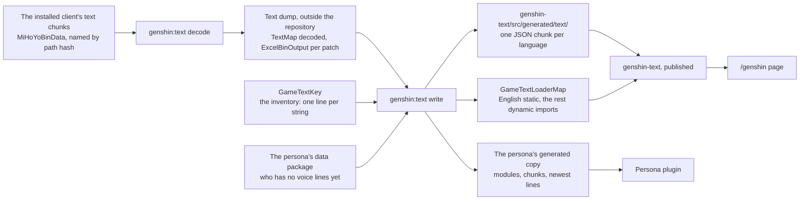
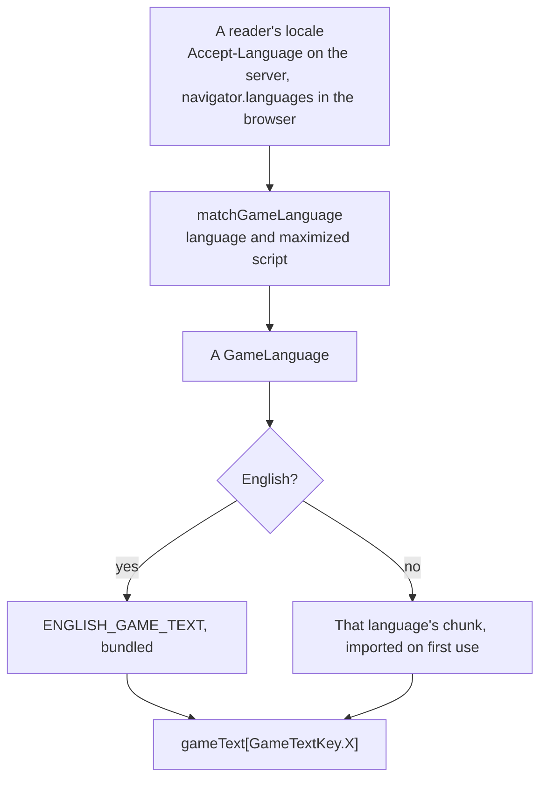

# Game text

The game already says most of what a recreation of it needs to say, in fifteen languages (`~/Esposter/genshin-parity/text/TextMap/`, one file per language), and says it better than a translation of ours would. `genshin-text` is where those words live in the repository: the game's languages, a way to pick one for a reader, and every string of the game's that a consumer shows, looked up by the id the game itself files it under (`packages/genshin-text/src/models/GameLanguage.ts`, `packages/genshin-text/src/models/GameTextKey.ts`, `packages/genshin-text/src/services/matchGameLanguage.ts`).

Nothing here is translated by hand. A string the game has is referenced, never written (`packages/genshin-text/src/models/GameTextKey.ts`); a string it does not have is a consumer's own words, in a consumer's own localization (the persona plugin's modules, for instance) and not in this package.

## How it works

- **The text is built to come from the installed client, the tables from a dump.** The client's text maps do not decode with a published scheme for the current patch: the chunks' length and word masks follow the published 7.0 scheme (`scripts/src/services/genshinText/constants.ts`, lines 60-63), but the mixer's core constants changed, so a known-plaintext solve against the current text does not hold. Until a decoder covers the current patch, the text maps stay the community dump's, kept to the remote `main` by size and not to the install's revision (no file records that revision): `pnpm -C scripts genshin:text fetch` replaces each text map whose size differs from `main`'s (`scripts/src/services/genshinText/fetchDump.ts`), as it does each table, so a reader never resolves a current table's text id against an older patch's map. `pnpm -C scripts genshin:text decode` reads each language's text maps from the client's own chunks, the client's own text-map folder and `TextMap_Medium` under each language's hash folder, every chunk named by its path hash and taken from the hotfixed copy under `Persistent` where the game has one. It writes them into `GENSHIN_TEXT_DIRECTORY`, by default `text` under the parity directory, as `TextMap/TextMap<code>_<n>.json` and the medium maps beside them (`~/Esposter/genshin-parity/text/TextMap/`, with `TextMapRU_0.json` and `TextMapRU_1.json`), after emptying `~/Esposter/genshin-parity/text/TextMap/` so the dump's maps are never a second source (`scripts/src/services/genshinText/decodeGameText.ts`). `~/Esposter/genshin-parity/text/ExcelBinOutput/` stays the community dump's (`~/Esposter/genshin-parity/text/ExcelBinOutput/`), pinned to the install's revision: the code-metadata route was researched on 2026-10-08, and found the only public 7.x decoder pinned to 7.0, reading a running process for its asset path and returning positional rows without names, with the build's field names likely scrambled in the metadata too. Everything here is a reference like every other the [derived assets](../derived-assets/design.md) read, never committed (`~/Esposter/genshin-parity/text/`, outside the repository). Its run waits on the [roadmap](../../../changes/genshin-roadmap/tasks.md) until then.
- **The account kit's strings are the second source.** What the game shows as the player signs in, before it has loaded its text map, comes from HoYoverse's account kit, whose own table per language sits in its resource bundle beside the game (`MiHoYoSDKRes`). The first `write` that needs it exports the tables into the dump with AnimeStudio, refusing while the game runs, and reads them as references like the text map (`scripts/src/services/genshinText/readSdkText.ts`, `~/Esposter/genshin-parity/text/Sdk/assets/plugins/mihoyosdk/resources/language/`, one file per language). The welcome card's greeting is the one key read there (`scripts/src/services/genshinText/constants.ts`, `tips_enter_game` reads "Welcome, %s!" in `~/Esposter/genshin-parity/text/Sdk/assets/plugins/mihoyosdk/resources/language/en.json`), its `%s` the player's name, placed where each language puts it.
- **`GameTextKey` is the inventory.** Each member's value is the game's own id for its string: the name the game's manual text map files an interface string under (`INFORMATION_AVATAR_BIRTHDAY`, `~/Esposter/genshin-parity/text/ExcelBinOutput/ManualTextMapConfigData.json`), the raw text hash where it names the string nothing, or the account kit's own key (`tips_enter_game`, `~/Esposter/genshin-parity/text/Sdk/assets/plugins/mihoyosdk/resources/language/en.json`) for a string the kit shows, so a consumer cannot tell which source a string came from. Referencing a new string is one line there (`packages/genshin-text/src/models/GameTextKey.ts`); the generator has no list of its own.
- **`pnpm -C scripts genshin:text find "<pattern>"` finds the id.** It searches the English text and prints each match's id beside it, named ids first, since an interface string is what a key is usually after (`scripts/src/services/genshinText/findGameText.ts`).
- **`pnpm -C scripts genshin:text quests` publishes the world's quests.** The quests `QuestId` names are published to the game data with their talks, and every word they show goes into a per-language record under `questText` (`scripts/src/services/genshinText/buildQuests.ts`, `scripts/src/services/genshinText/buildTextChunks.ts`, `packages/genshin-world/src/models/data/GameDataset.ts`), by the same text ids, since a quest's words are far too many to list one by one in `GameTextKey` ([quests](../quests/design.md)).
- **`pnpm -C scripts genshin:text names` publishes the names the world cites.** It collects every `nameTextId` in the published records and the world's data files, so it runs after the `genshin:assets` steps that publish them, and publishes every name those rows cite, by the text id each gives it, as one record a language under `nameText` (`scripts/src/services/genshinText/buildNames.ts`). A name a language lacks takes English's and the run says so, and the world fetches only the reader's language's record ([wish](../wish/design.md)).
- **`pnpm -C scripts genshin:text gcg` publishes the card game's words.** It reads the deck slices `genshin:assets gcg` last published, so it runs after it, and publishes every character's and action card's name and description, by the text id each slice carries, as one `gcgText` record for each language (`scripts/src/services/genshinText/buildGcgText.ts`) ([Genius Invokation TCG](../genius-invokation/README.md)).
- **`pnpm -C scripts genshin:text write` writes everything.** Every key in every language becomes one JSON chunk per language, and the loader map names them. A string keeps its colour tags, which a screen splits into coloured runs, and loses every other tag (`getInterfaceGameText`, `scripts/src/services/genshinText/getInterfaceGameText.ts`). The dump writes every line break as a backslash and an n, and every chunk holds a real line break in its place: `getPlainGameText` (`scripts/src/services/genshinText/getPlainGameText.ts`, against `~/Esposter/genshin-parity/text/TextMap/TextMapEN.json`, key `2019412480`, which holds a backslash and an n) makes that change once, and every writer of a chunk runs through it, `getInterfaceGameText` for the interface and `buildTextChunks` for the published records, so no screen splits on the escaped form. A key a language's map lacks takes English's text there and the run says so (`scripts/src/services/genshinText/writeGameText.ts`), since a dump that lost a string is the dump's fault rather than a reason to ship none. Its output is never formatted, so a format pass over the tree leaves alone what it wrote (`oxfmt.config.ts`, which ignores `**/generated/**`).

### Looking a string up

A consumer resolves a language once, loads its chunk once, and indexes the result by key — a lookup is `gameText[GameTextKey.Loading]` (`packages/genshin-text/src/models/GameTextKey.ts`, and "Loading..." under key `381031838` in `~/Esposter/genshin-parity/text/TextMap/TextMap_MediumEN.json`), with nothing between the key and its string. English is the one chunk bundled with the package, as the text every other language shows until its own arrives, and each other language is a dynamic import of a chunk of its own, so a page downloads only the language it shows (`packages/genshin-text/src/generated/GameTextLoaderMap.ts`).

`matchGameLanguage` takes a reader's preference list, most preferred first, and returns the first game language that shares a tag's language and, once both are maximized through `Intl.Locale`, its script: `zh-TW` and `zh-HK` read Traditional Chinese and `zh-CN` Simplified, while `pt-BR` and `en-GB` take the one Portuguese and English the game ships (`packages/genshin-text/src/services/matchGameLanguage.ts`, `packages/genshin-text/src/services/GameLanguageTagMap.ts`). A tag that is not well formed is skipped rather than thrown on, since a header is anyone's to write, and English is the answer when nothing matches (`packages/genshin-text/src/services/matchGameLanguage.ts`). `getAcceptLanguageTags` turns a header into that list by its quality weights (`packages/genshin-text/src/services/getAcceptLanguageTags.ts`).

An interface string the game fills numbers its values, `{0}` first: a wish's button is `Wish ×{0}` and a bag tab's room `{0} {1}/{2}` (`~/Esposter/genshin-parity/text/TextMap/TextMap_MediumEN.json`, `Wish ×{0}` and `{0} {1}/{2}`). `fillGameTextValues` (`packages/genshin-text/src/services/fillGameTextValues.ts`) fills every number at once with the values as they are, so a name holding a replacement pattern is never read as one, and a number with no value is left in place. A string the game colours is split into runs by `splitGameTextColors`, each run keeping the colour its `<color=#RRGGBBAA>` or six-digit `<color=#RRGGBB>` tag gives it (`packages/genshin-text/src/services/splitGameTextColors.ts`).

### The /genshin page

The page resolves the reader's language on the server from the request's `Accept-Language` and hands the resolved language and its chunk to the client in the payload (`useGameText`, `apps/web/app/composables/genshin/useGameText.ts`), so the page hydrates in the language it rendered in. It hands the chunk to the opening as its `gameText` prop, a required one on every screen of the opening that shows a word (`packages/genshin-world/src/components/Login/Status/Index.vue`, `packages/genshin-world/src/components/Login/Screen/Index.vue`, `packages/genshin-world/src/components/Login/Interface/Index.vue`), so the health notice, the login title, the account label and the status lines read in that language, and a screen a host forgets to give it fails to compile rather than falling back to English. The opening's container carries the language's tag, and its screen-reader status (`packages/genshin-world/src/components/Login/Status/Index.vue`, line 28) reads the login step's own line, while the game's own "Ready" in that language is read once the opening is ready by `apps/web/app/components/Genshin/Index.vue`, line 126, and "Loading..." labels the spinner (`packages/genshin-world/src/components/Login/Interface/Index.vue`, line 156) (`~/Esposter/genshin-parity/text/TextMap/TextMap_MediumEN.json`, keys `381031838` and `3896337670`).

### The persona plugin

The plugin is installed alone by a stranger's frozen `npm ci`, and every release of a sibling it depended on would move a range that lockfile would then disagree with ([persona plugin](../../infra/claude-interface/persona-plugin/README.md)). So `write` also copies the modules the plugin runs — the language enum, the tag map, the display name and the matcher of a typed name, the loader map and its chunks — into `packages/genshin-persona/src/generated/genshinText/`, re-aiming the package's `#src/` alias at the copy, and a test holds the copy byte for byte to what the source would produce (`scripts/src/services/genshinText/getPersonaModuleSource.ts`, `scripts/src/services/genshinText/getPersonaModuleSource.test.ts`). Beside the copy it writes, for every character the plugin's data package has no voice-over lines for yet (`scripts/src/services/genshinText/getCharacterLinesLoaderMapSource.ts`), their lines in every language as one chunk per language, the source the plugin's spinner reads before a dependency bump carries them.

## Notes

- **The game's own words ship; nothing else of the game's does.** A string referenced here is text the game shows, carried as text (`packages/genshin-text/src/generated/text/`), the way a recreation quotes the screen it recreates — no image, model, sound or file of the game's rides along with it, which [derived assets](../derived-assets/design.md) keeps to.
- **Every word of the opening is the game's.** The text map carries what the opening shows before the client loads its data, the door's prompt worded per platform with the PC's form kept, and the account kit carries the welcome (`~/Esposter/genshin-parity/text/Sdk/`); only the server's name stays as recorded, since the game takes it from the server list it is sent.
- **A word per gender is filled once, for one twin.** Some languages spell the Traveler with a word per gender (`{M#…}` and `{F#…}`); `fillLinePlaceholders` (`packages/genshin-text/src/services/fillLinePlaceholders.ts`) keeps one twin's, which the persona fills from the twin it speaks as, and the login screen, the character menu and a talk's words from `LOGIN_TRAVELER_GENDER` (`packages/genshin-world/src/services/login/constants.ts`).
- **The opening's English is the dump's.** The text map is the community dump's, whose revision no file records (see Open), so the health notice's wording is the dump's too.
- **A non-Latin language falls back past the game's face.** HYWenHei and Signika are the faces the [interface library](../interface-library/design.md) sets text in (`packages/genshin-interface/src/services/constants.ts`, `GAME_FONT_FAMILY`), and neither covers Chinese, Japanese, Korean or Thai, which a browser then draws in a system face. The visual suites and parity scoring compare the English client only.
- **The app's own interface is not translated.** What is the app's rather than the game's stays English, as the [internationalization](../../../deferred/architecture/i18n/design.md) decision has it; this package translates only what the game itself says.
- **The refusal while the game runs, on the first `write` that exports the account kit** — `scripts/src/services/genshinText/readSdkText.ts` calls `exportSdkText` when the kit's folder is missing (line 11), which runs `runAnimeStudio`; `scripts/src/services/recreation/animeStudio/runAnimeStudio.ts` (line 16) asserts readiness, and `GENSHIN_ANIMESTUDIO_OPTIONS` in `scripts/src/services/genshinAssets/shared/constants.ts` (line 75) names `checkIsGameRunning` as its block guard.
- **The door's prompt is worded per platform with the PC's form kept.** `~/Esposter/genshin-parity/text/TextMap/TextMap_MediumEN.json` key 3535917252, which `~/Esposter/genshin-parity/text/ExcelBinOutput/EmbeddedTextMapConfigData.json` names `UI_LOGIN_TOUCH_TO_ENTER`: "#{LAYOUT_MOBILE#TAP}{LAYOUT_PC#CLICK}{LAYOUT_PS#PRESS} TO BEGIN".
- **The opening's container carries the language's tag** — `apps/web/app/components/Genshin/Index.vue` line 113 binds `:lang` on the opening wrapper.
- **Signika covers Latin, Latin Extended and Vietnamese only.** Its `index.css` (`node_modules/.pnpm/@fontsource+signika@5.3.0/node_modules/@fontsource/signika/index.css`) has the subsets latin, latin-ext and vietnamese, with no range over Thai, CJK or Hangul.
- **The app's own labels stay English** — `apps/web/configuration/modules.ts` loads no i18n or locale module, and the only i18n imports under `apps/web` are the survey and JSON-forms libraries' own (`apps/web/app/services/survey/registerSurveyPlugin.ts`, `apps/web/app/components/Ui/SchemaForm/Index.vue`), with no code that selects a locale.

## Key files

| File                                                               | Role                                                                                                           |
| :----------------------------------------------------------------- | :------------------------------------------------------------------------------------------------------------- |
| `packages/genshin-text/src/models/GameLanguage.ts`                 | The game's fifteen languages, spelt as the community data package spells them                                  |
| `packages/genshin-text/src/models/GameTextKey.ts`                  | Every referenced string by the game's own text id: the inventory the generator reads                           |
| `packages/genshin-text/src/services/GameLanguageTagMap.ts`         | The BCP-47 tag of each language, which `Intl` needs                                                            |
| `packages/genshin-text/src/services/matchGameLanguage.ts`          | A reader's preference list to the nearest game language, English otherwise                                     |
| `packages/genshin-text/src/services/getAcceptLanguageTags.ts`      | An `Accept-Language` header as tags, most preferred first                                                      |
| `packages/genshin-text/src/services/fillGameTextValues.ts`         | An interface string's numbered values filled at once                                                           |
| `packages/genshin-text/src/services/splitGameTextColors.ts`        | A game string's colour tags split into runs, each with its CSS colour                                          |
| `packages/genshin-text/src/generated/GameTextLoaderMap.ts`         | English bundled, every other language a chunk imported on first use                                            |
| `scripts/src/services/genshinText/writeGameText.ts`                | The generator: every key, every language, the persona's copy and its newest lines                              |
| `scripts/src/services/genshinText/buildQuests.ts`                  | The world's quests, their talks and their words in every language                                              |
| `scripts/src/services/genshinText/buildNames.ts`                   | Every `nameTextId` in the published records and the world's data files, one record of the world's per language |
| `scripts/src/services/genshinText/buildGcgText.ts`                 | The card game's names and descriptions the deck slices name, one record per language                           |
| `scripts/src/services/genshinText/findGameText.ts`                 | The ids of every English string a pattern matches                                                              |
| `scripts/src/services/genshinText/decodeGameText.ts`               | Every language's text map exported from the installed client's chunks and decoded                              |
| `scripts/src/services/genshinText/decodeTextMap.ts`                | One text map chunk decoded, ported from the owomocha devkit (MIT), refused unless consumed exactly             |
| `scripts/src/services/genshinAssets/shared/getPathHash.ts`         | The name AnimeStudio exports an asset under, from its path                                                     |
| `scripts/src/services/genshinAssets/blocks/linkInstalledBlocks.ts` | Each block's file as the game loads it, its hotfixed copy under `Persistent` over StreamingAssets              |
| `scripts/src/services/genshinText/readSdkText.ts`                  | One language's account kit strings, exported from the installed game when first read                           |
| `scripts/src/services/genshinText/getPlainGameText.ts`             | A text map string as the game shows it on a PC: markup, furigana and escapes resolved                          |
| `scripts/src/services/genshinText/getInterfaceGameText.ts`         | A text map string as the interface draws it: read plain, its colour tags kept                                  |
| `scripts/src/services/genshinText/getPersonaModuleSource.ts`       | A module of the package as the persona runs it, under the persona's own alias                                  |
| `apps/web/app/composables/genshin/useGameText.ts`                  | The reader's language resolved on the server and its chunk handed over in the payload                          |
| `packages/genshin-interface/src/services/constants.ts`             | The interface library's `GAME_FONT_FAMILY`, the face game text is set in                                       |

## Sources

- [AnimeGameData](https://github.com/DimbreathBot/AnimeGameData), the community's per-patch dump of the game's data: the layout the text dump directory follows — `~/Esposter/genshin-parity/text/TextMap/`, the medium maps, and `~/Esposter/genshin-parity/text/ExcelBinOutput/ManualTextMapConfigData.json` and `FettersExcelConfigData.json`, the tables naming interface strings and characters' voice-over lines (`~/Esposter/genshin-parity/text/ExcelBinOutput/ManualTextMapConfigData.json`, `~/Esposter/genshin-parity/text/ExcelBinOutput/FettersExcelConfigData.json`).
- `~/Esposter/genshin-parity/text/TextMap/`, the game's text maps, one file per language; grounds the requirement "The game's text is available in its fifteen languages".
- `~/Esposter/genshin-parity/text/TextMap/TextMapEN.json`, the text map the line break is written in; grounds the requirement "A game string's line breaks are real line breaks".
- `index.css` in the `@fontsource/signika` package, which has three `@font-face` blocks, none with a unicode range for Thai, CJK or Hangul; grounds the requirement "Non-Latin game text draws in a system face".

## Open

- [ ] **The `ExcelBinOutput` tables and text maps match the install's revision** — no source yet: a file recording the dump's revision, which none holds.
- [ ] **The server's name stays as recorded** — no source yet: no source checked here shows how the server list names it.
- [ ] **The opening's English is the current build's, so the health notice reads its current wording** — no source yet: the dump's revision is unrecorded (see the first item), so its health notice was not compared with the current client's.
- [ ] **HYWenHei does not cover Chinese, Japanese, Korean or Thai** — no source yet: no HYWenHei font file is on disk, so its coverage is unread.
- [ ] **The mixer's core constants changed, so a known-plaintext solve against the current text does not hold** — no source yet: a known-plaintext solve of the current text's mixer constants, which no record keeps.
