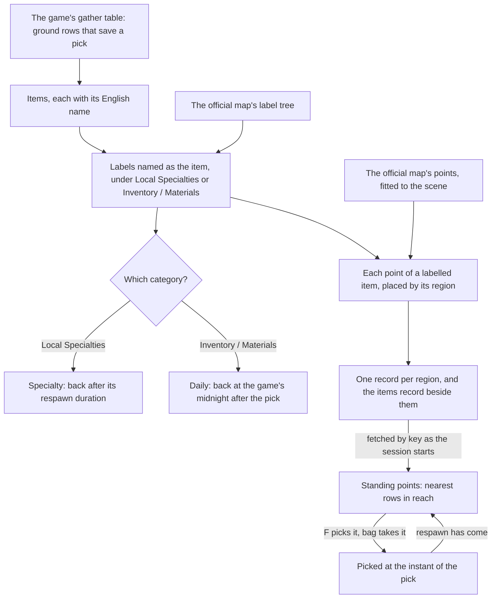

# Gathering

The plants and specialties of the open world are the gathering points the [proposal](../../../changes/genshin-gathering/design.md) describes: a point stands where the official map marks its item, and F picks it into the bag. This page is the build of that proposal for the points of the two categories that are picked, Local Specialties and Inventory / Materials. The ores are published beside them: the same builder places each ore the map marks under Ores, and the world keeps those points out of the pick ups, since an ore is struck until it breaks. Mining outcrops are built on [their own page](../mining-outcrops/design.md); investigation spots wait in the proposal.

## How it works

## Reading the tables

The slices and the items are published by `pnpm -C scripts genshin:assets gathering` to the gathering dataset of the [hosted game data](../hosted-game-data/design.md). It reads three tables from the game text dump, the gather table and the material table in `{data-root}/genshin-parity/text/ExcelBinOutput/` (`{data-root}/genshin-parity/text/ExcelBinOutput/GatherExcelConfigData.json` and `{data-root}/genshin-parity/text/ExcelBinOutput/MaterialExcelConfigData.json`) and the English text map, and the official map's label tree and fitted points from the references folder (`{data-root}/genshin-parity/references/interactive-map/label-tree.json` and `{data-root}/genshin-parity/references/interactive-map/points.json`). The gather table is fetched from the community's AnimeGameData repository into the dump and never committed.

- **A row is picked off the ground.** A gather row counts when it sits on the ground and saves its pick. The rows that save nothing belong to other pages, such as fishing, animals and events, and are not points here (`scripts/src/services/genshinAssets/gathering/readGatheringItems.ts`; `{data-root}/genshin-parity/text/ExcelBinOutput/GatherExcelConfigData.json`: only some of its rows carry a `saveType`, and the rest carry none). The ores' points are placed by the same builder, `scripts/src/services/genshinAssets/gathering/buildGatheringPlaces.ts`, through `placeMapPoints`, which skips every point off the ground layer (`scripts/src/services/genshinAssets/points/placeMapPoints.ts`).
- **An item is named as its label.** The item's English name is matched to the label of the same name the official map files under Local Specialties, Inventory / Materials or Ores. A Magical Crystal Chunk is left out, since a mining outcrop draws it, and so are a Scarlet Quartz and a Rainbowdrop Crystal, which have no poise requirement on the wiki's Mineral page (`scripts/src/services/genshinAssets/gathering/constants.ts`). An Electro Crystal is not left out: the official map files its points under Inventory / Materials (`{data-root}/genshin-parity/references/interactive-map/label-tree.json`, label 63), and the gather table picks it off the ground, so it is a picked point with its own respawn (see The respawn). Any other ground item that no label names, or whose material type the world does not name, is refused by the builder (`scripts/src/services/genshinAssets/gathering/readGatheringItems.ts`) unless `GATHER_EXCLUDED_ITEM_IDS` lists it (`scripts/src/services/genshinAssets/gathering/constants.ts`). The list holds the two crystals, Rukkhashava Mushrooms and Green Berryshroom, the last of which the Notes give the evidence for. Special Items, which holds the Oculi, is left to the statues' page.
- **Each point is the fit's.** Every point of a labelled item is carried into the game's coordinates by the [spawned places](../spawned-places/design.md) fit and then into its region's axes, its kind the item's id, and its region from its map area. Points on layers under the ground are left out, as the places' builder already does.

## The respawn

The gather table's refresh ids do not name a policy in the dump. The ground rows that carry a refresh name ids the policy table lacks, and the rest carry none, so the policy cannot be read off the row (`{data-root}/genshin-parity/text/ExcelBinOutput/GatherExcelConfigData.json`: its refresh ids are none of the ids in `{data-root}/genshin-parity/text/ExcelBinOutput/RefreshPolicyExcelConfigData.json`). The category settles it instead, as the wiki gives each:

- **A local specialty comes back `SPECIALTY_RESPAWN_DURATION` after it is picked**, the wiki's own figure for specialties (`{data-root}/cache/genshin-wiki/Page_Local_Specialty.json`, line 6).
- **A cooking ingredient comes back at the game's midnight after the pick.** That midnight is `GATHERING_DAILY_RESPAWN_HOUR`, 0:00 on the server's clock (`packages/genshin-world/src/services/time/constants.ts`), four hours before the [daily reset](../reset-clock/design.md), as the wiki gives the common overworld ingredients (`{data-root}/cache/genshin-wiki/Page_Reset.json`, line 19).
- **An Electro Crystal comes back two days after the pick.** It is filed under Inventory / Materials, whose category is the midnight, but its own label rule gives two days, as the wiki's Reset page gives its nodes beside White Iron Chunks and Starsilver (`{data-root}/cache/genshin-wiki/Page_Reset.json`, line 50), in `LABEL_RESPAWN_MAP` (`scripts/src/services/genshinAssets/gathering/constants.ts`).

An ore's respawn is its own, from the wiki's Reset page: an Iron Chunk at the game's midnight, a White Iron Chunk or Starsilver after `ORE_TWO_DAYS_RESPAWN_DURATION` from the break, and a Crystal Chunk, Amethyst Lump or Condessence Crystal after `ORE_THREE_DAYS_RESPAWN_DURATION` (`scripts/src/services/genshinAssets/gathering/constants.ts`). Those labels, and the Electro Crystal's, are keyed by the map's label id, since a plant's category does not settle them.

That page is tagged a stub asking for its timers and respawns to be verified (`{data-root}/cache/genshin-wiki/Page_Reset.json`, line 1), so the midnight of both, and the Electro Crystal's two days, rest on the wiki alone.

A point is kept as picked with the instant of the pick, and stands again once its respawn has come (`packages/genshin-world/src/services/gathering/checkIsGatheringPlaceStanding.ts`). Nothing runs while the page is closed: each look at the clock compares the instant with its respawn, and the page's clock looks every `GATHERING_CLOCK_INTERVAL_MS` while it is open.

## The ores' rules

An ore is struck until it breaks. The character's landed hits feed it from the strike loop, beside the enemies: each hit reaches the ores in its area as an enemy's capsule is reached, at the ore's ground point. A hit is melee when it sits in a normal or charged attack of a character wielding a sword, a claymore or a polearm, read off the kind of action its kit was built with it in and the weapon type its combatant carries from the roster's table, so no kit carries a flag (`packages/genshin-world/src/services/kit/checkIsMeleeHit.ts`; `packages/genshin-world/src/services/gathering/readOreHit.ts`). A hit is blunt by its own flag, `isBlunt`, which its kit record carries on every hit. The builder fills it from the wiki's Blunt Attack table by the hit's action, its character's weapon and its element (`scripts/src/services/genshinAssets/kits/candidates/getBluntKitCandidates.ts`): a claymore's normal or charged attack, a plunge by a sword, claymore or polearm, and Geo damage are blunt, and the table's exceptions settle the rest, by action or by one hit's path (`scripts/src/services/genshinAssets/kits/wiki/CharacterIdBluntOverrideMap.ts`). Chiori's skill and burst, Gorou's skill and burst, Klee's normal, charged and skill attacks, Candace's skill and her Guardian Stance 2-Hit, Neuvillette's Charged Attack (`{data-root}/cache/genshin-wiki/Category_Neuvillette_Talents.json`), Chongyun's and Eula's skills and bursts, and Xilonen's and Yun Jin's bursts are blunt; Ningguang's plunge, Gorou's Charged Attack, Xilonen's skill and Yun Jin's Opening Flourish are not. The Guardian Stance 2-Hit is the Normal Attack 2-Hit row, which is the record's `normalAttacks.1.hits.0`. Chiori's Coordinated Attack has no hit in her record or behaviour, so her skill's blunt flag has nothing to except, and her Tailoring stays open on her kit's design. A hit that names no element of its own deals its wielder's, and `checkIsBluntHit` makes it blunt as a Geo wielder's Geo is, so a Geo Traveler's skill is blunt and an Anemo one is not (`packages/genshin-world/src/services/kit/checkIsBluntHit.ts`). Shatter, the Rock seal (`checkIsSealFreed`, which reads the resolved element for Pyro too) and the ores share that rule. An excepted hit of a Geo character names its element, so a Geo wielder does not blunt it. An infusion keeps the flag of the hit it copies, so a Geo infusion does not blunt an attack the wiki does not list as blunt, as the wiki excepts "attacks infused with Geo that were not originally Blunt" (`{data-root}/cache/genshin-wiki/Page_Blunt_Attack.json`); the rule that read the infused element blunted those. Chiori's normal attack is not blunt on the cached wiki page: its Weaving Blade hits carry no blunt flag, only its plunges do (`{data-root}/cache/genshin-wiki/Category_Chiori_Talents.json`). Not mapped: Kinich's mid-air normal attack (his record holds no normal attack), Cyno's stance normal attacks, and Gorou's Crystal Collapse. Neuvillette's and Wanderer's catalyst plunges are not blunt, as the wiki's Blunt Attack page lists the plunges of sword, claymore and polearm users alone (`{data-root}/cache/genshin-wiki/Page_Blunt_Attack.json`, line 6). Each hit adds its poise damage over the ore's requirement for its kind, blunt or melee, so the ore breaks once its shares reach one, and a hit that is neither blunt nor melee adds nothing (`packages/genshin-world/src/services/gathering/strikeOre.ts`). The hits are read before an infusion copies them, so an infusion's converted poise does not reach an ore (`packages/genshin-world/src/services/gathering/readOreHit.ts`). An Overloaded that lands strikes the ores within 3 metres of the enemy it lands on too, as a blunt hit of its explosion's 90 poise, gcsim's, once the step's strikes have landed (`readReactionOreHit`); a reaction whose hit is not blunt strikes no ore, whatever poise the reaction table gives it (`packages/genshin-world/src/models/enemy/ReactionPoise.ts`; the blunt strike, the poise and the 3-metre circle are cited on the [combat page](../combat/design.md)). A broken ore drops its certain piece where it lay, and one more for each of `ORE_EXTRA_DROP_DRAW_COUNT` draws that comes under `ORE_EXTRA_DROP_CHANCE` (`packages/genshin-world/src/services/gathering/constants.ts`; `packages/genshin-world/src/services/gathering/rollOreDropCount.ts`). It comes back `ORE_TWO_DAYS_RESPAWN_DURATION` after it breaks for a White Iron Chunk or Starsilver, and `ORE_THREE_DAYS_RESPAWN_DURATION` after for a Crystal Chunk away from a mining outcrop, as the wiki's Reset page gives them. The respawn reads the same as the plants', from the instant of the break.

Each kind of attack takes the hits below to break an ore, its kit's poise run through the rule. A swing of several hits counts each of them, and a combo starts again at its first strike once it ends. Two counts are checked off a clip of one ore struck by that kind alone, unbroken, at 60 frames a second. The others are the rule's own, provisional until a clip shows them, and each is on the [roadmap](../../../changes/genshin-roadmap/tasks.md)'s Manual verification list.

| Attack                                   | Poise a hit      | Iron, White Iron, Starsilver (29 blunt, 200 melee, `OreItemIdBreakPoiseMap`) | Crystal, Magical Crystal and the rest (286, 2000, `OreItemIdBreakPoiseMap`) | Basis                                                           |
| :--------------------------------------- | :--------------- | ---------------------------------------------------------------------------: | --------------------------------------------------------------------------: | :-------------------------------------------------------------- |
| A claymore's combo, Noelle's or Razor's  | 97 to 160, blunt |                                                                            1 |                                                                           3 | Provisional                                                     |
| A sword's combo, the Traveler's          | 40 to 65, melee  |                                                                            5 |                                                                          41 | Provisional                                                     |
| A polearm's combo, Xiao's                | 25 to 87, melee  |                                                                            6 |                                                                          43 | Provisional                                                     |
| Overloaded                               | 90, blunt        |                                                                            1 |                                                                           4 | Provisional                                                     |
| A burst, Zhongli's Planet Befall         | 500, blunt       |                                                                            1 |                                                                           1 | Checked: one breaks a Crystal Chunk and a Magical Crystal Chunk |
| A Geo construct, Zhongli's pressed stele | 200, blunt       |                                                                            1 |                                                                           2 | Provisional                                                     |
| A sword's or polearm's low plunge        | 100, blunt       |                                                                            1 |                                                                           3 | Checked: three break a Crystal Chunk                            |

## The pick

F on a gathering point's row picks one of its item into the bag, through the same `addInventoryItem` a drop uses (`packages/genshin-world/src/store/pickups.ts`, `pickUpGatheringPlace`). The point is kept as picked only when the bag takes the item, so a full bag leaves it standing. The picked points are kept for the page's life only, as the drops are. An ore's point is never offered here: it is struck, not picked.

## Key files

| File                                                                             | Role                                                                                                             |
| :------------------------------------------------------------------------------- | :--------------------------------------------------------------------------------------------------------------- |
| `scripts/src/services/genshinAssets/gathering/readGatheringItems.ts`             | The items the gather table picks, matched to their map labels                                                    |
| `scripts/src/services/genshinAssets/gathering/buildGatheringPlaces.ts`           | Each region's points built as a slice, and the items table                                                       |
| `scripts/src/services/genshinAssets/gathering/constants.ts`                      | The categories, their respawns and the ground items left out by name                                             |
| `packages/genshin-world/src/services/gathering/computeGatheringRespawn.ts`       | The instant a picked point is back                                                                               |
| `packages/genshin-world/src/services/gathering/OreItemIdBreakPoiseMap.ts`        | Each ore's poise to break from blunt and from melee hits                                                         |
| `packages/genshin-world/src/services/gathering/strikeOre.ts`                     | An ore's broken share after one hit                                                                              |
| `packages/genshin-world/src/services/gathering/readOreHit.ts`                    | The hit an ore takes from a step's landed hit, melee by weapon, blunt by the wiki's Blunt Attacks                |
| `packages/genshin-world/src/services/kit/checkIsBluntHit.ts`                     | The one blunt rule the ores, Shatter and the Rock seal share: the hit's own flag, else its Geo                   |
| `scripts/src/services/genshinAssets/kits/candidates/getBluntKitCandidates.ts`    | Each hit's blunt flag from the wiki's table and the rules, and the Geo element an excepted hit names             |
| `scripts/src/services/genshinAssets/kits/wiki/CharacterIdBluntOverrideMap.ts`    | The wiki's Blunt Attack exceptions by character, by action or by one hit's path                                  |
| `packages/genshin-world/src/services/gathering/readReactionOreHit.ts`            | The hit an ore takes from a reaction's explosion, Overloaded's alone                                             |
| `packages/genshin-world/src/services/gathering/rollOreDropCount.ts`              | The pieces an ore drops                                                                                          |
| `packages/genshin-world/src/services/gathering/checkIsGatheringPlaceStanding.ts` | Whether a point stands at an instant                                                                             |
| `packages/genshin-world/src/store/pickups.ts`                                    | Mondstadt's points and items read as the world opens, each ore's broken share, and the pieces a broken ore drops |
| `packages/genshin-world/src/services/kit/stepActiveKit.ts`                       | The character's landed hits and an Overloaded's explosion, fed to the ores                                       |
| `packages/genshin-world/src/services/inventory/toItemDefinition.ts`              | An item's definition from its materials row, shared with drops                                                   |
| `packages/genshin-world/src/components/World/Session/Index.vue`                  | Rows for the standing points, and a pick into the bag                                                            |
| `packages/genshin-world/src/services/gathering/readMondstadtGatheringPlaces.ts`  | Mondstadt's points, fetched by their `gathering/mondstadt` key                                                   |

## Notes

- **One specialty is left out, and four cooking ingredients are not.** Rukkhashava Mushrooms has its map label in the singular, "Rukkhashava Mushroom" under Local Specialties (`{data-root}/genshin-parity/references/interactive-map/label-tree.json`), so no label matches its name. Apple, Starshroom, Bulle Fruit and Candlecap Mushroom are picked, since their notice-restoring type is one the world's material type names (`NoticeAddHp` in `packages/genshin-world/src/models/inventory/MaterialType.ts`), and their labels sit under Inventory / Materials.
- **Green Berryshroom is a quest item, left out by name.** Its ground row is `{data-root}/genshin-parity/text/ExcelBinOutput/GatherExcelConfigData.json` line 1037: a "GATHER_SAVE_TYPE_LOW" point on gadget 73019126, a "GatherObject" named "SceneObj_Gather_Small" (`{data-root}/genshin-parity/text/ExcelBinOutput/GadgetExcelConfigData.json`). Its material row is typed `MATERIAL_QUEST` (`{data-root}/genshin-parity/text/ExcelBinOutput/MaterialExcelConfigData.json`), which `MaterialType` does not hold, and the game's own type text for it reads "Quest Item" (`{data-root}/genshin-parity/text/TextMap/TextMap_MediumEN.json` line 231102). `{data-root}/genshin-parity/text/ExcelBinOutput/MaterialCondModifyExcelConfigData.json` gives it a "QUEST_GLOBAL_VAR_EQ" condition on quest variable 1503201. No label of `{data-root}/genshin-parity/references/interactive-map/label-tree.json` names it, and each point of `points.json` is marked under a label, so the official map marks none of its points, where Red Berryshroom, the cooking ingredient beside it, has six. A point stands only where the official map marks its item, so the item is left out.
- **The stand-ins are the drops' stand-ins, and they cap at `INTERACTABLE_CAPACITY` (`packages/genshin-world/src/services/interaction/constants.ts`).** The world draws each PickUp row as a sphere up to the stand-in capacity, in list order, so most of Mondstadt's points are not drawn. Prompts still come from every standing point in reach. No distance cull applies to the stand-ins.

## Sources

- [Local Specialty](https://genshin-impact.fandom.com/wiki/Local_Specialty), Genshin Impact Wiki: a harvested specialty respawns after 46 hours (`{data-root}/cache/genshin-wiki/Page_Local_Specialty.json`, line 6).
- [Reset](https://genshin-impact.fandom.com/wiki/Reset), Genshin Impact Wiki: the overworld Iron Chunk and common cooking ingredients spawning at 0:00 server time, four hours before the [daily reset](../reset-clock/design.md), which the page sets at 04:00, and the Electro Crystal nodes' two days after harvest (`{data-root}/cache/genshin-wiki/Page_Reset.json`, lines 2, 19 and 50).
- [Mineral](https://genshin-impact.fandom.com/wiki/Mineral), Genshin Impact Wiki: the poise each ore takes to break, from melee hits and from blunt ones (`{data-root}/cache/genshin-wiki/Page_Mineral.json`, the Breaking Ores table on lines 36 to 56), which `packages/genshin-world/src/services/gathering/OreItemIdBreakPoiseMap.ts` matches for all eleven ores; and a broken ore's drops, one for certain and one more for each of two draws at 10 per cent for regular ores (line 20; the special ores of The Chasm drop two for certain, line 21).
- [Interruption Resistance data](https://genshin-impact.fandom.com/wiki/Interruption_Resistance/Data), Genshin Impact Wiki, cached at `{data-root}/cache/genshin-wiki/Page_Interruption_Resistance%2FData.json`: Overloaded's 90 poise (line 31), and the poise of Superconduct, Swirl, Electro-Charged and the rest of its reaction table (lines 23 to 47).
- [gcsim](https://github.com/genshinsim/gcsim), MIT: the source of the Overloaded explosion, cited on the [combat page](../combat/design.md).
- [Genshin Impact - Fast Mining Methods](https://www.youtube.com/watch?v=6CY2RwKc_TE), YouTube, 0–10 s at 60 frames a second: three low plunges of the Traveler's break a Crystal Chunk.
- [Farming Ores with Zhongli](https://www.youtube.com/watch?v=EWYe-MYjmqU), YouTube, 77–82 s at 60 frames a second: one Planet Befall breaks a Crystal Chunk and a Magical Crystal Chunk. In `{data-root}/genshin-parity/captures/yt-EWYe-MYjmqU-ore-zhongli.mp4` the crystals stand at 80.25 s, one burst comes at about 80.5 s, and pickup prompts for both drops show from 81.75 to 82 s.
- [AnimeGameData](https://github.com/DimbreathBot/AnimeGameData), the community's per-patch dump: `GatherExcelConfigData` and `MaterialExcelConfigData`, the tables the items and their ground rows are read from.
- [Teyvat Interactive Map](https://act.hoyolab.com/ys/app/interactive-map/index.html), HoYoLAB: the official map's labels and points that the places are fitted from.
- `{data-root}/genshin-parity/text/ExcelBinOutput/RefreshPolicyExcelConfigData.json`, the daily refresh of 14400 seconds that the reset at 04:00 is read from. The cooking ingredients' midnight is the wiki's, not this policy's.
- The Genshin Impact Wiki's Blunt Attack page, cached at `{data-root}/cache/genshin-wiki/Page_Blunt_Attack.json`: most Geo damage is blunt except a short list, among it Ningguang's plunge (line 8), Gorou's Charged Attack and Crystal Collapses (line 9), Yun Jin's Opening Flourish (line 10), Chiori's "Sode" Coordinated Attack (line 11) and Xilonen's Elemental Skill (line 12). It grounds scenario 'A Geo character's physical normal attack and a listed exception do not strike blunt'.
- The Overloaded explosion's blunt strike, its 90 poise and the 3-metre circle, as the [combat page](../combat/design.md) cites them. Grounds scenario 'Overloaded explosion strikes ores nearby'.

## Reference

- A montage cut between strikes, so which of them count is settled here. Its source and recording are on [world compute](../compute/world/design.md).

## Open

The open check for each ore's own respawn is recorded with its requirement in [the spec](spec.md).

- [ ] **The table's Checked row for three low plunges breaking a Crystal Chunk** — no source yet: in `{data-root}/genshin-parity/captures/yt-6CY2RwKc_TE-ore-fast-methods.mp4` at 0 to 9 s, plunge landings show at about 2.2, 5.1 and 7.7 s and a Crystal Chunk pickup at about 8.3 s, but sword swings at about 3.5 and 3.7 s spark against the same ore, so the clip is not one kind of attack alone.
- [ ] **`ore-strike.mkv` holds the strikes this page settles** — no source: no `ore-strike.mkv` is in `{data-root}/genshin-parity/captures/`, and the stand-in there, `{data-root}/genshin-parity/captures/yt-VlRNdhoeXTk-ore-strike.mp4`, is the montage the page's own note calls cut between strikes, not the single recording the claim names. Nine frames of that stand-in over 0 to 204 s mix levels and ores under a watermark, so no one strike recording is seen.
