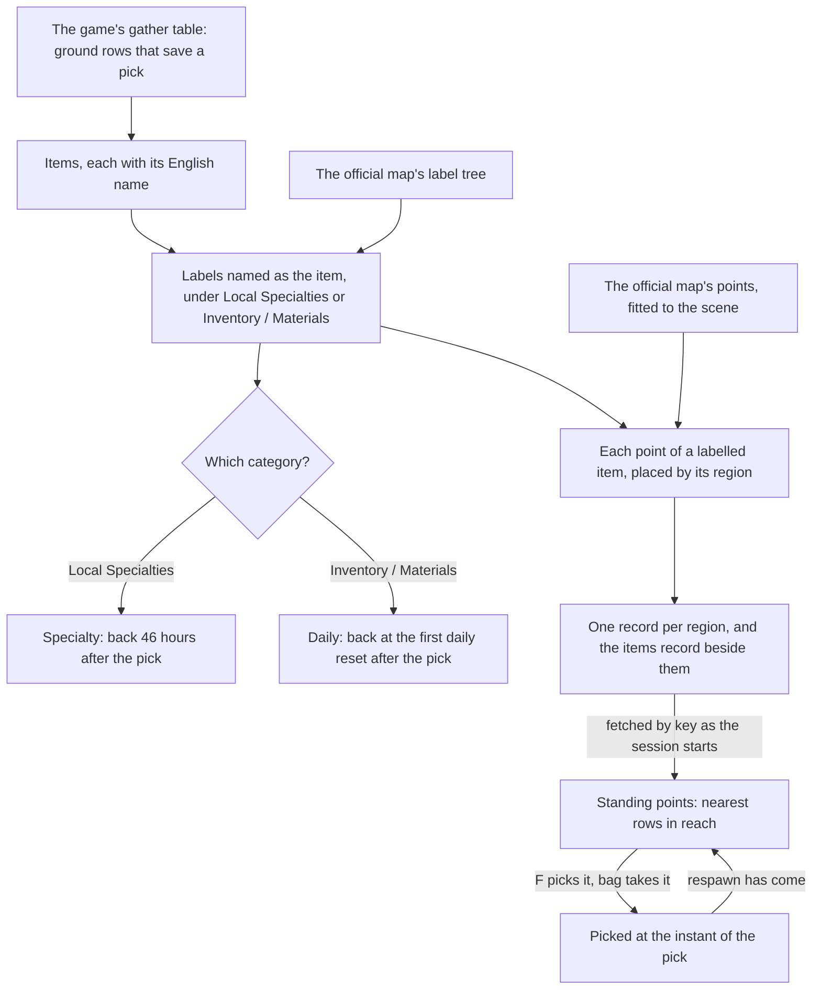

# Gathering

The plants and specialties of the open world are the gathering points the [proposal](../../../changes/genshin-gathering/design.md) describes: a point stands where the official map marks its item, and F picks it into the bag. This page is the first build of that proposal, covering the points of the two categories that are picked, Local Specialties and Inventory / Materials. The ores are published beside them: the same builder places each ore the map marks under Ores, and the world keeps those points out of the pick ups, since an ore is struck until it breaks. Mining outcrops and investigation spots wait in the proposal.

## How it works

## Reading the tables

The slices and the items are published by `pnpm -C scripts genshin:assets gathering` to the gathering dataset of the [hosted game data](../hosted-game-data/design.md). It reads three tables from the game text dump, the gather table and the material table in `ExcelBinOutput/` (`~/Esposter.noindex/genshin-parity/text/ExcelBinOutput/GatherExcelConfigData.json` and `MaterialExcelConfigData.json`) and the English text map, and the official map's label tree and fitted points from the references folder. The gather table is fetched from the community's AnimeGameData repository into the dump and never committed.

- **A row is picked off the ground.** A gather row counts when it sits on the ground and saves its pick. The rows that save nothing belong to other pages, such as fishing, animals and events, and are not points here (`scripts/src/services/genshinAssets/gathering/readGatheringItems.ts`; `~/Esposter.noindex/genshin-parity/text/ExcelBinOutput/GatherExcelConfigData.json`: 152 of its 748 rows carry a `saveType`, and the other 596 carry none).
- **An item is named as its label.** The item's English name is matched to the label of the same name the official map files under Local Specialties, Inventory / Materials or Ores. A Magical Crystal Chunk is left out, since a mining outcrop draws it, and so are a Scarlet Quartz, a Rainbowdrop Crystal and an Electro Crystal (shattered from a Tourmaline by Pyro), which have no poise requirement on the wiki's Mineral page (`scripts/src/services/genshinAssets/gathering/constants.ts`). Special Items, which holds the Oculi, is left to the statues' page.
- **Each point is the fit's.** Every point of a labelled item is carried into the game's coordinates by the [spawned places](../spawned-places/design.md) fit and then into its region's axes, its kind the item's id, and its region from its map area. Points on layers under the ground are left out, as the places' builder already does.

## The respawn

The gather table's refresh ids do not name a policy in the dump. The ground rows that carry a refresh name ids the policy table lacks, and the rest carry none, so the policy cannot be read off the row (`~/Esposter.noindex/genshin-parity/text/ExcelBinOutput/GatherExcelConfigData.json`: its six distinct refresh ids are none of the 20 ids in `RefreshPolicyExcelConfigData.json`). The category settles it instead, as the wiki gives each:

- **A local specialty comes back 46 hours after it is picked**, the wiki's own figure for specialties.
- **A cooking ingredient comes back at the first daily reset after the pick.** The daily reset is the 04:00 reset the shops and commissions use, read in the game's time zone, UTC+8, as the [Original Resin](../original-resin/design.md) page reads it. The wiki reads the common overworld ingredients as spawning at 0:00 server time, four hours before that reset; the change settles the reset, and the recording owed decides which the game keeps.

An ore's respawn is its own, from the wiki's Reset page: an Iron Chunk at the daily reset, a White Iron Chunk or Starsilver two days after the break, and a Crystal Chunk, Amethyst Lump or Condessence Crystal three days after (`scripts/src/services/genshinAssets/gathering/constants.ts`). Those labels are keyed by the map's label id, since a plant's category does not settle them.

**Owner decision.** The wiki's Reset page, which is not on disk, places the Iron Chunk's spawn at 0:00 server time, four hours before the 04:00 daily reset, as it places the common cooking ingredients; the reading above is the reset itself. The page is tagged a stub asking for its timers and respawns to be verified, so the owner decides which the game keeps.

A point is kept as picked with the instant of the pick, and stands again once its respawn has come (`packages/genshin-world/src/services/gathering/checkIsGatheringPlaceStanding.ts`). Nothing runs while the page is closed: each look at the clock compares the instant with its respawn, and the page's clock looks once a minute while it is open.

## The ores' rules

An ore is struck until it breaks. The character's landed hits feed it from the strike loop, beside the enemies: each hit reaches the ores in its area as an enemy's capsule is reached, at the ore's ground point. A hit is melee when it sits in a normal or charged attack of a character wielding a sword, a claymore or a polearm, read off the kind of action its kit was built with it in and the weapon type its combatant carries from the roster's table, so no kit carries a flag (`packages/genshin-world/src/services/kit/checkIsMeleeHit.ts`; `packages/genshin-world/src/services/gathering/readOreHit.ts`). A hit is blunt by `checkIsBluntHit`, the one rule that Shatter, the Rock seal (`checkIsSealFreed`, which reads the resolved element for Pyro too) and the ores share, read in the kit: a claymore's normal or charged attack, a plunge by a sword, claymore or polearm, or Geo damage the hit deals, read as `strikeEnemy` reads the element it deals, so a Geo Traveler's skill, which takes her wielder's element, is blunt and a Geo character's physical normal attack is not (`packages/genshin-world/src/services/kit/checkIsBluntHit.ts`). The wiki's Blunt Attack table comes first, by character and action (`CharacterIdBluntActionMap`, beside the rule, provisional): Chiori's normal attack, skill and burst, Gorou's skill and burst, Klee's normal, charged and skill attacks, Candace's skill, Chongyun's and Eula's skills and bursts, and Xilonen's and Yun Jin's bursts are blunt; Ningguang's plunge, Gorou's Charged Attack, Xilonen's skill and Yun Jin's Opening Flourish are not. Not mapped: Kinich's mid-air normal attack (his record holds no normal attack), Chiori's Sode, Candace's Guardian Stance 2-Hit, Cyno's stance normal attacks, and Gorou's Crystal Collapse. Neuvillette's and Wanderer's catalyst plunges are not blunt, as the wiki does not list them. Each hit adds its poise damage over the ore's requirement for its kind, blunt or melee, so the ore breaks once its shares reach one, and a hit that is neither blunt nor melee adds nothing (`packages/genshin-world/src/services/gathering/strikeOre.ts`). The hits are read before an infusion copies them, so an infusion's converted poise does not reach an ore (`packages/genshin-world/src/services/gathering/readOreHit.ts`). An Overloaded that lands strikes the ores within 3 metres of the enemy it lands on too, as a blunt hit of its explosion's 90 poise, gcsim's, once the step's strikes have landed (`readReactionOreHit`); no other reaction's hit carries poise (`packages/genshin-world/src/services/combat/damage/TransformativeReactionPoiseDamageMap.ts`, where Overloaded alone is 90; `~/Esposter.noindex/cache/gcsim-v2.47.2/pkg/reactable/overload.go`, lines 53-54 and 62, for the blunt strike, the 90 poise and the 3-metre circle). A broken ore drops its certain piece where it lay, and one more for each of two draws that comes under 10% (`packages/genshin-world/src/services/gathering/constants.ts`; `packages/genshin-world/src/services/gathering/rollOreDropCount.ts`). It comes back two days after it breaks for a White Iron Chunk or Starsilver, and three days after for a Crystal Chunk away from a mining outcrop, as the wiki's Reset page gives them. The respawn reads the same as the plants', from the instant of the break.

Each kind of attack takes the hits below to break an ore, its kit's poise run through the rule. A swing of several hits counts each of them, and a combo starts again at its first strike once it ends. Two counts are checked off a clip of one ore struck by that kind alone, unbroken, at 60 frames a second. The others are the rule's own, provisional until a clip shows them, and each is on the [roadmap](../../../changes/genshin-roadmap/tasks.md)'s Manual verification list.

| Attack                                   | Poise a hit      | Iron, White Iron, Starsilver (29 blunt, 200 melee) | Crystal, Magical Crystal and the rest (286, 2000) | Basis                                                           |
| :--------------------------------------- | :--------------- | -------------------------------------------------: | ------------------------------------------------: | :-------------------------------------------------------------- |
| A claymore's combo, Noelle's or Razor's  | 97 to 160, blunt |                                                  1 |                                                 3 | Provisional                                                     |
| A sword's combo, the Traveler's          | 40 to 65, melee  |                                                  5 |                                                41 | Provisional                                                     |
| A polearm's combo, Xiao's                | 25 to 87, melee  |                                                  6 |                                                43 | Provisional                                                     |
| Overloaded                               | 90, blunt        |                                                  1 |                                                 4 | Provisional                                                     |
| A burst, Zhongli's Planet Befall         | 500, blunt       |                                                  1 |                                                 1 | Checked: one breaks a Crystal Chunk and a Magical Crystal Chunk |
| A Geo construct, Zhongli's pressed stele | 200, blunt       |                                                  1 |                                                 2 | Provisional                                                     |
| A sword's or polearm's low plunge        | 100, blunt       |                                                  1 |                                                 3 | Checked: three break a Crystal Chunk                            |

## The pick

F on a gathering point's row picks one of its item into the bag, through the same `addInventoryItem` a drop uses. The point is kept as picked only when the bag takes the item, so a full bag leaves it standing. The picked points are kept for the page's life only, as the drops are. An ore's point is never offered here: it is struck, not picked.

## Key files

| File                                                                             | Role                                                                                              |
| :------------------------------------------------------------------------------- | :------------------------------------------------------------------------------------------------ |
| `scripts/src/services/genshinAssets/gathering/readGatheringItems.ts`             | The items the gather table picks, matched to their map labels                                     |
| `scripts/src/services/genshinAssets/gathering/buildGatheringPlaces.ts`           | Each region's points built as a slice, and the items table                                        |
| `scripts/src/services/genshinAssets/gathering/constants.ts`                      | The categories and their respawns                                                                 |
| `packages/genshin-world/src/services/gathering/computeGatheringRespawn.ts`       | The instant a picked point is back                                                                |
| `packages/genshin-world/src/services/gathering/OreItemIdBreakPoiseMap.ts`        | Each ore's poise to break from blunt and from melee hits                                          |
| `packages/genshin-world/src/services/gathering/strikeOre.ts`                     | An ore's broken share after one hit                                                               |
| `packages/genshin-world/src/services/gathering/readOreHit.ts`                    | The hit an ore takes from a step's landed hit, melee by weapon, blunt by the wiki's Blunt Attacks |
| `packages/genshin-world/src/services/kit/checkIsBluntHit.ts`                     | The one blunt rule the ores, Shatter and the Rock seal share, read off the hit's resolved element |
| `packages/genshin-world/src/services/kit/CharacterIdBluntActionMap.ts`           | The wiki's Blunt Attack table by character and action, provisional, with its gaps listed          |
| `packages/genshin-world/src/services/gathering/readReactionOreHit.ts`            | The hit an ore takes from a reaction's explosion, Overloaded's alone                              |
| `packages/genshin-world/src/services/gathering/rollOreDropCount.ts`              | The pieces an ore drops                                                                           |
| `packages/genshin-world/src/services/gathering/checkIsGatheringPlaceStanding.ts` | Whether a point stands at an instant                                                              |
| `packages/genshin-world/src/composables/useGatheringPoints.ts`                   | Mondstadt's points and items, read as the world opens                                             |
| `packages/genshin-world/src/composables/useWorldPickups.ts`                      | Each ore's broken share, and the pieces a broken ore drops                                        |
| `packages/genshin-world/src/services/kit/stepActiveKit.ts`                       | The character's landed hits and an Overloaded's explosion, fed to the ores                        |
| `packages/genshin-world/src/services/inventory/toItemDefinition.ts`              | An item's definition from its materials row, shared with drops                                    |
| `packages/genshin-world/src/components/World/Session/Index.vue`                  | Rows for the standing points, and a pick into the bag                                             |
| `packages/genshin-world/src/services/gathering/readMondstadtGatheringPlaces.ts`  | Mondstadt's points, fetched by their `gathering/mondstadt` key                                    |

## Notes

- **Four cooking ingredients and one specialty are left out.** Apple, Starshroom, Bulle Fruit and Candlecap Mushroom are typed as a notice-restoring material the world's material type does not name yet, and Rukkhashava Mushrooms has its map label in the singular. Each is one line to add when its type or name lands.
- **The stand-ins are the drops' stand-ins, and they cap at 64.** The world draws each PickUp row as a sphere up to the stand-in capacity, in list order, so most of Mondstadt's points are not drawn yet. Prompts still come from every standing point in reach. A distance cull of the stand-ins is the open part.
- **The respawns are the wiki's, not measured.** The 46 hours is the wiki's figure, and the daily point's clock is the shared daily reset, where the wiki reads the daily spawn at midnight. Both wait on a recording of a point picked and watched (see the [roadmap](../../../changes/genshin-roadmap/tasks.md)).

## Sources

- [Local Specialty](https://genshin-impact.fandom.com/wiki/Local_Specialty), Genshin Impact Wiki: a harvested specialty respawns after 46 hours.
- [Reset](https://genshin-impact.fandom.com/wiki/Reset), Genshin Impact Wiki: the overworld Iron Chunk and common cooking ingredients spawning at 0:00 server time, four hours before the [daily reset](../reset-clock/design.md).
- [Mineral](https://genshin-impact.fandom.com/wiki/Mineral), Genshin Impact Wiki: the poise each ore takes to break, from melee hits and from blunt ones.
- [Interruption Resistance/Data](https://genshin-impact.fandom.com/wiki/Interruption_Resistance/Data), Genshin Impact Wiki: Overloaded's 90 poise.
- [gcsim](https://github.com/genshinsim/gcsim)'s `~/Esposter.noindex/cache/gcsim-v2.47.2/pkg/reactable/overload.go:53-54` at v2.47.2, MIT: the Overloaded explosion's blunt strike and 90 poise, over a circle of 3 metres about the enemy it lands on.
- [Genshin Impact - Fast Mining Methods](https://www.youtube.com/watch?v=6CY2RwKc_TE), YouTube, 0–10 s at 60 frames a second: three low plunges of the Traveler's break a Crystal Chunk.
- [Farming Ores with Zhongli](https://www.youtube.com/watch?v=EWYe-MYjmqU), YouTube, 77–82 s at 60 frames a second: one Planet Befall breaks a Crystal Chunk and a Magical Crystal Chunk.
- [AnimeGameData](https://github.com/DimbreathBot/AnimeGameData), the community's per-patch dump: `GatherExcelConfigData` and `MaterialExcelConfigData`, the tables the items and their ground rows are read from.
- [Teyvat Interactive Map](https://act.hoyolab.com/ys/app/interactive-map/index.html), HoYoLAB: the official map's labels and points that the places are fitted from.

## Reference

- A montage cut between strikes, so which of them count is settled here. Its source and recording are on [world compute](../compute/world/design.md).

## Open

- [ ] **The respawn durations match the wiki** — no source yet: the Local Specialty, Reset and Mineral wiki pages are not in `~/Esposter.noindex/cache/genshin-wiki/`, so the 46 hours, the 04:00 reset, the 0:00 spawn and the 2- and 3-day ore respawns are unchecked.
- [ ] **The ore poise values match the wiki's Mineral page** — no source yet: the page is not cached; `packages/genshin-world/src/services/gathering/OreItemIdBreakPoiseMap.ts` carries the values.
- [ ] **The blunt-attack actions match the wiki** — no source yet: the wiki's Blunt Attacks table is not cached; `packages/genshin-world/src/services/kit/CharacterIdBluntActionMap.ts` carries the entries, and the exclusions of Neuvillette's and Wanderer's catalyst plunges are unchecked.
- [ ] **The blunt-attack map matches the wiki for Neuvillette's Charged Attack** — contradicted by `~/Esposter.noindex/cache/genshin-wiki/Category_Neuvillette_Talents.json`: its Charged Attack hit carries blunt = 1, and the map has no entry for him.
- [ ] **The blunt-attack map matches the wiki for Chiori's normal attack** — contradicted by `~/Esposter.noindex/cache/genshin-wiki/Category_Chiori_Talents.json`: its blunt flags sit on skill and plunge hits, none on normal attacks.
- [ ] **The two Checked rows of the poise table** — no source yet: the Zhongli clip `yt-EWYe-MYjmqU-ore-zhongli.mp4` and the Traveler's clip `yt-6CY2RwKc_TE-ore-fast-methods.mp4` were not frame-checked in this pass.
- [ ] **F picks a gathering point into the bag, and an ore is never picked** — no source yet: no gathering pick path calling `addInventoryItem` was found; `packages/genshin-world/src/composables/useWorldPickups.ts` builds the pick-up interactables for dropped items (`InteractionKind.PickUp`, line 100), which is the drop path, not a gathering point's.
- [ ] **The official map's label tree and fitted points are in the references folder** — no source yet: no file matching `teyvat`, `map-label` or `labels` was found under `~/Esposter.noindex/genshin-parity/references/`.
- [ ] **The ores are placed by the same builder, and points on layers under the ground are left out** — no source yet: `scripts/src/services/genshinAssets/gathering/buildGatheringPlaces.ts` is the builder (line 15), but no rule that leaves out a point under the ground was found in `scripts/src/services/genshinAssets/gathering/`.
- [ ] **Special Items (the Oculi) are left to the statues' page, and four cooking ingredients and one specialty are left out** — no source yet: neither exclusion was found in `scripts/src/services/genshinAssets/gathering/readGatheringItems.ts` or `buildGatheringPlaces.ts`.
- [ ] **The stand-ins cap at 64** — no source yet: no 64-stand-in capacity was found in `packages/genshin-world/src/services/gathering/` or `scripts/src/services/genshinAssets/gathering/`.
- [ ] **`ore-strike.mkv` holds the strikes this page settles** — no source yet: no `ore-strike.mkv` is in `~/Esposter.noindex/genshin-parity/captures/`, and the stand-in there, `yt-VlRNdhoeXTk-ore-strike.mp4`, is the montage the page's own note calls cut between strikes, not the single recording the claim names.
- [ ] **Items are named as their map labels, less the mining outcrop and poise exclusions** — no source yet: the map labels in `~/Esposter.noindex/genshin-parity/text/TextMapEN.json`, not yet compared with the item names.
- [ ] **Each ore respawns on its own clock: Iron at the daily reset, White Iron and Starsilver in two days, Crystal, Amethyst and Condessence in three** — no source yet: the game side is the wiki's Reset page, which is not in `~/Esposter.noindex/cache/genshin-wiki/`, and `~/Esposter.noindex/genshin-dump-backup-6.6/ExcelBinOutput/GadgetExcelConfigData.json` holds no respawn field to read it from; the repo's `getLabelRespawn.ts` and `constants.ts` are repo copies, not evidence.
- [ ] **Only Overloaded's explosion carries poise among the reactions** — no source yet: the wiki's Interruption Resistance/Poise page, named in the enemies page's Sources, is not on disk, and neither is its Interruption Resistance/Data page.
