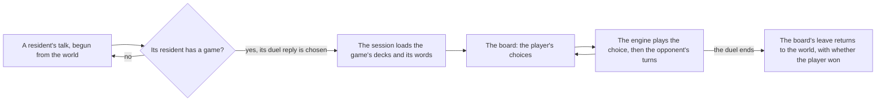

# Genius Invokation TCG duel board

The duel board is the screen a duel is played on, and the session that runs it. A talk offers the duel, the board holds the player's choices, and each choice is one engine action, after which the opponent's turns are the scripted policy's, until the board leaves. The rules the engine plays are on the [rules page](../rules/design.md), and the decks it plays are on the [decks page](../decks/design.md).

## How a duel is opened

- **A duel is opened by its game id.** A seat names the game of the card game's own table it duels with (`duelGameId`), and the week games its weekly guest challenge offers (`weekGames`: each game, the level it is offered at, and the week's Lucky Coins and Player EXP at that level). `genshin:assets gcg` publishes one small map, `gcg/games`, of the seated games and the week games from the game table: each game's opponent deck, and the player's deck the game names. A game whose opponent deck is not published fails the run, and one whose player deck is not published plays the placeholder deck 3 until it is.
- **The seated duels.** A world-level duelist's duel is its NPC's row in the dump's `GCGWorldLevel` table: the row's game as `duelGameId` and its talk as `duelTalkId`. Seated this way: 1423 (game 11106), 1435 (game 11004, talk 6143506, which replaces the wiki's game 1021 on her Souvenir shop row), 2304 (game 12303) and 2308 (game 12305). A week challenger's games are the levels of its NPC's `GCGWeekLevel` row, each with the week's reward at its level from `GCGWeekReward`: 9704 (games 1031 to 1035), 9706 (games 1051 to 1055) and 9715 (games 1101 to 1105). 9704's and 9715's standing duels stay on games 1031 and 1104, which have no world row. The residents' places are the scene-group NPC members and the residents builder's building-point and crafting-bench maps. Of the 221 duelists the dump names, 4 world-level and 3 week NPCs are placed, and the rest are not: 104 world-level NPCs, 112 week NPCs and the five scene duelists 1707 to 1711. Their sources were checked: the published `sceneNpcBorn/scene3` births and the scene-group NPC members hold only 2304 and 2308 of the world-level set and none of the others, and no building point names them. Boss, character and festival duels are not built. The nine enemy decks that the seated games name are not built (11001, 11004, 11102, 11106, 12003, 12105, 12303, 13003, 13102), so their games are not published and `gcg/games` fails on them until they are.
- **A talk offers the duel as a reply on its opening line.** The reply is the game's own "I challenge you to a duel!" (text id `191219274`), offered after the talk's own replies. Choosing it leaves the talk for the board, and the board's leave returns to the world.
- **A duel is offered from its talk, behind the Player Level.** A resident's duel is offered from its `duelTalkId` where it has one, else from the standing talk it begins; `getTalkDuelGameId` finds the resident by that talk. A week challenger's duel is open only when the Player Level opens its game (`checkIsGcgResidentDuelOpen`, through `listGcgOpenGameIds`). The Player Level is zero until the introduction quest is finished, and then the EXP's level, capped by the locks the main quests hold. A world-level duel has no Player Level gate, since its talk's quest condition opens it. Every resident holds their standing talk whatever the quests hold ([dialogue](../../dialogue/design.md)), and `mergeTalks` merges the talk sources in order, so a quest's talk of an id wins over a standing talk of the same id.

## The board and the session

- **The board holds only what the player is choosing.** `GcgScreen` keeps the dice picked, the card armed, the tuning and the switch and prepare choices, and every other choice leaves as an event. The session host plays each event through the engine and then runs the opponent through `advanceGcgOpponent`. The board clears its choice whether or not the engine takes it.
- **The scripted policy is the world's service.** The greedy policy (`takeGcgScriptedAction`) and `advanceGcgOpponent` are not the board's own, so the board and the tests drive one opponent. The policy takes the first card, then the first skill, then the round's end.
- **A won duel is the win its game counts.** `useWorldGcgDuel` holds the game being played, and leaving the board emits the card game's win for that game when the player won; the quests' win objectives count it.

## The reference

- **The reference is a public frame.** The board is judged against a frame at 407 seconds of the English PC client's tavern duel, cut from its 400-second segment (`gcg-yt-tvboQ_ZWO_I-400-410.mp4`). The board draws that frame's HP, dice, phase and turn, but not its characters, art or ornaments, which are the game's and are never drawn here. Its compare score is the snapshot's row in `ParityReferenceMap.snapshot.md`, the mean difference there, the remainder being the game's own art, ornate frame and profile plates, which the board does not draw or ship. The reference `gcg-duel-board` names the frame.
- **The board's layout is judged by the user's eye, and the visual suite holds no image of it until approved.** Its compare is recorded in `ParityReferenceMap.snapshot.md`; what remains is the game's ornate frame and profile plates, which the board neither draws nor ships. `Index.<platform>.png` is approved by `genshin:parity approve` once the layout is accepted.

## Key files

| File                                                                    | Role                                                                                                     |
| :---------------------------------------------------------------------- | :------------------------------------------------------------------------------------------------------- |
| `scripts/src/services/genshinAssets/gcg/buildGcgGames.ts`               | Builds the games map from the dump's game table                                                          |
| `scripts/src/services/genshinAssets/gcg/toGcgGames.ts`                  | Each game as a duel plays it, the placeholder deck where the game names an unbuilt one                   |
| `packages/genshin-world/src/services/gcg/readGcgGame.ts`                | A duel's game from the games record, by its game id in the game table                                    |
| `packages/genshin-world/src/services/gcg/createGcgDuel.ts`              | Opens a duel between two decks                                                                           |
| `packages/genshin-world/src/services/gcg/advanceGcgOpponent.ts`         | Runs a side through its preparation, reroll, replacement or turn, until the duel waits on the other side |
| `packages/genshin-world/src/services/gcg/takeGcgScriptedAction.ts`      | The greedy policy a side takes its turn by: the first card, then the first skill, then the round's end   |
| `packages/genshin-world/src/models/world/Resident.ts`                   | A resident's optional duel, its duel talk, and its week games                                            |
| `packages/genshin-world/src/composables/useWorldGcgDuel.ts`             | The game being played, and the leave that emits its win                                                  |
| `packages/genshin-world/src/composables/useGcgPlayerLevel.ts`           | The card game's Player Level, and whether a resident's duel is open at it                                |
| `packages/genshin-world/src/services/gcg/checkIsGcgResidentDuelOpen.ts` | Whether a week challenger's duel is open at the Player Level                                             |
| `packages/genshin-world/src/services/dialogue/constants.ts`             | The reply a talk offers a duel with                                                                      |
| `packages/genshin-world/src/services/dialogue/mergeTalks.ts`            | The talk sources merged by id, a shared id held by the earlier source                                    |
| `packages/genshin-world/src/components/Gcg/Screen/Index.vue`            | The duel board: the events it emits and the props it takes, the duel as the engine holds it              |
| `packages/genshin-world/src/components/Gcg/Session/Index.vue`           | The duel's host: loads its game's decks and words, plays each player event, then the opponent            |
| `packages/genshin-world/src/components/Gcg/Screen/Index.fixture.ts`     | The board in the frame's state: its HP, dice and turn, with the tutorial and placeholder decks           |
| `packages/genshin-world/src/components/Gcg/Screen/Index.reference.ts`   | The public frame the board is judged against, and what was found reading it                              |

## Sources

- The public frame the board is judged against: the English PC client's tavern duel, as recorded in the segment named above.
