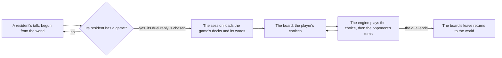

# Genius Invokation TCG duel board

The duel board is the screen a duel is played on, and the session that runs it. A talk offers the duel, the board holds the player's choices, and each choice is one engine action, after which the opponent's turns are the scripted policy's, until the board leaves. The rules the engine plays are on the [rules page](../rules/design.md), and the decks it plays are on the [decks page](../decks/design.md).

## How a duel is opened

- **A duel is opened by its game id.** A seat names the game of the card game's own table it duels with (`duelGameId`). `genshin:assets gcg` publishes one small map, `gcg/games`, of the seated games from the game table: each game's opponent deck, and the player's deck the game names. A game whose opponent deck is not published fails the run, and one whose player deck is not published plays the placeholder deck 3 until it is.
- **No duel is seated yet.** A seat is placed only on a challenger NPC that a built region's residents hold. The game's NPC is read from the dump's GCG week-level table, whose `npcId` names the challenger and whose `levelCondList` names each game's id. Two challengers have built decks: Marjorie, NPC 9701 on games 1021 to 1025 with deck 11005, and Ellin, NPC 9704 on games 1031 to 1035 with deck 11002. Neither has a resident row in `data/regions/*.json`, so `RESIDENT_DUEL_GAME_ID_MAP` is empty. The other built decks belong to player-versus-player games or the tutorial quest's levels, which name no NPC. Duels open from their challengers once their region's residents are written.
- **A talk offers the duel as a reply on its opening line.** The reply is the game's own "I challenge you to a duel!" (text id `191219274`), offered after the talk's own replies. Choosing it leaves the talk for the board, and the board's leave returns to the world.
- **A challenger's duel is offered from their standing talk.** Every resident holds their standing talk whatever the quests hold ([dialogue](../../dialogue/design.md)), and `mergeTalks` merges the talk sources in order, so a quest's talk of an id wins over a standing talk of the same id. A seated challenger's talk is that standing talk, and the duel reply is added to its opening line, so no talk is written for a duel.

## The board and the session

- **The board holds only what the player is choosing.** `GcgScreen` keeps the dice picked, the card armed, the tuning and the switch and prepare choices, and every other choice leaves as an event. The session host plays each event through the engine and then runs the opponent through `advanceGcgOpponent`. The board clears its choice whether or not the engine takes it.
- **The scripted policy is the world's service.** The greedy policy (`takeGcgScriptedAction`) and `advanceGcgOpponent` are not the board's own, so the board and the tests drive one opponent. The policy takes the first card, then the first skill, then the round's end.

## The reference

- **The reference is a public frame.** The board is judged against a frame at 407 seconds of the English PC client's tavern duel, cut from its 400-second segment (`gcg-yt-tvboQ_ZWO_I-400-410.mp4`). The board draws that frame's HP, dice, phase and turn, but not its characters, art or ornaments, which are the game's and are never drawn here. Its compare score is the snapshot's row in `ParityReferenceMap.snapshot.md`, the mean difference there, the remainder being the game's own art, ornate frame and profile plates, which the board does not draw or ship. The reference `gcg-duel-board` names the frame.
- **The board's layout is judged by the user's eye, and the visual suite holds no image of it until approved.** Its compare is recorded in `ParityReferenceMap.snapshot.md`; what remains is the game's ornate frame and profile plates, which the board neither draws nor ships. `Index.<platform>.png` is approved by `genshin:parity approve` once the layout is accepted.

## Key files

| File                                                                  | Role                                                                                                     |
| :-------------------------------------------------------------------- | :------------------------------------------------------------------------------------------------------- |
| `scripts/src/services/genshinAssets/gcg/buildGcgGames.ts`             | Builds the games map from the dump's game table                                                          |
| `scripts/src/services/genshinAssets/gcg/toGcgGames.ts`                | Each game as a duel plays it, the placeholder deck where the game names an unbuilt one                   |
| `packages/genshin-world/src/services/gcg/readGcgGame.ts`              | A duel's game from the games record, by its game id in the game table                                    |
| `packages/genshin-world/src/services/gcg/createGcgDuel.ts`            | Opens a duel between two decks                                                                           |
| `packages/genshin-world/src/services/gcg/advanceGcgOpponent.ts`       | Runs a side through its preparation, reroll, replacement or turn, until the duel waits on the other side |
| `packages/genshin-world/src/services/gcg/takeGcgScriptedAction.ts`    | The greedy policy a side takes its turn by: the first card, then the first skill, then the round's end   |
| `packages/genshin-world/src/models/world/Resident.ts`                 | A resident's optional duel, by the game it duels with                                                    |
| `packages/genshin-world/src/services/dialogue/constants.ts`           | The reply a talk offers a duel with                                                                      |
| `packages/genshin-world/src/services/dialogue/mergeTalks.ts`          | The talk sources merged by id, a shared id held by the earlier source                                    |
| `packages/genshin-world/src/components/Gcg/Screen/Index.vue`          | The duel board: the events it emits and the props it takes, the duel as the engine holds it              |
| `packages/genshin-world/src/components/Gcg/Session/Index.vue`         | The duel's host: loads its game's decks and words, plays each player event, then the opponent            |
| `packages/genshin-world/src/components/Gcg/Screen/Index.fixture.ts`   | The board in the frame's state: its HP, dice and turn, with the tutorial and placeholder decks           |
| `packages/genshin-world/src/components/Gcg/Screen/Index.reference.ts` | The public frame the board is judged against, and what was found reading it                              |

## Sources

- The public frame the board is judged against: the English PC client's tavern duel, as recorded in the segment named above.
