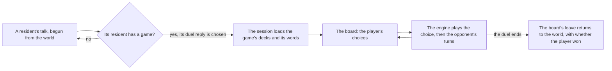

# Genius Invokation TCG duel board

The duel board is the screen a duel is played on, and the session that runs it. A talk offers the duel, the board holds the player's choices, and each choice is one engine action, after which the opponent's turns are the scripted policy's, until the board leaves. The rules the engine plays are on the [rules page](../rules/design.md), and the decks it plays are on the [decks page](../decks/design.md).

## How a duel is opened

- **A duel is opened by its game id.** A seat names the game of the card game's own table it duels with (`duelGameId`), and the week game its weekly guest challenge offers (`weekGame`: the game, the level it is offered at, and the week's Lucky Coins and Player EXP at that level). `genshin:assets gcg` publishes one small map, the games map, of the seated games and the week games from the game table: each game's opponent deck, and the player's deck the game names. A game whose opponent deck is not published fails the run, and one whose player deck is not published plays the placeholder deck 3 until it is (`scripts/src/services/genshinAssets/gcg/toGcgGames.ts`, which throws on a game the table lacks; `GCG_PLACEHOLDER_PLAYER_DECK_ID` of 3 in `scripts/src/services/genshinAssets/gcg/constants.ts`).
- **The seated duels.** A seat is placed on a resident of a built region, through the residents builder's own points. The game's NPC is read from the dump's GCG week-level table, whose `npcId` names the challenger and whose `levelCondList` names each game's id (`{data-root}/genshin-parity/text/ExcelBinOutput/GCGWeekLevelExcelConfigData.json`: NPC 9704 holds game 1031, and NPC 9715 holds games 1101 to 1105). Marjorie's duel (game 1021, deck 11005) sits on her Souvenir shop row, the seat of id 1435 (`packages/genshin-world/src/data/regions/mondstadt.json`, `duelGameId` 1021; game 1021 is deck 11005 in `{data-root}/genshin-parity/text/ExcelBinOutput/GCGGameExcelConfigData.json`), and the week table names NPC 9701 for game 1021, so the seat is hers through its game rather than through an NPC of id 1435; Ellin (NPC 9704, game 1031, deck 11002) stands at the Knights of Favonius headquarters' point (`packages/genshin-world/src/data/regions/mondstadt.json`, `duelGameId` 1031 on id 9704; game 1031 is deck 11002 in `{data-root}/genshin-parity/text/ExcelBinOutput/GCGGameExcelConfigData.json`); and Kimiya (NPC 9715, game 1104, deck 13105) stands beside Sumeru's crafting bench (`packages/genshin-world/src/data/regions/sumeru.json`, `duelGameId` 1104 on id 9715; game 1104 is deck 13105 in `{data-root}/genshin-parity/text/ExcelBinOutput/GCGGameExcelConfigData.json`). Ellin's and Kimiya's points are provisional. Furuya Noboru, Patton and Kurisu are not seated, since no point the scene holds is theirs (`packages/genshin-world/src/data/regions/mondstadt.json` and `packages/genshin-world/src/data/regions/sumeru.json` hold the only three `duelGameId` seats). A resident holds one duel game, so Kimiya's game 1105 is not offered (`packages/genshin-world/src/data/regions/sumeru.json` holds no `duelGameId` 1105). The other built decks belong to player-versus-player games or the tutorial quest's levels, which name no NPC.
- **The levels map drops a duel slot the table leaves empty.** `genshin:assets gcg` also publishes the levels map: each challenger's duels with the level that opens each, each Player Level's total EXP and the locks that hold the Player Level (`scripts/src/services/genshinAssets/gcg/toGcgLevels.ts`, fed by `scripts/src/services/genshinAssets/gcg/buildGcgLevels.ts`). The dump writes a challenger's unused slots as empty records, which the table reader fills with zeros: NPC 9716 holds game 1115 at level 10 and four empty slots (`{data-root}/genshin-parity/text/ExcelBinOutput/GCGWeekLevelExcelConfigData.json`). A zero game id names no game, so the builder drops those slots, and `gcgLevelsSchema` (`packages/genshin-world/src/models/gcg/gcgLevelsSchema.ts`), which requires positive ids and levels, reads only real duels.
- **A talk offers the duel as a reply on its opening line.** The reply is the game's own "I challenge you to a duel!" (text id `191219274`, `{data-root}/genshin-parity/text/TextMapEN.json`), offered after the talk's own replies (`packages/genshin-world/src/composables/useWorldTalks.ts`). Choosing it leaves the talk's screen for the board without ending the talk, so no talk-to quest event is emitted for it (`packages/genshin-world/src/components/World/Session/Index.vue`), and the board's leave returns to the world.
- **A challenger's duel is offered from their standing talk.** Every resident holds their standing talk whatever the quests hold ([dialogue](../../dialogue/design.md)), and `mergeTalks` merges the talk sources in order, so a quest's talk of an id wins over a standing talk of the same id (`packages/genshin-world/src/services/dialogue/mergeTalks.ts`). A seated challenger's talk is that standing talk, and the duel reply is added to its opening line, so no talk is written for a duel.

## The board and the session

- **The board holds only what the player is choosing.** `GcgScreen` keeps the dice picked, the card armed, the tuning and the switch and prepare choices in `useGcgSelection` (`packages/genshin-world/src/composables/useGcgSelection.ts`), and every other choice leaves as an event (`packages/genshin-world/src/components/Gcg/Screen/Index.vue`). The session host plays each event through the engine and then runs the opponent through `advanceGcgOpponent` (`packages/genshin-world/src/components/Gcg/Session/Index.vue`). The board clears its choice whether or not the engine takes it (`packages/genshin-world/src/composables/useGcgSelection.ts`, `clearSelection`).
- **The scripted policy is the world's service.** The greedy policy (`takeGcgScriptedAction`) and `advanceGcgOpponent` are not the board's own, so the board and the tests drive one opponent. The policy takes the first card, then the first skill, then the round's end (`packages/genshin-world/src/services/gcg/takeGcgScriptedAction.ts`).

## The reference

- **The reference is a public frame.** The board is judged against a frame at 407 seconds of the English PC client's tavern duel, cut from its 400-second segment ([the capture gcg cites](../../compute/gcg/design.md)). The board draws that frame's HP, dice, phase and turn, but not its characters' art or ornaments, which are the game's and are never drawn here; each character is a tinted card with its frame and HP, and the frame shows no name on a card, so a name is only the card's label. Its compare score is the snapshot's row in `scripts/src/services/genshinParity/shared/ParityReferenceMap.snapshot.md`, the mean difference in its `gcg-duel-board` row. The reference `gcg-duel-board` names the frame (`packages/genshin-world/src/components/Gcg/Screen/Index.reference.ts`; [the capture gcg cites](../../compute/gcg/design.md); the frame `{data-root}/genshin-parity/references/gcg-duel-board-tvboQ_ZWO_I-407.0s.png`).
- **The board's layout is placed from the frame's measures, and the visual suite holds its image.** The two plates, the band, the end-round coin, the hand's cost hexagons and the portrait rings take the frame's measured colours and places, the table's inner half its mean colour at each radius from the centre, the crest's light as a glow over the table's top centre and the top band, the bottom band greyer toward the right, the bottom border its own colour, and the round discs and the HP discs their measured fills, and the support zone its panel colour (`packages/genshin-world/src/components/Gcg/Screen/Index.vue`, `packages/genshin-world/src/components/Gcg/Screen/Card/Index.vue`, `packages/genshin-world/src/components/Gcg/Screen/Table/Index.vue`, `packages/genshin-world/src/components/Gcg/Screen/Hud/Index.vue`, `packages/genshin-world/src/components/Gcg/Screen/Character/Index.vue`). What the compare still counts is the game's art and icons, its table texture, the frame's ornament and the crest, the skill coins' cost chips, the name plates' text (the player's and the host's names, which no host feeds), and the third opponent card, which the frame raises about 42 pixels under a pointer the entry does not record and the board does not lift for an unchoosable character. `Index.png` is written by `genshin:parity approve`.

## Key files

| File                                                                       | Role                                                                                                     |
| :------------------------------------------------------------------------- | :------------------------------------------------------------------------------------------------------- |
| `scripts/src/services/genshinAssets/gcg/buildGcgLevels.ts`                 | Builds the levels map from the dump's level, week-level and level-lock tables                            |
| `scripts/src/services/genshinAssets/gcg/toGcgLevels.ts`                    | Each challenger's real duels, each Player Level's total EXP and its locks, dropping the empty slots      |
| `scripts/src/services/genshinAssets/gcg/buildGcgGames.ts`                  | Builds the games map from the dump's game table                                                          |
| `scripts/src/services/genshinAssets/gcg/toGcgGames.ts`                     | Each game as a duel plays it, the placeholder deck where the game names an unbuilt one                   |
| `packages/genshin-world/src/services/gcg/readGcgGame.ts`                   | A duel's game from the games record, by its game id in the game table                                    |
| `packages/genshin-world/src/services/gcg/createGcgDuel.ts`                 | Opens a duel between two decks                                                                           |
| `packages/genshin-world/src/services/gcg/advanceGcgOpponent.ts`            | Runs a side through its preparation, reroll, replacement or turn, until the duel waits on the other side |
| `packages/genshin-world/src/services/gcg/takeGcgScriptedAction.ts`         | The greedy policy a side takes its turn by: the first card, then the first skill, then the round's end   |
| `packages/genshin-world/src/models/world/Resident.ts`                      | A resident's optional duel, by the game it duels with                                                    |
| `packages/genshin-world/src/services/dialogue/constants.ts`                | The reply a talk offers a duel with                                                                      |
| `packages/genshin-world/src/services/dialogue/mergeTalks.ts`               | The talk sources merged by id, a shared id held by the earlier source                                    |
| `packages/genshin-world/src/components/Gcg/Screen/Index.vue`               | The duel board: the events it emits and the props it takes, the duel as the engine holds it              |
| `packages/genshin-world/src/composables/useGcgSelection.ts`                | The board's choices: the dice picked, the card armed, the tuning, and the switch and prepare picks       |
| `packages/genshin-world/src/components/Gcg/Screen/Plates/Index.vue`        | The two plates, one for each side, with their avatars                                                    |
| `packages/genshin-world/src/components/Gcg/Screen/Band/Index.vue`          | The band between the two rows, naming the phase                                                          |
| `packages/genshin-world/src/components/Gcg/Screen/RoundControls/Index.vue` | The end-round coin, the round and acting labels and the synchro                                          |
| `packages/genshin-world/src/components/Gcg/Screen/Confirm/Index.vue`       | The confirm bar of each phase, taking the phase and emitting its actions                                 |
| `packages/genshin-world/src/components/Gcg/Session/Index.vue`              | The duel's host: loads its game's decks and words, plays each player event, then the opponent            |
| `packages/genshin-world/src/components/Gcg/Screen/Index.fixture.ts`        | The board in the frame's state: its HP, dice and turn, with the tutorial and placeholder decks           |
| `packages/genshin-world/src/components/Gcg/Screen/Index.reference.ts`      | The public frame the board is judged against, and what was found reading it                              |

## Sources

- The public frame the board is judged against: the English PC client's tavern duel, as recorded in the segment named above.

## Open

- [ ] **The frame's art, its icons, the player nicknames, the UID and the lifted opponent card** — no source the screen owns: the cards', portraits' and coins' art is the game's, and the two nicknames and the UID are the player's own account, which no host feeds. The opponent's right card is raised in the frame with no active character behind it (the duel holds one), most likely the recording's pointer resting on it; a reference `pointer` would record that, and the board would need a hover lift for an unchoosable character, so it is not drawn.
- [ ] **Ellin stands at the Knights of Favonius headquarters' point, and Kimiya beside Sumeru's crafting bench** — no source yet: the scene group record that places NPC 9704 or 9715 is in none of the files searched, `{data-root}/genshin-dump-backup-6.6/BinOutput/Scene/SceneNpcBorn/scene3_npcborn.json`, the GCG scene tables, `{data-root}/genshin-parity/extracted/lua/raw` and `{data-root}/genshin-parity/extracted/mondstadt/world/world.json` (its matches are path ids), each holds no NPC record for either id.
