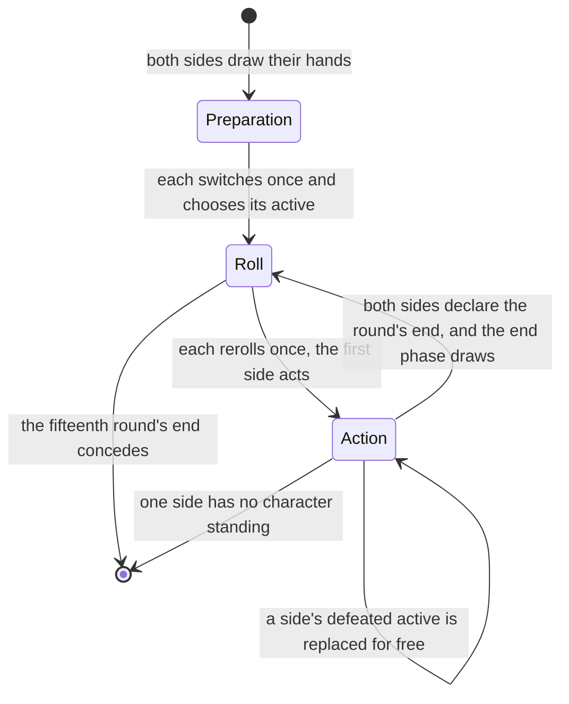
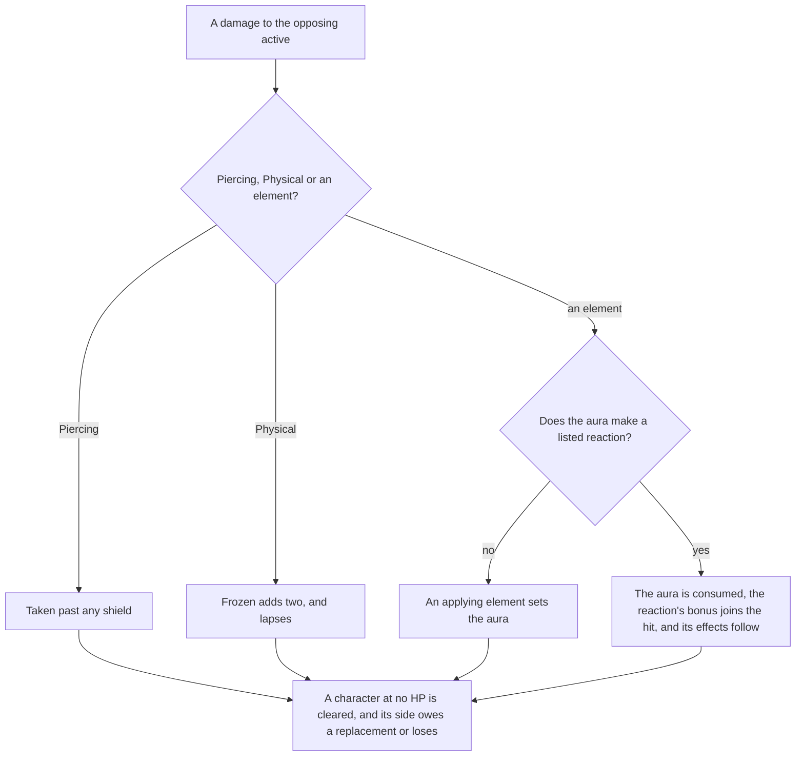

# Genius Invokation TCG rules

The engine is the duel's own rules: how a duel starts, how its dice, rounds, turns and phases run, and how a hit, a reaction and a defeat settle. The characters and cards that play under these rules are on the [decks page](../decks/design.md). The page is part of the [card game](../README.md).

## The standard rule

- **Duels against residents run the untimed standard rule.** The rule table's second rule is the one with no clocks, since a duel against a resident has no round to run out. Its reactions and hand limit are the matchmaking rule's. `genshin:assets gcg` writes its draw, hand limit and reactions as one slice the world imports on demand.
- **The reactions are the table's element pairs, and their effects are the wiki's.** The rule lists its reactions by pair, and the table gives each pair's id. The bonuses, the shields, the spread, the piercing and the forced switch come from the wiki's rules page, since the skill rows that name them carry their values in declared-value sets this build does not read.

## Dice, rolls and turns

- **Preparation switches once, then chooses.** A side's switched cards go back into its draw pile, which is shuffled and drawn from to refill its hand. Then it chooses its active character, and the first round's roll starts once both sides have.
- **Rolls and rerolls.** Each side rolls eight dice a round, each face one of the seven elements or Omni, equally likely, from the seeded source. Each side then has one reroll of any dice it names, and naming none passes.
- **Combat actions pass the turn.** Using a skill, switching for one die of any face and declaring the round's end are combat actions. Each passes the turn unless the other side has already declared its end.
- **Tuning is a fast action.** It discards a card to set one die to the active character's element, and the turn stays.
- **Playing a card is a fast action.** A card passes no turn.
- **A switch is paid through the field's reductions.** A switch costs one die of any face, and a card that reduces a switch takes that die off: Dawn Winery, twice a round, and Changing Shifts, once. A switch may therefore pay no die. Leave It to Me! makes the next switch a fast action and is spent by it.
- **A defeated active is replaced by a free action.** A side owes a replacement while one of its characters stands, and may take it at any point in the action phase. Only that side's turn actions wait on it, and the turn does not.
- **The round's end.** The side that declares first goes first next round, and the first round goes to the first side. Frozen lapses at the end phase. Each side then draws the rule's two cards, from the first side on, and a draw past the hand's limit is discarded.
- **A duel concedes after its fifteenth round.** Once that round's end phase closes, both sides concede with no winner, as the wiki gives the limit.
- **Energy.** A normal attack and an elemental skill gain the skill row's energy, one, and a burst pays the energy its cost names. A skill that a character cannot pay for is refused, and the dice it would have paid stay in the dice.
- **Combat actions are refused whole.** A refused action leaves the duel as it was and says why.
- **Charged and plunging attacks are markers no tutorial skill uses**, so the engine deals them no damage.

## Elements, reactions and damage

- **Elements apply, and Anemo and Geo do not.** Cryo, Hydro, Pyro, Electro and Dendro damage sets its aura. Anemo and Geo damage reacts with an aura and sets none, and Physical and Piercing damage reacts with nothing. A reaction consumes the aura it reacts with, and its element does not apply.
- **A reaction's bonus joins its instance.** Melt, Vaporize and Overloaded add two. Superconduct, Electro-Charged, Frozen, Crystallize, Burning, Bloom and Quicken add one. Swirl adds none.
- **The reactions leave their cards on the attacker's side.** Burning summons Burning Flame, which deals one Pyro at each end phase, spends a usage, and stacks to two usages. Bloom leaves Dendro Core onstage, which adds two to the next Pyro or Electro damage its side's skills deal, for one usage. Quicken leaves Catalyzing Field onstage, which adds one to the next Dendro or Electro damage, for two usages. The numbers are the game's own card descriptions, read through the text map. A second reaction of the same kind joins the card already there, up to the card's most usages, rather than a second copy.
- **Frozen and shields.** A Frozen target takes two more from a Pyro or Physical hit, and that hit removes the status, which otherwise lasts to the round's end. A shield takes damage before HP, and piercing skips it. Crystallize grants the attacker's active character one point, at most two.
- **Piercing and spread.** Superconduct and Electro-Charged pierce the other opposing characters for one. A Swirl spreads one of its aura's elements to each of them as damage only: it sets no aura and reacts with none. The wiki does not say whether a spread applies or reacts, so this is a settled call. A recording of a duel can overturn it ([References sought](../../../../changes/genshin-roadmap/tasks.md)).
- **Overloaded forces the switch.** An Overloaded active character is switched to the next standing character in order, with no choice given.
- **Phases run hooks.** The roll-phase hooks run once a side's dice are rolled, the action-phase hooks when the action phase opens, and the end-phase hooks in the end phase before the draws. An end-phase hook may return damage, which the phase deals, so a summon's end-phase damage is dealt by the phase rather than by the summon.
- **The end phase is not a phase of its own.** It runs as the round closes, and the next round's roll follows it.

A hit on the opposing active character is settled in one order:

## Key files

| File                                                             | Role                                                                          |
| :--------------------------------------------------------------- | :---------------------------------------------------------------------------- |
| `scripts/src/services/genshinAssets/gcg/buildGcgStandardRule.ts` | Builds the standard rule's record from the dump's rule and reaction tables    |
| `scripts/src/services/genshinAssets/gcg/toGcgStandardRule.ts`    | The rule row, with each listed reaction joined to its element pair            |
| `packages/genshin-world/src/services/gcg/readGcgStandardRule.ts` | Fetches the rule by its key and checks it against its schema                  |
| `packages/genshin-world/src/services/gcg/createGcgDuel.ts`       | Opens a duel between two decks                                                |
| `packages/genshin-world/src/services/gcg/prepareGcgSide.ts`      | A side's preparation, and the first roll once both have prepared              |
| `packages/genshin-world/src/services/gcg/rerollGcgDice.ts`       | A side's one reroll, and the action phase once both have rolled               |
| `packages/genshin-world/src/services/gcg/useGcgSkill.ts`         | A skill paid in dice and energy, then the turn passes                         |
| `packages/genshin-world/src/services/gcg/applyGcgDamage.ts`      | A hit's Frozen, reaction, shield and piercing, and its defeats                |
| `packages/genshin-world/src/services/gcg/declareGcgRoundEnd.ts`  | The round's end, and the end phase once both sides declare                    |
| `packages/genshin-world/src/services/gcg/endGcgRound.ts`         | The end phase: Frozen lapses, the draws, and the next round or the concession |
| `packages/genshin-world/src/services/gcg/switchGcgCharacter.ts`  | A switch for one die of any face, less where the field reduces it             |
| `packages/genshin-world/src/services/gcg/tuneGcgDie.ts`          | Tuning a die by a discarded card, as a fast action                            |
| `packages/genshin-world/src/services/gcg/replaceGcgCharacter.ts` | The free replacement a defeated active owes                                   |
| `packages/genshin-world/src/services/gcg/payGcgCost.ts`          | The dice a cost takes from the dice chosen, Omni standing in                  |
| `packages/genshin-world/src/services/gcg/getGcgReactionKind.ts`  | The reaction an element pair makes under a rule                               |
| `packages/genshin-world/src/services/gcg/runGcgRollPhase.ts`     | The roll-phase hooks of each side's field                                     |
| `packages/genshin-world/src/services/gcg/runGcgActionPhase.ts`   | The action-phase hooks, then the spent cards taken off                        |
| `packages/genshin-world/src/services/gcg/runGcgEndPhase.ts`      | The end-phase hooks, the rounds aged, then the spent cards taken off          |

## Sources

- [Genius Invokation TCG: Rules](https://genshin-impact.fandom.com/wiki/Genius_Invokation_TCG/Rules), Genshin Impact Wiki: the preparation, the round's phases, the zones, the elemental reactions and their bonuses, the piercing and the spread, and the fifteen-round limit.
- [AnimeGameData](https://gitlab.com/Dimbreath/AnimeGameData), the community's per-patch dump: the rule and element reaction tables the standard rule is written from.
