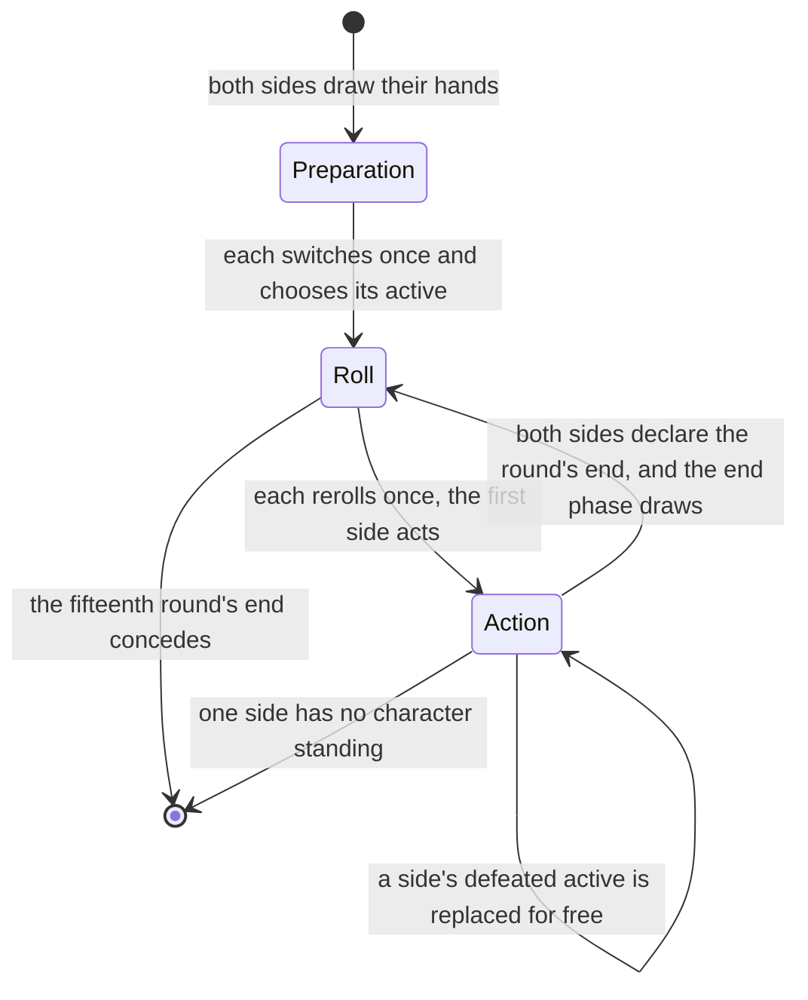
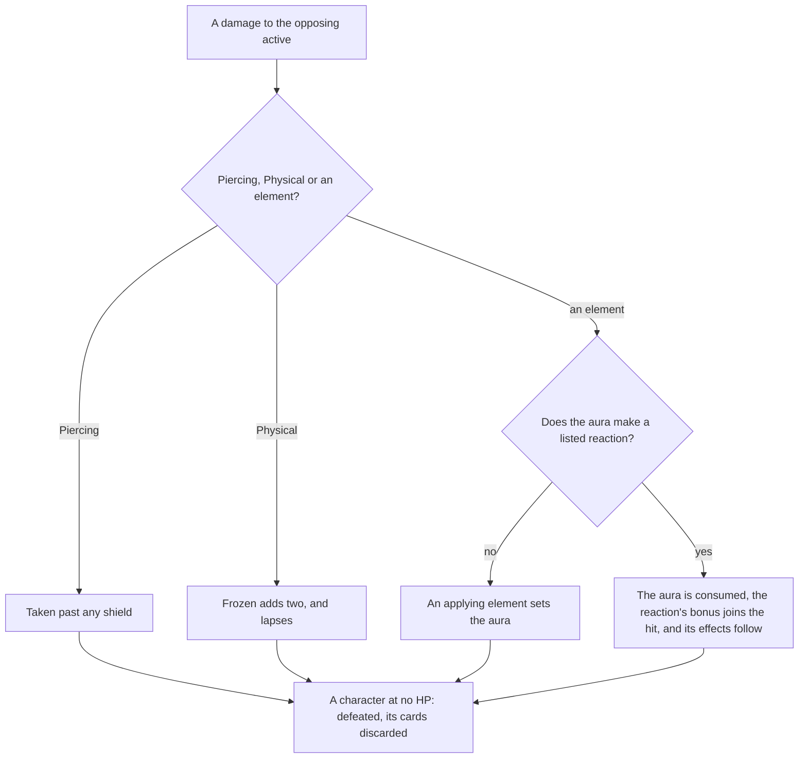

# Genius Invokation TCG rules

The engine is the duel's own rules: how a duel starts, how its dice, rounds, turns and phases run, and how a hit, a reaction and a defeat settle. The characters and cards that play under these rules are on the [decks page](../decks/design.md). The page is part of the [card game](../README.md).

## The standard rule

- **Duels against residents run the untimed standard rule.** The rule table's second rule is the one with no clocks, since a duel against a resident has no round to run out. Its reactions and hand limit are the matchmaking rule's. `genshin:assets gcg` writes its draw, hand limit and reactions as one slice the world imports on demand (`~/Esposter.noindex/genshin-parity/text/ExcelBinOutput/GCGRuleExcelConfigData.json`, rule 2 with no `roundTime`, a `handCardLimit` of 10 and a `drawCardNum` of 2; `scripts/src/services/genshinAssets/gcg/buildGcgStandardRule.ts`).
- **The reactions are the table's element pairs, and their effects are the wiki's.** The rule lists its reactions by pair, and the table gives each pair's id (`~/Esposter.noindex/genshin-parity/text/ExcelBinOutput/GCGElementReactionExcelConfigData.json`, 37 rows; `packages/genshin-world/src/services/gcg/getGcgReactionKind.ts`). The bonuses, the shields, the spread, the piercing and the forced switch come from the wiki's rules page, since the skill rows that name them carry their values in declared-value sets this build does not read.

## Dice, rolls and turns

- **Preparation switches once, then chooses.** A side's switched cards go back into its draw pile, which is shuffled and drawn from to refill its hand. Then it chooses its active character, and the first round's roll starts once both sides have (`packages/genshin-world/src/services/gcg/prepareGcgSide.ts`; the game's Prepare to Duel text, `#1002` in `~/Esposter.noindex/genshin-parity/text/ExcelBinOutput/GCGRuleTextDetailExcelConfigData.json`, gives one switch chance and the active character's choice).
- **Rolls and rerolls.** Each side rolls eight dice a round (the game's Duel Flow and Roll Phase give 8 Elemental Dice, `#1003` and `#2002` in `~/Esposter.noindex/genshin-parity/text/ExcelBinOutput/GCGRuleTextDetailExcelConfigData.json`), each face one of the seven elements or Omni, equally likely, from the seeded source (`packages/genshin-world/src/services/gcg/constants.ts`, `GCG_DICE_COUNT` of 8). Each side then has one reroll of any dice it names (`#2002`: one chance to choose any number of dice and reroll them), and naming none passes (`packages/genshin-world/src/services/gcg/rerollGcgDice.ts`). A card may grant a side another reroll in the roll phase (Knights of Favonius Library): naming dice then rerolls them and keeps the roll open, until the side names none.
- **Combat actions pass the turn.** Using a skill, switching for one die of any face and declaring the round's end are combat actions. Each passes the turn unless the other side has already declared its end (`packages/genshin-world/src/services/gcg/useGcgSkill.ts`, `packages/genshin-world/src/services/gcg/switchGcgCharacter.ts`, `packages/genshin-world/src/services/gcg/declareGcgRoundEnd.ts`; the game's `#3001` passes the turn after a combat action, and `#3006` lets the side yet to declare its end keep acting, in `~/Esposter.noindex/genshin-parity/text/ExcelBinOutput/GCGRuleTextDetailExcelConfigData.json`).
- **A turn begins with what the field deals.** A side handed its choice of action first deals what its field's before-action cards deal (Tenko Thunderbolts' 3 Electro, card `114083` in `~/Esposter.noindex/genshin-parity/text/ExcelBinOutput/GCGCardExcelConfigData.json`), and a side declaring its round's end first deals what its round-end cards deal (Sesshou Sakura, whose `$[K3]` counter starts at 3, card `114081` in `~/Esposter.noindex/genshin-parity/text/ExcelBinOutput/GCGCardExcelConfigData.json`). Each is dealt like any damage, through the side's modifiers (`packages/genshin-world/src/services/gcg/runGcgSideDamageHook.ts`).
- **Tuning is a fast action.** It discards a card to set one die to the active character's element, and the turn stays (`packages/genshin-world/src/services/gcg/tuneGcgDie.ts`; `#3001` makes Elemental Tuning a fast action, in `~/Esposter.noindex/genshin-parity/text/ExcelBinOutput/GCGRuleTextDetailExcelConfigData.json`).
- **Playing a card is a fast action.** A card passes no turn (`packages/genshin-world/src/services/gcg/playGcgCard.ts`; `#3001`, in `~/Esposter.noindex/genshin-parity/text/ExcelBinOutput/GCGRuleTextDetailExcelConfigData.json`, names playing a card a fast action).
- **A switch is paid through the field's reductions.** A switch costs one die of any face, and a card that reduces a switch takes that die off: Dawn Winery, twice a round, and Changing Shifts, once. A switch may therefore pay no die (`packages/genshin-world/src/services/gcg/switchGcgCharacter.ts`; the game's switch costs one die, `#3003` in `~/Esposter.noindex/genshin-parity/text/ExcelBinOutput/GCGRuleTextDetailExcelConfigData.json`). Leave It to Me! (card `332006` in `~/Esposter.noindex/genshin-parity/text/ExcelBinOutput/GCGCardExcelConfigData.json`, whose text makes the next switch count as `$[K2]` instead of `$[K1]`) makes the next switch a fast action and is spent by it.
- **A reduction is read from every character's cards, and a holder's own reduction needs its holder active.** The field's cost reductions read every character's equipments and statuses with the field, so a card that names the side reduces whoever pays. A card that names its holder (Vermillion Hereafter, Capricious Visage, Superlative Superstrength, Minty Meat Rolls, Northern Smoked Chicken, Yaksha's Mask) checks that its holder is the active character, since only the active character pays for a skill or a played card (`packages/genshin-world/src/services/gcg/effects/checkIsGcgActiveHolder.ts`).
- **A defeated active is replaced by a free action.** A side owes a replacement while one of its characters stands, and may take it at any point in the action phase. Only that side's turn actions wait on it, and the turn does not (`packages/genshin-world/src/services/gcg/replaceGcgCharacter.ts`; the game's defeat, `#6011` in `~/Esposter.noindex/genshin-parity/text/ExcelBinOutput/GCGRuleTextDetailExcelConfigData.json`, comes once the skill or effect completes).
- **The round's end.** The side that declares first goes first next round, and the first round goes to the first side. Frozen lapses at the end phase. Each side then draws the rule's two cards, from the first side on, and a draw past the hand's limit is discarded (`packages/genshin-world/src/services/gcg/endGcgRound.ts`, `packages/genshin-world/src/services/gcg/declareGcgRoundEnd.ts`; the game's End Phase draws 2 cards, `#2004` in `~/Esposter.noindex/genshin-parity/text/ExcelBinOutput/GCGRuleTextDetailExcelConfigData.json`).
- **A duel concedes after its fifteenth round in the engine.** Once that round's end phase closes, both sides concede with no winner (`packages/genshin-world/src/services/gcg/constants.ts`, `GCG_ROUND_LIMIT` of 15; `packages/genshin-world/src/services/gcg/endGcgRound.ts`). The game's own Round Limit text, `#6016` in `~/Esposter.noindex/genshin-parity/text/ExcelBinOutput/GCGRuleTextDetailExcelConfigData.json`, ends a duel with no winner at the start of Round 15 instead.
- **Energy.** A normal attack and an elemental skill gain the skill row's energy, one (`#3002` in `~/Esposter.noindex/genshin-parity/text/ExcelBinOutput/GCGRuleTextDetailExcelConfigData.json`, gain 1 Energy), and a burst pays the energy its cost names. A skill that a character cannot pay for is refused, and the dice it would have paid stay in the dice (`packages/genshin-world/src/services/gcg/useGcgSkill.ts`).
- **Combat actions are refused whole.** A refused action leaves the duel as it was and says why (`packages/genshin-world/src/services/gcg/useGcgSkill.ts`).
- **A charged attack is a normal attack by a side whose Elemental Dice were even in number before its Action Phase.** The flag is settled as the action phase begins, before any card hears it, and holds for the round, as the wiki's Genius Invokation TCG Rules give it: "Before your Action Phase, should the total number of your Elemental Dice be even, your Normal Attack will be considered a Charged Attack." The engine deals no damage for the flag itself; the cards that read it do (`packages/genshin-world/src/services/gcg/runGcgActionPhase.ts`, `packages/genshin-world/src/services/gcg/effects/checkIsGcgChargedAttack.ts`; the game's text is `#6008` and `#6009` in `~/Esposter.noindex/genshin-parity/text/ExcelBinOutput/GCGRuleTextDetailExcelConfigData.json`). **A plunging attack is a normal attack by a character switched in this Round**: the first skill that character uses after the switch spends it, so her next Normal Attack is a plunge, and the cards hear it as one (`packages/genshin-world/src/services/gcg/runGcgSkillUse.ts`, `packages/genshin-world/src/services/gcg/effects/runGcgOnSkillUsed.ts`). A switch an effect makes counts as one too, and a defeat's replacement does not. Both calls are provisional: the wiki's Plunging Attack page is the open-world action and does not settle the TCG case.

## Elements, reactions and damage

- **Elements apply, and Anemo and Geo do not.** Cryo, Hydro, Pyro, Electro and Dendro damage sets its aura. Anemo and Geo damage reacts with an aura and sets none, and Physical and Piercing damage reacts with nothing. A reaction consumes the aura it reacts with, and its element does not apply. An element a card's effect applies with no damage reacts with the aura the same way, but the reaction deals no damage, since a non-DMG application's DMG-dealing effects are ignored; its other effects still land (`packages/genshin-world/src/services/gcg/applyGcgDamage.ts`, `packages/genshin-world/src/services/gcg/effects/applyGcgApplication.ts`; the game's `#4002` says the DMG-dealing effects of a non-DMG application are ignored, in `~/Esposter.noindex/genshin-parity/text/ExcelBinOutput/GCGRuleTextDetailExcelConfigData.json`).
- **A reaction's bonus joins its instance.** Melt, Vaporize and Overloaded add two (`#5001` to `#5003`). Superconduct, Electro-Charged, Frozen, Crystallize, Burning, Bloom and Quicken add one (`#5004` to `#5006`, `#5011` to `#5017`). Swirl adds none (`#5007` to `#5010`), all read from `~/Esposter.noindex/genshin-parity/text/ExcelBinOutput/GCGRuleTextDetailExcelConfigData.json` (the game's text), and matched by `packages/genshin-world/src/services/gcg/constants.ts`, `GcgReactionKindBonusMap`.
- **The reactions leave their cards on the attacker's side.** Burning summons Burning Flame, which deals one Pyro at each end phase, spends a usage, and stacks to two usages. Bloom leaves Dendro Core onstage, which adds two to the next Pyro or Electro damage its side's skills deal, for one usage. Quicken leaves Catalyzing Field onstage, which adds one to the next Dendro or Electro damage, for two usages (`packages/genshin-world/src/services/gcg/constants.ts`: the usages of Burning Flame at 2, Dendro Core at 1 and Catalyzing Field at 2). The numbers are the game's own card descriptions, read through the text map (`#5015` to `#5017` in `~/Esposter.noindex/genshin-parity/text/ExcelBinOutput/GCGRuleTextDetailExcelConfigData.json`). A second reaction of the same kind joins the card already there, up to the card's most usages, rather than a second copy.
- **Frozen and shields.** A Frozen target takes two more from a Pyro or Physical hit, and that hit removes the status, which otherwise lasts to the round's end (`packages/genshin-world/src/services/gcg/constants.ts`, `GCG_FROZEN_BONUS` of 2; `packages/genshin-world/src/services/gcg/applyGcgDamage.ts`; `#5006` in `~/Esposter.noindex/genshin-parity/text/ExcelBinOutput/GCGRuleTextDetailExcelConfigData.json`). A shield takes damage before HP, and piercing skips it. Crystallize grants the attacker's active character one point, at most two (`packages/genshin-world/src/services/gcg/constants.ts`, `GCG_CRYSTALLIZE_SHIELD` of 1 and `GCG_SHIELD_LIMIT` of 2; `packages/genshin-world/src/services/gcg/effects/applyGcgNonDamageReactionEffects.ts`; `#5011`, which says Max 2 points, in `~/Esposter.noindex/genshin-parity/text/ExcelBinOutput/GCGRuleTextDetailExcelConfigData.json`).
- **Piercing and spread.** Superconduct and Electro-Charged pierce the other opposing characters for one. A Swirl spreads one of its aura's elements to each of them as damage only: it sets no aura and reacts with none, and the spread is one damage of the side that made the Swirl, so that side's damage modifiers bear on it once, however many characters it reaches. A piercing from the same reaction is one damage too, and bears them once (`packages/genshin-world/src/services/gcg/constants.ts`, `GCG_PIERCING_DAMAGE` and `GCG_SPREAD_DAMAGE`, each 1; `packages/genshin-world/src/services/gcg/applyGcgDamage.ts`; `#5004` and `#5007` in `~/Esposter.noindex/genshin-parity/text/ExcelBinOutput/GCGRuleTextDetailExcelConfigData.json` give one piercing and one spread damage). The wiki does not say whether a spread applies or reacts, so this is a settled call. A recording of a duel can overturn it ([References sought](../../../../changes/genshin-roadmap/tasks.md)).
- **Overloaded forces the switch.** An Overloaded active character is switched to the next standing character in order, with no choice given (`packages/genshin-world/src/services/gcg/effects/applyGcgNonDamageReactionEffects.ts`; `#5003` in `~/Esposter.noindex/genshin-parity/text/ExcelBinOutput/GCGRuleTextDetailExcelConfigData.json`: the target is forcibly switched to the next character).
- **Phases run hooks.** The roll-phase hooks run once a side's dice are rolled, the action-phase hooks when the action phase opens, and the end-phase hooks in the end phase before the draws (`packages/genshin-world/src/services/gcg/runGcgRollPhase.ts`, `packages/genshin-world/src/services/gcg/runGcgActionPhase.ts`, `packages/genshin-world/src/services/gcg/runGcgEndPhase.ts`). An end-phase hook may return damage, which the phase deals, so a summon's end-phase damage is dealt by the phase rather than by the summon. A card may also name the Piercing DMG it deals to each opposing character on standby, which the phase deals before the hook's damage. A defeat is heard too: once a defeat is settled (`packages/genshin-world/src/services/gcg/applyGcgDamage.ts`, whose `settleGcgDefeats` settles each defeated character; the game's `#6011` defeat, in `~/Esposter.noindex/genshin-parity/text/ExcelBinOutput/GCGRuleTextDetailExcelConfigData.json`), the cards on the other side's field hear it, each with the character it is attached to, so an artifact can act on an opposing defeat (Gambler's Earrings, `packages/genshin-world/src/services/gcg/cards/gamblersEarrings.ts`).
- **A character hears the DMG it takes, wherever it takes it.** Every hurt of a character goes through one primitive, which, when the character is still standing and lost HP or shield, calls the cards attached to it and its Passive skills' after-damage hooks (`packages/genshin-world/src/services/gcg/applyGcgDamage.ts`). A hit that a shield absorbs whole still counts as the character taking DMG, which the wiki does not state, so that reading is provisional.
- **The end phase is not a phase of its own.** It runs as the round closes, and the next round's roll follows it (`packages/genshin-world/src/services/gcg/declareGcgRoundEnd.ts`, `packages/genshin-world/src/services/gcg/endGcgRound.ts`; the game's End Phase runs its card effects, then two draws, then the next round, `#2004` in `~/Esposter.noindex/genshin-parity/text/ExcelBinOutput/GCGRuleTextDetailExcelConfigData.json`).

A hit on the opposing active character is settled in one order (`packages/genshin-world/src/services/gcg/applyGcgDamage.ts`):

## Key files

| File                                                                                  | Role                                                                                                                                                        |
| :------------------------------------------------------------------------------------ | :---------------------------------------------------------------------------------------------------------------------------------------------------------- |
| `scripts/src/services/genshinAssets/gcg/buildGcgStandardRule.ts`                      | Builds the standard rule's record from the dump's rule and reaction tables                                                                                  |
| `scripts/src/services/genshinAssets/gcg/toGcgStandardRule.ts`                         | The rule row, with each listed reaction joined to its element pair                                                                                          |
| `packages/genshin-world/src/services/gcg/readGcgStandardRule.ts`                      | Fetches the rule by its key and checks it against its schema                                                                                                |
| `packages/genshin-world/src/services/gcg/createGcgDuel.ts`                            | Opens a duel between two decks                                                                                                                              |
| `packages/genshin-world/src/services/gcg/prepareGcgSide.ts`                           | A side's preparation, and the first roll once both have prepared                                                                                            |
| `packages/genshin-world/src/services/gcg/rerollGcgDice.ts`                            | A side's one reroll, and the action phase once both have rolled                                                                                             |
| `packages/genshin-world/src/services/gcg/useGcgSkill.ts`                              | A skill or a Technique paid in dice and energy, then the turn passes                                                                                        |
| `packages/genshin-world/src/services/gcg/applyGcgDamage.ts`                           | The source side's damage modifiers, then a hit's Frozen, reaction, shield and piercing, its defeats, and the DMG-taken notice to a character still standing |
| `packages/genshin-world/src/services/gcg/createGcgActiveCharacterSwitch.ts`           | The switch built over the damage its hooks deal, handed in so damage that forces a switch imports no cycle                                                  |
| `packages/genshin-world/src/services/gcg/switchGcgActiveCharacter.ts`                 | A switch, however made: the active character set and flagged as switched in, its cards hearing it, so her next Normal Attack is a plunge                    |
| `packages/genshin-world/src/services/gcg/effects/applyGcgNonDamageReactionEffects.ts` | The effects a reaction leaves that deal no DMG: Frozen, shield, the Overloaded switch, and the cards                                                        |
| `packages/genshin-world/src/services/gcg/effects/applyGcgApplication.ts`              | An element a card applies with no damage, which reacts with the aura its character holds                                                                    |
| `packages/genshin-world/src/services/gcg/declareGcgRoundEnd.ts`                       | The round's end and its round-end hooks, and the end phase once both sides declare                                                                          |
| `packages/genshin-world/src/services/gcg/endGcgRound.ts`                              | The end phase: Frozen lapses, the draws, and the next round or the concession                                                                               |
| `packages/genshin-world/src/services/gcg/switchGcgCharacter.ts`                       | A switch for one die of any face, less where the field reduces it                                                                                           |
| `packages/genshin-world/src/services/gcg/tuneGcgDie.ts`                               | Tuning a die by a discarded card, as a fast action                                                                                                          |
| `packages/genshin-world/src/services/gcg/replaceGcgCharacter.ts`                      | The free replacement a defeated active owes                                                                                                                 |
| `packages/genshin-world/src/services/gcg/payGcgCost.ts`                               | The dice a cost takes from the dice chosen, Omni standing in                                                                                                |
| `packages/genshin-world/src/services/gcg/getGcgReactionKind.ts`                       | The reaction an element pair makes under a rule                                                                                                             |
| `packages/genshin-world/src/services/gcg/runGcgRollPhase.ts`                          | The roll-phase hooks of each side's field                                                                                                                   |
| `packages/genshin-world/src/services/gcg/runGcgActionPhase.ts`                        | The Charged Attack flag, the action-phase hooks, then the spent cards taken off                                                                             |
| `packages/genshin-world/src/services/gcg/runGcgSideDamageHook.ts`                     | A side's before-action or round-end hook run, its damage dealt from the side                                                                                |
| `packages/genshin-world/src/services/gcg/effects/checkIsGcgChargedAttack.ts`          | Whether a skill is a Charged Attack for its side, by the flag the action phase settled                                                                      |
| `packages/genshin-world/src/services/gcg/runGcgEndPhase.ts`                           | The end-phase hooks, the rounds aged, then the spent cards taken off                                                                                        |

## Sources

- Genius Invokation rule texts, the game's own, read off disk on 2026-10-26: `~/Esposter/genshin-parity/text/ExcelBinOutput/GCGRuleTextDetailExcelConfigData.json`, each row's `contentTextMapHash` and `titleTextMapHash` looked up in `~/Esposter/genshin-parity/text/TextMap/TextMapEN.json`. Quotes below carry the row's id as `#id`, read from that text; `#1003` ("Both sides will get 8 Elemental Dice to roll.") grounds each side's eight dice a round in the spec.

- [Genius Invokation TCG: Rules](https://genshin-impact.fandom.com/wiki/Genius_Invokation_TCG/Rules), Genshin Impact Wiki: the preparation, the round's phases, the zones, the elemental reactions and their bonuses, the piercing and the spread, and the fifteen-round limit.
- [AnimeGameData](https://gitlab.com/Dimbreath/AnimeGameData), the community's per-patch dump: the rule and element reaction tables the standard rule is written from.

## Open

- [ ] **A duel concedes after its fifteenth round, as the game does** — contradicted by `~/Esposter.noindex/genshin-parity/text/ExcelBinOutput/GCGRuleTextDetailExcelConfigData.json`: Round Limit says both sides lose at the start of Round 15.
- [ ] **Tenko Thunderbolts deals 3 Electro** — no source yet: the placeholder `$[K104]` in its card text is not resolved to Electro here.
- [ ] **Sesshou Sakura lasts four usages** — contradicted by `~/Esposter.noindex/genshin-parity/text/ExcelBinOutput/GCGCardExcelConfigData.json`: its card text starts the `$[K3]` counter at 3.
- [ ] **A turn begins with the damage the field's before-action and round-end cards deal** — no source yet: a rule text giving the before-action and round-end timing of cards in general; `#2004` gives only the End Phase's card effects, and the Tenko and Sesshou card texts are the two read.
- [ ] **A switch is paid through the field's reductions, and may pay no die** — no source yet: the reduction cards' texts (Dawn Winery, Changing Shifts) and a rule text for a switch paid with no die.
- [ ] **A card that names its holder's reduction needs its holder active** — no source yet: the texts of the named cards (Vermillion Hereafter and the rest), which are not read here.
- [ ] **A defeated active is replaced by a free action that only that side's turn actions wait on** — no source yet: a rule text giving the free replacement; `#6011` gives only the defeat.
- [ ] **Each side draws the rule's two cards from the first side on, and a draw past the hand's limit is discarded** — no source yet: `#2004` says only that both players draw 2 cards, not the order or the discard.
- [ ] **Energy is gained by a normal attack and an elemental skill, and a skill a character cannot pay for is refused** — no source yet: a rule text giving the refusal of an unpayable skill; `#3002` gives the energy gain.
- [ ] **Each side has one reroll of any dice it names, and naming none passes** — no source yet: a rule text stating that naming no dice passes; `#2002` gives one chance to reroll any number of dice.
- [ ] **An element applied with no damage reacts with its aura but deals no damage, and its other effects still land** — no source yet: whether its other effects still land, which `#4002` does not state.
- [ ] **A shield takes damage before HP** — no source yet: the order of a shield against HP, which `#6006` does not state (it deducts a shield's points to block some DMG).
- [ ] **Leave It to Me! makes the next switch a fast action and is spent by it** — no source yet: the keyword placeholders `$[K1]` and `$[K2]` in its card text are not resolved here.
- [ ] **A second reaction of the same kind joins the card already there, up to its most usages** — no source yet: the effect that places a reaction's card was not among the files read under `packages/genshin-world/src/services/gcg/effects/`.
