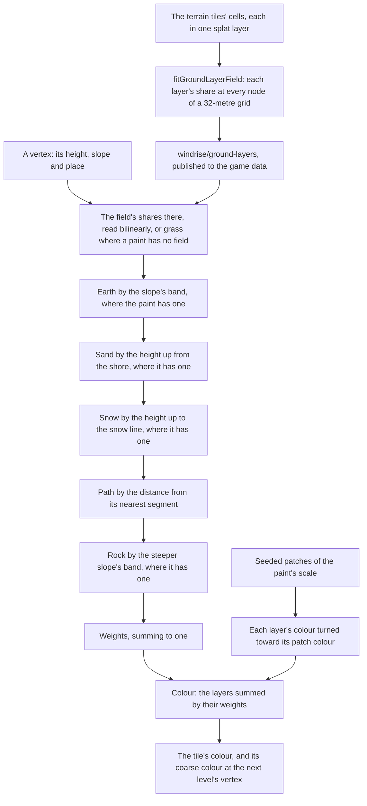

# Ground paint

Genshin's terrain is painted in layers: its tiles hold a weight per layer at every texel, and its shader blends each layer's texture by them, so a meadow turns to bare earth on its banks and to rock on its cliffs. The ground here is painted the same way, by layers and their weights. Where the layers lie is a field of their shares fitted from the layer each of the tiles' cells is painted in, and each layer is a pair of colours rather than a texture.

## How it works

- **A biome's paint is data.** `GroundPaint` holds each layer's two colours, how wide the patches they turn between are, the field that places its layers (`layerField`), and the rules a biome lays over them: the slopes bare earth and rock come in across, the heights sand and snow reach where a biome has a shore or a snow line, and its paths as segments with a width. Windrise's (`createWindriseGroundPaint`, over the field and the surfaces each terrain worker is loaded with) is its field and no rule: no slope band, no shore and no snow line, and no path segment, since its roads are the field's path layer.
- **The layers lie where the game's terrain places them.** The game places its layers by cell, never by slope: each tile names the splat layer every four-metre cell is painted in, and each layer its kind ([game data formats](../game-data-formats/design.md)). So a ground's layers are a field of their shares, fitted from those cells (`fitGroundLayerField`): each cell within the terrain radius takes the ground layer its kind paints (`TerrainSplatKindGroundLayerMap`: grass, soil as earth, stone as rock, snow, and sand and Sumeru's desert as sand), but for the stone the game paints its roads in, which is the path (`readGroundLayerCells`), and each node of a grid over the radius holds the shares of the cells round it, splatted by how near each stands as a bilinear read gives them back, a node no cell reaches taking its nearest reached node's (`computeGroundLayerField`). A vertex reads the field bilinearly (`sampleGroundLayerField`). The field is our own parameters at the grid's resolution, never the game's texture, and every region's tiles hold their cells, so any region's field is fitted the same way.
- **Each layer paints its cells' colour.** A layer's colour is the mean of the base-map texels standing on the cells painted in it (`fitGroundLayerColours`, `Ground.layers` in the `windrise/surfaces` record), so the field and the colours are read off the same cells. Only Windrise's tiles have their base maps exported, so another region's layers wait on its base maps for their colours, never on its cells.
- **Rules are laid in order, each over what is under it.** Each rule a paint gives comes in by its own amount, a smoothstep across its band, and every layer already laid keeps only the rest, so the weights always sum to one and the last layer wins where two overlap: rock over everything on a cliff, path over sand on a beach road (`createGroundLayerWeights`). A path's amount is how near the point stands to its nearest segment, all of it within half the path's width and none past its falloff; segments are filed by the cells they reach, as the terrain's features are, so a point reads only the paths near it. A paint with no field lays its rules over grass.
- **The weights are solved per vertex, in the worker.** The game's weights are data per texel, not something its shader works out, so ours take the same place: the terrain's worker reads them at each vertex off the main thread rather than per pixel every frame. With each layer a flat colour pair, blending the weights per pixel would draw the same colours the vertices interpolate, so the vertex colour is the paint (`createGroundPaintColor`).
- **The morph keeps working.** A vertex's coarse colour is painted the same way at the even vertex it collapses onto, with that level's slope, so a tile morphing to the next level paints the ground that level paints, and the material morphs the colour as it morphs the normal ([terrain](../terrain/design.md)).
- **Grass grows only on the grass layer.** The grass reads the ground's colour from above and grows only where it is green ([vegetation](../vegetation/design.md)), so the earth, the rock, the sand and the path stay bare of blades, and the flowers grow only where the weights are nearly all grass ([scatter](../scatter/design.md)).

## What it costs to run

- **A bilinear read, a few rules and a noise per vertex, in the worker.** The field is four nodes' shares a layer, a band one smoothstep, a path one segment measure per path in the vertex's cell, and the patches one simplex sample, so painting costs a fraction of a tile's heights.
- **A field of tens of kilobytes.** Windrise's is a grid of 64 nodes a side over its two-kilometre square, each layer its cells hold to the hundredth.
- **Nothing on the GPU.** The paint is the vertex colour the terrain already carried, so the ground's material and its draw are unchanged.

## Key files

| File                                                                        | Role                                                                                |
| :-------------------------------------------------------------------------- | :---------------------------------------------------------------------------------- |
| `packages/genshin-engine/src/terrain/createGroundLayerWeights.ts`           | The layers' weights at a point: the field's shares, then each rule over them        |
| `packages/genshin-engine/src/terrain/sampleGroundLayerField.ts`             | A field's shares at a point, read bilinearly                                        |
| `packages/genshin-engine/src/terrain/createGroundPaintColor.ts`             | A vertex's colour from its weights and each layer's patched colour                  |
| `packages/genshin-engine/src/models/terrain/GroundPaint.ts`                 | A biome's paint: its layers' colours, their patches, its field, the rules and paths |
| `packages/genshin-engine/src/models/terrain/GroundLayerField.ts`            | A grid of each layer's shares                                                       |
| `packages/genshin-engine/src/models/terrain/GroundLayer.ts`                 | The layers a ground is painted in                                                   |
| `packages/genshin-world/src/services/windrise/createWindriseGroundPaint.ts` | Windrise's paint: its field and its layers' colours                                 |
| `packages/genshin-world/src/workers/terrainTile.worker.ts`                  | Windrise's ground painted by its paint, on its own seed, once the worker is loaded  |
| `scripts/src/services/genshinAssets/fit/fitGroundLayerField.ts`             | A ground's field fitted from its terrain tiles' cells                               |
| `scripts/src/services/genshinAssets/fit/computeGroundLayerField.ts`         | Layered points splatted onto a grid's nodes as each layer's shares                  |
| `scripts/src/services/genshinAssets/fit/readGroundLayerCells.ts`            | The ground layer every cell of a tile is painted in, its road stone the path        |
| `scripts/src/services/genshinAssets/fit/fitGroundLayerColours.ts`           | Each layer's colour, the mean of the base-map texels on its cells                   |

## Notes

- **The cell is the surface pass's call.** Windrise's field is fitted at 32 metres, the cell at which the surface pass reads the Ground's colour inside its gate. The cell sizes it was chosen against are [scene derivation](../scene-derivation/design.md)'s.
- **No rule is laid over Windrise's field.** The slope sorts none of the layers, and the sand at the shore, the snow and the roads are the field's own layers, painted where the game paints them, so a slope, height or path rule has nothing left to place.
- **A layer has no texture.** Its detail is a pair of colours across patches tens of metres wide. The game's layer textures carry detail under a metre, which a per-pixel layer node would add; it is built only if the surface pass's structure, not its mean colour, says the ground needs it ([ground detail](../../../changes/genshin-ground-detail/design.md)).
