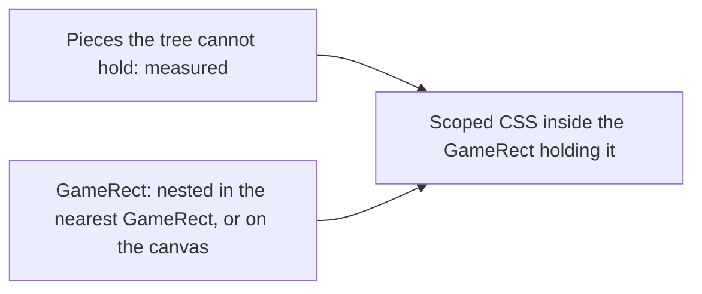

# Interface layout

A screen's interface is laid out by the game's own tree. Unity places every piece of an interface with a RectTransform: two anchors as shares of its parent's box, a pivot as a share of its own, the pivot's offset from the anchors (the anchored position) and how far its size strays from the anchors' span (the size delta) (`{data-root}/genshin-parity/extracted/login-ui/rects.json`, each record's `anchorMin`, `anchorMax`, `pivot`, `position` and `size`). A screen's markup follows that tree piece for piece, so a piece sits inside its game parent and inherits its anchoring, and a fix to a parent reaches everything in it. On the login screen the foot, `Bottom`, is anchored to the screen's bottom (`{data-root}/genshin-parity/extracted/login-ui/rects.json`, `Bottom`: `anchorMin` [0, 0], `anchorMax` [1, 0], `pivot` [0, 0]), and the loading row, the account, the build string and both button columns ride in it on any window.

## How it works

- **The tree is the screen's data.** `genshin:assets interface` exports the screen's RectTransforms from the game's block, outside the repository like every other reference (`scripts/src/services/genshinAssets/interface/extractComponentInterface.ts`). The screen's `fit` turns it into its `interfaceRects` record with `fitInterfaceRects`: every piece's anchors, pivot, position and size in canvas units, and its scale where it is not one, keyed by its path under the interface's root. The root is the canvas itself, so it is left out (`scripts/src/services/genshinAssets/fit/fitInterfaceRects.test.ts`). Each screen reads its rects from their published record in the [hosted game data](../hosted-game-data/design.md) and keeps only the pieces it places by, each named by the screen's own enum of them (`HudInterfaceRectName` for the [HUD](../hud/design.md), `LoginInterfaceRectName` for the login, whose rects the opening reads during its splashes) (`packages/genshin-world/src/generated/gameDataLock.json`, keys `hud/interfaceRects` and `login/interfaceRects`).
- **One component nests the tree.** `GameRect` takes a piece's rect and draws a box placed by it inside its game parent's box, or on the canvas when its `parent` is the canvas's own rect, which is the default for a root. A nested piece takes its parent's resolved rect explicitly: the parent exposes it as a slot prop, `<GameRect v-slot="{ rect: centerRect }" ...>`, and the child passes it as `:parent="centerRect"`. The markup reads as the game's tree: `<GameRect :rect="interfaceRects['GrpLogin/Bottom']">` holds the `GameRect` of `GrpLogin/Bottom/CurrentAccount`, which holds that of its build string.
- **The browser is the layout engine.** A RectTransform's corners are its anchors' points in the parent plus `offsetMin = anchoredPosition − sizeDelta × pivot` and `offsetMax = offsetMin + sizeDelta`, which absolute positioning with `calc()` expresses exactly (`toCanvasRectStyle`, over `computeRectOffsets`; `packages/genshin-interface/src/services/computeRectOffsets.test.ts`, `packages/genshin-interface/src/services/toCanvasRectStyle.test.ts`), at no cost per piece. A layout engine of its own (Yoga, Taffy) would lay out a different model and need Unity's rebuilt on top of it.
- **A scaled piece scales about its pivot.** A rect whose scale is not one takes it as a CSS `scale` with its origin at the pivot, as Unity scales a RectTransform, so a piece pivoted at a corner keeps that corner where the tree places it. Whether the minimap's `GrpMap` is pivoted at a corner is open below.
- **A layout group's children are left out.** A `GridLayoutGroup` places its children at run time, so their rects read zero; the fit keeps the group's own rect and drops everything under it (`scripts/src/services/genshinAssets/fit/fitInterfaceRects.test.ts`), and the group's stacking and spacing are scoped CSS on its `GameRect`, measured off a recording.
- **What the tree cannot hold is measured inside the piece holding it.** A prefab the page loads at run time, such as the door's prompt in `BtnPressStart`, has no rect in the page's block, and a script that resizes a piece at run time (the age rating's layout adaptor) makes its rect a container only. Each is measured on a recording and written as CSS inside the `GameRect` it loads into, so it still rides with its parent. A line of text is set by the game's text component at run time, so its place inside its rect is measured too.
- **The game's clips play on the same tree.** Each `GameRect` a clip moves carries its path under the clips' root as its `data-clip-target`, so a fade the game plays on a parent fades everything the markup nests in it, as the door's prompt fades with `Center/SwitchServer`.

## Notes

- **The prompt's measure is written from its parent's box**, `calc(var(--unit) * 38 - var(--canvas-unit) * 128)` from a container standing 128 canvas units in (`packages/genshin-world/src/components/Login/Interface/Index.vue`, the `bottom` rule). The measure stays the one taken off the recording, and the parent's term keeps it where the recording shows on any window.

## Key files

| File                                                                        | Role                                                          |
| :-------------------------------------------------------------------------- | :------------------------------------------------------------ |
| `scripts/src/services/genshinAssets/interface/extractComponentInterface.ts` | The screen's RectTransform tree, exported from its block      |
| `scripts/src/services/genshinAssets/fit/fitInterfaceRects.ts`               | The tree as rects keyed by path, a group's children out       |
| `packages/genshin-world/src/models/login/LoginInterfaceRects.ts`            | The login page's fitted rects, by the pieces it places        |
| `packages/genshin-interface/src/components/GameRect/Index.vue`              | A piece placed by its rect inside its parent's, or the canvas |
| `packages/genshin-interface/src/services/toCanvasRectStyle.ts`              | Unity's RectTransform as CSS, the one layout computation      |
| `packages/genshin-world/src/components/Login/Interface/Index.vue`           | The login's interface, nested as the game's tree              |

## Open

- [ ] **The login's loading row, account, build string and button columns ride in `Bottom` on any window** — no source yet: no recording at another window size, and no test, shows them riding in it.
- [ ] **A nested `GameRect` is placed inside its parent's box** — no source yet: no test holds the nesting, and `GameRect` has no fixture.
- [ ] **A scaled piece keeps its pivot corner where the tree places it** — no source yet: the export holds `GrpMap`'s scale of 0.6 but no pivot, and no test holds the scale origin.
- [ ] **A `GridLayoutGroup`'s children read zero rects and are spaced as the recording shows** — no source yet: the children's rects are not checked against a recording, and the recording is not named.
- [ ] **A prefab or text line the tree cannot hold is measured on a recording** — no source yet: the recordings for `BtnPressStart` and the age rating's layout adaptor are not named, and no test holds their measures.
- [ ] **A clip-moved `GameRect` carries its clip path as `data-clip-target`, and the door's prompt fades with `Center/SwitchServer`** — no source yet: no test holds `data-clip-target`, and no clip in the extracted set names `Center/SwitchServer`.
- [ ] **The prompt's 38-unit measure is taken off a recording** — no source yet: the recording is not named.

## Sources

- `{data-root}/genshin-parity/extracted/character/interface/json/RectTransform/RectTransform#324437.json`, `GrpMap` with a local scale of 0.6. Grounds the requirement "A scaled piece scales about its pivot".
- The game's own recording of the group's stacking and spacing, not named (see Open): "as the game's own recording shows". Grounds the requirement "A layout group's children take the group's spacing" and scenario "Group children are spaced as the recording shows".
