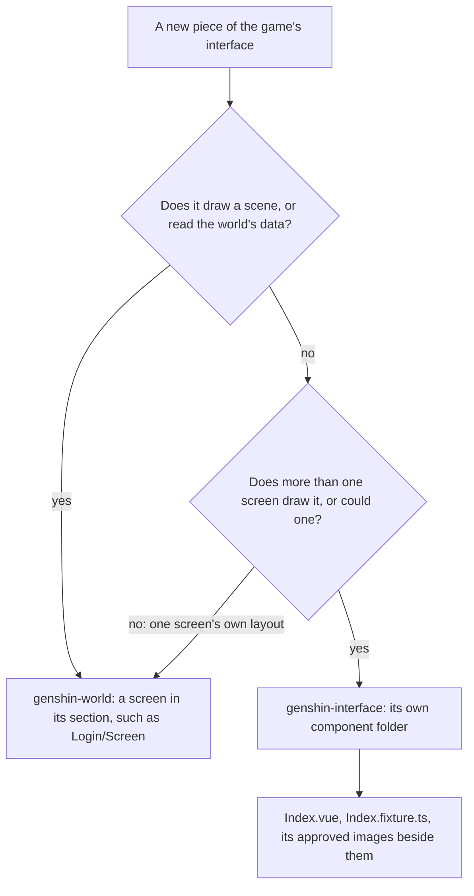
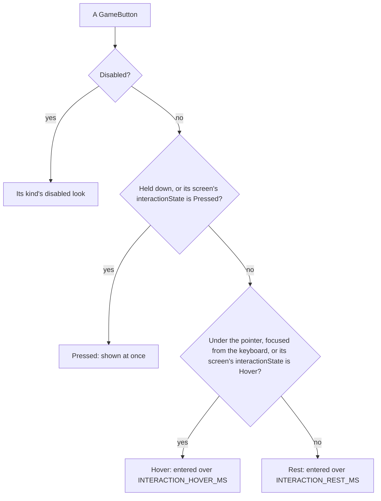

# Interface library

`genshin-interface` holds the pieces the game's screens are made of, as presentational Vue components with no three.js in them: the root a screen is drawn in, the button every state of the game's is drawn by, the round buttons and their glyphs, the server bar, the progress bar, the prompt band, the notice card, the wait mark, the ornamented divider and the item tile a reward list draws. `genshin-world` builds its screens from them, and a page that shows only interface loads this package alone.

## Where a piece goes

- **A screen draws inside `GameScreen`.** The root is the window's size container, in the game's face and pointer. Its `--unit` is a pixel of the game's 1920 by 1080 screen fitted to the window's smaller axis, as the game fits its interface. Its `--canvas-unit` is a unit of the interface's 1600 by 900 canvas, where the game's RectTransforms place each piece, 1.2 screen units at 1080 high, and its `--canvas-inset` how far the canvas stands in from each side of a screen wider than 16:9: its spare width, up to 71 units, measured on a 2560 and a 3440 wide recording. On a touch screen the first two are `MOBILE_INTERFACE_SCALE` times larger, through its `--interface-scale`, as the mobile client's interface is: the root reads touch from `(pointer: coarse)`, or from its `isTouch` prop where the page decides it, as the world's HUD does. Each is a custom property resolved where a child uses it, against the one container.
- **A piece sits where the game anchors it.** `toCanvasRectStyle` turns a `CanvasRect`, a RectTransform's anchors, pivot, anchored position and size, into the CSS that places it in its parent's box, from the foot up as Unity's y runs, so a piece anchored to the bottom stays there on any window. Its start is Unity's `offsetMin`, the anchored position less the size delta's share before the pivot (`computeRectOffsets`, the one layout of a RectTransform), so a piece stretched between two anchors keeps its place whatever its pivot. A screen places its pieces through `GameRect`, which draws each inside its game parent's box from the screen's fitted tree ([interface layout](../interface-layout/design.md)).
- **The pointer is the game's own.** A four-pointed star with its point at the upper left, white and cream facets either side of its diagonal and a gold star inside lit from its inner corner. It was traced from the wiki's render of the game's tutorial and drawn as an SVG cursor, 25 pixels across as the game draws it on a 1080 high screen.
- **Each glyph is centred on its ink.** The game trims each icon's sprite to its ink and centres it on its button, so each traced glyph is drawn about its ink's middle (`InterfaceIconCentreMap`) rather than its trace's crop.
- **Each glyph is traced within its button.** The round buttons' glyphs were traced eight times enlarged from a 1440 high recording, with everything outside each button's white disc painted white first, so the tracer's paper is the disc's white and no glyph is clipped by a square region. The settings gear's grey ring is drawn over it, since a trace splits a mid grey from its ink.
- **Every piece has a fixture and images.** A component is a folder: `Index.vue`, the `Index.fixture.ts` whose props and variants it is shot in, and `Index.<platform>.png` and `Index-<variant>.<platform>.png`, each shot to the component's own box at the game's 1080 high scale. `pnpm -C packages/genshin-interface test:visual` holds each to its image and fails for a component without a fixture, so no piece reaches a screen unshot; `GameScreen`, `GameRect` and `TwoColumnScreen`, which draw nothing of their own, are the exceptions.
- **Sizes and colours are the English client's.** Each is measured from its 1080 high recording of the login screen, and the whole interface is compared over the recording's own frame on the [parity](../parity/README.md) page, so a piece's place is exact to the unit. Its text is set in Signika, which is narrower than the game's face at one cap height, so a line keeps the game's cap height and is letter-spaced to its width.

## Interaction states

Every button the game draws is a `GameButton`, whose `kind` is the game's button template it copies, so each state's look lives once, in the button, and a screen only places it. Its content takes the colour the state sets, and a piece no state reaches stays the screen's own.

- **A state is entered over its own crossfade.** The game's button controllers (block 07356235, read from its animators' transitions into each state) fade into a hover over 0.05 seconds and back to rest over 0.1, and into a press at once, which `INTERACTION_HOVER_MS` and `INTERACTION_REST_MS` hold: each is the duration of the state being entered, so a hover fades in and out at the game's two speeds. The cream pill's own controllers take `INTERACTION_PILL_REST_MS` back to rest, and its press plays a clip of its own over `INTERACTION_PRESS_MS`, eased by `GAME_SMOOTHSTEP_EASING`, the smoothstep its samples trace exactly.
- **The colours are the game's own.** `GAME_CREAM`, `GAME_INK` and `GAME_GOLD` are its button clips' colours, the cream a lit icon turns, the ink a cream pill's words are and the gold the side bar's icons rest in.
- **Keyboard focus is drawn as a hover.** The game has no keyboard focus of its own to copy, so `:focus-visible` takes the hover's look. A `Plain` button, which the game draws the same in every state, is ringed in white instead, so focus still shows.
- **A screen forces a state for its fixture.** `GameScreen`'s `interactionState` draws every button on it, and on any screen drawn inside it, in that state in place of the pointer's, so a fixture's `hover` and `pressed` variants are shot without a pointer. The visual suite of this package hands a component fixture's `interactionState` to the stage's `GameScreen`; a screen in `genshin-world` whose root is a `GameScreen` takes it from its fixture's props as its own.
- **A Disc is the Paimon menu's side bar.** At rest its icon is gold. Hovered, a translucent navy disc 65 units across lights behind it and the icon turns cream and grows by 1.12, its name shown in a dark slate box past the side bar's edge. Pressed, the disc turns cream and the icon ink, and the icon falls back to its resting size, the smaller click a press gives; all measured off the English PC client's settings gear at 1080 high, the disc's colour fitted over two recordings' side bars.
- **A Pill is the game's cream pill**, the quit prompt's choices. At rest its words are ink inside the pill's bevel, a pale rim and a darker band 3 units each, read off the wiki's crop of the prompt. Hovered, a white ring lights over its edge, 1 unit outside it and 2 within, and it keeps its size. Pressed, the pill turns a half-alpha slate under a gold light 2 units in from its edge, fading from full to half as the words turn from black to cream. The game adds that light onto the world, which a screen's own layer cannot reach, so it is drawn at half alpha in the colour the sum settles to, the game's over any world but for red, 12 short. Each state is the game's own clip for the prompt's option pill, measured on its twin, a dialog's Confirm, in the settings recording.
- **A press resizes only what the game's own resizes.** The side bar's icon is the one built that does; the game's core pill and list templates hold their size, and the event screens' buttons, which grow by 1.02 hovered and settle at 0.98 pressed in most of their controllers, wait on those screens.
- **A Row is a rectangular piece**, a menu's tab, list entry or row. Hovered or focused, a tint `GAME_ROW_HOVER` lights over its own box and behind its words, as a Disc's disc does; pressed, `GAME_ROW_PRESS` at once; and a parent's `aria-selected="true"` holds the hover tint. Both are provisional: the game draws no state for a plain button, so no recording shows a row under the pointer, and the [roadmap](../../../changes/genshin-roadmap/tasks.md) asks for them to be read off one.
- **A Reply is the dialogue's pill**, a translucent black the cream Pill does not match. At rest it is a fifth black over the scene, `GAME_REPLY_REST`, measured off the English client's dialogue choices (the reply frame the [dialogue](../dialogue/design.md) page is placed by), its darkness swept from 0.15 to 0.45 against that frame and the best kept. Its hover and focus are a white pill with its words slate, `GAME_REPLY_HOVER` and `GAME_REPLY_HOVER_INK`, and its press holds that look at once. Provisional past the rest: no recording shows a reply under the pointer, and the look is the one a lit reply took before the kind. The [roadmap](../../../changes/genshin-roadmap/tasks.md) asks for them to be read off a 60 frame recording of the dialogue choices hovered.
- **Which pieces draw each kind.** Disc: the Paimon menu's side bar and the Settings close. Pill: the quit prompt's choices, the World Level dialog's adjust and the placeholder's Back. Plain: the profile card's info icon, the Paimon menu's Back and the World Level dialog's close. Row: the Paimon menu's entries, the Settings tabs and the map's jump list. Reply: the dialogue screen's replies, each lit by its screen's selection as the pointer lights one.
- **The game draws some buttons the same in every state.** The profile card's info icon is one: its disc reads the same from the pointer's arrival to the click that opens its dialog, so it is a `Plain` button. Back is drawn the same way, provisionally, since no recording shows it under the pointer.
- **A button for a screen not built yet is disabled.** The game has no such button, so a Disc is drawn faded and answers nothing.

## Key files

| File                                                              | Role                                                                                                     |
| :---------------------------------------------------------------- | :------------------------------------------------------------------------------------------------------- |
| `packages/genshin-interface/src/components/GameScreen/Index.vue`  | The root: the units, the canvas's inset, the face and the pointer                                        |
| `packages/genshin-interface/src/services/constants.ts`            | The face, the units, the canvas's inset, the pointer, the separator, and the states' colours and timings |
| `packages/genshin-interface/src/services/toCanvasRectStyle.ts`    | A RectTransform as the CSS that places it                                                                |
| `packages/genshin-interface/src/components/GameRect/Index.vue`    | A piece placed by its rect inside its game parent's                                                      |
| `packages/genshin-interface/src/components/GameButton/Index.vue`  | Every button, in its game template's look for each state                                                 |
| `packages/genshin-interface/src/services/InterfaceIconPathMap.ts` | Each round button's traced glyph                                                                         |
| `packages/genshin-interface/src/components/components.visual.ts`  | The suite holding every component to its images                                                          |

## Sources

- [Tutorial System Show Cursor](https://genshin-impact.fandom.com/wiki/File:Tutorial_System_Show_Cursor.png), Genshin Impact Wiki: the pointer.
- [GENSHIN IMPACT | CELESTIA DOOR | LOADING SCREEN](https://www.youtube.com/watch?v=rBnfA4pXw6U): the 1080 high, 60 frame recording of the English client's login screen, which every size and colour here is measured from.
- Block 07356235, the English PC client's interface block: its button controllers' transitions into each state, and its button clips' colours, read with AnimeStudio and fitted, nothing of it kept.
- [The Settings screen from the side bar](https://www.youtube.com/watch?v=5EmJX_RyuY8) (`captures/yt-5EmJX_RyuY8-menu-settings.mp4`), recorded on the English PC client in 2024 at 1080 high and 60 frames a second: the side bar's settings gear at rest at 9.8 seconds, hovered at 10.5 and held down at 10.65.
- The same recording's brightness dialog from 140.5 seconds: its Confirm hovered and pressed, the cream pill's ring and gold light measured at 1080 high.
- [Quitting from the Paimon menu](https://www.youtube.com/watch?v=kIDee7nyD0w) (`captures/yt-kIDee7nyD0w-menu-quit-prompt.mp4`), the English PC client in 2024 at 1080 high: the side bar hovered over another green, against which the disc's colour is fitted.
- `captures/world-level-dialog-2024.mkv`, the English PC client at 1080 high and 60 frames a second: the info icon from the pointer's arrival to its click, unchanged.
