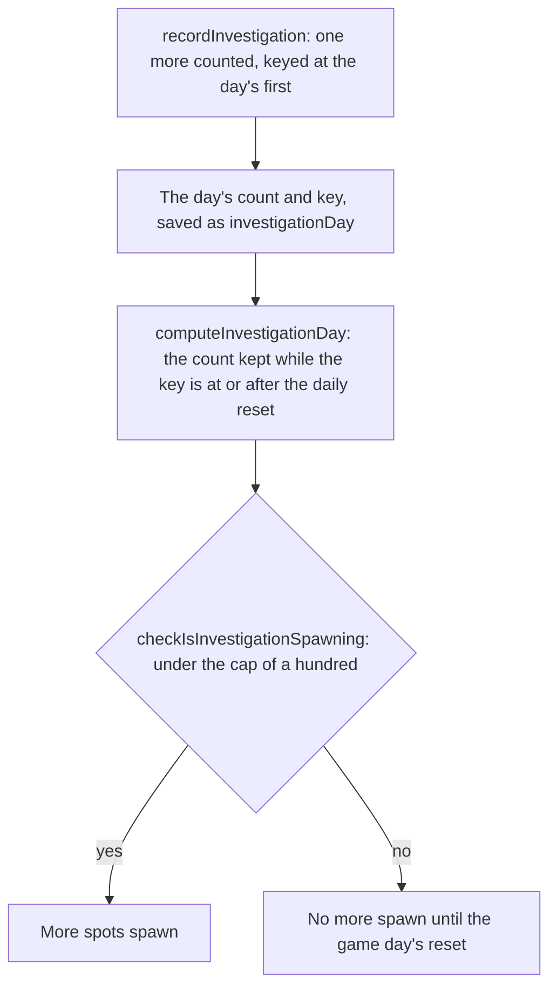

# Investigation

The rule that caps the investigation spots a player may investigate in a game day: a hundred, after which no more spawn. The count it reads is kept as the day's count and key, not as each investigation's instant. Nothing places the spots or gives a reward yet, so the cap and the day's count are the parts built, and the [proposal](../../../changes/genshin-gathering/design.md) keeps the rest.

## How it works

## Rules

- **A hundred a day.** `INVESTIGATION_DAILY_CAP` is the most investigations in one game day. At the cap, no more spots spawn; below it, they do.
- **The count is the game day's.** The game day starts at the daily reset, 04:00 in the game's time zone, so the count that the cap compares is the one kept from that reset. `computeInvestigationDay` keeps a day's count while its key is at or after the latest reset, read by `computeLastDailyReset`, the reset the commissions read, so the game day is the one the commissions keep and not a second reset. `recordInvestigation` counts one more investigation and keys a day that has none at its first. The day is saved as the `investigationDay` slice, `{ count, dayKey }`, whose key is empty before the first investigation. Two copies of a save merge by the larger count when both keys fall in the same game day, and otherwise by the later day's counter.

## Key files

| File                                                                                | Role                                                               |
| :---------------------------------------------------------------------------------- | :----------------------------------------------------------------- |
| `packages/genshin-world/src/services/investigation/constants.ts`                    | The daily cap of investigations                                    |
| `packages/genshin-world/src/services/investigation/checkIsInvestigationSpawning.ts` | Whether spots still spawn after this many in the game day          |
| `packages/genshin-world/src/services/investigation/computeInvestigationDay.ts`      | The day's count, kept while its key is at or after the daily reset |
| `packages/genshin-world/src/services/investigation/recordInvestigation.ts`          | One more investigation counted in the game day                     |
| `packages/genshin-world/src/models/investigation/InvestigationDaySave.ts`           | The day's count and key as the save holds them                     |

## Sources

- [Investigation](https://genshin-impact.fandom.com/wiki/Investigation), Genshin Impact Wiki: spots that give artifacts, ingredients, ores or Mora, and the daily cap of a hundred investigations.
- [Daily Reset](https://genshin-impact.fandom.com/wiki/Daily_Reset), Genshin Impact Wiki: what comes back at the daily reset and around it.
