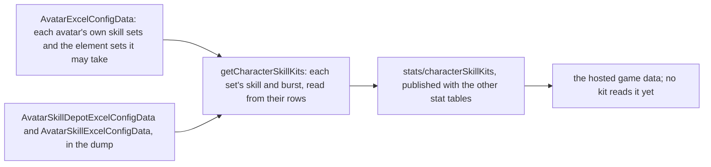
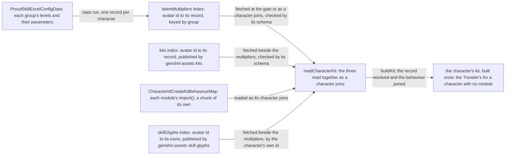
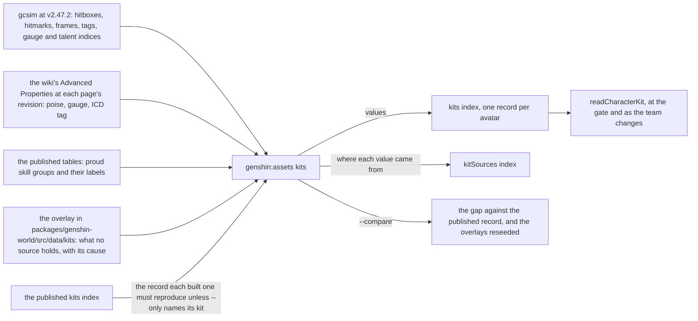
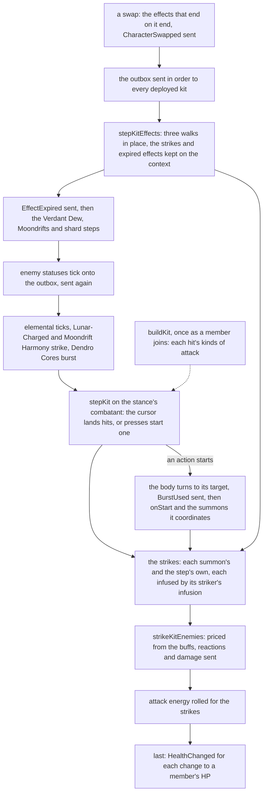

# Character kits

A character's combat kit is its skills, cooldowns, costs and talent multipliers, and the game keeps those in its tables by the character's skill sets. Every playable character's kit is written on the framework below: the skill sets and talent multipliers read from the tables, the targeting that turns an action to its enemy, and the shared effects and kit events every kit uses. The table at the end links one page per character, and it is the record of which kits are built. The kits' hits are [combat](../combat/design.md)'s, and the kit's action state machine is documented there too. The attributes a kit is priced from are on [character attributes](../character-attributes/design.md), and the character's movement on the field is on [character controller](../character-controller/design.md).

## Skill sets

A character has one skill set in its own form, and a set for each element form its element may take, the one a statue's element picks. A set holds a skill, the character's elemental skill, and a burst, its energy skill, each read from the skill table by its id. The skill has a cooldown and its charges (`maxChargeNum` in `~/Esposter.noindex/genshin-dump-backup-6.6/ExcelBinOutput/AvatarSkillExcelConfigData.json`), the burst a cooldown, an energy cost and the element it deals, the element its energy is named as. `~/Esposter.noindex/genshin-dump-backup-6.6/ExcelBinOutput/AvatarSkillDepotExcelConfigData.json`, `~/Esposter.noindex/genshin-dump-backup-6.6/ExcelBinOutput/AvatarSkillExcelConfigData.json`, `scripts/src/services/genshinAssets/stats/getCharacterSkillKits.ts`

- **A set with neither a skill nor a burst is left out.** A character none of whose sets has either is left out too. One of the Traveler's element sets, 705, holds neither in this dump, so the dump gives the Traveler no form for it. `~/Esposter.noindex/genshin-dump-backup-6.6/ExcelBinOutput/AvatarSkillDepotExcelConfigData.json` (depot 705: `energySkill` and `attackModeSkill` both 0), `scripts/src/services/genshinAssets/stats/getCharacterSkillKits.ts`
- **A burst's element is the one its energy names, when it names one of the seven.** A burst that costs no element has none. Which set a Traveler's kit reads is for the element a statue gives, which is not built yet. `scripts/src/services/genshinAssets/stats/getCharacterSkillKits.ts`
- **The table is published by** `pnpm -C scripts genshin:assets stats`, the same run as the characters, weapons and artifacts. Each character is checked against the world's schema as it is built. `scripts/src/services/genshinAssets/commands/statsCommand.ts`

## Talent multipliers

The stats run publishes each playable character's combat talent multipliers as its own entry of the `talentMultipliers` index, by its avatar id, keyed by the talent's proud skill group. A level keeps its parameters (`paramList`) up to the last one that is not zero, so a read past that point is zero. The labels, the text id naming each parameter (`paramDescList`), go apart into the character's entry of the `talentLabels` index, which the combat table never carries. `scripts/src/services/genshinAssets/stats/writeTalentTables.ts`, `scripts/src/services/genshinAssets/stats/toTalentTables.ts`

Each character's multipliers are an entry of the hosted `talentMultipliers` index, under its avatar id ([hosted game data](../hosted-game-data/design.md)). `TalentMultiplierLoaderMap` is keyed by avatar id, and each entry reads that character's record from the world's game data base and checks it against its schema. `readTalentMultipliers` merges the records it is given by group, and `getTalentMultiplier` reads a parameter from the table by its index, which `buildKit` does for each parameter a kit's record names. `readCharacterKits` builds each joining character's kit once (`readCharacterKit`), from its multipliers, its `kits` record and its behaviour module, the three read together as the character joins, and `buildKit` turns the record's frames into seconds and its parameters into the tables' values, joins the behaviour and tags the hits; a character with no module fights with the Traveler's kit, from the Traveler's record, multipliers and behaviour. The world's gate reads the starting team's kits before the world opens, so its first frame has each member's combatant, and the world reads a character's as the team changes to take it in, reading a failed read again `DATA_FETCH_RETRY_MS` later, since a team that stays as it is starts no other. The world's entry carries neither: the multipliers' loader map replaced one static import that was 1.4 MB of it, and the behaviour map loads each module through its own `import()`, which the build splits into a chunk, while the barrel leaves the modules out. A member whose kit is still in flight has no combatant yet, which is a loading state rather than an error: it gains no energy, and on the field its kit's step waits, starting no attack, skill or burst and holding the team's effects, while the body moves on. The entry is held to its measured size as it stands, 2,284,676 bytes, with the kit modules and every character's icons out of it: its size snapshot (`packages/genshin-world/src/index.test.ts`) is the gate, so a regression past that figure fails the test, and a cut to a lower ceiling is a separate open item, not decided here. What the entry is made of is none of a character's: the glyph path maps the screens share (about 150 KB of path data, the element marks' and the Paimon menu's entries' the most of them, each traced path written in its shortest form, see [parity tracing](../parity/tracing/design.md)), the components (about 350 KB), the kit framework (about 74 KB) and the loader maps naming each character's hosted entries. A character's skill and burst icons are per-character data like a kit, so they are hosted, one entry a character of the `skillGlyphs` index ([HUD](../hud/design.md)), and `readCharacterKit` reads a character's through `SkillGlyphsLoaderMap` by its own id beside the kit's three reads, so the kit carries them to the HUD and the entry holds none.

Talent levels and constellations are read at the level the kit is built at: raising them is the [talents](../talents/design.md) and [constellations](../../../changes/genshin-constellations/design.md) pages'.

## Targeting

An action turns the body to the enemy it targets as it starts. That is the living enemy inside the action's targeting area scoring highest, where an enemy's score is 0.7 times its nearness to the body within the area's radius, plus 0.3 times its nearness to straight ahead, the angle from the body's facing over a half-turn. An enemy more than 2 metres above or below the body scores a fifth of that. Enemies outside the area, and the dead, are not targeted. The view, current-target and priority coefficients are not built. `packages/genshin-world/src/services/kit/selectAttackTarget.ts`

The enemy an action turns to is the primary target (`KitContext.primaryTarget`), as gcsim's `PrimaryTarget` is the one its on-target hits are placed on (`~/Esposter/cache/gcsim-v2.47.2/pkg/core/combat/enemy.go:50`). It outlasts the action and a swap, so a hit no action of its own targets, such as a summon's discharge as a reaction lands, is placed on it. An action that finds no enemy leaves none, and the step lets it go once it dies or its camp leaves the world. An aimed shot targets the camera's aim, so it leaves the primary target as it stood. A strike with a target lands on that target only. `packages/genshin-world/src/models/kit/KitContext.ts`

## Shared effects

Each effect is on the party, in the list a `KitEffectState` holds, so a switch leaves it running, and a drown or a jump clears it. Each one is ticked each step. `packages/genshin-world/src/models/kit/KitEffectState.ts`

- **Damage** is a hit: its talent multiplier, its gauge of an element, the element it names when it is not its character's own, the DMG Bonus it carries of its own, if any, added to its striker's as it is priced, and the additive base damage it reads from its striker, if any, added to its base damage. A hit with no internal cooldown applies its whole gauge, and one under a cooldown shares it through it. `packages/genshin-world/src/services/kit/strikeKitEnemies.ts`
- **Infusion** makes the character's normal attacks, charged attack and plunges deal its element at the gauge the hit gives it, 1U for a strike and 0U for a collision. One that converts the attacks gives each hit its converted poise and reach where it has them, and one with a DMG Bonus adds it to each hit it infuses, as Bane of All Evil's does to Xiao's Normal, Charged and Plunging Attacks alone. It is refreshed by a second one of its kind on the same character, not stacked. `packages/genshin-world/src/services/kit/effects/getKitInfusion.ts`
- **Buff** adds a stat bonus to the character's pricing for its seconds: a flat ATK adds to its attack and any other bonus to its attribute total. It is refreshed by one of its attribute from the same source on the same character, not stacked: a source names the effect that gives it, so two effects on one attribute run side by side, as Sprawling Greenery's two Elemental Mastery buffs do. A kit gives one to a member in a call (`buffKitMember`), and the same one to every member of the deployed team, each its own, in another (`buffKitTeam`). A buff of `Attribute.DamageReduction` cuts the enemies' strikes on its member, as the combat page's DMG Reduction decision gives it. `packages/genshin-world/src/services/kit/effects/buffKitMember.ts`, `packages/genshin-world/src/services/kit/effects/buffKitTeam.ts`
- **Heal and drain** are `changeKitMemberHealth`, the one way a kit changes a member's current HP, its own or another's, by an amount of HP: a heal is raised by its source's Healing Bonus and the member's Incoming Healing Bonus as the buffs on them stand, and a drain is taken as it is, as gcsim's `Heal` and `Drain` price them; the Max HP a share is taken of is the final one after the buffs on the member, read through `getKitMaxHealth` from the member's one build, `getBuffedCombatant` with no position, which the heal's Incoming Healing Bonus is read from too. Under it, the party's `healPartyMember` and `damagePartyMember` change a share of a standing member's Max HP, a heal never above all of it and a drain never below none, and a downed member stays down, as only a revive brings one back. Each records its change in the party's `healthChanges`, which [party](../party/design.md) describes and `HealthChanged` sends to the kits. `packages/genshin-world/src/services/kit/effects/changeKitMemberHealth.ts`
- **Energy** is the party's `gainPartyEnergy`, which an enemy's drop calls through `collectKitEnergyDrops`. `packages/genshin-world/src/services/party/gainPartyEnergy.ts`
- **Field** is a circle placed where its character casts, for its seconds, with a tick on a schedule. Each tick runs while the body stands inside it, reading the character on the field and the team, and a tick's own buffs and infusions start at their full seconds. A tick that lands a hit casts it as a summon from the field's centre rather than the body, so a field that stays where it was cast lands its ticks from there whatever the body does after, as gcsim fixes a field's area as it is cast. A kit casts one in a call (`castKitField`), naming its schedule and its seconds, and its radius unless it reaches the body wherever it stands, and the call returns the field for a kit that reads it again. A field its character casts again under its name restarts the one standing, as gcsim keys each named field by its name, unless the field is stacked, which several of one name may stand as (see a Sourcewater Droplet). A task is how a kit sets something going a few frames on, as gcsim queues a task on its character: a field with no edge whose one tick runs after its delay (`scheduleKitTask`). `packages/genshin-world/src/services/kit/effects/castKitField.ts`
- **A periodic task** is a whole-world schedule a kit runs on its character's clock: its first tick, then one every interval, for each that falls before its end, as `schedulePeriodicKitTask` runs Jahoda's heals. It ticks wherever the body stands, which a field does not. `packages/genshin-world/src/services/kit/effects/schedulePeriodicKitTask.ts`
- **A Sourcewater Droplet** is a field with no tick, left at a point for its seconds by `castSourcewaterDroplet`. `absorbSourcewaterDroplets` ends up to a maximum of those inside an area, each once, as a charge's legal evaluation picks them up (`~/Esposter.noindex/cache/gcsim-v2.47.2/internal/characters/neuvillette/charge.go:51-66`); a droplet ended is never absorbed again. Droplets are stacked, so a new one stands beside the others under the same id rather than restarting one. `packages/genshin-world/src/services/kit/effects/castSourcewaterDroplet.ts`, `packages/genshin-world/src/services/kit/effects/absorbSourcewaterDroplets.ts`
- **An action's length can be decided as it runs.** An action's `decideLength` is read once its seconds reach `atSeconds`, and its `decide` returns the length the action plays from then on; until then it plays its record's seconds. Neuvillette's Equitable Judgment is sized this way, from the droplets its legal evaluation picks up. `packages/genshin-world/src/models/kit/KitAction.ts`
- **A tick falls due on its frame.** As gcsim's tick does at its delay, a field's tick is due once the seconds left to it are within `FLOAT_RESIDUE` of none, so a float sum of frames that drifts a sub-nanosecond past its frame does not land the tick a frame late. `packages/genshin-world/src/services/floatResidue.ts`
- **Summon** is an entity cast where its character stands, which lands its own hits on the seconds their hitmarks fall at, for its seconds. It is priced by the combatant that cast it, as it stood then, and its hits land from its own body, not the character's. A summon may travel: its body moves forward at its speed from its start on its clock, and its hits are reached from where it is then. A summon may follow the body on the field instead: its body stands where that body stands on each step, whoever is on the field, and its hits are reached from there. A summon whose seconds end on its last hitmark lives `SUMMON_LINGER_SECONDS` past it, so the step that lands its last hit still has it on the field however its clock and its seconds left round. A summon its kit ends, as Durin's recast ends his Dragon and Yae Miko's burst her totems, lands nothing from the next step, as gcsim's ticks check that their summon still stands. Its hits are dealt as the kind of attack its kit names as it casts it (`KitSummon.attackTag`), gcsim's attack tag for them, and as none where its kit names none. A kit casts one in a call (`castKitSummon`), naming its id, its kind, its seconds and the enemy it strikes, if it strikes one, beside its hits, the call returning the summon for a kit that reads it again. The hits that land every interval from a first frame, as Guoba's and the steles' do, are a list in the kit's record, each at its own hitmark's frames, and a kit whose count is set as it plays, as Oz's is by its seconds, builds them from the seconds its record holds. An action's hits whose hitmarks fall past its end are a summon too, cast as the action runs its course (`queueKitHits`), so each lands at its hitmark through a later action or a swap, dealt as the action's kind of attack and infused as it lands, by [combat's timing rule](../combat/design.md): an action's `seconds` is its gcsim cancel, never stretched to its last hit. `packages/genshin-world/src/services/kit/constants.ts`, `packages/genshin-world/src/services/kit/effects/castKitSummon.ts`
- **A coordinated summon** is set going by the character on the field, whoever that is: as that character starts a normal attack, `coordinateKitSummons` runs each summon's `onNormalAttackStart` with the world's context, whose body and combatant are that character's, called by the character component beside the action's own start. Any other action sets none going, and the summon's hook decides what it casts. `packages/genshin-world/src/services/kit/effects/coordinateKitSummons.ts`
- **A combatant holds the deployed team's elements.** Each deployed member's element, in the team's order, is read off its record and the Traveler's from his element now, and a status or a hit reads them through its combatant as the team stands, so a passive counts its team's elements with no hook per member. A combatant built with no team holds none. `packages/genshin-world/src/services/kit/createCombatant.ts`
- **A held skill's charge can be completed early.** A kit completes it with a mark on the character, which a hold clears when it starts and its release reads: the release then plays the highest hold level whatever the skill was held for, as Candace's Aegis of Crossed Arrows does when she is hit in the hold (`~/Esposter.noindex/cache/genshin-wiki/Category_Candace_Talents.json`: a hit in the Hold finishes its charge). The mark is a status, so a kit reads and sets it the way it does any other. `packages/genshin-world/src/models/kit/KitSkillHold.ts`
- **A charged attack's charge can be skipped.** A kit grants a character's next charged attack a skip of its charge with `grantKitChargeSkip`, for the seconds given, and the attack spends it as it starts. It starts `chargeSeconds` into the action, which its behaviour sets, so its hitmarks and its end come that much sooner, and the action object is unchanged for its identity checks. Ganyu's Constellation 6 is the one user (`~/Esposter.noindex/cache/gcsim-v2.47.2/internal/characters/ganyu/aimed.go:78-83`). `packages/genshin-world/src/services/kit/effects/grantKitChargeSkip.ts`
- **A skill's cooldown can be waived.** A kit's `checkIsSkillCooldownWaived` lets a press start while its cooldown runs, and `getSkillCooldownMultiplier` cuts the cooldown a press sets, as Xianyun's Constellation 6 presses do. `packages/genshin-world/src/models/kit/KitBehaviour.ts`
- **A plunge can be a variant.** A kit's `plungeVariants` are leaps its skill state plays in place of the standard plunge when the body lands, the first whose check holds playing, as Xianyun's Driftcloud Wave does at each Skyladder press. Its record holds each as `plungeVariants`, an action of its own, and its behaviour gives each check. `packages/genshin-world/src/models/kit/KitBehaviour.ts`
- **A shield** is set on the team by the character that casts it, for the seconds left of it, and is recast over the one that character already holds. It takes the damage the character on the field takes, whichever character cast it: an enemy's strike is taken by every live shield at once, each absorbing the full damage through the combat's `absorbShieldDamage` against the strike's element at the struck character's Shield Strength as its buffs leave it, and the character loses the least any of them passes on. A timed Shield Strength buff on the member on the field so raises every shield's absorption while it lasts, as gcsim sums its shield bonus modifiers into each shield's absorption (`~/Esposter/cache/gcsim-v2.47.2/pkg/core/player/shield/handler.go:90`, `~/Esposter/cache/gcsim-v2.47.2/pkg/core/player/shield/bonus.go:16`) and Dahlia's Constellation 2 adds one (`~/Esposter/cache/gcsim-v2.47.2/internal/characters/dahlia/cons.go:37`). A shield of an element absorbs a strike of its own element 250% as effectively, as gcsim's shield does (`~/Esposter/cache/gcsim-v2.47.2/pkg/core/player/shield/template.go:59`), so Yanfei's Constellation 4 and Beidou's Constellation 1 cast a Pyro and an Electro shield. The wiki gives the rule in its own words: "when the active character takes damage, damage is dealt to shield health first", and "When a character has more than one shield, the damage dealt by an enemy will affect every active shield simultaneously" ([Shield](https://genshin-impact.fandom.com/wiki/Shield)). A shield is dropped once its health is spent. A shield with an explosion goes off as it ends, whether its seconds run out, its health is spent or it is recast over. A kit casts one in a call (`castKitShield`) given the world's context, naming its element, health and seconds and its explosion if it carries one; the call tells the deployed team's kits the shield stands (`ShieldCast`) and returns it for a kit that reads it again, as Zhongli's Jade Shield does, and a Crystallize shard's shield is cast through it too. `packages/genshin-world/src/services/kit/effects/castKitShield.ts`, `packages/genshin-world/src/services/kit/effects/absorbKitShield.ts`
- **A kit may leave a pick-up in the world** (`KitPickUp`): a point the character on the field walks within its radius of, once the seconds left of it fall to its `pickableSeconds`, and its `onPickedUp` then does what picking it up does with the combat state, the member on the field among it, as Mizuki's Yumemi Style Special Snacks heal or explode. The step picks them up after the Crystallize shards (`pickUpKitPickUps`). A pick-up taken is dropped from the team's effects, so its kit hears no `EffectExpired` for it, and one never taken runs out, which its kit hears as the effect expiring, as gcsim's gadget killed on a pickup skips the OnExpiry it calls when its time runs out (`~/Esposter/cache/gcsim-v2.47.2/pkg/gadget/gadget.go:36`, `:62`; `~/Esposter/cache/gcsim-v2.47.2/internal/characters/mizuki/snack.go:62`, `:66`, `:136`). `packages/genshin-world/src/models/kit/KitPickUp.ts`, `packages/genshin-world/src/services/kit/pickUpKitPickUps.ts`
- **A taunt** is an entity placed where its character cast it, with health, which draws the enemies' strikes while it stands. A taunt that carries an explosion explodes once, from its body and priced by the combatant that cast it, when its seconds run out or its health is gone, and one that carries none, as Ushi does, ends dealing nothing. `castKitTaunt` casts one, copying its body so it stays where it was cast. An enemy within its aggro range strikes it instead of the character, and each strike is taken from its health by `damageKitTaunt`, which puts the damage on the context's outbox for the kits to hear as `TauntDamaged`. `packages/genshin-world/src/services/kit/effects/castKitTaunt.ts`
- **A bubble** is held on one enemy by a hit that casts it, for its seconds. A hit with poise damage bursts it, as its seconds running out do: the Omen goes on the enemy from the burst, and the explosion lands on that enemy alone, from where it stands, priced by the combatant that cast it. A hit that casts a bubble holds the enemy in one, and never restarts the one it holds, since each cast's bubble bursts on its own. `packages/genshin-world/src/services/kit/effects/stepKitBubble.ts`
- **A status on a character** is a mark it carries for its seconds, by an id (`KitStatus`), as gcsim's character statuses are: a passive's or a constellation's own cooldown, such as Thundering Retribution's half second on the character on the field (`~/Esposter.noindex/cache/gcsim-v2.47.2/internal/characters/fischl/asc.go:45`), or a mark a kit reads later, such as Havoc: Annihilation's on Tartaglia's stance (`~/Esposter.noindex/cache/gcsim-v2.47.2/internal/characters/tartaglia/burst.go:68-70`, `~/Esposter.noindex/cache/gcsim-v2.47.2/internal/characters/tartaglia/skill.go:221-223`). A second one of its id on the same character restarts it. A kit adds one in a call (`addKitStatus`), and a gate on a repeat starts its cooldown and learns whether one is still running in another (`startKitCooldown`), one that has run out on a step letting the gate through on it, as gcsim's `StatusIsActive` reads a status's expiry. `findKitStatus` reads it, `checkHasKitStatus` whether it is there, and `checkIsKitStatusActive` whether it has not run out, as one that runs out on a step stays among the effects until that step drops it. `countKitStatusStacks` reads the stacks one holds, none once it has run out, so a count that lapsed starts again from one. `extendKitStatus` extends one that has not run out, as far as the seconds it may run past its start allow, keeping what it has added on the status's `extendedSeconds`, which a status started again starts from none: Clash of Kings' Laws of the Board read it. `endKitStatus` ends one, so the next step drops it and sends its expiry, as a held skill's charge is cleared and Disaster and Remorse's two buffs end with its Path of Conflict. `packages/genshin-world/src/models/kit/KitStatus.ts`
- **A counter window opens on a hit taken in a hold.** `openKitCounterWindow` opens a status of its id for its seconds on a character when a hit lands on it while the active character's skill is held (`KitContext.isSkillHeld`, which the step's input gives): a strike that costs it HP with no kit as the source, or a shield taking a strike for it. Drowns count, as the record gives them no cause. A second hit restarts it. A kit reads the window in `jumpsSkillHoldToTop`, and a release while it stands plays the top hold level whatever seconds it was held, as a completed charge does. Yun Jin's Ascension 1 is its first user, with a provisional 0.5 seconds; Beidou's Ascension 1 is the next, when built. `packages/genshin-world/src/services/kit/effects/openKitCounterWindow.ts`
- **A resource on a character** is a count with a cap that outlives any timer, such as Raiden's Resolve, Itto's Superlative Superstrength, Eula's Lightfall Sword stacks and Aloy's coils, held as a status whose stacks are the amount, which never runs out unless a stance holds it. `gainKitResource` adds to it up to its maximum and returns what is held then, `spendKitResource` drops it at once and returns what it held, and `countKitResource` reads it. `packages/genshin-world/src/services/kit/effects/gainKitResource.ts`
- **A stance** plays its own normal attacks, charged attack and its stamina, skill and burst, and its dash and jump where it sets them, in place of its character's kit while it lasts (`KitStance`), and counts the seconds it has held, which its end reads. `enterKitStance` builds its combatant once as it starts, the character's combatant with the stance's actions in place in its kit, and the step of the character on the field plays the combatant of the stance it holds (`findKitStance`), its attributes as they stood as the stance started, so a stance's attacks are that character's normal and charged attacks wherever a kit's actions are read: their hits' kinds, an infusion, a coordinated summon. A stance that ends on a swap (`isEndedOnSwap`) ends as its character leaves the field, before the team's kits hear of the swap, as gcsim's exit handlers delete theirs: Soukai Kanka, Pactsworn Pathclearer, Nilou's two, Musou Isshin, the Seven-Phase Flash, the Melee Stance, Niwabi Fire-Dance, Paramita Papilio, the Ceremonial Garment, Painted Dome's and Manifest Flame's. A buff or an infusion that ends on a swap ends with them, as the Paramita's Pyro infusion and ATK and Royal Descent's do, and so does a summon its character cast, as Klee's sparks do, landing nothing from the swap's step (`endKitSwapEffects`). Zhongli's RES cut stands on his Jade Shield rather than the field, as gcsim's shred tasks read his `shielded` tag, and Razor's Wolf Within, Xiao's Bane of All Evil and Ningguang's Star Jades keep a field of their own that ticks every step: Razor's first tick at the hitmark gives his bonus only if he still stands on the field, Xiao's drain and Tamer of Demons read his infusion standing within the swap's own step, and a Star Jade a gem gives after Ningguang has left ends on the next step, where no swap follows. Itto's Arataki Kesagiri stance, which his stacks hold, Durin's and the Windfavored state, during which gcsim allows no swap, stay. `packages/genshin-world/src/models/kit/KitStance.ts`, `packages/genshin-world/src/services/kit/effects/enterKitStance.ts`
- **A stance's hits deal the kind of attack of the group they play in**, set as its kit is built, unless a hit names its own: Nilou's sword dance plays as her normal attacks but names Elemental Skill DMG, and Ayato's Shunsuiken slashes are Normal Attack DMG. `packages/genshin-world/src/services/kit/tagKitHits.ts`
- **A field may lower cooldowns.** A skill or a burst cast while the body stands inside a field with a `cooldownMultiplier` has its cooldown multiplied by it, each such field multiplying in turn, as Atmospheric Revolution's frost field does (`getKitFieldCooldownMultiplier`). `packages/genshin-world/src/services/kit/effects/getKitFieldCooldownMultiplier.ts`
- **An infusion may quicken the normal attacks.** An infusion with a `normalAttackSpeedBonus` plays each normal attack of its character that much faster, its seconds and its hitmarks alike, as Steady Breathing's does (`~/Esposter.noindex/cache/genshin-wiki/Category_Chongyun_Talents.json`: Normal ATK SPD in its field). `packages/genshin-world/src/services/kit/effects/getKitInfusion.ts`
- **A hit may launch.** A hit marked `isLaunching`, an Air stagger level on the wiki, leaves an enemy it staggers carrying `ENEMY_LAUNCHED_STATUS_ID` while the stagger lasts, which a kit's `onStrike` or a status reads as the enemy being airborne, as the [enemies](../enemies/design.md) page sets out. `packages/genshin-world/src/services/enemy/constants.ts`
- **A strike may carry a DMG Bonus against some enemies.** A kit's `getStrikeDamageBonus` reads each of its own strikes, the enemy it lands on and the team's effects, and adds what it returns to the hit's DMG Bonus as it is priced, as Frozen to the Bone's 15% against an enemy with Cryo on it and Rally of Four Blades' 15% against an enemy with less of its HP left do. `getStrikeCriticalRateBonus` does the same for the hit's CRIT Rate, `getStrikeCriticalDamageBonus` for its CRIT DMG, and `getStrikeAdditiveBaseDamageBonus` adds a flat amount to its base damage, and `getStrikeDefenceIgnored` the share of the enemy's defence the hit ignores, as Nicole's sixth constellation does; all five read the team's effects, so a constellation reads a bonus its kit's actions set going, as Diluc's Flowing Flame does. The strike hooks get the striker as it is priced, with its buffs on, so a buff on the striker counts in the bonus a hook returns, as Tighnari's ascension 4 bonus reads the Elemental Mastery a buff adds. `getStrikeAdditiveBaseDamageBonus` also takes the team's built combatants by id as its fifth argument, which a kit reads a team's elements or a member's attributes from; the other strike hooks have no character map, so a kit that needs the striker's stats reads them from the strike it is given. An `elementCriticalDamage` effect adds its CRIT DMG to every strike of its element by its character as the hit is priced (`getElementCriticalDamageBonus`), as Shenhe's Constellation 2 gives the active character on Cryo strikes inside her field. `packages/genshin-world/src/models/kit/KitBehaviour.ts`, `packages/genshin-world/src/services/kit/effects/getElementCriticalDamageBonus.ts`
- **A Moonsign character's kit holds its Moonsign Benediction** (`moonsignBenediction`): the Lunar reactions it turns the party's reactions into and the Base DMG Bonus it gives them from its holder's stats, which the deployed team's Moonsign reads as each strike lands. A `lunarHit` on a hit makes it a direct Lunar hit, which [combat](../combat/design.md#lunar-reactions) prices from the stat its `getScalingStat` reads, ATK if none, as Hymn of Eternal Rest's Lunar-Bloom is. The party's Dew is the Lunar-Bloom's resource, its Verdant Dew and then its Moonridge Dew, which a kit spends with `spendDew`. `packages/genshin-world/src/services/party/spendDew.ts`
- **A Stellar Linchpin character's kit holds its Stellar Jubilee** (`stellarJubilee`): the Stellar reactions it enables for its party while it is deployed. The deployed team's enablers are read as each strike lands, and a Superconduct or a Cryo Swirl becomes a Stellar-Conduct or a Stellar Swirl only while one of them enables it, as [combat](../combat/design.md) prices it. A Jubilee's behaviour may give the Base DMG Bonus it adds to the party's Stellar damage from its holder's stats (`getBaseDamageBonus`), as a Benediction does its Lunar reactions: each deployed Jubilee's adds up, read from its holder as the team's buffs leave it (`getPartyStellarBaseDamageBonus`), and raises the base of every Stellar reaction's damage, a Stellar Vortex's explosion among it, as gcsim v2.47.2 adds each Jubilee's to every Stellar Swirl reaction attack, its vortex's detonation one (`~/Esposter/cache/gcsim-v2.47.2/internal/characters/odette/stellar.go:66`, `~/Esposter/cache/gcsim-v2.47.2/internal/characters/traveler/common/cryo/stellar.go:61`, `~/Esposter/cache/gcsim-v2.47.2/pkg/reactable/stellarswirl_gadget.go:48`). A direct Stellar hit takes it too, as [combat](../combat/design.md) prices it.
- **A member's Radiance: Stellar-Conduct is a status the Polestar Field gives.** While the body stands inside a Polestar Field, every deployed member carries `RADIANCE_STELLAR_CONDUCT_STATUS_ID` for the field's think interval, its stacks the field's count of the last think, so a kit whose character has a Radiance reads it with `checkIsKitStatusActive`, as gcsim's isRadianceSSC reads the field's status on Yae Miko (`~/Esposter/cache/gcsim-v2.47.2/internal/characters/yaemiko/stellar.go:108`, `~/Esposter/cache/gcsim-v2.47.2/pkg/reactable/stellarconduct_gadget.go:160`). Her Constellation 6's CRIT DMG on her Stellar-Conduct hits then waits only on her kit dealing them ([Odette](odette/design.md) places the field).
- **A kit deals Stellar-Conduct DMG through a direct Stellar hit.** The reaction deals none of its own, so a hit that names its `stellarReactionType` is priced by `getDirectStellarDamage`, the Glimmer formula over its talent multiplier of ATK with no Defence, at a Stellar-Conduct's coefficient by the count its striker's Radiance: Stellar-Conduct carries ([combat](../../../changes/archive/2026-10-22-genshin-combat/design.md), gcsim `~/Esposter/cache/gcsim-v2.47.2/pkg/enemy/damage.go:212`). Its party bonuses are its reaction's, read through `getPartyReactionBonus` with that reaction type.
- **A status on an enemy may strike on its own schedule.** A status with a `tickIntervalSeconds` counts down to its next tick, and each tick that falls due while it lasts is put on the outbox (`tickEnemyStatuses`), which the step sends to the kits at once, as Hydrospout's on Riptide is (`~/Esposter.noindex/cache/gcsim-v2.47.2/internal/characters/tartaglia/riptide.go:43`, `riptide.go:58-76`). A refresh restarts its seconds and keeps the schedule it holds. A status may also cut the ATK the enemy strikes with by its `attackReduction`, as Divine Suppression's Talisman does, and a status's own interval is a status of its own, as Riptide Flash's 0.7 seconds on each enemy are (`~/Esposter.noindex/cache/gcsim-v2.47.2/internal/characters/tartaglia/riptide.go:105`). `packages/genshin-world/src/services/kit/tickEnemyStatuses.ts`

## Kit events

A passive or a constellation that answers something happening in combat is a kit's `onKitEvent`, one handler on each kit over one channel. The step of the character on the field sends each event to the kit of every member of the deployed team whose combatant is built, on the field or off it (`emitKitEvent`), and each kit reads it as its own character, whose ascension and constellation count gate what it does. A handler writes through the team's effects, the party and the enemy's statuses, and a strike it sets off is a summon cast at the enemy or the body, landing a frame or more on, as gcsim queues them. `packages/genshin-world/src/services/kit/emitKitEvent.ts`

```mermaid
flowchart TD
  STEP["stepActiveKit, at the fixed step"] -->|"another character on the field than the last step's"| SWAP["CharacterSwapped"]
  STEP -->|"the outbox: an enemy's strike a taunt took since the last step"| TAUNT["TauntDamaged"]
  STEP -->|"stepKitEffects or stepKitNightsoul: an effect or blessing that ran out"| EXPIRED["EffectExpired"]
  STEP -->|"the outbox: tickEnemyStatuses puts on it a status's tick that falls due"| TICK["StatusTicked"]
  STEP -->|"a normal attack starts, as its action does"| STARTED["NormalAttackStarted"]
  STEP -->|"a normal attack's first hitmark falls"| LANDED["NormalAttackLanded"]
  STEP -->|"a burst starts, ahead of its own start"| BURST["BurstUsed"]
  STEP -->|"a skill starts, as a burst does"| SKILL["SkillUsed"]
  STEP -->|"a charged attack's first hitmark falls"| CHARGED["ChargedAttackLanded"]
  STEP --> STRIKES["strikeKitEnemies: each strike on each enemy it reaches"]
  STRIKES -->|"the hit triggered reactions"| REACTION["ReactionTriggered"]
  STRIKES -->|"the enemy took its damage, CRIT or not, defeated or not"| DAMAGE["DamageTaken"]
  STRIKES -->|"the hit landed on an enemy, dealt as an element where it deals one"| ENEMYHIT["EnemyHit"]
  STRIKES -->|"the hit landed on a weak point"| WEAKPOINT["WeakPointHit"]
  STRIKES -->|"the hit took the enemy's last health"| DEFEATED["EnemyDefeated"]
  STEP -->|"an elemental tick, a Lunar hit or a reach took the enemy's last health"| DEFEATED
  STRIKES -->|"collectKitEnergyDrops: the enemy dropped energy, which the team took"| PARTICLE["EnergyParticleCollected"]
  STEP -->|"the outbox: Mora the character on the field picked up since the last step"| MORA["MoraPickedUp"]
  STEP -->|"last: each change to a member's HP the party recorded since the last step"| HEALTH["HealthChanged"]
  HEALTH -->|"a change a kit refused the fall of, just after it"| REFUSED["FallRefused"]
  SWAP --> EMIT["emitKitEvent: every deployed member's kit, as its own combatant"]
  TAUNT --> EMIT
  EXPIRED --> EMIT
  TICK --> EMIT
  STARTED --> EMIT
  LANDED --> EMIT
  BURST --> EMIT
  REACTION --> EMIT
  DAMAGE --> EMIT
  PARTICLE --> EMIT
  MORA --> EMIT
  HEALTH --> EMIT
  REFUSED --> EMIT
  SKILL --> EMIT
  CHARGED --> EMIT
  ENEMYHIT --> EMIT
  WEAKPOINT --> EMIT
  DEFEATED --> EMIT
  EMIT --> EFFECTS["the kit's handler: summons, statuses, heals, energy, cooldowns"]
  EFFECTS -->|"its summons' hits, on a later step"| STEP
```

- **CharacterSwapped** carries the character that left the field and the one now on it, read off the character the team's effects last stepped with (`KitEffectState.fieldCharacterId`). Chongyun's field infuses the one coming on, Ayato's Namisen stacks clear as he leaves, and Fischl's burst spawns its Oz at once. `packages/genshin-world/src/services/kit/stepActiveKit.ts`
- **TauntDamaged** carries a taunt on the team and the damage an enemy's strike dealt it. `damageKitTaunt` puts each strike on the outbox (`KitContext.outbox`) as it lands, between steps, and the step sends the outbox in the order the strikes landed and empties it, ahead of its effects running down, so a strike that spends the taunt's health is heard before the taunt ends. Ushi's stack as it takes damage answers it (`~/Esposter.noindex/cache/gcsim-v2.47.2/internal/characters/itto/skill.go:34`). `packages/genshin-world/src/services/kit/effects/damageKitTaunt.ts`
- **EffectExpired** carries an effect the step dropped, its seconds run out, its kit or a swap ends it, or a Nightsoul blessing's points run out, which `stepKitNightsoul` sends for the blessing it exits. Rimechaser Blade strikes as Chongyun's field ends, and Tartaglia's stance sets his skill's cooldown as it ends. `packages/genshin-world/src/services/kit/effects/stepKitEffects.ts`
- **NormalAttackStarted** carries a normal attack of the character on the field as its action starts, with the action and whether it is the first strike of its string (`isFirstStrike`), as gcsim's watcher reads the normal attack state's start. Raincutter sets its wave off from it, 7 frames on for a string's first strike and as it starts for a later one. `coordinateKitSummons` runs each summon's `onNormalAttackStart` at the same point, but it carries no first-strike flag, so a kit that needs one reads this event. `packages/genshin-world/src/services/kit/stepActiveKit.ts`
- **NormalAttackLanded** carries a normal attack of the character on the field as its first hitmark falls, whether or not it struck anything. Evernight Raven's Oz attacks along with it, Gaze of the Deep fires with Fischl's own, and Ice Unleashed's blades follow Chongyun's fourth strike. `packages/genshin-world/src/services/kit/stepActiveKit.ts`
- **ReactionTriggered** carries an enemy, the reactions a hit triggered on it, the kind of attack of that hit (`KitHit.attackTag`, none for a reaction a reach carries) and the combatant that dealt the hit. Thundering Retribution answers an Electro-related one the character on the field triggers while Oz stands (`~/Esposter.noindex/cache/gcsim-v2.47.2/internal/characters/fischl/asc.go:31-80`). `packages/genshin-world/src/services/kit/strikeKitEnemies.ts`
- **DamageTaken** carries an enemy, the hit as it struck, its kind of attack when it is one of its kit's own actions (`KitHit.attackTag`), the combatant that dealt it, whether it was a CRIT hit and whether it defeated the enemy. The Talisman's heal, A Glimpse into Arcanum, Ascetics of Frost, Frozen Skies, and Riptide's application and every strike it sets off answer it. It is the one event a kit reads a CRIT hit from: `strikeKitEnemies` sends it beside `EnemyHit` for each enemy a hit lands on, as gcsim's attack callback reads IsCrit for each enemy an attack strikes (`~/Esposter/cache/gcsim-v2.47.2/pkg/core/info/combat.go:22`), so `EnemyHit` carries no CRIT of its own and Rosaria's Constellations 1 and 4 read `isCritical` here.
- **ShieldAbsorbed** carries the owner of a shield that took part of an enemy's strike on a party member, the party member the strike was on, the health the shield lost and the health it has left, none once the strike broke it, as gcsim's shield handler reads a shield's health after each strike and breaks it at none (`~/Esposter/cache/gcsim-v2.47.2/pkg/core/player/shield/handler.go:107`). A shield broken or run out is then sent as `EffectExpired`, as gcsim's OnShieldBreak is sent for both (`:140`, `:164`). `strikePartyMember` sends one per live shield the strike reaches, so a kit reads a hit on its own character whoever owns the shield, as Diluc's Searing Ember does (`~/Esposter.noindex/cache/gcsim-v2.47.2/internal/characters/diluc/cons.go:40-41`).
- **PartyMemberStruck** carries an enemy's strike that landed on a party member: the enemy that struck, the member it landed on and whether a shield on the team took any of it. `strikePartyMember` returns it after the strike's `ShieldAbsorbed` events, and the world screen puts both on the outbox, so a strike a shield absorbed whole is told too, as gcsim's `OnPlayerHit` is emitted ahead of the shields (`~/Esposter/cache/gcsim-v2.47.2/pkg/avatar/avatar.go:31`). An effect that lasts for the next attacks a member takes counts it.
- **ShieldCast** carries a shield as it stands on the team, its owner the character that cast it. `castKitShield` sends it to the deployed team's kits once the shield is added, as gcsim's shield handler emits `OnShielded` from its `Add` (`~/Esposter/cache/gcsim-v2.47.2/pkg/core/player/shield/handler.go:81`). A Crystallize shard's shield is cast through it as the character whose reaction left the shard, gcsim's owner of the shard's shield (`~/Esposter/cache/gcsim-v2.47.2/pkg/reactable/crystallize.go:102`), ahead of the shard's `CrystallizeShardPickedUp` on the outbox. Jadefall's Splendor, Starcaller's Watch, Fractured Halo and Angelos' Heptades read it for a shield their wielder cast (`~/Esposter/cache/gcsim-v2.47.2/internal/weapons/catalyst/jadefallssplendor/jadefallssplendor.go:69`, `~/Esposter/cache/gcsim-v2.47.2/internal/weapons/catalyst/starcallerswatch/starcallerswatch.go:47`, `~/Esposter/cache/gcsim-v2.47.2/internal/weapons/spear/fracturedhalo/fracturedhalo.go:75`, `~/Esposter/cache/gcsim-v2.47.2/internal/weapons/catalyst/angelosheptades/angelosheptades.go:79`), Verdict for any Crystallize shield the party picks up (`~/Esposter/cache/gcsim-v2.47.2/internal/weapons/claymore/verdict/verdict.go:65`), and Nighttime Whispers in the Echoing Woods for a Crystallize shield picked up with its wearer on the field (`~/Esposter/cache/gcsim-v2.47.2/internal/artifacts/nighttimewhispersintheechoingwoods/nighttimewhispersintheechoingwoods.go:65`).
- **StatusTicked** carries an enemy and the status on it whose tick fell due. Hydrospout answers Riptide's. `packages/genshin-world/src/services/kit/tickEnemyStatuses.ts`
- **BurstUsed** carries the member that used its Elemental Burst and the burst's energy cost, sent as the burst starts and ahead of the burst's own start, as gcsim announces a burst before it plays. Resolve's stacks from another member's burst answer it (`~/Esposter.noindex/cache/gcsim-v2.47.2/internal/characters/raiden/burst.go:125-135`). `packages/genshin-world/src/services/kit/stepActiveKit.ts`
- **SkillUsed** carries the member that used its Elemental Skill, sent as the skill starts, as a burst is. `packages/genshin-world/src/services/kit/stepActiveKit.ts`
- **ChargedAttackLanded** carries a charged attack of the character on the field as its first hitmark falls, whether or not it struck anything, as a normal attack does. `packages/genshin-world/src/services/kit/stepActiveKit.ts`
- **A charged attack variant** plays in place of the charged attack while its check holds on the step it starts (`chargedAttackVariant` in the record, `checkIsActive` in the behaviour), as a burst variant does. Its hits are tagged as charged attacks and its first hitmark sends `ChargedAttackLanded`, as the charged attack's does. `packages/genshin-world/src/services/kit/stepActiveKit.ts`
- **EnemyHit** carries an enemy, the attack tag of the strike that landed it, the element a hit was dealt as where it deals one (its own, or the striker's where it carries a gauge) and the striker, sent for each enemy a hit lands on. `packages/genshin-world/src/services/kit/strikeKitEnemies.ts`

- **WeakPointHit** carries an enemy and the striker of a hit whose `KitHit.weakPoint` is set. The strike sets the flag on an aimed hit (`KitStrike.isAimed`) to an enemy whose family has weak points the wiki states, the Ruin machines (the Automatons family, cited part by part in `packages/genshin-world/src/services/enemy/enemyFamilyWeakPoints.ts`). Every aimed hit on them counts, as the aim's point and the exposure conditions (airborne, paralysed, specific attacks) are not modelled.
- **EnemyDefeated** carries the enemy and the striker, the combatant that owns the damage that took its last health, if one does. A strike sends it after its `DamageTaken`; an elemental tick, a reaction's reach and a Lunar hit send it too, and only from a standing enemy, so a dead one is never defeated twice. `packages/genshin-world/src/services/kit/strikeKitEnemies.ts`
- **EnergyParticleCollected** carries the particles or orbs an enemy dropped: how many, which of the two, their element, none for a clear one, and the member on the field, who collects them. It is sent once the team has taken their energy, every standing member by the game's rule, the one on the field in full and the others a share by the party's size, as gcsim distributes a particle before announcing it. Every drop is collected where it falls, a strike's, a reaction's reach or an elemental tick's alike (`collectKitEnergyDrops`). Wishes Unnumbered's Resolve answers it (`~/Esposter.noindex/cache/gcsim-v2.47.2/internal/characters/raiden/asc.go:18-22`, `~/Esposter.noindex/cache/genshin-wiki/Category_Raiden_Shogun_Talents.json`).
- **MoraPickedUp** carries the character on the field as it picks up Mora lying in the world. A pick up is an interaction outside the step, so the pickups emit it as a world event (`pickUpMora`), which the combat puts on the outbox for the next step to send. Lucky Dog's four-piece answers it (`~/Esposter.noindex/genshin-dump-backup-6.6/ExcelBinOutput/EquipAffixExcelConfigData.json` affixId 2100111, picking up Mora restores 300 HP; `~/Esposter.noindex/genshin-dump-backup-6.6/ExcelBinOutput/ReliquarySetExcelConfigData.json` set 10011, pieces 2 and 4) ([artifact enhancement](../artifact-enhancement/design.md)). `packages/genshin-world/src/composables/useWorldPickups.ts`
- **CrystallizeShardPickedUp** carries the character on the field as it picks up a Crystallize shard, and the shard's element. `pickUpCrystallizeShards` puts each pickup on the outbox as it grants the shard's shield, and the step sends it straight after, as gcsim's shard adds its shield and the add emits `OnShielded` (`~/Esposter/cache/gcsim-v2.47.2/internal/template/crystallize/shard.go:71`, `~/Esposter/cache/gcsim-v2.47.2/pkg/core/player/shield/handler.go:81`). Gorou's Constellation 2 and Navia's Crystal Shrapnel read it (`~/Esposter/cache/gcsim-v2.47.2/internal/characters/gorou/cons.go:82`, `~/Esposter/cache/gcsim-v2.47.2/internal/characters/navia/skill.go:276`), and Archaic Petra's four-piece reads it for its holder on the field (`~/Esposter/cache/gcsim-v2.47.2/internal/artifacts/archaic/archaic.go:71`). A Lunar-Crystallize, which gcsim sends as OnLunarCrystallize (`~/Esposter/cache/gcsim-v2.47.2/pkg/reactable/lunarcrystallize.go:44`) and the same three answer, is a reaction among a `ReactionTriggered`'s, as Columbina's kit reads it.
- **NightsoulPointsConsumed** carries the character whose Nightsoul blessing drained points over a step, and the points it drained. The step raises it as it drains them, from `stepKitNightsoul`'s drain and nowhere else, after its walks, so a kit answering it reads the points as the step left them. Iansan's Constellation 1 answers it (`~/Esposter.noindex/cache/gcsim-v2.47.2/internal/characters/iansan/skill.go:101-104`, `~/Esposter.noindex/cache/gcsim-v2.47.2/internal/characters/iansan/cons.go:17-33`). `packages/genshin-world/src/services/kit/effects/stepKitNightsoul.ts`
- **NightsoulPointsGained** carries the character whose Nightsoul points were generated, and the points it gained: the points it added up to its maximum, none when it was full, as gcsim's generate event reports them. The step raises it as a blessing gains them, after its walks, as it raises the consumed one. A hook raises it in its own call as it generates points through `gainKitNightsoulPoints` (Varesa's skill and plunges, Mavuika's refill), and a blessing's entry raises none, as gcsim's entry sets its points without a generate event. No kit answers it yet. `packages/genshin-world/src/services/kit/effects/generateKitNightsoulPoints.ts`
- **HealthChanged** carries a recorded change to a member's HP, as the party's `healthChanges` hold it, with no character for an enemy's strike or a drown. The change carries the attack's element where the attack has one. `healPartyMember` and `damagePartyMember` record every change wherever it is made, so a strike between steps is heard as well as a kit's own, and the step sends the changes last and empties them: a change a handler makes as it hears one is sent on the next step. Let the People Rejoice's Fanfare and Endless Waltz answer it.
- **FallRefused** carries the character whose fall a kit refused, sent just after the `HealthChanged` that left it standing at the share the refusal keeps. Hu Tao's Constellation 6 answers it with her CRIT Rate (`~/Esposter.noindex/cache/gcsim-v2.47.2/internal/characters/hutao/cons.go:48-54`). `packages/genshin-world/src/services/kit/createKitFallRefusal.ts`

## How a kit is read

Every kit page is written on the same reading, so a page names only what departs from it.

- **Values.** A kit's multipliers are read from its character's proud skill groups in the [hosted game data](../hosted-game-data/design.md): the first group holds the strikes, the charged attack, its stamina and the plunges, the second the skill's and the third the burst's. Cooldowns and the burst's energy cost come from those groups or the skill kit record, at the level their talent plays at when the kit is built. A page lists its groups and how many decimal places its multipliers match gcsim's to. `scripts/src/services/genshinAssets/kits/readKitInputs.ts`
- **Sources.** A page's Sources cites the character's gcsim directory at v2.47.2, the tag its record is read at, and the files it reads, with what the kit takes from each: hitmarks, cancels, reaches and areas, and the values gcsim states. `kitSources` names the file and line each of the record's values came from, so a page cites what its record holds. A gcsim file or function is named in prose or linked to its raw file, never as a code name, since this tree holds no gcsim. `scripts/src/services/genshinAssets/kits/buildKitRecordWithDonors.ts`
- **A table cell is cited by its row.** An area whose radius is read from an index into a module-scope Go table, `attackHitboxes[c.NormalCounter][0]`, takes the row the counter names, and the overlay cites the line of that row, not the constructor's; the reader finds the constructor from the table's declaration line. An index that is neither a literal nor the hit counter gives no area. `scripts/src/services/genshinAssets/kits/gcsim/toGcsimArea.ts`
- **A wiki row is cited by its page and row.** A hit the wiki's join cannot reach, as one with no multiplier has no label to find its row by, takes a field of its row where the overlay cites the talent page's title and the row of its Advanced Properties, as Lisa's Lightning Rose activation takes the 10 poise of its Activation DMG row (`~/Esposter.noindex/cache/genshin-wiki/Category_Lisa_Talents.json`); the build reads the field from the cached page, and the citation holds the record to it. `scripts/src/services/genshinAssets/kits/readKitInputs.ts`
- **A character's field is a value only where its package writes it once.** A `c.<field>` the package's own `char` struct declares takes the value of its one literal `=` write, cited at that line, when nothing else in the package increments, compound-assigns or writes it again. A field of the embedded template, such as `NormalCounter`, or one written twice or changed by `op=` or `++`, gives no value, so an index on it names no row. `scripts/src/services/genshinAssets/kits/readKitInputs.ts`
- **A local alias reads as its single right-hand side.** A constructor's source, `player := c.Core.Combat.Player()`, resolves to that expression when the name is bound once by `:=` or `var` at the function's top level, before the use. A name bound again, or in an inner scope, gives no area: `Unsourced` with the reason "alias not single-assignment". `scripts/src/services/genshinAssets/kits/readKitInputs.ts`
- **A borrowed plunge.** gcsim has no plunge file for most kits. Their plunges borrow Bennett's plunge timings from gcsim's `~/Esposter/cache/gcsim-v2.47.2/internal/characters/bennett/plunge.go`: each landing's frames, hitmark and reach, and the collision's, each cited at its file and line as `NoActionFile`, a stand-in rather than a value gcsim states for the kit. Each field the kit's own wiki row gives (the internal cooldown tag, the poise, and the gauge where the hit is elemental by its slot) takes the wiki's, the latest source and the kit's own, over the stand-in. A field the wiki does not give keeps Bennett's. A kit that takes other timings or no poise says so on its page, and a recording of the character's plunges would settle each one.
- **A borrowed charged attack.** A charged attack gcsim does not implement takes another kit's measured frames and reach, or the table's shape for a spin, with the multiplier and stamina read from the first group, until a recording settles it. `scripts/src/services/genshinAssets/kits/buildKitRecordWithDonors.ts`

## How a kit's record is built

`pnpm -C scripts genshin:assets kits` publishes each character's record as `kits` and where each of its values came from as `kitSources`, both by avatar id, the Traveler's under `TRAVELER_CHARACTER_ID`. A record is built from gcsim at v2.47.2, the wiki, the published tables and the character's committed overlay (`packages/genshin-world/src/data/kits/`). A publish replaces the whole index, so it builds every kit, and it fails on a record that differs from the published one unless its kit is named in `--only`: a value moves only where a commit names the kit it means to change. It also builds each kit from its new record and behaviour module, at the levels a character starts at, and fails on one whose module reads a value its record lacks, so no publish carries a record its game cannot build. It builds the published kits and each one `--only` names, so a kit yet to be published is built the first time `--only` names it, and fails the publish where it is built unnamed; `--compare` reports such a kit and seeds no overlay for it, as there is no published record to reproduce.

- **What the slots do not hold is held by name.** A value a behaviour reads outside its record's slots is in one of seven bags (`actions`, `areas`, `frames`, `hitFields`, `hits`, `parameters`, `stances`), under the name its module reads it by, as one value or a list of them. A count a kit reckons in whole frames, as gcsim rounds a cut off an interval or adds a drawn interval to the last hitmark, is read as frames (`readFrames`, `readFramesList`) and turned into seconds at the end (`toKitSeconds`), so no module divides by the frame rate. A stance holds only the actions that differ from its kit's. A hit's fields are a hit short of what its behaviour gives as it plays, a hitmark or a multiplier, and are read naming exactly those (`readHitFields(name, shortFields)`), so the read is typed as the hit it is and fails on a record that holds a field named or lacks another. A `frames` or `parameters` entry named for a constant of its character's gcsim folder takes that constant as gcsim's value, joined by the name the record or the overlay holds, so a rename reads at its new name before it is published; one gcsim only derives keeps its name and is classified by its module's comment. A value gcsim writes inline is cited by the overlay entry `{ file, line, source: "Gcsim", value }`, with the file relative to its character's folder: the line evaluates to the value, and the citation stands, or the line's first value is read as a difference that compare names as `DiffersFromSource`; a line inside a `for` loop whose count is a literal takes the array of its value at each index, and a loop whose count is not one is `Unsourced`; an area is cited by the circle constructor on its line, its radius and fan angle equal to the object's and its height the builders' shared 2 metres, and a box or a line with no constructor is `Unsourced`; a named field's line, an `Element`, `ICDTag` or `AttackTag` written in a literal or assigned to, or `UseDef: true` for a DEF scaling, gives the field's value through the mapping the writer gives a hit (`toGcsimElement`, `toGcsimInternalCooldownTag`, `toGcsimAttackTag`), and gcsim's `attributes.NoElement`, as its `attributes.Physical`, is a hit of no element, so its line gives no value; a hitmark inside a `Tasks.Add(func() {` block takes the block's `}, delay)` added, nested blocks adding up, and any other field is cited as written whatever block its line is in, and a delay that is not a number makes the value `Unsourced`. An overlay key may name a run of consecutive hits, `hits.fatalBlossoms.0-6.hitmarkFrames`: a cited array gives one value per hit, matched element by element against the loop's element at each hit's index, and a field the run shares takes one value for every hit. `packages/genshin-world/src/services/shared/toKitSeconds.ts`
- **A value the kit picks as it plays is a list.** Where a level, a count or a place picks one of several talent parameters or hits, its record holds each in order and its module takes the one it needs, so no module names a talent's group: Xinyan's shield at each level, Yae Miko's totem strike at each, Yanfei's charged attack at each count of seals, Furina's Salon members and Ayato's Shunsuiken strikes. A test over the modules holds the split, failing on one that divides by the frame rate, names a proud skill group or calls `getTalentMultiplier`. `packages/genshin-world/src/services/kit/getTalentMultiplier.ts`
- **`--compare` reports the gap and seeds the overlays.** The gap is each value where the record built from the sources and the committed overlay differs from the published one, a table's reference and another reference to the same parameter counting as one value where both read the same at every level. The run then rewrites each overlay so the gap is none: a value no source holds is an entry with its cause, one of the six shared causes by rule or `Unclassified`, and a value a source disagrees with keeps the published one as `DiffersFromSource`, unless gcsim gives it at a file:line and the module's comments do not explain it, where it takes gcsim's value (see the gcsim-wins bullet). A cause the committed overlay already holds is kept while its value stands, so a run never downgrades it to `Unclassified`. An overlay file that fails to read is left as it is and reported under the failures, since a rebuild from nothing would drop its hand-authored entries. `scripts/src/services/genshinAssets/kits/compareKits.ts`
- **A named hit joins to gcsim by its multiplier.** A hit (a named list's `hits.<name>.<i>`, a skill hold's or a stance's hit, or a single `hitFields.<name>`) takes its talent group from its multiplier's proud skill group, its talent variable from the gcsim leaves holding its index, and its multiplier from gcsim as the join's value. A multiplier naming a `constellation` joins to the variant of its key whose calls are read with the loop bounds that constellation gives, so Xiangling's Slowbake list, which names constellation 4, takes its twelve ticks where the base key's calls give nine. From that variable's one attack literal, its `Mult` sets after it included, it takes its element, gauge, internal cooldown tag and poise; a variable with two literals gives none. A queue call after an if else fires the latest attack each of its branches sets, so each variable a branch sets takes that call; a call inside the branches fires only the attack it sits under. A queue call fires the attack its variable is bound to in scope, so a `:=` inside a block, or a binding to a call, hides an outer literal until the block closes, as Xinyan's Constellation 2 block does. Its hitmark and area come from the queue calls firing that variable's attacks: the hitmark from the call's delay, the area from its `combat.New*Hit*` hitbox, read as a circle or box on the player or the primary target. A call with no delay gives its hit none of its fields where the hit has no hitmark of its own, so no hit is built with an undefined hitmark. A hit with a hitmark takes the one call firing at that hitmark first, so a call of another delay its site also makes (a melody tick firing the skill's own attack) is not the hit. Where the calls are as many as the named list's hits they are taken in the order they land, by their damage delay. A key one of whose calls has no delay, as a call in a loop over a parameter has none, gives no hit a call by its place, since that call could land anywhere among them, as Jean's entering and exiting damage show; each hit still takes a field every one of the key's calls gives alike, as Escoffier's Frosty Parfait ticks take their one area. A list whose hits join two keys takes no call by its place, though each key's calls are as many as its hits there, since a key is shared by hits of other lists and slots, as Klee's bombs share her first strike's and Sayu's hold hits her tap's, so counts that agree are no sign the calls are the list's; Xinyan's impromptu list chooses its DoT hitmarks from gcsim, each taking the call landing at it. Where they are not, the calls of several keys from one declaration site (an `AttackInfo` literal and the `Mult` sets after it, or a struct copy of it) are taken together when their count sums to the list's length, merged in the order they land and each hit taking the call at its place; a site whose calls land at one delay, or with no delay, has no order to merge by and is not taken, and a site sharing a key with another site that makes as many calls is taken by neither, as the hit cannot tell them apart. Otherwise the hit's hitmark and area stay Unclassified. A list of indexed hits whose hits all join one key takes its length from the calls that key makes, where those calls land in order, so a loop of one call makes its list as long as the loop, even where the source names only the multiplier of its first hit, as Xiangling's pyronado list does with its nine ticks; a hit with no index (`hits.sword`) is a hit of its own and takes no length. A loop over a talent table runs once per row its config lists, so Durin's burst strikes, queued in a loop over the rows of their multipliers, land at the delays their index reads. A struct copy (`aiC2 = ai`) is a declaration of its own: its source as of the copy, with the field sets it gets after, and its site is the copy's line. Every hit's multiplier path is matched by one matcher, and a hit is a named list's only where the hit path that matcher reads is `hits.<name>.<i>`, so a skill hold's `skillHolds.0.hits.0` names no list; a single `hitFields.<name>` joins by its multiplier's value like the rest, with one call from its key, and names no list either. A talent's own hits list stays empty under its named lists only where every hit of its own joins the group at an index a named hit joins at; Yaoyao's Moonjade Descent joins its group at index 3 beside her radishes at index 0, so its one hit stays in the list gcsim counts. `scripts/src/services/genshinAssets/kits/buildKitRecordWithDonors.ts`
- **A multiplier with no talent row joins its array by value.** A hit whose gcsim label names no parameter reads the array its attack's talent variable names in the character's `zz_<name>.dm.go`, the `var` of that name (`kick = []float64{...}`, or a row per hit for a nested array). The array's rows are matched to the talent table at every level of each proud skill group, and it joins only where one parameter of one group matches all of them; a multi-row array that reads several parameters joins to none. The label route wins where both name a parameter, and the value is cited at the array's line. A named hit's multiplier entry stays in its overlay even where gcsim agrees, as the record reaches the hit through the entry's `group|index` key, so its removal leaves the hit without one. A choice of gcsim carrying a value its path's sources do not give is the join's: it holds its value until the join has read the record, then takes the join's candidate of that value, so a chosen hitmark names the one call of its hit's attack landing at it, as Navia's first cannon shot does where gcsim's reader gives her tick loop one call.
- **A frame list with no named constant joins the queue calls its attack names.** A frame list (`frames.<name>.<i>`) that gcsim gives no named constant of its name takes its hits from the queue calls whose attack's `Abil` names the list's name without its hit word (`boundlessOriginHitmarks` for `Boundless Origin (C6)`), its name matching either the text before the parenthesis or the parenthesis' own text. The `Abil` is the literal's own string or a string constant of its file, as set by the literal; a later `Abil` set is not read. Where the calls do not number as the list's hits, or two of them land at one delay, the list has none, and each hit takes its call's damage delay in the order they land. `scripts/src/services/genshinAssets/kits/buildKitRecordWithDonors.ts`
- **A value a source states where the kit's design says nothing takes the source's value.** A `DiffersFromSource` entry drops where a candidate gives the value and the kit's design states no reason for the record's, the source winning; a comment in the kit's module does not keep it. The builder refuses a `DiffersFromSource` entry whose value a source's candidate gives exactly, as a choice of that source names it, though not one whose reference reads the same numbers as a source's reference to another talent, whose level it does not play at. A field the tables hold (multipliers, stamina, cooldowns, energy and counts) takes the tables' value first, then gcsim's, then the wiki's, since the dump is the latest version and gcsim copies an older one; every other field takes gcsim's value first, then the tables', then the wiki's. A wiki-only candidate moves the movable fields only, and so does a gcsim value: an internal cooldown tag, element, gauge, area and poise, and a plunge's collision hitmark from its `collisionHitmark` constant. A borrowed plunge's stand-in comes after the kit's own wiki row, as the borrowed plunge bullet above says. A frame count stays as recorded only where the kit's design cites a recording, and a hitmark moves only where gcsim names one. An `Unclassified` entry a source candidate gives takes that candidate under the order above, since no source or recording is cited for it. A length stays as recorded whatever the source. A hitmark is the frame its hit lands: a projectile's is its literal after the travel its function gives, since the engine has no flight time. A gcsim `None` element or a zero gauge is no value. A path only gcsim or a rule gives, which the published record lacks, takes no entry: the next publish adds it rather than removing it, and the kit's records differ until it is named in `--only`. `scripts/src/services/genshinAssets/kits/buildKitPublication.ts`
- **A queue call in a loop of constant bounds fires once per iteration.** A `QueueAttack` or `QueueAttackWithSnap` inside a `for` loop whose start, bound and step are constants is read once per iteration, its delay with the loop variable's value, as layla/burst.go's eight ticks are and amber/burst.go's `i <= 120` arrows are. A bound that is a local a constellation branch reassigns with `=` is read at the constellation the multiplier names, or at the base's zero: a branch the constellation reaches (`if c.Base.Cons >= M` with M at or below it) takes its assignment, and one it does not reach has its `=` left out, as Xiangling's pyronado loop to `maxDuration` is, which reads 600 at the base and 840 at four constellations (gcsim's burst.go:66-72), so nine ticks and twelve. A `for i, delay := range` loop over a constant slice, as odette/burst.go's `burstHitmarks` is, is read once per element with the element as its delay. A literal whose `Element` is a local slice the loop variable indexes, `ele[i]` over `ele := []attributes.Element{...}` as varka/burst.go's is, is one attack per iteration, with that entry as its element and the slice's line as its citation, so each call takes its own iteration's element; an entry that is not a gcsim element name, such as `c.conversionElem`, gives none. A slice a branch reassigns after its declaration gives none either, as the branch may leave its entries unset. An `if` on a constant loop's index that sets a field of a copy of an attack, as odette/burst.go's `if i == 0 { aiCopy.PoiseDMG = 30 }` does, makes a variant of the copy for that iteration: the calls of that iteration take the field, and the others take the copy. A local declared with its ok flag, `travel, ok := p["travel"]`, takes the first constant its branch that defaults it assigns, `travel = tickTravel`, since the player's parameter is absent in the default run. A `QueueAttack` inside a `Tasks.Add(func() {...}, delay)` closure is delayed by the closure's `delay` as well as its own, since the task runs the body that long after the action, so Venti's stormeyeTicks are `106+24*i` where their own delay is zero. A loop whose step has no constant value, as `i += tickrate` has in Aino's burst.go when a call sets `tickrate`, is not unrolled: the reader gives it its first iteration alone, its variable at its start, so the call in its body fires once at the start's delay, and a bound the reader cannot read gives no loop. A step that is a bare local with a constant value, `i += tick {`, steps by that value, and its brace opens the body, not a composite literal. `~/Esposter/cache/gcsim-v2.47.2/internal/characters/layla/burst.go:42-52`, `~/Esposter/cache/gcsim-v2.47.2/internal/characters/odette/burst.go:64-69`, `~/Esposter/cache/gcsim-v2.47.2/internal/characters/varka/burst.go:30-44`, `~/Esposter/cache/gcsim-v2.47.2/internal/characters/venti/burst.go:64`, `~/Esposter/cache/gcsim-v2.47.2/internal/characters/xiangling/burst.go:66-72`
- **A hold's clamp gives both its indexes.** A skill's hold parameter clamped as `min(max(p["hold"], 0), 1)` and passed to a helper reads each of its values as an index: a delay `skillHitmarks[hold]` takes 0 for the press and 1 for the hold. The call a delay reads with the hold at 1 gives the hold's hitmark where no hold constant gives one, as Chiori's sweep does at 37 frames. Any other clamp reads nothing, as its values are not the press and the hold's. `scripts/src/services/genshinAssets/kits/buildKitRecordWithDonors.ts`
- **The Traveler's gcsim folder is composite.** Her files are read from `~/Esposter/cache/gcsim-v2.47.2/internal/characters/traveler/anemo/lumine` and `~/Esposter/cache/gcsim-v2.47.2/internal/characters/traveler/common/anemo` as one character, and a constant gcsim reads by her gender is taken at the gender her `NewTraveler` call passes, Lumine's (`~/Esposter.noindex/cache/gcsim-v2.47.2/internal/characters/traveler/anemo/lumine/lumine.go:17`).
- **Holds, presses and arrows are read from gcsim's names.** A hold's frames and hitmarks come from its `skillShortHold` and `skillHold` constants, one hold per list where they are lists of lists, and its area from the hitbox of the one queue call firing at that hitmark, else the `E-Hold` hitbox where the hold strikes once. That call's attack gives the hold's element, gauge, tag and poise, and its talent leaf the multiplier, where the call is the only one at its hitmark. A press's come from its `skillPress` and `skillTap` constants and its `E-Tap` or `E-Press` hitbox. A press's or a hold's hitmarks listed as plain numbers are one for each state gcsim reads them at, as Razor's are for his burst, so they give no hits. An arrow's box on its target is the circle round the body as long as the box. A hold's cooldown is the `cd` local its switch's case sets, where the `SetCD` or `SetCDWithDelay` call passes that local, read in frames and given in seconds; a call passing a literal gives none. A burst's or a hold's variant, and a hold gcsim models apart from the module's (Kirara's and Sayu's two levels against eleven), are not read from gcsim, so their values stand in the overlay. `scripts/src/services/genshinAssets/kits/readKitInputs.ts`
- **A committed overlay is held to the published record.** `kitOverlays.test.ts` reads every overlay's values against the published record at the same paths, through the mirror, so an overlay edited without a publish fails it.
- **A path's default is its first candidate in one order.** The named lists' empty hits, the sources' values, the named hits' fields and the rules are merged in that order (`mergeKitCandidateSources`), for the record a build reproduces and for the one a resolve checks, so both choose the same default at every path. `scripts/src/services/genshinAssets/kits/buildKitRecordWithDonors.ts`
- **A burst's first hit takes the energy element where no source gives one.** The rule reads the energy skill's `costElemType` through the element map (`tables.element`), so a character whose burst hits deal the element of its energy gets it from the dump, not from the overlay. `scripts/src/services/genshinAssets/kits/buildKitRecordWithDonors.ts`
- **gcsim's calls are read in one walk.** A call's arguments are read by the parse that reads the call, which records each argument's first token as it walks them, so a queue call and a hitbox constructor take their arguments' starts from it rather than from a second walk over the same parameters. `scripts/src/services/genshinAssets/kits/readKitInputs.ts`
- **gcsim is read at v2.47.2 alone.** It is gcsim's last release under MIT, and every later tag is under its own licence, so the builder reads that tag and records it in each value's provenance, and every link a comment or page makes into gcsim's tree names it, which `scripts/src/workspace/gcsimLinks.test.ts` holds; a character the tag predates is built from the tables, the wiki and its overlay. gcsim is read, never run: a handful of literal forms, a constant evaluator for sums and quotients, which keeps a whole-valued float a float, and a YAML read take its values, and what a character does is written here against the primitives rather than translated from gcsim's queue.
- **A character the tag predates is built one way.** Its frames are its clips' lengths at 60 a second, as totals only, since the clips carry no events to read as a hit or a cancel. Its hitmarks and areas are a gcsim kit's of the same weapon and role, provisional until a recording of its strikes settles them. Its multipliers are its proud skill groups' rows, each at the position its table label names, and its energy, cooldowns and costs are the table's. Its passives add nothing until a kit reads them. Its page names only its clips, its donors, its labels and its costs. `scripts/src/services/genshinAssets/kits/buildKitRecordWithDonors.ts`
- **A borrowed value names its donor per path.** An overlay entry with the cause `BorrowedFromDonor` names the donor's character id and the path whose value it takes, so a strike gcsim numbers differently from its donor's names the donor's index for it. The value is the donor's resolved value at that path in the same build, so a donor that borrows is read through its own donors, and a chain of donors that borrows back to a kit already being built fails the build. `packages/genshin-world/src/services/kit/build/createKitRecordResolver.ts`
- **gcsim's shapes the reader takes.** A slot's frames are read from its first state where gcsim lists one per state, and from the first state at each level where the list is nested. A `const` group's spec with no expression repeats the group's last one, and an index named by `iota` is its spec's place in the group. A burst with no attack under the burst tag is a buff, a heal or a drain, so it has no hits. A queue call whose hitbox is `combat.NewSingleTargetHit` is a circle of no radius on the primary target, the one hit gcsim gives a target alone. A slot with no hitmark constant is hit by the queue calls its frames' file makes with its first attack literal, each at the damage delay its call passes, except a call firing at a hold's hitmark, which is the hold's hit and not the slot's (Zhongli's Stone Stele hold is one, beside the press's named list), and a charged attack with no hitmark constant is read from the queue calls of its charge's file the same way. A claymore's charged attack, which gcsim has no file for, takes the shared no-action-file rule, so it is no gap in gcsim. `scripts/src/services/genshinAssets/kits/readKitInputs.ts`
- **A gcsim hitbox's offset is folded into its radius.** An attack area has an angle, a height and a radius, and no offset, so a circle's forward offset, its Y, is added to its radius: a circle on the body is its offset plus its radius, a fan is that reach at its angle, and a circle on the target is the targeting area's radius plus its offset plus its radius. A sideways offset, its X, is ignored, as a body circle's always was, and a box on the target keeps no offset. A hitbox centred on a place the code computes, a gadget's or the cast's, is priced as the player's, since the kit's module puts the hit there. A cited area is priced as the hitbox read from its constructor is, so a line gives the same area cited or read. A hit with no ability hitbox for its place takes the hitbox of the queue call that fires it at its hitmark, and a hit whose leaves are joined by place takes its queue call's attack where that call fires an iteration's own attack. `scripts/src/services/genshinAssets/kits/gcsim/toGcsimArea.ts`
- **A single hit's area is its queue call's.** A skill or burst of one hit with no press hitbox takes the hitbox of the one queue call firing its hit's talent variable. Calls firing one variable are one hit's alternatives, which a branch reader picks between, so none of them is read. `scripts/src/services/genshinAssets/kits/gcsim/toGcsimArea.ts`
- **A name in a queue call takes its value in its own function.** A local takes the latest assignment before the call in its function, and only when a block of that assignment always reaches the call: a latest assignment a branch may skip gives no value, even where an earlier one would, so a value set in one `if` branch is not borrowed by the call after it. A local of another function is never read. A parameter takes the arguments its function's callers pass: a delay or a hitbox read per call gets one candidate for each distinct argument, as a `QueueCharTask` closure's delay written in a parameter does, and where the callers disagree and a single value is needed, as for a hitbox's radius, it has none. A name no assignment reaches takes the character's constant of that name. A queue call's hitbox passed as a bare local (`ap := combat.NewCircleHitOnTarget(...)`, then `QueueAttack(ai, ap, ...)`) takes the constructor the local is assigned at, under the same rule: the local's latest assignment in the call's own function, which a block of it must always reach, so a branch that reassigns it leaves the call with no hitbox. `scripts/src/services/genshinAssets/kits/readKitInputs.ts`
- **The overlays hold about ten thousand entries.** Most are `Unclassified`, a value the published record holds that no source gives and no shared cause explains, until its kit's module comments say what it is; about a sixth are `DiffersFromSource`, where a source disagrees and the kit's design says why the published value stands; a few dozen choose the wiki's or the tables' value over gcsim's, and a few dozen name a shared cause. Each kit's are classified from its module's comments, a kit at a time, in the `kit-records` ledger. `packages/genshin-world/src/data/kits/`

gcsim's regularity at v2.47.2, counted over every character folder. The tag is fixed, so the counts do not move:

| What a kit needs                         | Where gcsim holds it                                                                 | Regular in                                                                                                    |
| :--------------------------------------- | :----------------------------------------------------------------------------------- | :------------------------------------------------------------------------------------------------------------ |
| Each hit's area                          | `config.yml`'s `abilities` hitboxes: shape, centre, offset, radius or box, fan angle | 110 of 110 characters, 1,645 hitboxes                                                                         |
| Each multiplier's talent parameter       | `zz_<name>.dm.go`, the game's own index `{n}` beside each multiplier                 | 110 of 110, 1,607 multipliers                                                                                 |
| Which multiplier each hit deals          | `config.yml`'s `talents`                                                             | 110 of 110                                                                                                    |
| Normal attack hitmarks and cancels       | the `attackHitmarks` literal, and `InitNormalCancelSlice(hitmark, frames)`           | 107 and 110 of 110                                                                                            |
| Charged attack                           | a hitmark constant, and `InitAbilSlice(frames)`                                      | 77 of 77                                                                                                      |
| Plunges                                  | hitmark constants as small integer sums (`44 + 3`), and `InitAbilSlice`              | 53 of 53; the other characters have no plunge file                                                            |
| Skill and burst                          | a hitmark constant, and `InitAbilSlice`                                              | hitmarks in 90 and 85 of 110, frames in 110 of 110; the rest are scheduled tasks                              |
| Attack tag, ICD tag, element, durability | each `AttackInfo` literal                                                            | 848, 845, 831 and 828 of 856                                                                                  |
| Poise                                    | `PoiseDMG`                                                                           | 87 of 856, so poise is read from the wiki                                                                     |
| Max HP or DEF scaling                    | gcsim's FlatDmg                                                                      | 41 of 111 on the same line; the rest go through a local variable, so they go in the overlay                   |
| Nightsoul                                | one shared template, and gcsim's Nightsoul tag among a hit's additional tags         | the Natlan characters, as Kinich's `~/Esposter/cache/gcsim-v2.47.2/internal/characters/kinich/skill.go` shows |

## Framework decisions

- **A kit is its record and one behaviour module.** The record holds every value, and `buildKit` resolves it once as its character joins: each frame count divided into seconds at `KIT_FRAMES_PER_SECOND`, each area as the record holds it, each multiplier, cooldown, cost and stamina read off the talent tables at its group and index, and each hit tagged. Every kit has the same slots: a normal attack's string of hits, a charged attack, a plunge's collision and its low and high plunges, an Elemental Skill and an Elemental Burst. The behaviour is one module under `packages/genshin-world/src/services/kit/characters/`, keyed by its declared id into the generated behaviour map, which loads it as its character joins, and its `create<Name>KitBehaviour` returns what the character alone does over the shared effects (a hit, a field, a summon, a buff, an infusion, a heal and a shield), written from the talent's description and the wiki's notes. A character with no module fights with the Traveler's kit. `packages/genshin-world/src/services/kit/buildKit.ts`, `packages/genshin-world/src/services/kit/build/createKitRecordResolver.ts`
- **A behaviour reads its record once, as its kit is built.** Its module is given the record's reader (`KitRecordReader`) and reads every value it plays by at its top, never as the kit plays: a slot's off the kit the record's slots build, which is the very kit `buildKit` returns, so a check against `kit.elementalBurst.hits[0]` holds as the kit plays, and anything else by its name in the record's bags. A read fails on a name its bag does not hold or holds in the other shape, so a typo fails the kit's suite. What the behaviour returns joins the slots by place, an action's hits in the order its record holds them, and the build fails on a behaviour naming more than its record holds, or on a record feature no value completes left without what its behaviour gives: a party heal's chance, a bubble's Omen, a stacked hit's status and a variant's check. `packages/genshin-world/src/models/kit/KitRecordReader.ts`
- **Behaviour is TypeScript, the record values.** The record holds no expression or condition, so a constellation's gate, a passive's condition and an event's answer are functions in the character's module, typed and tested as any code, and a hit's talent parameter is read by the builder from gcsim's talent file, which names the game's index beside each multiplier, never mapped by hand. No generated TypeScript is committed for a kit, since its record is a hosted dataset. `packages/genshin-world/src/services/kit/build/applyKitBehaviour.ts`
- **A catalyst's and a bow's attacks.** A catalyst's every attack deals its element, a bow's only its charged shot, and every other weapon physical damage unless an infusion changes it. A bow's `R` aims instead of targeting, as the controls bind it. `packages/genshin-world/src/services/kit/buildKit.ts`
- **A kit's action carries its start.** A kit action may name an `onStart` that adds its effects, given the world's one context (`KitContext`), whose body and combatant are the character's, and the enemy it turned to, so a module writes what its burst or skill sets going without the framework knowing which. An action may also name a `canStart` that reads the same context and refuses its start while a cost it holds is short: a refused action starts nothing, spends nothing and leaves its cooldown, charge, energy or place in the string as it was, as a stamina shortfall already does. A burst may name a variant the same way a skill hold does, played instead while its check holds on the step it starts. `packages/genshin-world/src/models/kit/KitContext.ts`
- **A hit may carry a landing condition.** A hit may name a `landsWhen` that reads the same context and decides whether it lands as its hitmark falls, so an extra hit a Moonsign gates lands only while the condition holds. A hit with none always lands, and a hit that lands is priced as before. `packages/genshin-world/src/models/kit/KitHit.ts`
- **A character's ascension phase is on its combatant.** A passive reads `combatant.ascension` against the phase its table names, so the Diluc A4 gate is `ascension >= 4`. The deployed team's built combatants come in as its third argument, from `getDeployedCombatants`, so a passive reads each member's element and region, the Energy it holds and whether it is on the field; a test builds one with `createDeployedCombatant`, so a field the type gains is one file's change. `packages/genshin-world/src/services/party/getDeployedCombatants.ts`
- **A stat converted from Max HP runs as a second phase.** A kit's or a weapon's `getConversionBonuses` is called by `getBuffedCombatant` after every ordinary passive, buff and Enduring Rock bonus is on the combatant, so the Max HP it reads is the buffed one, and each conversion is handed the same combatant, never another conversion's output. A kit reads Max HP through `getKitMaxHealth`, unless the combatant it holds is already the buffed one. `packages/genshin-world/src/services/kit/effects/getBuffedCombatant.ts`
- **A character's constellations are on its combatant as a count.** A character's `constellationCount` is on her `Character` record, and the world copies it onto the combatant beside its ascension phase. The [save data](../save-data/design.md) holds the roster, so a reload restores the characters a player held. A constellation reads `combatant.constellationCount` against the level it needs, so Breastplate's C1 gate is `constellationCount >= 1` and its C4 gate `constellationCount >= 4`, each read as the effect is cast. Bennett's C1 and C6 read it alike, on `constellationCount >= 1` and `constellationCount >= 6`. `packages/genshin-world/src/models/character/Character.ts`
- **A gcsim call says what it puts on the character.** "ApplySelfInfusion" puts an elemental aura on the character, not a weapon infusion; only "AddWeaponInfuse" is one, and the kit's `infusion` effect is that. A branch on `c.Base.Cons >= N` is constellation N, so the kit gates it on `constellationCount >= N`. The Bennett fix is the evidence: its field infused the character at every constellation, having read the self-infusion as a weapon infusion, with the Cons 6 branch left ungated. `packages/genshin-world/src/services/kit/effects/getKitInfusion.ts`
- **Boxes are circles.** An area holds a fan or a circle, so a box is priced as the circle to its farthest corner, `BoxAsCircle`, provisional until areas hold boxes.
- **A kit's provisional values share causes the builder applies by rule.** A plunge gcsim has no file for is the borrowed plunge above. A claymore's charged attack gcsim gives no frames for strikes at half a second and a second and ends at 1.2. A poise neither gcsim sets explicitly nor the wiki gives reads 0, the rule's last candidate. A hold's threshold with no table or wiki figure is half a second, Bennett's first Charge Level's 0.5. A reach on a target is the circle round the body until areas hold targets, the targeting area of the hit's own talent group plus the circle's offset and radius: the strikes' for the normal attack's group, which holds its strikes, its charged attack and its plunges, and the skill's for a skill's or a burst's. A kit that casts the hit as a summon at the cast, whose circle should reach only its own radius, holds that radius as `DiffersFromSource` and its design says why, as Jean's field and Xingqiu's swords do. A talent whose hits its module spawns as a named list keeps its own list at zero, `NamedHitList`, as Amber's burst does with its fiery rain arrows, where gcsim counts three. A stance's actions keep their own lists at zero the same way when a named list joins the elemental skill's group, as Clorinde's Night Vigil does with Swift Hunt and Impale the Night. `genshin:assets kits` names each as a `KitProvisionalCause` and applies it by rule, so a kit's own page and overlay name only the value that differs from these, and a value borrowed from a donor names that donor and the path it takes its value from. `scripts/src/services/genshinAssets/kits/buildKitRecordWithDonors.ts`
- **A kit design credits a plunge or poise value to what holds it.** A sentence about a plunge's frames, reach or poise, or a hit's poise, credits the record or the wiki the value is read from, never a kit module, which holds no such value, and does not set the kit's value against Bennett's. A plunge borrowed from a donor names that donor, as a borrowed plunge does in the record's own rules above.
- **A unit gcsim does not model is `NoGcsimUnit`.** A value no source gives for a character gcsim has no folder for names `NoGcsimUnit`, the cause for a unit gcsim does not model, and the builder refuses it for a character gcsim has a folder for, which can read the value. It replaces `Unclassified` on such a kit's entries, so a kit's row can be swept once none is left. `scripts/src/services/genshinAssets/kits/buildKitRecordWithDonors.ts`
- **A hit that only carries an effect is `NoDamageHit`.** A module that lands an enemy status or a pulse by casting hits, as Zhongli's Jade Shield cuts RES from a summon's hits every 18 frames, holds each such hit's multiplier at 0 under `NoDamageHit`, since the game deals no damage with it and gcsim models the effect without an attack. `scripts/src/services/genshinAssets/kits/buildKitRecordWithDonors.ts`
- **An overlay value no source gives is `Unsourced` once its module has been read.** The builder refuses an `Unsourced`, `NoPoiseSource` or `NoDamageHit` entry at a path a source gives, so such an entry is deleted where the source gives the record's value, and otherwise names `DiffersFromSource` with its design's reason. `Unsourced` names a value the published record holds that no source gives and no module comment explains; the published value stands. `Unclassified` is the cause a value takes until its kit's `kit-records` row is swept, and it leaves the enum with the last row. A row is swept only when none of its kit's entries is still `Unclassified`: an entry its module explains but no cause names stays `Unclassified`, and its kit reopens for a sweep that gives it a source. `scripts/src/workspace/ledgerUnits.test.ts` fails a dated `kit-records` row whose overlay holds one.
- **A hit's gauge, tag, group and particles come from the wiki.** The client holds them only in its scrambled ability configs, so the builder reads a hit's gauge, internal cooldown tag and poise from the wiki's Advanced Properties into its record beside gcsim's, and `kitSources` names the page each came from. Poise is gcsim v2.47.2's where gcsim sets `PoiseDMG` explicitly in the kit's own file, else the wiki row's, then a borrowed plunge's stand-in, since gcsim not modelling poise is no zero in the game; the `NoPoiseSource` rule's zero comes last. A hit with no source value stays provisional, its value in its overlay. A hit's label is the table label of the multiplier the record publishes at its path, the overlay's where it sets a value and else its first gcsim candidate's, since gcsim gives most holds and named hits no multiplier of their own; a hit at or past its list's length takes none, the overlay's length or else the empty list a named list leaves its slot. Every hit takes a label but the normal attack page's strikes, charged attack, plunges and collision, which take their rows by their titles. Each hit joins the wiki rows its table label finds on the page of the talent whose proud skill group that label belongs to, as `findLabelRows` finds them (a label's exact title, or that title followed by a place such as `4-Hit DMG 1` or `4-Hit DMG B`, and a numbered label keeping only the rows of its own hit number or of none), where hits of one action (a list's hits, a top-level list's named by its list, so `hits.fieryRainArrows` and `hits.everyArrowFindsItsTargetFieryRainArrows` are two) that share a label and find a row numbered for each of them each take the row numbered as their place in path order, a row numbered by its trailing place, else by its `N-Hit` word; where a label finds no row and the page's rows titled with counts (`5 Main Arrows`, `13 Sub Arrows`) add up to the hits, the hits take those rows by order, each row as many hits as its count, so the first five arrows take the first row and the rest the second. Each hit takes each field those rows give alike (its poise, its ICD tag and, where elemental, its gauge), citing the first row that gives it. A named hit takes no row a slot hit on that page takes, as a row describes one attack. The Traveler's page holds a block under each of her forms, so her kit takes only the blocks headed Lumine, the form gcsim reads her as, and the unheaded ones. A wiki ICD text the enum does not name is not written, and its row's poise still stands. `scripts/src/services/genshinAssets/kits/readKitInputs.ts`
- **A collision is physical until an infusion takes it.** The wiki writes a gauge on every collision row, a physical one's 0 as well, so a collision's gauge is read only for a catalyst. An infusion gives any other collision its element at 0U, with no aura, as the wiki's table gives it. `packages/genshin-world/src/services/kit/effects/getKitInfusion.ts`
- **A charged attack after a strike skips its windup.** gcsim skips 14 frames of the charge's windup after a normal attack, so the hit lands at 56 frames here, and at 70 from rest, which the kit does not start.
- **A skill with holds starts on its release.** A kit's `elementalSkillHolds` are ordered by their minimum seconds, and a release plays the highest level its held seconds reach, else the press, on that level's cooldown. The press therefore starts when the key is let go, as the game's Charge Levels do, rather than on the press. A counter window standing on the character releases at the top level in the same way, whatever seconds it was held (see the counter window bullet above). `packages/genshin-world/src/services/kit/startNextKitAction.ts`
- **A cooldown multiplier is read as a skill's cooldown starts.** `getSkillCooldownMultiplier` takes the world's context, the body, the combatant and the team's effects among it, and each skill's cooldown is multiplied by it when the skill starts. Bennett's A1 cuts every Passion Overload by 20%, and A4 halves it while Bennett stands in a field he cast, which a field's `characterId` names. The deployed team's Impetuous Winds multiplies a skill's cooldown by a further 0.95 after the kit's own, in `startNextKitAction`, so the two compose. `packages/genshin-world/src/services/kit/startNextKitAction.ts`
- **A charged attack's stamina multiplier is read as it starts.** `getChargedAttackStaminaMultiplier` takes the world's context, and a charged attack's stamina is multiplied by it both where the pool is checked and where it is spent, in `startNextKitAction`, so a multiplier of none starts the attack on an empty pool. A charged attack that costs none spends nothing, so it does not hold the pool's refill back. Ningguang's Backup Plan gives none while she holds a Star Jade, from Ascension 1, and Impetuous Winds' cut applies after the kit's, as it does to every spend. `packages/genshin-world/src/services/kit/startNextKitAction.ts`
- **An enemy's strike takes the team's shields through the combat shield, all at once.** `absorbKitShield` gives the strike's damage to every live shield, each priced by `absorbShieldDamage` with the strike's element and the struck character's Shield Strength with its buffs on, the rule the combat page gives, so the Geo shield's 150%, an elemental shield's 250% against its own element and the shield strength are the combat's. The character takes the least overflow among them as damage to HP, so a shield that holds the whole strike leaves none. The kit keeps no second absorption arithmetic. `packages/genshin-world/src/services/kit/effects/absorbKitShield.ts`
- **An enemy strikes the nearest live taunt within its aggro range.** `selectEnemyTaunt` picks, for each enemy on each step, the nearest taunt within `ENEMY_AGGRO_RANGE` of the enemy, and a taunt with no seconds or no health left is not picked. The taunt takes the damage the strike would deal the active character, as the kit gives a taunt no defence of its own. `packages/genshin-world/src/services/kit/selectEnemyTaunt.ts`
- **An enemy's statuses add to the damage of each hit on it.** An enemy carries statuses for their seconds, stepped with the enemy. A hit's `enemyStatus` gives it to each enemy it strikes before the hit's damage is taken, given its striker and the striker's Max HP as the hit lands, restarting a status of its id, each status's `damageTakenBonus` adds to the damage bonus the hit reads, its `resistanceReduction` lowers the enemy's resistance to each element it names, as Enduring Rock's Geo RES does, and its `physicalResistanceReduction` lowers the Physical RES a physical hit reads, as the Jade Shield's does, and its `defenseReduction` lowers the DEF a hit's defence reads, by the game's defence multiplier. A status whose tick scales with its applier's Max HP keeps that Max HP as `wielderMaxHealth`, as Hu Tao's Blood Blossom does, so its tick reads the Max HP it was applied with and not the one she has as it ticks. A hit's `enemyStatusAfterDamage` gives its status the same way once the hit's damage has landed, and only when that damage is above zero, so a status that follows the damage does not land on a hit that deals none, as Ayaka's Constellation 4 needs. `packages/genshin-world/src/models/enemy/EnemyStatus.ts`
- **The team's effects are the world screen's.** The world's context holds one `KitEffectState`, the character on the field steps it, and the enemies and their strikes read its list. A kit's write reassigns the list rather than changing it, as the adding and the removing do, so a walk runs over the list as it stood, and only the step's last walk, where no kit code runs, drops what ran out by reassigning the list once its walk is done. A kit drops effects at once by a check (`removeKitEffects`), and the step sends no `EffectExpired` for them, where an effect a kit ends by running its seconds out is dropped by the step's last walk and heard as expired. The character emits `clearKitEffects` on a drown, a jump and its unmount, which the screen answers by emptying the list, so a shield or taunt does not outlive a drown, a jump or the character's unmount. A switch clears nothing, so a shield another character cast stands while someone else is on the field. `packages/genshin-world/src/models/kit/KitEffectState.ts`
- **A skill's charges are the seconds until every one is back.** A kit's `elementalSkillCharges` gives its skill more than one, and the party member's one skill cooldown counts the seconds until all of them are back: each use adds its cooldown, and the skill starts while no more than the other charges' cooldowns are left, which `getSkillReadySeconds` reads for the step and the HUD alike. That is the game's recharge, a charge at a time, each on the skill's cooldown, as gcsim's charges run, and a skill of one charge waits out the whole cooldown as before. A use adds its cooldown at the kit's multiplier and Impetuous Winds', and the charges' threshold takes Impetuous Winds' alone, which is exact while no kit with charges has a multiplier of its own, as none does. The HUD counts down only while no charge stands, and the count of charges the game draws on the button is not built. Klee's and Xiao's skills hold 2 (`~/Esposter.noindex/genshin-dump-backup-6.6/ExcelBinOutput/AvatarSkillExcelConfigData.json`, maxChargeNum 2 on 10292 and 10262), their skill sets' count, which each record holds as `skillCharges`, as a kit reads no skill set. `packages/genshin-world/src/services/kit/getSkillReadySeconds.ts`
- **One event channel, not a hook per event.** A kit has one `onKitEvent`, sent every event of combat while its character is deployed, as gcsim subscribes each character to the core's events, and a handler that answers only some ignores the rest. A new passive or constellation is a branch of its kit's handler, never a new hook on the framework. `packages/genshin-world/src/services/kit/emitKitEvent.ts`
- **A kit can refuse a fall its own character would take.** `refusesFall` is one optional hook on a kit, given its character's Combatant and the team's effects. `damagePartyMember` asks it only when a damage would take the member to none, and a refusal leaves the member at the share its refusal keeps (`FallRefusal`, 1 HP for Hu Tao's Constellation 6 (`~/Esposter.noindex/cache/gcsim-v2.47.2/internal/characters/hutao/cons.go:48-50`)), records the change as refused and sends `FallRefused` after it. The check may start a cooldown, which is why it is asked only then. A kit with no refusal of its own leaves the fall as it is. `packages/genshin-world/src/services/party/damagePartyMember.ts`
- **A deployed member's kit adds to a reaction through `getPartyReactionBonus`.** The hook is read over the deployed team for each transformative, Lunar and Stellar reaction a member makes, given the reaction, with the element its damage is dealt in and the enemy it lands on, and the world's context, and its flat base damage, CRIT DMG, CRIT Rate and DMG Bonus join the reaction's own. Its Elevation is the final multiplier of a Lunar or Stellar reaction's damage and a direct Lunar or Stellar hit's, apart from both bonuses, which Columbina's constellations, Flins' Constellation 6, Lauma's Constellation 6 and Odette's constellations raise in gcsim v2.47.2 (`~/Esposter/cache/gcsim-v2.47.2/internal/characters/columbina/cons.go:31`, `~/Esposter/cache/gcsim-v2.47.2/internal/characters/flins/cons.go:173`, `~/Esposter/cache/gcsim-v2.47.2/internal/characters/lauma/cons.go:159`, `~/Esposter/cache/gcsim-v2.47.2/internal/characters/odette/cons.go:298`). A Lunar reaction reads it per contributor, and a strike's transformative reactions on its target read it too. Unlike a strike's, a kit's own reactions are read too, so Kaveh's Constellation 4 guards on the reaction's combatant being himself (`~/Esposter.noindex/cache/gcsim-v2.47.2/internal/characters/kaveh/cons.go:43-52`). A Dendro Core's burst hands its core's kind on with the reaction, so a kit answers for the cores of one kind, as Nilou's does for the Bountiful Cores.
- **A deployed member's kit adds to another member's strike through `getPartyStrikeBonus`.** The hook is read over the deployed team for each strike, and its flat base damage, CRIT DMG, CRIT Rate, DMG Bonus and defence ignored join the strike's own totals. A member's own strikes are priced by its own hooks, once each, so the hook never reads the striker's own kit. `packages/genshin-world/src/models/kit/KitBehaviour.ts`
- **An action's start is given the enemy it turned to.** `onStart` reads the target the step's targeting picked, so a hit gcsim centres on the primary target lands there from a summon, as Flash of Havoc does (`~/Esposter.noindex/cache/gcsim-v2.47.2/internal/characters/tartaglia/burst.go:72`). `packages/genshin-world/src/services/kit/startNextKitAction.ts`
- **Every call a kit answers is given the world's one context.** `KitContext` is the world's combat state, built once by `useWorldCombat` and written in place by each step: the party, every built combatant of the deployed team by id, the enemies and their tables, the team's effects, the seeded random source, the outbox, the body and combatant of the character on the field, the locomotion state the step's input gives it (standing, a dash, a jump, a glide, as the party has it), the character controller's stamina pool, which a kit's effect restores to through `restore`, the count of the deployed team's Hexerei characters, and the step's own lists of the effects that ran out on it and the strikes it lands, which it empties by their length, so a step where nothing lands allocates nothing. An action's start, a variant's check, a summon's coordination, a field's tick, a hit's strike, a sprint, the cooldown and stamina multipliers and an event are all given it, so no call builds a context of its own, and a test builds it with `createKitTestContext`. A hit's strike is given the strike as well, whose body and combatant are the ones that dealt it, and an event the kit's own combatant, which a passive reads as its own character. What only the step of the character on the field reads, the controller it acts from, the camera's aim and the ores its hits strike, is apart from it (`ActiveKitControls`). `packages/genshin-world/src/models/kit/KitContext.ts`
- **The bench times the proof party's minute.** `stepActiveKit.bench.ts` runs the scripted minute idle and in combat, and the diff of its committed report is a change's before against its after on one machine. The kit framework took about a fifth off the minute idle and in combat alike, the before re-run from the bench's first commit in the same sitting. A profile of the minute put about two fifths of it in Vue's reactive reads and writes of the party, which no kit owns: `stepPartyCooldowns` writing every member's unchanged zero cooldowns each step the most of them, then the Moondrifts' seconds. So the world's party holds the state only the step reads raw and writes a cooldown only while it runs ([party](../party/design.md)), which took the minute from 34.5 to 19.3 ms idle and from 45.8 to 30.1 ms in combat, re-run in one sitting on mains power under a load of about 58 on eight cores, and two more alternating pairs agreed within 2 ms. The reads of the members and the teams the HUD draws stay reactive; typed arrays and an ECS store for the effects wait until the bench shows the kits' own pricing or effects dominating it.
- **The step reads what the build resolved.** A stance's combatant is built once as the stance starts, and each hit carries its kinds of attack from the build (below), so no frame searches a kit. An action and a summon each keep the index of their next hit (`KitState.nextHitIndex`, `KitSummon.nextHitIndex`), so a step compares one hitmark rather than the whole list, and a summon with nothing due does nothing. `stepKitEffects` steps the team's effects in one order, their seconds, then the fields, then the summons, taunts, bubbles and shields, in three walks, the last dropping what ran out; an effect a field's tick adds is stepped only by the walks after that tick. Strikes and events are plain objects made as they land, with no pool kept for them, since a step where nothing lands makes none. Hits land on seconds, not on an integer frame clock, which would move the step a hit on a boundary lands in. `packages/genshin-world/src/services/kit/effects/stepKitEffects.ts`
- **A kit draws from the world's one seeded random source.** The context carries it (`KitContext.random`), so a kit's step, an action's start, a field's tick and a hit's strike draw from the same source the kit events, a hit's CRIT and a shard's bearing read, and the world plays the same under the same seed. The Ajaw's laser intervals are drawn as Kinich's burst starts. A summon's hits read no random source. `packages/genshin-world/src/models/kit/KitContext.ts`
- **A strike an event sets off is a summon.** Thundering Retribution, the Talisman's and Riptide's strikes and the coordinated attacks are summons cast where the enemy or the body stands, landing a frame or more on as gcsim queues them, priced by the combatant that casts them; Fischl's are priced by Oz, which holds her as she cast it. `packages/genshin-world/src/services/kit/effects/castKitSummon.ts`
- **A hit's kind of attack is set on it as its kit is built, and a summon's is read off the summon. A hit whose wiki entry names no damage kind deals no kind of attack, as gcsim tags it none. A skill's second use before its cooldown is a charge count, so a constellation that adds one charge takes it through `getSkillChargeBonus`, as Ganyu's Constellation 2 does (`~/Esposter.noindex/cache/gcsim-v2.47.2/internal/characters/ganyu/ganyu.go:33-35`).** `tagKitHits` gives each hit of a kit's actions its action's kind as `buildKit` builds the kit, and each hit of a stance's as `enterKitStance` builds the stance's kit, so a hit keeps its kind through a stance that starts or ends while its action plays, and an infusion's copy keeps it too. Beside it, the hit is given the kind of the action it sits in (`KitHit.actionAttackTag`), which an infusion and an ore read rather than the kind it is dealt as: an infusion takes the hits of a normal attack, the charged attack and the plunges, and an ore takes a normal or charged attack's as melee, so a stance's normal attack whose stance ends mid-swing is still a normal attack to both, as gcsim infuses an attack by its own tag as it lands (`~/Esposter/cache/gcsim-v2.47.2/internal/template/character/character.go`). A summon's hits carry the kind its kit names as it casts it, gcsim's tag for them: Aurous Blaze's explosion is Elemental Burst DMG, and Thundering Retribution, the hit an Electro reaction sets off, Elemental Skill DMG. An action's own hits queued past its end carry their action's. A summon whose kit names no kind deals none, as gcsim's "AttackTagNone" hits do, unless the latest game text names one, as the wiki does for Illuga's Aedon hit (`~/Esposter.noindex/cache/genshin-wiki/Category_Illuga_Talents.json`: Aedon's Tap and Hold text, Geo DMG), which gcsim has no folder for. A reaction's own damage is no kit's hit, so it sends no `DamageTaken`, and gcsim's reaction tags are none of the five kinds a kit reads.
- **A normal attack lands as its first hitmark falls.** `NormalAttackLanded` is sent once for each normal attack, whether or not it strikes, as the wiki gives Evernight Raven "every execution of a Normal Attack regardless if it hits", where gcsim fires it as the attack starts and every second it holds. `packages/genshin-world/src/services/kit/stepActiveKit.ts`
- **An interval on an enemy is a status of its own.** Riptide Flash's 0.7 seconds, Riptide Slash's 1.5 and the Talisman heal's second each go on the enemy as a status of their own id, as gcsim keeps them (`~/Esposter.noindex/cache/gcsim-v2.47.2/internal/characters/tartaglia/riptide.go:105`, `riptide.go:162`, `~/Esposter.noindex/cache/gcsim-v2.47.2/internal/characters/qiqi/burst.go:98`), and a passive's own interval goes on its character as a `KitStatus`. `packages/genshin-world/src/models/kit/KitStatus.ts`
- **A skill's sweep reads full while more is left than the kit's own cooldown**, as a stance's end sets on Tartaglia's 1-second press cooldown (`~/Esposter.noindex/cache/genshin-wiki/Category_Tartaglia_Talents.json`). `packages/genshin-world/src/services/kit/getSkillReadySeconds.ts`
- **A Swirl's member is matched by its element from the deployed combatants.** The world's context carries every built combatant of the deployed team by id (`KitContext.characterIdCombatantMap`), so a passive reads each member's element as the Swirl's element is read. `packages/genshin-world/src/models/kit/KitContext.ts`
- **A field's Geo count reads the deployed team's combatants.** A field's tick is given the world's context, whose combatants by id Crunch counts its Geo members from, as gcsim counts the party when it loads. `packages/genshin-world/src/services/kit/effects/stepKitField.ts`
- **An absorb check takes one element from all the enemies it reaches, in gcsim's priority.** `findAbsorbedElement` walks Pyro, Hydro, Electro and Cryo in turn and takes the first any reached enemy holds, whichever enemy holds it, as gcsim's absorb check walks its priority ahead of its enemies. An element is held as gcsim reads an aura: Pyro under a Burning aura too, and Cryo under Freeze. Sucrose's field, Kazuha's Autumn Whirlwind and Heizou's Windmuster Iris each read it, Heizou's on the one enemy its aura check strikes. `packages/genshin-world/src/services/kit/findAbsorbedElement.ts`

One fixed step of the character on the field, in its order:

## Not built in the framework

Each page names only what it alone lacks. These are the gaps every page shares, so each is stated once here.

- **The Nightsoul Blessing's points and entry are built; its strikes are not.** Each Natlan character holds its own Nightsoul points and blessing, as gcsim's per-character state does: `enterKitNightsoulBlessing` enters it with its points and rate, and the step runs each rate, ending the blessing when its points drain to none. Five Natlan kits enter theirs so far (Mavuika, Ifa, Mualani, Iansan and Kinich). The strikes a blessing replaces are not built, and each Natlan page names what its own Blessing would change. Kachina's waits on Turbo Twirly's riding states, and Mizuki's state is the Dreamdrifter, not the Nightsoul Blessing. `packages/genshin-world/src/services/kit/effects/enterKitNightsoulBlessing.ts`
- **Constellations 3 and 5 raise talent levels no kit reads.** Each raises the skill and the burst by three levels, and a kit reads each group at its start level, so `getConstellationTalentAdditions` is unread.
- **Skill particles are not built.** A skill's or burst's particles wait on a hit that gives particles, which nothing yet does, so an enemy's HP drop and a Resonance's particle on a listed reaction (`getReactionParticleDrops`) are the only energy a strike gives.
- **A talent raise takes effect at the next join or reload.** A kit is built once as its character joins the party, so an upgraded talent or a constellation's raise plays at its new level from then, not at once. A kit in play holds its state, so rebuilding it on each raise is not built. `packages/genshin-world/src/services/kit/readCharacterKits.ts`
- **The Hexerei team bonus is not built.** Every Hexerei kit and its constellations waits on it. gcsim turns them on by default, and the kits here follow the standard kit.
- **The Hexerei characters are the wiki's Hexerei Characters category.** `countKitHexereiMembers.ts` lists the twelve it names, read from the wiki on 2026-10-19 because the dump tags none of them. `checkIsKitSecretRite` reads whether the deployed team holds Hexerei: Secret Rite, which takes two or more of its members to be Hexerei (`HEXEREI_SECRET_RITE_MINIMUM`), as gcsim reads its Hexerei count against two. Every kit that reads it passes the deployed team's ids, never the roster the party owns.
- **A hit's reach can be a hitbox about its target.** A strike with a `hitbox` lands on its target and on each enemy the hitbox reaches of it, an on-target circle or box in the world's axes as gcsim's on-target hitboxes are, an enemy keeping its default facing. A strike with a target and no hitbox lands on the target alone. `packages/genshin-world/src/services/kit/strikeKitEnemies.ts`
- **A kit moves no enemy.** Pulls, knockbacks and holds that move or fix an enemy in place are not built.
- **A fall is refused only on the paths that ask for it.** `hitPartyMember`, which an enemy's strike, a boar's charge and a fixed-damage hit go through, and `changeKitMemberHealth`, a kit's drain, ask the member's kit. Xiao's and Kuki's drains of a share of the member's current HP and drownParty's drain do not, so a member they take to none falls whatever her kit would refuse. `packages/genshin-world/src/services/kit/hitPartyMember.ts`
- **A hit is priced from its striker and the party strike hooks alone.** A kit reads no other member's buff into a hit except through `getPartyStrikeBonus` (above), so a banner that adds to another member's hits is not built.
- **Hitlag, ICD groups and strike types are not recorded.** gcsim holds them, and they stay out of the record until a rule reads them.
- **A character holds no aura.** Only an enemy holds elemental state in this package, so an aura on a party member is not built.

## Out of scope

- **The Mannequins have no kit.** Avatars 10000117 and 10000118 are Miliastra Wonderland's avatars, not the main game's roster (their `descTextMapHash` text in `~/Esposter.noindex/genshin-parity/text/TextMap/TextMap_MediumEN.json` names the Miliastra Wonderland). Their dump entries hold no energy skill (`~/Esposter.noindex/genshin-dump-backup-6.6/ExcelBinOutput/AvatarSkillDepotExcelConfigData.json`, depots 11701 and 11801, `energySkill` 0), and a kit's record requires its burst, so no record is built for them and they stay without a kit. A character without a kit fights by the Traveler's kit.

## Key files

| File                                                                                       | Role                                                                                                                                                                                                                                                                                                                                                                                   |
| :----------------------------------------------------------------------------------------- | :------------------------------------------------------------------------------------------------------------------------------------------------------------------------------------------------------------------------------------------------------------------------------------------------------------------------------------------------------------------------------------- |
| `scripts/src/services/genshinAssets/kits/compareKits.ts`                                   | The gap between each kit's record built from its sources and its published one, and the overlays reseeded                                                                                                                                                                                                                                                                              |
| `scripts/src/services/genshinAssets/kits/buildKitPublication.ts`                           | Every kit's record and sources built for a publish, failing on a record that differs from its published one unless its kit is named                                                                                                                                                                                                                                                    |
| `scripts/src/services/genshinAssets/kits/buildKitRecordWithDonors.ts`                      | A kit built after each donor its overlay borrows from, with those donors read through the same builder, failing on a donor chain that borrows back to a kit being built                                                                                                                                                                                                                |
| `scripts/src/services/genshinAssets/kits/gcsim/toGcsimArea.ts`                             | A gcsim hitbox as the area a kit prices it at: a box as the circle to its far corner, a circle ahead of the body or on a place the code computes as its offset plus its radius, a fan as its angle, and a circle gcsim centres on the target as the targeting's radius plus its offset plus its own (`createBoxReach`, `createCircleReach`, `createFanReach`, `createTargetedHitArea`) |
| `packages/genshin-world/src/models/kit/record/KitRecord.ts`                                | A kit's published record: its slots, its holds and stances, and its named values                                                                                                                                                                                                                                                                                                       |
| `packages/genshin-world/src/services/kit/buildKit.ts`                                      | A kit from its record, its multipliers and its behaviour, built once as its character joins                                                                                                                                                                                                                                                                                            |
| `packages/genshin-world/src/services/kit/build/createKitRecordResolver.ts`                 | A record's slots resolved into a kit: frames into seconds, parameters off the talent tables, each hit's fields mapped once and a whole hit narrowed from them                                                                                                                                                                                                                          |
| `packages/genshin-world/src/services/kit/build/createKitRecordReader.ts`                   | The reader a behaviour is given: the slot kit, and each named value resolved as the slots are                                                                                                                                                                                                                                                                                          |
| `packages/genshin-world/src/services/kit/build/applyKitBehaviour.ts`                       | Joins a behaviour to its kit's slots by place, failing on what the record does not hold or leaves incomplete                                                                                                                                                                                                                                                                           |
| `packages/genshin-world/src/models/kit/KitBehaviour.ts`                                    | What a character alone does, which its module returns from its record's reader                                                                                                                                                                                                                                                                                                         |
| `packages/genshin-world/src/data/kits/kitOverlays.test.ts`                                 | Holds every committed overlay's values to the published record                                                                                                                                                                                                                                                                                                                         |
| `packages/genshin-world/src/services/kit/characters/kitModules.test.ts`                    | Holds every kit module to behaviour alone: none divides by the frame rate, names a proud skill group or reads a talent's table                                                                                                                                                                                                                                                         |
| `packages/genshin-world/src/models/character/SkillDepot.ts`                                | A skill set: its skill's cooldown and charges, its burst's cooldown, cost and element                                                                                                                                                                                                                                                                                                  |
| `packages/genshin-world/src/models/character/CharacterSkillKit.ts`                         | A playable character's skill sets by its id                                                                                                                                                                                                                                                                                                                                            |
| `scripts/src/services/genshinAssets/stats/getCharacterSkillKits.ts`                        | Every playable character's skill sets, from the dump's tables                                                                                                                                                                                                                                                                                                                          |
| `scripts/src/services/genshinAssets/stats/toSkillDepot.ts`                                 | One skill set, from its depot row and the skill rows                                                                                                                                                                                                                                                                                                                                   |
| `scripts/src/services/genshinAssets/stats/toTalentTables.ts`                               | Each character's talent groups: their levels, parameters and labels, apart                                                                                                                                                                                                                                                                                                             |
| `scripts/src/services/genshinAssets/stats/writeTalentTables.ts`                            | Each character's entries of the two talent indexes, and the loader map whose entries read the hosted index                                                                                                                                                                                                                                                                             |
| `scripts/src/services/genshinAssets/commands/statsCommand.ts`                              | Publishes the skill sets as `stats/characterSkillKits` with the other stat tables                                                                                                                                                                                                                                                                                                      |
| `packages/genshin-world/src/generated/talentMultipliers/TalentMultiplierLoaderMap.ts`      | The loader map reading each character's multipliers from the hosted index as the character joins                                                                                                                                                                                                                                                                                       |
| `packages/genshin-world/src/services/kit/readTalentMultipliers.ts`                         | The given characters' multipliers, checked and merged by proud skill group                                                                                                                                                                                                                                                                                                             |
| `packages/genshin-world/src/services/kit/readCharacterKits.ts`                             | The joining characters' kits, each read and built once                                                                                                                                                                                                                                                                                                                                 |
| `packages/genshin-world/src/services/kit/readCharacterKit.ts`                              | A character's multipliers, record, behaviour module and traced skill glyphs read together and built, and the Traveler's for a character with no module                                                                                                                                                                                                                                 |
| `packages/genshin-world/src/composables/useWorldCombat.ts`                                 | The deployed team's kits: the gate's for the starting team, and a character's read as the team takes it in                                                                                                                                                                                                                                                                             |
| `packages/genshin-world/src/services/kit/createCombatant.ts`                               | A character's combatant once its kit is built: its attributes, and its element and weapon type off the roster                                                                                                                                                                                                                                                                          |
| `packages/genshin-world/src/services/kit/stepKit.ts`                                       | An action's cursor and the presses                                                                                                                                                                                                                                                                                                                                                     |
| `packages/genshin-world/src/models/kit/Kit.ts`                                             | The built kit its readers keep, each hit carrying its kind of attack and its action's                                                                                                                                                                                                                                                                                                  |
| `packages/configuration/src/services/generateExports.ts`                                   | The barrel's option for directories a package loads on demand, which leaves the kit modules out of the entry                                                                                                                                                                                                                                                                           |
| `packages/genshin-world/src/components/World/Screen/Index.vue`                             | The gate whose `character-kits` step reads the starting team's kits                                                                                                                                                                                                                                                                                                                    |
| `packages/genshin-world/src/index.test.ts`                                                 | The entry's size snapshot                                                                                                                                                                                                                                                                                                                                                              |
| `scripts/src/services/genshinAssets/kits/readKitInputs.ts`                                 | What the builder reads for each kit: its published record unless it is yet to be published, and its sources' candidates                                                                                                                                                                                                                                                                |
| `scripts/src/services/sweeps/duplicateCode/constants.ts`                                   | The duplicate-code finder's thresholds                                                                                                                                                                                                                                                                                                                                                 |
| `scripts/src/workspace/duplicateCode.test.ts`                                              | Holds the whole scan at no clone the finder reports                                                                                                                                                                                                                                                                                                                                    |
| `packages/genshin-world/src/services/kit/stepActiveKit.ts`                                 | The kit on the field at the world's step, playing nothing while its combatant is not built, its stance's actions while one holds, the stance, buffs, infusions and summons of the character leaving the field that end on a swap ended, and the step's events sent to the team's kits                                                                                                  |
| `packages/genshin-world/src/services/kit/replayScriptedMinute.test.ts`                     | One scripted minute of the world's fixed step for a team, in combat or idle, which the bench drives                                                                                                                                                                                                                                                                                    |
| `packages/genshin-world/src/services/kit/stepActiveKit.bench.ts`                           | The proof party's minute timed idle and in combat, its report's diff a change's before against its after                                                                                                                                                                                                                                                                               |
| `packages/genshin-world/src/services/kit/getTalentMultiplier.ts`                           | A talent's parameter at a level, by its index                                                                                                                                                                                                                                                                                                                                          |
| `packages/genshin-world/src/services/kit/selectAttackTarget.ts`                            | The targeting score an action turns the body to                                                                                                                                                                                                                                                                                                                                        |
| `packages/genshin-world/src/models/kit/Combatant.ts`                                       | A character as its hits are priced, its element and the kind of weapon it wields among what it carries                                                                                                                                                                                                                                                                                 |
| `packages/genshin-world/src/models/kit/KitSkillHold.ts`                                    | A skill's hold level: its action, cooldown and the seconds held to reach it                                                                                                                                                                                                                                                                                                            |
| `packages/genshin-world/src/models/kit/KitContext.ts`                                      | The world's combat state every call a kit answers is given, built once and written in place by each step, with the step's own lists                                                                                                                                                                                                                                                    |
| `packages/genshin-world/src/models/enemy/EnemyStatus.ts`                                   | An enemy's status: its id, the seconds left of it, the DMG taken it adds to each hit, the RES, DEF and ATK it takes off, and its own tick                                                                                                                                                                                                                                              |
| `packages/genshin-world/src/services/enemy/addEnemyStatus.ts`                              | Gives an enemy a status, restarting the one it already holds of its id and keeping its tick's schedule                                                                                                                                                                                                                                                                                 |
| `packages/genshin-world/src/services/kit/effects/stepKitField.ts`                          | A field's schedule, run on each step, ticking while the body stands in it, and a following field's centre moved to the body                                                                                                                                                                                                                                                            |
| `packages/genshin-world/src/services/kit/effects/castSourcewaterDroplet.ts`                | A Sourcewater Droplet, a field with no tick, found by its id and absorbed once                                                                                                                                                                                                                                                                                                         |
| `packages/genshin-world/src/services/kit/effects/absorbSourcewaterDroplets.ts`             | Ends up to a maximum of the droplets inside an area, each once                                                                                                                                                                                                                                                                                                                         |
| `packages/genshin-world/src/services/kit/effects/stepKitTaunt.ts`                          | A taunt's end, exploding if it carries an explosion, once its seconds or its health run out                                                                                                                                                                                                                                                                                            |
| `packages/genshin-world/src/services/kit/effects/damageKitTaunt.ts`                        | An enemy's strike taken from a taunt's health, and put on the outbox for the kits to hear as `TauntDamaged`                                                                                                                                                                                                                                                                            |
| `packages/genshin-world/src/services/kit/sendKitOutbox.ts`                                 | Sends the outbox's events in the order they were raised and empties it in place                                                                                                                                                                                                                                                                                                        |
| `packages/genshin-world/src/services/kit/selectEnemyTaunt.ts`                              | The taunt an enemy's aggro picks, as the [enemies](../enemies/design.md) page sets out                                                                                                                                                                                                                                                                                                 |
| `packages/genshin-world/src/services/kit/readKitStackedHit.ts`                             | A stacked hit's multiplier and poise by the stacks on an enemy, which the hit consumes                                                                                                                                                                                                                                                                                                 |
| `packages/genshin-world/src/models/kit/KitStackedHit.ts`                                   | A hit whose multiplier and poise are set by the stacks of a status on the enemy it strikes                                                                                                                                                                                                                                                                                             |
| `packages/genshin-world/src/services/kit/getSkillReadySeconds.ts`                          | The seconds before a skill can be used again, read off the seconds until every charge of it is back                                                                                                                                                                                                                                                                                    |
| `packages/genshin-world/src/services/kit/createMaxHealthScaledBonus.ts`                    | A hit's flat base damage as a share of its striker's Max HP, as gcsim's flat damage hits are                                                                                                                                                                                                                                                                                           |
| `packages/genshin-world/src/services/kit/effects/absorbKitShield.ts`                       | Every live shield on the team takes an enemy's strike through the combat's absorption                                                                                                                                                                                                                                                                                                  |
| `packages/genshin-world/src/services/kit/effects/stepKitSummon.ts`                         | A summon's clock, moving a following or travelling summon and putting each hit its clock has reached in the step's strikes                                                                                                                                                                                                                                                             |
| `packages/genshin-world/src/services/kit/effects/coordinateKitSummons.ts`                  | Sets each coordinated summon going as the character on the field starts a normal attack                                                                                                                                                                                                                                                                                                |
| `packages/genshin-world/src/models/kit/KitSkillChain.ts`                                   | A skill's follow-up presses and the window each press leaves open                                                                                                                                                                                                                                                                                                                      |
| "packages/genshin-world/src/generated/characterKitMap/CharacterIdCreateKitBehaviourMap.ts" | The behaviour map of `import()` calls, generated at build from every module in `packages/genshin-world/src/services/kit/characters/` keyed by its declared id, each module a chunk the barrel leaves out                                                                                                                                                                               |
| `packages/genshin-world/scripts/kit/generateCharacterKitMap.ts`                            | Writes the behaviour map from the build hook, which then writes the barrel without the kit modules                                                                                                                                                                                                                                                                                     |
| `packages/genshin-world/src/services/kit/effects/healKitStriker.ts`                        | Heals the character that struck an enemy by a hit's share of its ATK, per enemy struck                                                                                                                                                                                                                                                                                                 |
| `packages/genshin-world/src/models/kit/KitEffectState.ts`                                  | The team's effects, held on one owner so each write reassigns the list                                                                                                                                                                                                                                                                                                                 |
| `packages/genshin-world/src/services/kit/effects/addKitEffect.ts`                          | Adds an effect, refreshing one of its kind on the same character from the same source, of the same id, the same stance, a field of the same id unless it is stacked, or the same element's CRIT DMG from the same source                                                                                                                                                               |
| `packages/genshin-world/src/services/kit/effects/removeKitEffects.ts`                      | Drops every effect a check picks at once, reassigning the list, with no `EffectExpired` sent for them                                                                                                                                                                                                                                                                                  |
| `packages/genshin-world/src/services/kit/effects/castKitSummon.ts`                         | Casts a summon onto the team's effects                                                                                                                                                                                                                                                                                                                                                 |
| `packages/genshin-world/src/services/kit/effects/castKitShield.ts`                         | Casts a shield onto the team's effects, over the one its character holds, and tells the team's kits it stands                                                                                                                                                                                                                                                                          |
| `packages/genshin-world/src/services/kit/effects/openKitCounterWindow.ts`                  | Opens a counter window on a character for its seconds when a hit lands on it while its skill is held                                                                                                                                                                                                                                                                                   |
| `packages/genshin-world/src/services/kit/effects/castKitTaunt.ts`                          | Casts a taunt onto the team's effects                                                                                                                                                                                                                                                                                                                                                  |
| `packages/genshin-world/src/services/kit/effects/createKitSummon.ts`                       | Builds a summon cast where its body stands, landing its hits from there, with the fields its kit names, for its seconds or a tenth past its last hit                                                                                                                                                                                                                                   |
| `packages/genshin-world/src/services/kit/effects/stepKitEffects.ts`                        | Runs the effects' seconds down, a stance's held seconds up and the fields' ticks, puts the summons', taunts', bubbles' and shields' strikes in the step's strikes, and drops in place those that run out into the expired effects                                                                                                                                                      |
| `packages/genshin-world/src/services/kit/effects/getKitInfusion.ts`                        | The infusion on a character's normal attacks, charged attack and plunges, if one is on it                                                                                                                                                                                                                                                                                              |
| `packages/genshin-world/src/models/kit/KitBubble.ts`                                       | A bubble holding an enemy: its seconds, its explosion and its Omen, until it bursts                                                                                                                                                                                                                                                                                                    |
| `packages/genshin-world/src/services/kit/effects/strikeKitBubble.ts`                       | A hit's bubble: a poise hit bursts the enemy's, and a casting hit holds the enemy in one                                                                                                                                                                                                                                                                                               |
| `packages/genshin-world/src/services/kit/effects/stepKitBubble.ts`                         | A bubble's clock: its burst, and the explosion on its enemy alone                                                                                                                                                                                                                                                                                                                      |
| `packages/genshin-world/src/services/kit/effects/stepKitShield.ts`                         | A shield's explosion, from the body on the field, once its seconds run out or its health is spent                                                                                                                                                                                                                                                                                      |
| `packages/genshin-world/src/services/kit/effects/healKitParty.ts`                          | Rolls a hit's party heal under a shield or unshielded, healing each member of the deployed team by a flat HP and ATK, DEF and Max HP shares                                                                                                                                                                                                                                            |
| `packages/genshin-world/src/models/kit/KitPartyHeal.ts`                                    | A hit's party heal: its chance, ATK, DEF and Max HP shares, flat HP and whether it needs a shield                                                                                                                                                                                                                                                                                      |
| `packages/genshin-world/src/services/kit/effects/infuseKitHit.ts`                          | Infuses a landed hit, or a summon's strike's, that sits in a normal attack, the charged attack or a plunge                                                                                                                                                                                                                                                                             |
| `packages/genshin-world/src/services/kit/effects/getBuffedCombatant.ts`                    | The combatant with its buffs and passives added to the pricing, then its stats converted from Max HP                                                                                                                                                                                                                                                                                   |
| `packages/genshin-world/src/services/kit/constants.ts`                                     | The targeting weights, the kit's shared timing constants, the radius of a field with no edge and the weapons a melee infusion converts                                                                                                                                                                                                                                                 |
| `packages/genshin-world/src/services/kit/findAbsorbedElement.ts`                           | The element an absorb check takes from the enemies it reaches, in gcsim's priority                                                                                                                                                                                                                                                                                                     |
| `packages/genshin-world/src/models/kit/KitEvent.ts`                                        | The events of combat a kit answers, one per `KitEventKind`                                                                                                                                                                                                                                                                                                                             |
| `packages/genshin-world/src/models/kit/KitNormalAttackStartedEvent.ts`                     | A normal attack of the character on the field as its action starts, and whether it is its string's first strike                                                                                                                                                                                                                                                                        |
| `packages/genshin-world/src/models/kit/KitFallRefusedEvent.ts`                             | A kit refused a member's fall, sent just after the change that left it standing                                                                                                                                                                                                                                                                                                        |
| `packages/genshin-world/src/models/party/FallRefusal.ts`                                   | A kit's refusal of the fall a damage would bring a member to, with the share of Max HP it keeps                                                                                                                                                                                                                                                                                        |
| `packages/genshin-world/src/services/kit/createKitFallRefusal.ts`                          | The refusal a member's own kit makes of its fall, leaving the member at 1 HP while the kit's check holds                                                                                                                                                                                                                                                                               |
| `packages/genshin-world/src/models/kit/ActiveKitControls.ts`                               | What the step of the character on the field reads beyond the context: its controller, the camera's aim, its landed hits and the ores                                                                                                                                                                                                                                                   |
| `packages/genshin-world/src/services/kit/emitKitEvent.ts`                                  | Sends an event to the kit of each deployed member whose combatant is built                                                                                                                                                                                                                                                                                                             |
| `packages/genshin-world/src/services/kit/emitKitEnemyDefeated.ts`                          | Sends an enemy's defeat to the kit of each deployed member, from the combatant whose damage left it Dead                                                                                                                                                                                                                                                                               |
| `packages/genshin-world/src/services/kit/collectKitEnergyDrops.ts`                         | An enemy's energy drops, taken by the team and sent to its kits as collected by the member on the field                                                                                                                                                                                                                                                                                |
| `packages/genshin-world/src/services/kit/strikeKitEnemies.ts`                              | A step's strikes on the enemies they reach, priced, the reactions and damage they cause sent as events, and the strikes kept in place to those that struck                                                                                                                                                                                                                             |
| `packages/genshin-world/src/services/kit/tickEnemyStatuses.ts`                             | The ticks of the enemies' statuses that strike on their own schedule, put on the outbox                                                                                                                                                                                                                                                                                                |
| `packages/genshin-world/src/services/kit/tagKitHits.ts`                                    | Each hit of a kit's actions given its action's kind of attack, as the kit or a stance's kit is built                                                                                                                                                                                                                                                                                   |
| `packages/genshin-world/src/models/kit/KitStatus.ts`                                       | A status on a character: a cooldown of its own or a mark its kit reads                                                                                                                                                                                                                                                                                                                 |
| `packages/genshin-world/src/models/kit/KitStance.ts`                                       | A stance's combatant, built once with its actions in place of its character's, the seconds it has held, and whether a swap ends it                                                                                                                                                                                                                                                     |
| `packages/genshin-world/src/services/kit/effects/endKitSwapEffects.ts`                     | Ends each effect of a character leaving the field that ends on a swap, a summon by the character that cast it                                                                                                                                                                                                                                                                          |
| `packages/genshin-world/src/services/kit/effects/enterKitStance.ts`                        | A stance entered on a combatant, its combatant built as it starts, ended on a swap or not                                                                                                                                                                                                                                                                                              |
| `packages/genshin-world/src/services/kit/effects/findKitStance.ts`                         | The stance a character holds, whose combatant the step plays                                                                                                                                                                                                                                                                                                                           |
| `packages/genshin-world/src/services/kit/effects/checkHasKitStatus.ts`                     | Whether a character carries a status of an id                                                                                                                                                                                                                                                                                                                                          |
| `packages/genshin-world/src/services/kit/effects/findKitStatus.ts`                         | A character's status of an id among the team's effects                                                                                                                                                                                                                                                                                                                                 |
| `packages/genshin-world/src/services/kit/effects/checkIsKitStatusActive.ts`                | Whether a character's status of an id has not run out                                                                                                                                                                                                                                                                                                                                  |
| `packages/genshin-world/src/services/kit/effects/addKitStatus.ts`                          | Adds a status of an id to a character                                                                                                                                                                                                                                                                                                                                                  |
| `packages/genshin-world/src/services/kit/effects/addKitSwapLock.ts`                        | Starts a swap lock on a character, for the seconds its caller gives it                                                                                                                                                                                                                                                                                                                 |
| `packages/genshin-world/src/services/kit/effects/checkIsKitSwapBlocked.ts`                 | Whether a character's swap lock holds a party switch off it, false for an empty field slot                                                                                                                                                                                                                                                                                             |
| `packages/genshin-world/src/services/kit/effects/consumeKitResource.ts`                    | Spends an amount of a resource a character holds, keeping the rest of its status, and reports whether it held the amount                                                                                                                                                                                                                                                               |
| `packages/genshin-world/src/services/kit/effects/startKitCooldown.ts`                      | Starts a cooldown unless one is running, and returns whether it started                                                                                                                                                                                                                                                                                                                |
| `packages/genshin-world/src/services/kit/effects/countKitResource.ts`                      | The amount of a resource a character holds                                                                                                                                                                                                                                                                                                                                             |
| `packages/genshin-world/src/services/kit/effects/gainKitResource.ts`                       | Adds to a resource up to its maximum, and returns what is held then                                                                                                                                                                                                                                                                                                                    |
| `packages/genshin-world/src/services/kit/effects/spendKitResource.ts`                      | Drops a resource at once, and returns what it held                                                                                                                                                                                                                                                                                                                                     |
| `packages/genshin-world/src/services/kit/effects/createKitField.ts`                        | Builds a field cast at a point, its centre its own and its radius unbounded unless it is given one                                                                                                                                                                                                                                                                                     |
| `packages/genshin-world/src/services/kit/effects/castKitField.ts`                          | Casts a field onto the team's effects                                                                                                                                                                                                                                                                                                                                                  |
| `packages/genshin-world/src/services/kit/effects/scheduleKitTask.ts`                       | Runs a task once after its delay, as gcsim queues a task on its character                                                                                                                                                                                                                                                                                                              |
| `packages/genshin-world/src/services/kit/effects/schedulePeriodicKitTask.ts`               | Runs a task on a schedule, its first tick then one every interval, for each that falls before its end                                                                                                                                                                                                                                                                                  |
| `packages/genshin-world/src/services/kit/effects/buffKitMember.ts`                         | Gives a member a buff                                                                                                                                                                                                                                                                                                                                                                  |
| `packages/genshin-world/src/services/kit/effects/buffKitTeam.ts`                           | Gives every member of the deployed team the same buff, each its own                                                                                                                                                                                                                                                                                                                    |
| `packages/genshin-world/src/services/kit/effects/getKitFieldCooldownMultiplier.ts`         | The cooldown factor of the fields a skill or burst is cast inside                                                                                                                                                                                                                                                                                                                      |
| `packages/genshin-world/src/services/party/gainPartyMemberEnergy.ts`                       | A flat amount of energy a passive or constellation gives one member, up to its burst's cost                                                                                                                                                                                                                                                                                            |
| `packages/genshin-world/src/services/party/healPartyMember.ts`                             | Heals a standing member up to all its HP, recording the change with its overflow and its healer                                                                                                                                                                                                                                                                                        |
| `packages/genshin-world/src/services/party/damagePartyMember.ts`                           | Takes a share of a standing member's HP, recording the change, and downs it at none                                                                                                                                                                                                                                                                                                    |
| `packages/genshin-world/src/services/kit/effects/changeKitMemberHealth.ts`                 | The one way a kit heals or drains a member by an amount of HP, a heal raised by the Healing and Incoming Healing Bonuses                                                                                                                                                                                                                                                               |
| `packages/genshin-world/src/models/party/PartyHealthChange.ts`                             | HP changes as they took effect, queued on the party and carried by `HealthChanged`                                                                                                                                                                                                                                                                                                     |

## Sources

- [AnimeGameData](https://github.com/DimbreathBot/AnimeGameData), the community's per-patch dump: the avatar, skill depot and skill tables the table is read from, and the proud skill table the multipliers are read from.
- [gcsim](https://github.com/genshinsim/gcsim), MIT up to [v2.47.2](https://github.com/genshinsim/gcsim/tree/v2.47.2/internal/characters), the tag the builder reads: each character's `config.yml` hitboxes and talents, its action files' hitmark and frame literals and `AttackInfo` records, and its generated `zz_<name>.dm.go` talent indices. The shared Nightsoul state is in [`~/Esposter/cache/gcsim-v2.47.2/internal/template/nightsoul`](https://github.com/genshinsim/gcsim/tree/v2.47.2/internal/template/nightsoul).
- **Animation clips, read for timings.** The clips' own events are the only timings gcsim does not give, and they are empty: no attack clip of Xiangling's or Kachina's fires an event, so no event is a hit or a cancel. A clip's duration is its whole length at 60 a second, 107 to 135 frames for Xiangling's five normal attacks against gcsim's cancel frames of 17 to 70, so a duration is read as an action's total frames only, and each hit's hitmark is taken from gcsim's hitmarks for a kit with the same strike count, provisional until a recording settles it. Read with `pnpm -C scripts genshin:assets timings <pattern>`. Nefer's, Zibai's, Illuga's, Lohen's and Linnea's clips carry no events either, so their frames are read the same way.
- **Animator controllers and event patterns, not read for timings.** A hit's timing could sit in a character's "AnimatorController" state machines or its "ConfigAnimatorEventPattern". The extraction does not decode the controllers (no "AnimatorController" type is indexed), and the "EventPattern_Loli_Pole_Kachina" block is not read, so this source gives no timing for any kit.
- **Avatar ability configs, not read for timings.** The per-avatar ability tables are scrambled `MiHoYoBinData` named by hash, and no Kachina or new kit's ability file is identified among them, so this source gives no timing for any kit.
- [Template:Advanced Properties](https://genshin-impact.fandom.com/wiki/Template:Advanced_Properties), Genshin Impact Wiki, read through the wiki's [MediaWiki API](https://genshin-impact.fandom.com/api.php) (`action=parse`, `prop=wikitext`): each hit's gauge, ICD tag and type, and poise. [Dough-Fu](https://genshin-impact.fandom.com/wiki/Dough-Fu) is the hand-worked case the builder's tests take their oracle from.
- [Shield](https://genshin-impact.fandom.com/wiki/Shield), Genshin Impact Wiki: the active character's damage is taken by its shields first, every active shield takes an enemy's strike at once, and absorption is scaled by the active character's Shield Strength.

## Characters

| Page                                       | Covers                                                                                                        |
| :----------------------------------------- | :------------------------------------------------------------------------------------------------------------ |
| [Aino](aino/design.md)                     | Three strikes, a provisional charged attack, Musecatcher and Cool Your Jets Ducky                             |
| [Albedo](albedo/design.md)                 | Solar Isotoma, Transient Blossoms and the Fatal Blossoms                                                      |
| [Alhaitham](alhaitham/design.md)           | Universality's tap and hold, Particular Field and Projection Attacks                                          |
| [Aloy](aloy/design.md)                     | Freeze Bomb and Rushing Ice                                                                                   |
| [Alyosha](alyosha/design.md)               | Four strikes, the charged attack, Thunderbolt Strike's tap; her burst not built                               |
| [Amber](amber/design.md)                   | Explosive Puppet's Baron Bunny and Fiery Rain                                                                 |
| [Arlecchino](arlecchino/design.md)         | Invitation to a Beheading and All Is Ash's Spike and Cleave                                                   |
| [Baizhu](baizhu/design.md)                 | Universal Diagnosis and Holistic Revivification's seamless shield                                             |
| [Barbara](barbara/design.md)               | Let the Show Begin♪ droplets, Melody Loop and Shining Miracle♪                                                |
| [Beidou](beidou/design.md)                 | Tidecaller's shield and the Thunderbeast's Targe                                                              |
| [Bennett](bennett/design.md)               | Passion Overload's Charge Levels and Fantastic Voyage's field                                                 |
| [Candace](candace/design.md)               | Heron's Sanctum's shields and Wagtail's Tide's Prayer                                                         |
| [Charlotte](charlotte/design.md)           | Framing's press, its Snappy Silhouette marks, Still Photo and Kamera                                          |
| [Chasca](chasca/design.md)                 | Four strikes, the charged Aimed Shot and Galesplitting's first hit                                            |
| [Chevreuse](chevreuse/design.md)           | Rapid Interdiction Fire's hold and Ring of Bursting Grenades                                                  |
| [Chiori](chiori/design.md)                 | Fluttering Hasode's Tamoto doll and Hiyoku: Twin Blades                                                       |
| [Chongyun](chongyun/design.md)             | Layered Frost's field and Rimechaser Blade                                                                    |
| [Citlali](citlali/design.md)               | Three strikes, the charged attack and Ice Storm                                                               |
| [Clorinde](clorinde/design.md)             | Five strikes, the charged attack and Last Lightfall                                                           |
| [Collei](collei/design.md)                 | Floral Brush and Trump-Card Kitty's explosion and leap                                                        |
| [Columbina](columbina/design.md)           | Three strikes, the charged attack, and the skill's press and DoT field                                        |
| [Cyno](cyno/design.md)                     | Chasmic Soulfarer and Pactsworn Pathclearer's Mortuary Rite                                                   |
| [Dahlia](dahlia/design.md)                 | Four strikes, charged attack, Immersive Ordinance, Radiant Psalter                                            |
| [Dehya](dehya/design.md)                   | Molten Inferno and Incineration Drive                                                                         |
| [Diluc](diluc/design.md)                   | Searing Onslaught and Dawn                                                                                    |
| [Diona](diona/design.md)                   | Icy Paws and Signature Mix's field                                                                            |
| [Dori](dori/design.md)                     | Alcazarzaray's Exactitude's Connector field and Troubleshooter Shot                                           |
| [Durin](durin/design.md)                   | Tap E's window, Confirmation of Purity and Denial of Darkness, and both Dragons                               |
| [Emilie](emilie/design.md)                 | Four strikes, Lumidouce Case's summon hit and Spiritbreath Thorn                                              |
| [Escoffier](escoffier/design.md)           | Three strikes, Low-Temperature Cooking and Scoring Cuts                                                       |
| [Eula](eula/design.md)                     | Grimheart stacks, Icewhirls and Glacial Illumination                                                          |
| [Faruzan](faruzan/design.md)               | Wind Realm of Nasamjnin and the Dazzling Polyhedron                                                           |
| [Fischl](fischl/design.md)                 | Oz, Midnight Phantasmagoria and Thundering Retribution                                                        |
| [Flins](flins/design.md)                   | Manifest Flame's press and Cometh the Night's initial and final hits                                          |
| [Freminet](freminet/design.md)             | Pressurized Floe's Upward Thrust and Shadowhunter's Ambush                                                    |
| [Furina](furina/design.md)                 | Salon Solitaire's members and Singer, Fanfare and the Arkhe hits                                              |
| [Gaming](gaming/design.md)                 | Stellar Rend, Bestial Ascent and Suanni's Gilded Dance                                                        |
| [Ganyu](ganyu/design.md)                   | Frostflake Arrow, Ice Lotus and Celestial Shower                                                              |
| [Gorou](gorou/design.md)                   | General's War Banner and Crystal Collapse                                                                     |
| [Heizou](heizou/design.md)                 | Heartstopper Strike, Vacuum Slugger and Windmuster Iris                                                       |
| [Hu Tao](hu-tao/design.md)                 | Her string, charged attack, Guide to Afterlife's Paramita stance and Spirit Soother's heal                    |
| [Iansan](iansan/design.md)                 | Three strikes, the charged attack and Thunderbolt Rush                                                        |
| [Ifa](ifa/design.md)                       | Three strikes, the charged attack and her plunges                                                             |
| [Illuga](illuga/design.md)                 | Four strikes, the charged attack, the plunges, Press and the burst's two hits; his Hold not built             |
| [Ineffa](ineffa/design.md)                 | Four strikes, charged attack, Cleaning Mode, Cyclonic Exterminator                                            |
| [Itto](itto/design.md)                     | Masatsu Zetsugi, Ushi and the Arataki Kesagiri                                                                |
| [Jahoda](jahoda/design.md)                 | Three strikes, the charged shot and Savvy Strategy's pursuit                                                  |
| [Jean](jean/design.md)                     | Gale Blade and Dandelion Breeze's field                                                                       |
| [Kachina](kachina/design.md)               | Four strikes, the charged attack, the plunges and the burst's Geo hit                                         |
| [Kaeya](kaeya/design.md)                   | Frostgnaw and Glacial Waltz's icicles                                                                         |
| [Kamisato Ayaka](kamisato-ayaka/design.md) | Soumetsu's storms and Senho's infusion                                                                        |
| [Kamisato Ayato](kamisato-ayato/design.md) | Kyouka's Soukai Kanka stance and Suiyuu's field                                                               |
| [Kaveh](kaveh/design.md)                   | Artistic Ingenuity and Painted Dome                                                                           |
| [Kazuha](kazuha/design.md)                 | Chihayaburu and Kazuha Slash's Autumn Whirlwind                                                               |
| [Keqing](keqing/design.md)                 | Stellar Restoration and Starward Sword                                                                        |
| [Kinich](kinich/design.md)                 | Three strikes, charged attack and the burst's first hit                                                       |
| [Kirara](kirara/design.md)                 | Tail-Flicking Flying Kick's shield and Secret Art: Surprise Dispatch                                          |
| [Klee](klee/design.md)                     | Jumpy Dumpty, Sparks 'n' Splash and Sparkly Explosion                                                         |
| [Kokomi](kokomi/design.md)                 | Bake-Kurage and Nereid's Ascension                                                                            |
| [Kujou Sara](kujou-sara/design.md)         | The Cover and its Ambush                                                                                      |
| [Kuki](kuki/design.md)                     | Grass Ring of Sanctification                                                                                  |
| [Lan Yan](lan-yan/design.md)               | Four strikes, the charged attack and Lustrous Moonrise                                                        |
| [Lauma](lauma/design.md)                   | Three strikes, the charged attack and Hymn of Hunting                                                         |
| [Layla](layla/design.md)                   | Nights of Formal Focus, Starlight Slug, Night Stars and Shooting Stars                                        |
| [Linnea](linnea/design.md)                 | Three strikes, a charged shot, the plunges, Lumi's four skill hits; her burst is a heal                       |
| [Lisa](lisa/design.md)                     | Violet Arc and Lightning Rose                                                                                 |
| [Lohen](lohen/design.md)                   | Five strikes, the charged attack, the plunges and the six-hit burst; his skill not built                      |
| [Lynette](lynette/design.md)               | Enigmatic Feint and the Bogglecat Box of Magic Trick                                                          |
| [Lyney](lyney/design.md)                   | Bewildering Lights and the Prop Arrow's Grin-Malkin Hat                                                       |
| [Mavuika](mavuika/design.md)               | Four strikes, the charged attack and her plunges                                                              |
| [Mika](mika/design.md)                     | Starfrost Swirl and Skyfeather Song                                                                           |
| [Mona](mona/design.md)                     | Mirror Reflection of Doom and Stellaris Phantasm                                                              |
| [Mualani](mualani/design.md)               | Three strikes, the charged attack and Boomsharka-laka                                                         |
| [Nahida](nahida/design.md)                 | All Schemes to Know's press and full hold                                                                     |
| [Navia](navia/design.md)                   | Rosula Shardshot and As the Sunlit Sky's Singing Salute                                                       |
| [Nefer](nefer/design.md)                   | Four strikes, a charged attack, the plunges, Shadow Dance and the burst                                       |
| [Neuvillette](neuvillette/design.md)       | Hydro strikes, his skill and his burst                                                                        |
| [Nicole](nicole/design.md)                 | Three strikes, the charged attack, and the skill's and burst's hits                                           |
| [Nilou](nilou/design.md)                   | Dance of Haftkarsvar's Pirouette and Dance of Abzendegi                                                       |
| [Ningguang](ningguang/design.md)           | Star Jades, Jade Screen and Starshatter                                                                       |
| [Noelle](noelle/design.md)                 | Breastplate and Sweeping Time                                                                                 |
| [Odette](odette/design.md)                 | Five strikes, the charged attack, the plunges, Adagio's press and Presto's hits; Stellar Vortex placed        |
| [Ororon](ororon/design.md)                 | Three strikes, Aimed Shot, Spirit Orb and Dark Voices' Echo                                                   |
| [Prune](prune/design.md)                   | Her normal attacks, charged attack, Ring-A-Ding-Ding's press and the burst's initial hit                      |
| [Qiqi](qiqi/design.md)                     | Herald of Frost and Fortune-Preserving Talisman                                                               |
| [Raiden Shogun](raiden-shogun/design.md)   | The Eye and Musou Isshin                                                                                      |
| [Razor](razor/design.md)                   | Electro Sigils, the Wolf Within and Lightning Fang                                                            |
| [Rosaria](rosaria/design.md)               | Ravaging Confession and Rites of Termination                                                                  |
| [Sandrone](sandrone/design.md)             | Three strikes, the charged attack, Prism Shot and the burst's four hits; Power Overdrive not built            |
| [Sayu](sayu/design.md)                     | Fuufuu Windwheel and Muji-Muji Daruma                                                                         |
| [Sethos](sethos/design.md)                 | Fully-charged Aimed Shot and Ancient Rite: Thunderous Roar of Sand                                            |
| [Shenhe](shenhe/design.md)                 | Spring Spirit Summoning and Divine Maiden's Deliverance                                                       |
| [Sigewinne](sigewinne/design.md)           | Bolstering Bubblebalm's bubbles and Super Saturated Syringing                                                 |
| [Skirk](skirk/design.md)                   | Seven-Phase Flash, its strikes and charged attack, and her plunges                                            |
| [Sucrose](sucrose/design.md)               | Astable Anemohypostasis Creation-6308 and Forbidden Creation                                                  |
| [Tartaglia](tartaglia/design.md)           | The Ranged and Melee Stances and Riptide                                                                      |
| [Thoma](thoma/design.md)                   | Blazing Blessing and Crimson Ooyoroi's Fiery Collapse                                                         |
| [Tighnari](tighnari/design.md)             | Vijnana-Phala Mine and Tanglevine Shaft with its secondary                                                    |
| [Traveler](traveler/design.md)             | The Anemo form's attacks, Palm Vortex and Gust Surge                                                          |
| [Varesa](varesa/design.md)                 | Three strikes, Rush's press and Flying Kick, outside her blessing                                             |
| [Varka](varka/design.md)                   | Five strikes, the charged attack, and the skill and burst's Anemo hits                                        |
| [Venti](venti/design.md)                   | Skyward Sonnet, Wind Domain and Stormeye                                                                      |
| [Vesna](vesna/design.md)                   | Six strikes, the charged attack, the plunges, The Art of Victory and For the Tsaritsa!                        |
| [Vodyanitsa](vodyanitsa/design.md)         | Four strikes, the charged attack, the plunges, Rechitativ: Sonorous Dawn and Koda: Sink With Thee             |
| [Wanderer](wanderer/design.md)             | Hanega: Song of the Wind and Kyougen: Five Ceremonial Plays                                                   |
| [Wriothesley](wriothesley/design.md)       | Darkgold Wolfbite and Icefang Rush                                                                            |
| [Xiangling](xiangling/design.md)           | Guoba, Pyronado and Oil Meets Fire                                                                            |
| [Xianyun](xianyun/design.md)               | Stars Gather at Dusk, with four strikes and Skyladder's first press                                           |
| [Xiao](xiao/design.md)                     | Lemniscatic Wind Cycling and Bane of All Evil                                                                 |
| [Xilonen](xilonen/design.md)               | Three strikes, the charged attack and Yohual's Scratch                                                        |
| [Xingqiu](xingqiu/design.md)               | Fatal Rainscreen and Raincutter                                                                               |
| [Xinyan](xinyan/design.md)                 | Sweeping Fervor and Riff Revolution                                                                           |
| [Yae Miko](yae-miko/design.md)             | Sesshou Sakura totems and Great Secret Art: Tenko Kenshin                                                     |
| [Yanfei](yanfei/design.md)                 | Scarlet Seals, Signed Edict and Done Deal                                                                     |
| [Yaoyao](yaoyao/design.md)                 | Yuegui radishes and Moonjade Descent                                                                          |
| [Yelan](yelan/design.md)                   | Lingering Lifeline and Depth-Clarion Dice                                                                     |
| [Yoimiya](yoimiya/design.md)               | Niwabi Fire-Dance's Blazing Arrows and Aurous Blaze                                                           |
| [Yumemizuki Mizuki](mizuki/design.md)      | Three strikes, the charged attack and Aisa Utamakura Pilgrimage                                               |
| [Yun Jin](yun-jin/design.md)               | Opening Flourish, Cliffbreaker's Banner and Ascension 1's counter window                                      |
| [Zhongli](zhongli/design.md)               | Stone Steles, Jade Shield and Planet Befall                                                                   |
| [Zibai](zibai/design.md)                   | Four strikes, a charged attack, the plunges and the burst's two hits; her skill's Lunar Phase Shift not built |

- [Fearnaught](https://genshin-impact.fandom.com/wiki/Fearnaught), [I Got Your Back](https://genshin-impact.fandom.com/wiki/I_Got_Your_Back) and [To Be Cleaned](https://genshin-impact.fandom.com/wiki/To_Be_Cleaned), Genshin Impact Wiki: Bennett's A4, and Noelle's C1 and C4, as the kit gates them.

## Open

- [ ] **the Shield rule in the wiki's words, shields first and every active shield at once** — no source yet: the Shield wiki page is not in the cached wiki, which holds talent pages only.
- [ ] **Yanfei's Constellation 4 and Beidou's Constellation 1 cast a Pyro and an Electro shield** — no source yet: no gcsim line for either constellation was opened.
- [ ] **Mizuki's Yumemi Style Special Snacks heal or explode** — no source yet: the snack's heal branch is not located in the cited `snack.go` lines.
- [ ] **Yun Jin's Ascension 1 window at a provisional 0.5 seconds** — no source yet: the 0.5-second figure has no recorded source, only the provisional mark.
- [ ] **Raiden's Resolve, Itto's Superlative Superstrength, Eula's Lightfall Sword stacks and Aloy's coils are resources held as stacks** — no source yet: none of the four kits' stack rules was opened.
- [ ] **Soukai Kanka, Pactsworn Pathclearer, Nilou's two, Musou Isshin, the Seven-Phase Flash, the Melee Stance, Niwabi Fire-Dance, Paramita Papilio, the Ceremonial Garment, Painted Dome's and Manifest Flame's end on a swap** — no source yet: gcsim's exit handlers for these stances were not located.
- [ ] **Atmospheric Revolution's frost field lowers cooldowns** — no source yet: the named source does not hold this value, since gcsim has no Atmospheric Revolution and the cached Chongyun page names it only in a Talent Note.
- [ ] **an Air stagger level on the wiki marks `isLaunching`** — no source yet: the wiki's stagger table is not in the cache.
- [ ] **Frozen to the Bone's 15% against Cryo and Rally of Four Blades' 15% against an enemy with less HP** — no source yet: neither talent's value was opened in the cached wiki or gcsim.
- [ ] **Nicole's sixth constellation, Diluc's Flowing Flame and Tighnari's ascension 4 bonus read as the kit does** — no source yet: none of the three effects' values was opened.
- [ ] **Hymn of Eternal Rest's Lunar-Bloom takes its ATK scaling** — contradicted by `~/Esposter.noindex/cache/gcsim-v2.47.2/internal/characters/lauma/skill.go:134`: the Lunar-Bloom hit sets UseEM, so it scales on Elemental Mastery.
- [ ] **Chongyun's field infuses the character coming on, Ayato's Namisen stacks clear as he leaves, and Fischl's burst spawns Oz at once** — no source yet: none of the three kits' swap rules was opened.
- [ ] **Rimechaser Blade strikes as Chongyun's field ends, and Tartaglia's stance sets his skill's cooldown as it ends** — no source yet: neither kit's end rule was opened.
- [ ] **Raincutter sets its wave 7 frames on for a first strike** — no source yet: which strike the counter names at the state change is set in the minazuki template, which is not read here; `~/Esposter.noindex/cache/gcsim-v2.47.2/internal/characters/xingqiu/xingqiu.go:49-58` gives the 7-frame start delay where NormalCounter is 1.
- [ ] **Evernight Raven's Oz attacks with the normal attack, Gaze of the Deep fires with Fischl's, and Ice Unleashed follows Chongyun's fourth strike** — no source yet: none of the three kit effects was opened.
- [ ] **the Talisman's heal, A Glimpse into Arcanum, Ascetics of Frost, Frozen Skies and Riptide answer a damage taken** — no source yet: none of these effects' triggers was opened.
- [ ] **gcsim's generate event reports the points a Nightsoul gains** — no source yet: the generate event line in gcsim was not located.
- [ ] **Let the People Rejoice's Fanfare and Endless Waltz answer a health change** — no source yet: neither effect was opened in gcsim or the wiki.
- [ ] **Nilou's Dendro Core burst answers the Bountiful Cores** — no source yet: `~/Esposter/cache/gcsim-v2.47.2/internal/characters/nilou/burst.go` names no Dendro or Bountiful Core; `~/Esposter.noindex/cache/gcsim-v2.47.2/internal/characters/nilou/asc.go` lines 23 to 26 give Bloom's Bountiful Cores sharing the Dendro Core cap, which is not the burst's answer.
- [ ] **the Ajaw's laser intervals are drawn as Kinich's burst starts** — contradicted by `~/Esposter.noindex/cache/gcsim-v2.47.2/internal/characters/kinich/burst.go:101`: each interval is drawn with Rand.Intn as the previous laser queues.
- [ ] **Aurous Blaze's explosion is Elemental Burst DMG, and Thundering Retribution's hit Elemental Skill DMG** — no source yet: neither hit's attack tag was opened in gcsim or the wiki.
- [ ] **the wiki gives Evernight Raven's normal attack "regardless if it hits"** — no source yet: the Evernight Raven wiki page is not in the cached wiki.
- [ ] **Constellations 3 and 5 raise the skill and the burst by three levels** — no source yet: neither constellation's talent addition was opened in the cached wiki or the dump.
- [ ] **gcsim turns the Hexerei kits' bonus on by default** — no source yet: gcsim's Hexerei default was not located.
- [ ] **the Hexerei characters are the twelve on the wiki's Hexerei Characters category, read on 2026-10-19** — no source yet: that category page is not in the cached wiki.
- [ ] **a hit's reach is an on-target circle or box as gcsim's on-target hitboxes are** — no source yet: gcsim's on-target hitbox line was not located.
- [ ] **the animation clips of Xiangling's and Kachina's attacks fire no events** — no source yet: the clip extraction output is not on disk under `~/Esposter.noindex/genshin-parity/extracted`, since a depth-3 search finds Xiangling and Kachina only in lua and map files.
- [ ] **the wiki's Advanced Properties give each hit's gauge, ICD tag and type, and poise** — no source yet: the Template:Advanced_Properties page is not in the cached wiki.
- [ ] **Bennett's A1 cuts every Passion Overload by 20%, and A4 halves it in his field** — no source yet: the 20% and the halving were not found in the cached talent page.
- [ ] **Ningguang's Backup Plan gives no charge while she holds a Star Jade, from Ascension 1** — no source yet: the cached talent page names the passive but not the Star Jade condition.
- [ ] **Enduring Rock's Geo RES, the Jade Shield's physical RES and Hu Tao's Blood Blossom read as the kits build them** — no source yet: none of the three effects' values was opened.
- [ ] **a claymore's charged attack has no frames at half a second and a second, and ends at 1.2** — no source yet: the gcsim claymore line was not located.
- [ ] **gcsim skips 14 frames of the charge's windup, so the hit lands at 56 frames here and 70 from rest** — no source yet: gcsim's windup line was not located.
- [ ] **Bennett's first Charge Level's 0.5 seconds as the threshold, as the game's Charge Levels do** — no source yet: neither the threshold nor the game's Charge Levels were opened.
- [ ] **Xianyun's Driftcloud Wave starts at each Skyladder press and Constellation 6 waives presses** — no source yet: neither effect was opened in gcsim or the wiki.
- [ ] **Durin's recast ends his Dragon and Yae Miko's burst ends her totems** — no source yet: neither end rule was opened in gcsim or the wiki.
- [ ] **Chiori's sweep reads its hitmark at 37 frames, and Kirara's and Sayu's holds have two levels against eleven** — no source yet: neither hold's frames were opened in gcsim.
- [ ] **ApplySelfInfusion puts an elemental aura on the character, and only AddWeaponInfuse is a weapon infusion** — no source yet: the gcsim function names were not located.
- [ ] **Breastplate's constellation gates and Bennett's C1 and C6 gates read as the kit reads them** — no source yet: neither constellation's gate was opened in gcsim or the wiki.
- [ ] **Diluc's ascension 4 gate and the Sprawling Greenery, Bane of All Evil and Shenhe's constellation effects** — no source yet: none of the effects was opened in gcsim or the wiki.
- [ ] **Zhongli's RES cut stands on his Jade Shield, and Razor's, Xiao's and Ningguang's fields tick every step** — no source yet: the gcsim shred and field lines were not located.
- [ ] **the Stellar Jubilee and Radiance rules read as the kits build them** — no source yet: none of the Jubilee rules was opened beyond the cited lines.
- [ ] **a summon's Guoba and steles hits land every interval from their first frame** — no source yet: neither hit list was opened in gcsim.
- [ ] **Itto's Arataki Kesagiri stance and Durin's Windfavored state block gcsim's swap** — no source yet: neither state's swap block was opened in gcsim.
- [ ] **Nilou's sword dance names Elemental Skill DMG, and Ayato's Shunsuiken slashes are Normal Attack DMG** — no source yet: neither hit's attack tag was opened in gcsim.
- [ ] **gcsim's shred tasks read the Zhongli `shielded` tag** — no source yet: gcsim's shred task line was not located.
- [ ] **the gcsim absorb check walks Pyro, Hydro, Electro and Cryo in its priority** — no source yet: gcsim's absorb priority line was not located.
- [ ] **the Hexerei Secret Rite reads gcsim's Hexerei count against two** — no source yet: gcsim's Hexerei count line was not located.
- [ ] **the animator controllers and ability configs give no timing for any kit** — no source yet: no extraction output was opened to confirm the absence.
