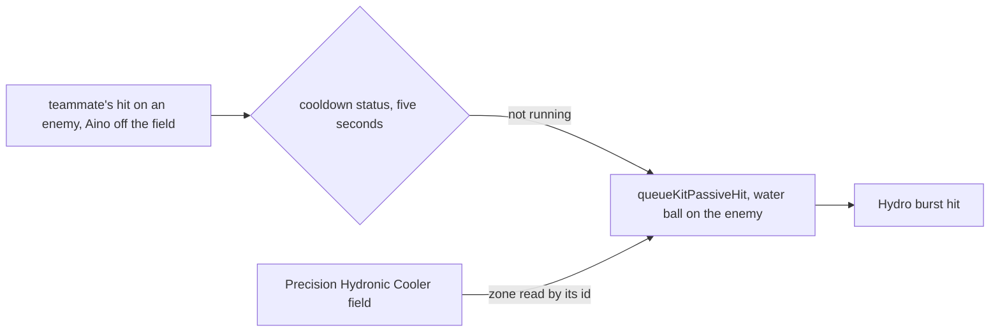

# Aino

Aino's kit is its record and one behaviour module, `createAinoKitBehaviour` (`packages/genshin-world/src/services/kit/characters/ainoKit.ts`), on avatar 10000121 (`{data-root}/genshin-dump-backup-6.6/ExcelBinOutput/AvatarExcelConfigData.json`): her three strikes and charged attack, a plunge collision and two plunges, Musecatcher's two stages, and Cool Your Jets Ducky's Water Balls with the Ascension 4 Elemental Mastery bonus, Constellation 2's water ball on each hit her active teammate lands while she is off the field, Constellation 1's Elemental Mastery, Constellation 4's energy on each skill hit, and Constellation 6's reaction bonus. Her multipliers are read from proud skill groups 12131, 12132 and 12139 (`packages/genshin-world/src/services/kit/characters/ainoKit.ts`). Her skill's cooldown of 10 seconds, the burst's cooldown of 13.5 and energy cost of 50 are read from the same groups (group 12132 index 2, group 12139 indices 2 and 3, in `{data-root}/genshin-dump-backup-6.6/ExcelBinOutput/ProudSkillExcelConfigData.json`), and they match gcsim's values (`{data-root}/cache/gcsim-v2.47.2/internal/characters/aino/skill.go:71`, `{data-root}/cache/gcsim-v2.47.2/internal/characters/aino/burst.go:69`, `{data-root}/cache/gcsim-v2.47.2/internal/characters/aino/aino.go:19`) and the wiki's Precision Hydronic Cooler page's 13.5 seconds and 50 (`{data-root}/cache/genshin-wiki/Category_Aino_Talents.json`).

## Decisions

- **Her strikes land at their hitmarks, with no travel.** gcsim queues each strike's damage at its hitmark, so the strikes land at 23, 20 and 35 and 43 frames (`{data-root}/cache/gcsim-v2.47.2/internal/characters/aino/attack.go:16`), in animations ending at 48, 75 and 93 frames (`{data-root}/cache/gcsim-v2.47.2/internal/characters/aino/attack.go:29`, `{data-root}/cache/gcsim-v2.47.2/internal/characters/aino/attack.go:31`, `{data-root}/cache/gcsim-v2.47.2/internal/characters/aino/attack.go:33`). Their poise is gcsim's, 88.923, 88.512 and 48.3 per hit (`{data-root}/cache/gcsim-v2.47.2/internal/characters/aino/attack.go:17`). The third strike's first hit is a box of 2.5 by 3.5 metres one metre behind the body, and its second a circle of radius 2, as gcsim's boxes are drawn (`{data-root}/cache/gcsim-v2.47.2/internal/characters/aino/attack.go:20`, `{data-root}/cache/gcsim-v2.47.2/internal/characters/aino/attack.go:21`). Her strikes are physical, so they carry no element (`{data-root}/cache/gcsim-v2.47.2/internal/characters/aino/attack.go:47`).
- **Her charged attack is provisional.** gcsim implements no charge for Aino, so her charged attack borrows Ayato's measured claymore charge, as [a borrowed charged attack](../README.md) sets out, 55 frames, a hit at 24 (`{data-root}/cache/gcsim-v2.47.2/internal/characters/ayato/charge.go:16`, `{data-root}/cache/gcsim-v2.47.2/internal/characters/ayato/charge.go:19`), and the reach of a target within the strike area. Its multiplier is the table's at index 4, 1.1309 in the dump's group 12131, and its stamina is the table's at index 5, 40, which group 12131's labels place there. The question is on the [roadmap](../../../../changes/genshin-roadmap/tasks.md).
- **Her plunges are provisional.** Aino has no gcsim plunge file; her plunges use Bennett's timings, as [a borrowed plunge](../README.md) takes them, with the wiki's poise, 200 high and 150 low, and her collision the wiki's 35 (the Bish-Bash-Bosh Repair page's Advanced Properties, titles 7 to 9), under her own multipliers at table indices 7, 8 and 9, which the dump's group 12131 holds at 0.745878, 1.49144 and 1.862889, and the [roadmap](../../../../changes/genshin-roadmap/tasks.md) holds the question.
- **Musecatcher's second stage is struck from the body.** gcsim centres its second stage on the body, a circle of radius 3.5 centred 1.2 metres ahead (`{data-root}/cache/gcsim-v2.47.2/internal/characters/aino/skill.go:17`, `{data-root}/cache/gcsim-v2.47.2/internal/characters/aino/skill.go:18`, `{data-root}/cache/gcsim-v2.47.2/internal/characters/aino/skill.go:60`), and does not carry its poise, as its stage's attack is copied before its own values are set (`{data-root}/cache/gcsim-v2.47.2/internal/characters/aino/skill.go:48` copies it, `{data-root}/cache/gcsim-v2.47.2/internal/characters/aino/skill.go:57` sets the poise on the original). The kit takes the wiki's 60 for it, the Musecatcher page's Stage 2 poise (`{data-root}/cache/genshin-wiki/Category_Aino_Talents.json`), and both stages are Hydro (`{data-root}/cache/gcsim-v2.47.2/internal/characters/aino/skill.go:42`), gauge 1 on the same page (`{data-root}/cache/genshin-wiki/Category_Aino_Talents.json`).
- **Cool Your Jets Ducky's beat is gcsim's, and its count and window are open.** gcsim drops one every 90 frames (`{data-root}/cache/gcsim-v2.47.2/internal/characters/aino/asc.go:10`) from 123 frames (`{data-root}/cache/gcsim-v2.47.2/internal/characters/aino/burst.go:15`), through a loop bounded by 14.2 seconds (`{data-root}/cache/gcsim-v2.47.2/internal/characters/aino/burst.go:46`), so the balls fall at ten ticks, the last at 933 frames, each landing 10 frames after it falls (`{data-root}/cache/gcsim-v2.47.2/internal/characters/aino/burst.go:64`). A ball's hitmark, the frame gcsim queues it at from the burst's start, is therefore the first tick's 123 frames plus those ten, 133 frames, which the kit takes less the first tick to land it from its drop. No line holds that sum, so the overlay marks it `Unsourced`, as it marks the reach below. It stays `Unsourced` until the gcsim reader resolves the burst's multi-value cooldown return, deferred in [gcsim multi-value returns](../../../../deferred/genshin/gcsim-multi-value-returns/design.md). The dump's group 12139 holds 14 seconds at index 1 (`{data-root}/genshin-dump-backup-6.6/ExcelBinOutput/ProudSkillExcelConfigData.json`), and the wiki's Precision Hydronic Cooler page gives a duration of 14s and up to nine balls (`{data-root}/cache/genshin-wiki/Category_Aino_Talents.json`), so the count and the window are open, see [not built](#not-built). Each ball strikes a random enemy within 10 metres of the body (`{data-root}/cache/gcsim-v2.47.2/internal/characters/aino/burst.go:44`, `{data-root}/cache/gcsim-v2.47.2/internal/characters/aino/burst.go:49`), which the kit cannot draw, so each ball's reach is the area it could land in, 11 metres round the body, as Ayato's ticks are. The 11 metres is the field's radius of 10, at `{data-root}/cache/gcsim-v2.47.2/internal/characters/aino/burst.go:44`, plus the ball's hitbox of 1, at `{data-root}/cache/gcsim-v2.47.2/internal/characters/aino/config.yml:87`, and no line gives the sum, so the overlay marks it `Unsourced`. The burst's 852 frames are `14.2*60` (`{data-root}/cache/gcsim-v2.47.2/internal/characters/aino/burst.go:46`), and Ascension 4's half at `{data-root}/cache/gcsim-v2.47.2/internal/characters/aino/asc.go:19`. A ball against several enemies therefore overstates its damage.
- **Her skill's two multipliers match the dump and the wiki at level 1, and their join is `Unsourced`.** gcsim reads them by level from its skill table (`{data-root}/cache/gcsim-v2.47.2/internal/characters/aino/skill.go:49`), and the dump's group 12132 holds 0.656 and 1.888 at indices 0 and 1 (`{data-root}/genshin-dump-backup-6.6/ExcelBinOutput/ProudSkillExcelConfigData.json`), which are the wiki's Musecatcher Stage 1 and Stage 2 values of 65.6% and 188.8% at level 1 (`{data-root}/cache/genshin-wiki/Category_Aino_Talents.json`). No line gives the proud skill group's index the join names, so their causes say so and the published values stand.
- **Ascension 4 adds half her Elemental Mastery to each Water Ball.** gcsim's `a4Dmg` (`{data-root}/cache/gcsim-v2.47.2/internal/characters/aino/asc.go:15`) is read as the balls are cast (`{data-root}/cache/gcsim-v2.47.2/internal/characters/aino/burst.go:62`), at half her Elemental Mastery (`{data-root}/cache/gcsim-v2.47.2/internal/characters/aino/asc.go:19`), and the kit reads the striker's Elemental Mastery the same way (`packages/genshin-world/src/services/kit/characters/ainoKit.ts`).
- **Constellation 6 raises the active member's reactions for fifteen seconds after her burst.** gcsim's "c6OnBurst" (`{data-root}/cache/gcsim-v2.47.2/internal/characters/aino/cons.go:163`) starts a status on Aino, and its `c6Init` (`{data-root}/cache/gcsim-v2.47.2/internal/characters/aino/cons.go:128`) adds a reaction bonus to each member that holds while that member is the active one, 15% on Electro-Charged, Bloom, Lunar-Charged, Lunar-Bloom and Lunar-Crystallize, and 20% more at Ascendant Gleam (`{data-root}/cache/gcsim-v2.47.2/internal/characters/aino/cons.go:145`, `{data-root}/cache/gcsim-v2.47.2/internal/characters/aino/cons.go:146`, `{data-root}/cache/gcsim-v2.47.2/internal/characters/aino/cons.go:147`). The kit starts the status at her burst's start and reads it through `getPartyReactionBonus` (`packages/genshin-world/src/services/kit/characters/ainoKit.ts`), which takes a reaction of the active member's as `damageBonus`. The 15%, the 20% and the 15 seconds are the dump's `paramList` for Constellation 6 (talent `1216`: 0.15, 0.2 and 15, in `{data-root}/genshin-dump-backup-6.6/ExcelBinOutput/AvatarTalentExcelConfigData.json`), and gcsim's `{data-root}/cache/gcsim-v2.47.2/internal/characters/aino/cons.go:150` to `{data-root}/cache/gcsim-v2.47.2/internal/characters/aino/cons.go:153` gives the reactions as the lunar ones, Electro-Charged and Bloom. The reaction list is open against the wiki, see [not built](#not-built).
- **Constellation 4's energy is an internal cooldown on her skill's hits.** gcsim gives her 10 energy on each skill attack that strikes an enemy, behind a 10-second internal cooldown that both stages share, so the kit reads each skill hit's damage and holds the cooldown as a status of her own, `aino-constellation-4` (`packages/genshin-world/src/services/kit/characters/ainoKit.ts`) (`{data-root}/cache/gcsim-v2.47.2/internal/characters/aino/cons.go:114`, `{data-root}/cache/gcsim-v2.47.2/internal/characters/aino/cons.go:123`, `{data-root}/cache/gcsim-v2.47.2/internal/characters/aino/cons.go:125`, `{data-root}/cache/gcsim-v2.47.2/internal/characters/aino/skill.go:67`). The dump's talent `1214` holds 10 energy and 10 seconds, which match (`{data-root}/genshin-dump-backup-6.6/ExcelBinOutput/AvatarTalentExcelConfigData.json`).

- **Constellation 2's water ball is a hit queued on the enemy its teammate struck.** gcsim's `c2Init` (`{data-root}/cache/gcsim-v2.47.2/internal/characters/aino/cons.go:69`) listens for each enemy hit by the active member while Aino is off the field and her burst's status runs (`{data-root}/cache/gcsim-v2.47.2/internal/characters/aino/cons.go:74`, `{data-root}/cache/gcsim-v2.47.2/internal/characters/aino/cons.go:81`, `{data-root}/cache/gcsim-v2.47.2/internal/characters/aino/cons.go:84`, `{data-root}/cache/gcsim-v2.47.2/internal/characters/aino/cons.go:87`), once every five seconds (`{data-root}/cache/gcsim-v2.47.2/internal/characters/aino/cons.go:93`), and queues a Hydro burst hit of 25% of her ATK plus her Elemental Mastery (`{data-root}/cache/gcsim-v2.47.2/internal/characters/aino/cons.go:105`, `{data-root}/cache/gcsim-v2.47.2/internal/characters/aino/cons.go:106`), with the Ascension 4 bonus added to it (`{data-root}/cache/gcsim-v2.47.2/internal/characters/aino/asc.go:15`). The kit queues the water ball on the enemy with `queueKitPassiveHit` (`packages/genshin-world/src/services/kit/characters/ainoKit.ts`), reading the zone as the field `Precision Hydronic Cooler` by its id, and the cooldown as a status of her own, `aino-constellation-2-cooldown`. The 25% and 100% shares and the five seconds are the dump's `paramList` for Constellation 2 (talent `1212`: 0.25, 1.0 and 5, in `{data-root}/genshin-dump-backup-6.6/ExcelBinOutput/AvatarTalentExcelConfigData.json`), which gcsim's `{data-root}/cache/gcsim-v2.47.2/internal/characters/aino/cons.go:93` and `{data-root}/cache/gcsim-v2.47.2/internal/characters/aino/cons.go:105` use, written as constants beside the switch, as Constellation 4's are; the kit does not read the table yet, so the numbers are provisional until it does.

## Not built

- **Ascension 1 at Ascendant Gleam drops the balls every 0.7 seconds, each landing with a 4 metre radius, which is open.** gcsim's `{data-root}/cache/gcsim-v2.47.2/internal/characters/aino/asc.go:12` gives the balls that interval (`0.7 * 60`) and radius (4), read as the burst is cast, but the wiki's Precision Hydronic Cooler page gives every 0.75 seconds and up to 20 balls, so the interval is open. The landing circle's reach is the kit's proxy for the random enemy a ball falls on: the 10 metre search plus the ball's radius, which is 11 metres at the base and 14 at Ascension 1.
- **Each Water Ball is under an internal cooldown: the burst's at base, and its moon hit's at Ascension 1 at Ascendant Gleam.** The record takes the elemental burst's tag from the wiki's Precision Hydronic Cooler row, and gcsim's `{data-root}/cache/gcsim-v2.47.2/internal/characters/aino/asc.go` gives the moon hit's where its a1BurstEnhance gives the Ascendant interval, so a ball's strikes share one cooldown per tag. Constellation 2's ball has none, as `{data-root}/cache/gcsim-v2.47.2/internal/characters/aino/cons.go` gives it.
- **Constellation 2's ball strikes the enemy it is queued on alone.** gcsim queues it as a circle of 1.5 metres about that enemy (`{data-root}/cache/gcsim-v2.47.2/internal/characters/aino/cons.go:109`), which also reaches the enemies beside it. The kit's ball does not yet reach the enemies beside it, as the [kits README](../README.md#targeting) gives for a strike aimed at one target.
- **Constellation 1's Elemental Mastery is a buff on Aino and on the member on the field.** gcsim's `c1Init` (`{data-root}/cache/gcsim-v2.47.2/internal/characters/aino/cons.go:23`) gives 80 Elemental Mastery to Aino for fifteen seconds from her skill or burst (c1OnSkillBurst, `{data-root}/cache/gcsim-v2.47.2/internal/characters/aino/cons.go:61`), and to the active member other than her while it runs. The dump's talent `1211` holds the 80 and the fifteen seconds. Aino's own copy holds whoever is active, as gcsim's self mod does. The kit gives her the buff from her skill or burst, sourced to her status so a recast restarts it, and gives the member a swap brings on the buff for what is left of the status, ended when that member leaves the field. A passive reads only its own combatant, so the member on the field takes a buff, which `getBuffedCombatant` adds to its attribute total.
- **Cool Your Jets Ducky's count and window are open.** The wiki's Precision Hydronic Cooler page gives a 14 second duration and up to nine balls, the dump's group 12139 gives 14 seconds, and gcsim's loop runs 14.2 seconds for ten balls (`{data-root}/cache/gcsim-v2.47.2/internal/characters/aino/burst.go:46`), so the kit's 852-frame window and ten balls are gcsim's alone.
- **The reactions Constellation 6 raises are open.** The cached wiki holds Constellation 6's name in the Precision Hydronic Cooler page, not its text, and gcsim's `{data-root}/cache/gcsim-v2.47.2/internal/characters/aino/cons.go:150` to `{data-root}/cache/gcsim-v2.47.2/internal/characters/aino/cons.go:153` also counts Bountiful Core damage, which the kit does not.
- **Musecatcher's hold is not built, as gcsim does not implement it either.** Her skill's particles are not granted by the kit.
- **Her Ascension 1 passive, Modular Efficiency Protocol, is built as the burst's enhancement at Ascendant Gleam (`packages/genshin-world/src/services/kit/characters/ainoKit.ts`).** The field's interval and radius are fixed at its cast, so the level is read as the burst is cast, as gcsim reads it (`{data-root}/cache/gcsim-v2.47.2/internal/characters/aino/burst.go:31`). Her Ascension 4 passive, Structured Power Booster, is built as the water ball's Elemental Mastery bonus (`packages/genshin-world/src/services/kit/characters/ainoKit.ts`). The talent levels above the level the kit is built at are the [talents](../../talents/design.md) and [constellations](../../../../changes/genshin-constellations/design.md) pages'.

## Key files

| File                                                            | Role                                                                                                                                                   |
| :-------------------------------------------------------------- | :----------------------------------------------------------------------------------------------------------------------------------------------------- |
| `packages/genshin-world/src/services/kit/characters/ainoKit.ts` | `createAinoKitBehaviour`, Aino's strikes, provisional charged attack and plunges, Musecatcher, and Cool Your Jets Ducky's Water Balls with Ascension 4 |

## Sources

- [gcsim](https://github.com/genshinsim/gcsim/tree/v2.47.2/internal/characters/aino), MIT: each strike's hitmark, animation, poise and shape, Musecatcher's stages, and Cool Your Jets Ducky's interval, duration, radius and landing delay, read from `attack.go`, `skill.go`, `burst.go`, `asc.go` and `cons.go`.
- The proud skill groups' indices, read from gcsim's data file for the character, and the group values of the hosted game data, which the dump's `{data-root}/genshin-dump-backup-6.6/ExcelBinOutput/ProudSkillExcelConfigData.json` and `{data-root}/genshin-dump-backup-6.6/ExcelBinOutput/AvatarTalentExcelConfigData.json` (talents `1211` to `1216`) confirm for the values cited above.
- The wiki pages cached at `{data-root}/cache/genshin-wiki/Category_Aino_Talents.json`: the Bish-Bash-Bosh Repair, Musecatcher and Precision Hydronic Cooler pages, for the poise, the gauge, the duration, the cooldowns and the interval the open items name.
- [gcsim](https://github.com/genshinsim/gcsim/tree/v2.47.2/internal/characters/ayato), MIT: the claymore charge's frames and reach, borrowed as Aino's charged attack's are provisional.
- [gcsim](https://github.com/genshinsim/gcsim/blob/v2.47.2/internal/characters/bennett/plunge.go), MIT: the plunges' timings, borrowed as Aino's own folder has no plunge file.
- [Musecatcher](https://genshin-impact.fandom.com/wiki/Musecatcher), [Bish-Bash-Bosh Repair](https://genshin-impact.fandom.com/wiki/Bish-Bash-Bosh_Repair) and [Precision Hydronic Cooler](https://genshin-impact.fandom.com/wiki/Precision_Hydronic_Cooler), Genshin Impact Wiki: the poise of Musecatcher's two stages, the Water Ball, the plunges and the collision.
- Requirement "Ascension 1 at Ascendant Gleam drops the Water Balls faster and wider": the wiki gives 0.75 seconds.
- Requirement "Constellation 6 raises the active member's reactions for fifteen seconds after the burst": against the wiki's text, which the cache does not hold.

## Open

- [ ] **Each ball's reach of 11 metres round the body** — no source yet: no line gives the sum of the field's radius of 10 and the ball's hitbox of 1.
- [ ] **The join of the skill's two multipliers to group 12132's indices 0 and 1** — no source yet: no line gives the proud skill group index the join names.
