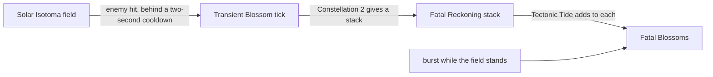

# Albedo

Albedo's kit is its record and one behaviour module, `createAlbedoKitBehaviour`, avatar 10000038 (`{data-root}/genshin-dump-backup-6.6/ExcelBinOutput/AvatarExcelConfigData.json`): five strikes (`{data-root}/cache/gcsim-v2.47.2/internal/characters/albedo/attack.go:16`), a charged attack of two hits (`{data-root}/cache/gcsim-v2.47.2/internal/characters/albedo/charge.go:16`), a collision and two plunges (`{data-root}/cache/gcsim-v2.47.2/internal/characters/albedo/plunge.go:21`, `{data-root}/cache/gcsim-v2.47.2/internal/characters/albedo/plunge.go:22`), Abiogenesis: Solar Isotoma with its hit and the Transient Blossoms it sets off, and Rite of Progeniture: Tectonic Tide with its Fatal Blossoms. His multipliers are read from proud skill groups 3831, 3832 and 3839; the charged attack's stamina, the field's seconds and cooldown, and the burst's cooldown and energy cost are read from the same groups (`{data-root}/genshin-dump-backup-6.6/ExcelBinOutput/ProudSkillExcelConfigData.json`, with the wiki's `stamina=20` and `cd=12s` in `{data-root}/cache/genshin-wiki/Category_Albedo_Talents.json`). A Transient Blossom's tick is priced by his DEF (`{data-root}/cache/gcsim-v2.47.2/internal/characters/albedo/skill.go:61`), and the Fatal Blossoms come only while the field stands (`{data-root}/cache/gcsim-v2.47.2/internal/characters/albedo/burst.go:65`). Constellation 1 is built: each Transient Blossom regenerates 1.2 Energy for Albedo (`{data-root}/cache/gcsim-v2.47.2/internal/characters/albedo/skill.go:141`, and the dump's talent 381 at `{data-root}/genshin-dump-backup-6.6/ExcelBinOutput/AvatarTalentExcelConfigData.json` holds 1.2), and his Solar Isotoma raises his DEF by 50% for 20 seconds, which is open, see [not built](#not-built). Both passives are built: from Ascension 1, Calcite Might makes a Transient Blossom deal 25% more DMG to an enemy under half its HP, read as the blossom strikes (`{data-root}/cache/gcsim-v2.47.2/internal/characters/albedo/asc.go:22`, `{data-root}/cache/gcsim-v2.47.2/internal/characters/albedo/asc.go:33`), and from Ascension 4 the team's Elemental Mastery rises under Tectonic Tide by 125 (`{data-root}/cache/gcsim-v2.47.2/internal/characters/albedo/asc.go:47`). Constellation 2 is built: each Transient Blossom gives Albedo a Fatal Reckoning stack (`{data-root}/cache/gcsim-v2.47.2/internal/characters/albedo/skill.go:146`), which Tectonic Tide adds to each Fatal Blossom but not to its own first hit. Constellation 4's plunging attack bonus is built, as a buff on the active member alone on the Plunging Attack bonus attribute, checked on gcsim's 0.3-second clock (`{data-root}/cache/gcsim-v2.47.2/internal/characters/albedo/cons.go:33`, `{data-root}/cache/gcsim-v2.47.2/internal/characters/albedo/cons.go:37`, `{data-root}/cache/gcsim-v2.47.2/internal/characters/albedo/skill.go:75`). Constellation 6's DMG bonus is built too, on the active member within the field while a Crystallize shield protects it (`{data-root}/cache/gcsim-v2.47.2/internal/characters/albedo/cons.go:68`, `{data-root}/cache/gcsim-v2.47.2/internal/characters/albedo/cons.go:69`) or a Moondrift stands within the field.

## Decisions

- **Transient Blossoms trigger on a hit inside the Solar Isotoma, once every 2 seconds.** gcsim's field strikes on damage in its area behind one 2-second internal cooldown (`{data-root}/cache/gcsim-v2.47.2/internal/characters/albedo/skill.go:129`), and here the hit's enemy must stand within the field's radius of 10 (`{data-root}/cache/gcsim-v2.47.2/internal/characters/albedo/skill.go:53`, checked at `{data-root}/cache/gcsim-v2.47.2/internal/characters/albedo/skill.go:124`), the tick landing at that enemy a frame later (`{data-root}/cache/gcsim-v2.47.2/internal/characters/albedo/skill.go:131` to `{data-root}/cache/gcsim-v2.47.2/internal/characters/albedo/skill.go:135`, a circle of 3.4 at a delay of 1). The tick's multiple is of DEF, so its hit takes no ATK, and the Fatal Blossoms come with the burst while the field stands.

- **Abiogenesis's press hit belongs to the Solar Isotoma, so `skill.hits` is empty.** The field spawns as its hit lands, so the record reads that hit at `hits.solarIsotoma` and keeps `skill.hits` empty, where gcsim counts one (`{data-root}/cache/gcsim-v2.47.2/internal/characters/albedo/skill.go:55`, its one `QueueAttackWithSnap` at the 25-frame hitmark of `{data-root}/cache/gcsim-v2.47.2/internal/characters/albedo/skill.go:16`).
- **Fatal Blossoms take their hitmarks from one cited array, and their area is `DiffersFromSource`.** gcsim queues the seven blossoms in a loop of "maxBlossoms" (`{data-root}/cache/gcsim-v2.47.2/internal/characters/albedo/burst.go:78`) at line 96, `fatalBlossomHitmark+i*5`, inside the burst's queue with `burstHitmark` as its delay (`{data-root}/cache/gcsim-v2.47.2/internal/characters/albedo/burst.go:99`), so the overlay cites `hits.fatalBlossoms.0-6.hitmarkFrames` as one array of 145 to 175 by element. Their area is a circle of 3 on the blossom's own centre (`{data-root}/cache/gcsim-v2.47.2/internal/characters/albedo/burst.go:95`), which the hitbox reader does not resolve, their poise is 30 (`{data-root}/cache/gcsim-v2.47.2/internal/characters/albedo/burst.go:69`), their gauge and cooldown tag are the wiki's, 1 and `ElementalBurst`, from the Tectonic Tide page's Fatal Blossom row (`{data-root}/cache/genshin-wiki/Category_Albedo_Talents.json`), shared by the run, their element and multiplier are gcsim's (`{data-root}/cache/gcsim-v2.47.2/internal/characters/albedo/burst.go:35`, and the dump's group 3839 index 1 at 0.72 (`{data-root}/genshin-dump-backup-6.6/ExcelBinOutput/ProudSkillExcelConfigData.json`), the wiki's 72% at level 1 (`{data-root}/cache/genshin-wiki/Category_Albedo_Talents.json`)), shared by the run, and their blunt flag is `Unsourced` with the same reason.
- **Fatal Reckoning is flat damage on each Fatal Blossom, and its share of the burst's first hit is open.** gcsim adds 30% of Albedo's DEF per stack as flat damage to the burst's first hit (`{data-root}/cache/gcsim-v2.47.2/internal/characters/albedo/burst.go:46`, read at the burst's start) and to the blossoms (`{data-root}/cache/gcsim-v2.47.2/internal/characters/albedo/burst.go:74`), and the record reads that DEF with her buffs on, as her blossoms are priced. The record plays the burst's first hit with no per-cast override, so only the blossoms carry the bonus here; the first hit's share is the open part of Constellation 2, see [not built](#not-built).

- **Constellation 6's DMG bonus shares Constellation 4's check, and reads the team's Crystallize shield or a Moondrift in the field.** gcsim's `c6` (`{data-root}/cache/gcsim-v2.47.2/internal/characters/albedo/cons.go`) runs on the same 0.3-second clock from the same skill frame as `c4` (`{data-root}/cache/gcsim-v2.47.2/internal/characters/albedo/skill.go:75` and `{data-root}/cache/gcsim-v2.47.2/internal/characters/albedo/skill.go:78`), so the kit checks both on one status. The check gives the active member, while it stands in the standing Solar Isotoma's field, 17% DMG for a second on `Attribute.AllDamageBonus`, when a live Crystallize shield in the kit's effects, which is the team's, or a Moondrift of the party's lunar crystallize within the field's radius, holds. The shield clause is gcsim's (`{data-root}/cache/gcsim-v2.47.2/internal/characters/albedo/cons.go:68`, `{data-root}/cache/gcsim-v2.47.2/internal/characters/albedo/cons.go:69`), and the 17% is gcsim's own literal (`{data-root}/cache/gcsim-v2.47.2/internal/characters/albedo/cons.go:73`), not the dump's: the dump's talent `386` (`{data-root}/genshin-dump-backup-6.6/ExcelBinOutput/AvatarTalentExcelConfigData.json`), Constellation 6, holds 20 and 2.5. gcsim does not read Moondrifts, and the kit reads them as the game's text is said to name them, which is open, see [not built](#not-built).
- **Constellation 4's plunge bonus is the active member's buff on an attribute, read at pricing, on gcsim's 0.3-second clock.** gcsim's `{data-root}/cache/gcsim-v2.47.2/internal/characters/albedo/cons.go` raises the Plunging Attack DMG of the active party member while it stands in the standing Solar Isotoma's field (`{data-root}/cache/gcsim-v2.47.2/internal/characters/albedo/cons.go:33`), for a second, and checks the field every 0.3 seconds from the skill's hitmark, when the Solar Isotoma is made (`{data-root}/cache/gcsim-v2.47.2/internal/characters/albedo/skill.go:75` starts the first check 18 frames after the spawn, and `{data-root}/cache/gcsim-v2.47.2/internal/characters/albedo/cons.go:50` queues each one after). Albedo's kit starts the check's status at the press, for the hitmark plus 0.3 seconds, so the first check runs 0.3 seconds after the Solar Isotoma's spawn, and each check starts a 0.3-second status of its own. A check that finds the field standing refreshes a buff of 30% (`{data-root}/cache/gcsim-v2.47.2/internal/characters/albedo/cons.go:37`, a 60-frame base at `{data-root}/cache/gcsim-v2.47.2/internal/characters/albedo/cons.go:39`) on `Attribute.PlungingAttackDamageBonus` for the active member alone, which `strikeEnemy` adds to a plunge's damage bonus, so a teammate's plunge is not raised. A Solar Isotoma whose seconds have run out is not standing, though the step has not yet dropped it, so neither a check nor the burst's Fatal Blossoms take it.

## Not built

- **The first hit's Fatal Reckoning share is open.** gcsim's `{data-root}/cache/gcsim-v2.47.2/internal/characters/albedo/burst.go:46` gives the burst's first hit the stacks' 30% of DEF as well as the blossoms, and the record plays that hit with no per-cast override, so the kit's first hit takes none.
- **Constellation 1's 50% DEF for 20 seconds is open.** The dump's talent `381` holds 1.2, 0.5 and 20, which match the energy and the kit's values, but gcsim gives Albedo no defence buff for it, and the local English text map does not hold the talent's wording under its hash, so the attribute is not sourced.
- **Constellation 6's Moondrift clause is open.** gcsim does not read Moondrifts, and the local English text map holds neither the talent's name under its hash (`3605874945`) nor the phrase the design quotes, so the clause has no source.
- **Calcite Might's second clause is not built.** The wiki's Calcite Might page also adds 240% of Albedo's DEF to each Transient Blossom while a Solar Isotoma of his stands, which neither gcsim (`{data-root}/cache/gcsim-v2.47.2/internal/characters/albedo/asc.go:22`, the 25% only) nor the kit gives.

## Key files

| File                                                              | Role                                                                                                                      |
| :---------------------------------------------------------------- | :------------------------------------------------------------------------------------------------------------------------ |
| `packages/genshin-world/src/services/kit/characters/albedoKit.ts` | `createAlbedoKitBehaviour`, Albedo's kit with Solar Isotoma, its Transient Blossoms, Tectonic Tide and the Fatal Blossoms |

## Sources

- [gcsim v2.47.2](https://github.com/genshinsim/gcsim/tree/v2.47.2/internal/characters/albedo), MIT: Albedo's strikes' hitmarks and cancels, the charged attack, Solar Isotoma's hit and its Transient Blossom's tick, Tectonic Tide's and the Fatal Blossoms' frames and areas, and Constellation 2's and the passives' values, read for the reach they give, and Constellation 4's Plunging Attack DMG raise of 30% for a second, grounding the requirement "Constellation 4 raises the active member's plunges inside the Solar Isotoma".
- The dump's proud skill groups `3831`, `3832` and `3839`, and its talents `381` to `386`, which hold Constellations 1 to 6, read from `{data-root}/genshin-dump-backup-6.6/ExcelBinOutput/ProudSkillExcelConfigData.json` and `{data-root}/genshin-dump-backup-6.6/ExcelBinOutput/AvatarTalentExcelConfigData.json`.
- The wiki pages cached at `{data-root}/cache/genshin-wiki/Category_Albedo_Talents.json`: Abiogenesis: Solar Isotoma (duration 30 seconds, cooldown 4 seconds), Rite of Progeniture: Tectonic Tide (the Fatal Blossom row's gauge, tag and poise, and its 12-second cooldown and 40 energy) and Calcite Might.
