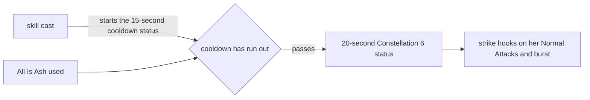

# Arlecchino

Arlecchino's kit is its record and one behaviour module, `createArlecchinoKitBehaviour`, on avatar 10000096 (`{data-root}/genshin-dump-backup-6.6/ExcelBinOutput/AvatarExcelConfigData.json`): six strikes, a charged attack, a collision and two plunges, All Is Ash's Spike and Cleave, and Balemoon Rising. Her multipliers read proud groups 9631, 9632 and 9639 at her talent level, and match gcsim's values to four decimal places (`{data-root}/genshin-dump-backup-6.6/ExcelBinOutput/ProudSkillExcelConfigData.json`, `{data-root}/cache/gcsim-v2.47.2/internal/characters/arlecchino/zz_arlecchino.dm.go`). Her strikes, shot and plunges are physical, as gcsim has them with the Bond of Life off (`{data-root}/cache/gcsim-v2.47.2/internal/characters/arlecchino/attack.go`, line 123, `{data-root}/cache/gcsim-v2.47.2/internal/characters/arlecchino/charge.go`, line 58, `{data-root}/cache/gcsim-v2.47.2/internal/characters/arlecchino/plunge.go`, line 89). Her multipliers and costs read the dump's groups at her talent level: group 9631's index 7 is her charged attack's 25 stamina, and group 9639 holds the burst's 3.704, 15 seconds and 60 energy (`{data-root}/genshin-dump-backup-6.6/ExcelBinOutput/ProudSkillExcelConfigData.json`). The gcsim file names in this page (`{data-root}/cache/gcsim-v2.47.2/internal/characters/arlecchino/attack.go`, `{data-root}/cache/gcsim-v2.47.2/internal/characters/arlecchino/cons.go` and the rest) are in `{data-root}/cache/gcsim-v2.47.2/internal/characters/arlecchino/`.

## Decisions

- **Each strike's reach is its box or circle's offset plus its radius.** gcsim places each hitbox at an offset from her body (`{data-root}/cache/gcsim-v2.47.2/internal/characters/arlecchino/attack.go`, line 47 to line 54), so it is priced by [the hitbox rule](../README.md) (`packages/genshin-world/src/services/kit/characters/arlecchinoKit.ts`). The fan of her second strike is priced at its 2.6 radius (`{data-root}/cache/gcsim-v2.47.2/internal/characters/arlecchino/attack.go`, line 32) and 0.5 offset (`{data-root}/cache/gcsim-v2.47.2/internal/characters/arlecchino/attack.go`, line 49), with its 300 degree sweep kept (`{data-root}/cache/gcsim-v2.47.2/internal/characters/arlecchino/attack.go`, line 56).
- **The fourth strike's two hits are both 3 in the attack group.** They land at 24 and 35 frames (`{data-root}/cache/gcsim-v2.47.2/internal/characters/arlecchino/attack.go`, line 18) within its 55-frame animation (`{data-root}/cache/gcsim-v2.47.2/internal/characters/arlecchino/attack.go`, line 80), as gcsim has them.
- **The charged attack is a circle of radius 4 centred 0.9 metres ahead of its target,** priced at the targeting area's radius plus 4.9, 9.9 metres (`{data-root}/cache/gcsim-v2.47.2/internal/characters/arlecchino/charge.go`, line 73 to line 77), hitting at 37 frames (`{data-root}/cache/gcsim-v2.47.2/internal/characters/arlecchino/charge.go`, line 14) of its 60-frame animation (`{data-root}/cache/gcsim-v2.47.2/internal/characters/arlecchino/charge.go`, line 17). It costs the table's 25 stamina (`{data-root}/genshin-dump-backup-6.6/ExcelBinOutput/ProudSkillExcelConfigData.json`, group 9631 index 7).
- **The plunges are gcsim's.** The low and high plunges land at 47 and 48 frames (`{data-root}/cache/gcsim-v2.47.2/internal/characters/arlecchino/plunge.go`, line 21, `:22`), with circles of radius 3 and 5 one metre ahead (`{data-root}/cache/gcsim-v2.47.2/internal/characters/arlecchino/plunge.go`, line 28, `:33`, `:101`, `:157`), and poise 100 and 150 (`{data-root}/cache/gcsim-v2.47.2/internal/characters/arlecchino/plunge.go`, line 27, `:32`). The collision is a circle of radius 1, queued 41 frames into a plunge (`{data-root}/cache/gcsim-v2.47.2/internal/characters/arlecchino/plunge.go`, line 23, `:190`), as gcsim queues it. The kit strikes it on every plunge that ends among enemies, not only when gcsim's `collision` option is set (`{data-root}/cache/gcsim-v2.47.2/internal/characters/arlecchino/plunge.go`, line 59): that option only tells gcsim's simulator to assume the contact, so the kit keeps its own rule (`packages/genshin-world/src/services/kit/characters/arlecchinoKit.ts`).
- **Cleave's reach is measured from different points.** gcsim's circle reaches 10.5 metres from the target, as the [roadmap](../../../../changes/genshin-roadmap/tasks.md) gives it. The kit centres the circle on Arlecchino's body and reaches 10.5 metres from there (gcsim's `{data-root}/cache/gcsim-v2.47.2/internal/characters/arlecchino/skill.go`, line 63), so the kit's reach is understated for targets far from her body. The question stays open on the roadmap.
- **Balemoon Rising hits once at 110 frames of its 146** (`{data-root}/cache/gcsim-v2.47.2/internal/characters/arlecchino/burst.go`, line 13, `:20`), a circle of radius 6.5 six metres ahead (`{data-root}/cache/gcsim-v2.47.2/internal/characters/arlecchino/burst.go`, line 40), priced at 12.5 metres, with 3.704 of the table's multiplier (`{data-root}/genshin-dump-backup-6.6/ExcelBinOutput/ProudSkillExcelConfigData.json`, group 9639 index 0, `{data-root}/cache/gcsim-v2.47.2/internal/characters/arlecchino/zz_arlecchino.dm.go`), a gauge of 1 (the wiki's 1U, `{data-root}/cache/genshin-wiki/Category_Arlecchino_Talents.json`), and the table's cooldown of 15 seconds (`{data-root}/cache/gcsim-v2.47.2/internal/characters/arlecchino/burst.go`, line 55) on 60 energy (its maximum, `{data-root}/cache/gcsim-v2.47.2/internal/characters/arlecchino/arlecchino.go:25`; the dump's group 9639 index 5, the wiki's 60, `{data-root}/genshin-dump-backup-6.6/ExcelBinOutput/ProudSkillExcelConfigData.json`).
- **Her skill's cooldown is the table's 30 seconds** (`{data-root}/cache/gcsim-v2.47.2/internal/characters/arlecchino/skill.go`, line 67).
- **Constellation 6's CRIT starts at All Is Ash, for 20 seconds, once every 15.** gcsim's `c6skill` (`{data-root}/cache/gcsim-v2.47.2/internal/characters/arlecchino/cons.go`, line 91) gives 10% CRIT Rate and 70% CRIT DMG (`{data-root}/cache/gcsim-v2.47.2/internal/characters/arlecchino/cons.go`, line 102 and `:103`) to her Normal Attacks and Balemoon Rising (`{data-root}/cache/gcsim-v2.47.2/internal/characters/arlecchino/cons.go`, line 107 to line 110) for 20 seconds (`{data-root}/cache/gcsim-v2.47.2/internal/characters/arlecchino/cons.go`, line 105), behind a 15-second internal cooldown started on each skill cast (`{data-root}/cache/gcsim-v2.47.2/internal/characters/arlecchino/cons.go`, line 99). The kit starts the cooldown as a status of her own, `arlecchino-constellation-6-cooldown`, and on a pass gives the 20-second status `arlecchino-constellation-6`, which its strike hooks read on her own Normal Attacks and burst (`packages/genshin-world/src/services/kit/characters/arlecchinoKit.ts`). The values are the dump's `paramList` for Constellation 6 (0.1, 0.7, 20 and 15, talent `966` in `{data-root}/genshin-dump-backup-6.6/ExcelBinOutput/AvatarTalentExcelConfigData.json`), and gcsim's `{data-root}/cache/gcsim-v2.47.2/internal/characters/arlecchino/cons.go`, line 107 to line 110 names the same Normal Attacks and Elemental Burst. The game's own text for the talent (`{data-root}/genshin-parity/text/TextMap/TextMap_MediumEN.json`, hash 4255841423) gives the same 10% CRIT Rate, 70% CRIT DMG, 20 seconds and once every 15 seconds.

- **Balemoon Rising resets her skill's cooldown 107 frames in.** gcsim's `{data-root}/cache/gcsim-v2.47.2/internal/characters/arlecchino/burst.go` queues `ResetActionCooldown(action.ActionSkill)` at that frame (`{data-root}/cache/gcsim-v2.47.2/internal/characters/arlecchino/burst.go`, line 43), and the kit schedules the same reset as a task that zeroes her party member's skill cooldown (`packages/genshin-world/src/services/kit/characters/arlecchinoKit.ts`).

## Not built

- **Bond of Life, the strikes' Pyro variant, is not built.** While it is up, her strikes and charged attack are Pyro and add a bonus that scales with her HP debt, and each strike consumes some of that debt. The Bond of Life hook it sits on is built; the HP debt it scales with is not, so it waits on the HP-debt hook alone.
- **The Masque of the Red Death's debt damage waits on the HP-debt hook.** It adds to her strikes and charged attack as a share of her debt and her total ATK, and its ascension and constellation bonuses go with it.
- **The Blood-Debt Directive, the sigils her Cleave sets off, waits on the HP-debt hook.** Its debt limit, its Pyro sigils and its ticks all wait on it.
- **Balemoon Rising's heal waits on the HP-debt hook,** as it is paid from her debt.
- **Her utility passive is built, from no ascension,** the Balemoon Alone May Know's 40% Pyro DMG Bonus (`{data-root}/cache/gcsim-v2.47.2/internal/characters/arlecchino/asc.go`, line 17, name in `{data-root}/genshin-dump-backup-6.6/TextMap/TextMap_MediumEN.json`). Her Ascension 1 passive waits on the HP-debt hook, which its Blood-Debt Directives read, and her Ascension 4 passive's RES is not built, as gcsim v2.47.2 models no Resistances. Constellations 1, 2 and 4 each need the Masque of the Red Death or a Blood-Debt Directive's absorption, which the kit does not record, and Constellation 6's added damage to Balemoon Rising is not built, as it reads Bond of Life's percentage.

## Key files

| File                                                                  | Role                                                                                                                           |
| :-------------------------------------------------------------------- | :----------------------------------------------------------------------------------------------------------------------------- |
| `packages/genshin-world/src/services/kit/characters/arlecchinoKit.ts` | `createArlecchinoKitBehaviour`, Arlecchino's kit with her six strikes, charged attack, plunges, All Is Ash and Balemoon Rising |

## Sources

- [gcsim](https://github.com/genshinsim/gcsim/tree/v2.47.2/internal/characters/arlecchino), MIT: the kit's hitmarks and animations, the hitboxes and their offsets, the plunge and burst circles, the poise of the plunges, and the proud group indices behind each multiplier, cost and cooldown.
- The dump's proud skill groups `9631`, `9632` and `9639`, and its talents `961` to `966`, read from `{data-root}/genshin-dump-backup-6.6/ExcelBinOutput/ProudSkillExcelConfigData.json` and `{data-root}/genshin-dump-backup-6.6/ExcelBinOutput/AvatarTalentExcelConfigData.json`, which hold Constellation 6's 0.1, 0.7, 20 and 15.
- The wiki pages cached at `{data-root}/cache/genshin-wiki/Category_Arlecchino_Talents.json`, for Balemoon Rising's 1U gauge, its 15-second cooldown and 60 energy.
