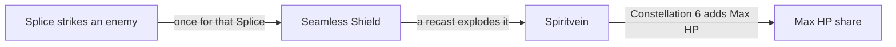

# Baizhu

Baizhu's kit is its record and one behaviour module, `createBaizhuKitBehaviour`, on avatar 10000082 (`{data-root}/genshin-dump-backup-6.6/ExcelBinOutput/AvatarExcelConfigData.json`): four strikes (`{data-root}/cache/gcsim-v2.47.2/internal/characters/baizhu/attack.go` line 17), a charged attack, a collision and two plunges (`{data-root}/cache/genshin-wiki/Category_Baizhu_Talents.json`), Universal Diagnosis's first hit (`{data-root}/cache/gcsim-v2.47.2/internal/characters/baizhu/skill.go` lines 26 and 61), and Holistic Revivification's seamless shield (`{data-root}/cache/gcsim-v2.47.2/internal/characters/baizhu/burst.go` lines 34 to 38), Constellations 1, 4 and 6 (`{data-root}/cache/gcsim-v2.47.2/internal/characters/baizhu/cons.go` lines 17, 77 and 94), and Constellation 2's Gossamer Sprite: Splice without its heal (`{data-root}/cache/gcsim-v2.47.2/internal/characters/baizhu/cons.go` line 25), with Constellation 6's Spiritvein damage (`{data-root}/genshin-dump-backup-6.6/ExcelBinOutput/AvatarTalentExcelConfigData.json`, talent `826`) and the Seamless Shield its Splice makes. His multipliers are read from proud skill groups 8231, 8232 and 8239 (`{data-root}/genshin-dump-backup-6.6/ExcelBinOutput/ProudSkillExcelConfigData.json`); the charged attack's stamina, the skill's cooldown, and the burst's cooldown and energy cost are read from the same groups (`packages/genshin-world/src/services/kit/characters/baizhuKit.ts`). The shield absorbs his share of Max HP plus its flat amount (`{data-root}/cache/gcsim-v2.47.2/internal/characters/baizhu/burst.go` line 66). It lasts to the frame gcsim gives its first expiry (`{data-root}/cache/gcsim-v2.47.2/internal/characters/baizhu/burst.go:70`, with the expiry of 152 frames at `{data-root}/cache/gcsim-v2.47.2/internal/characters/baizhu/burst.go:19`, after the 81-frame shield at `{data-root}/cache/gcsim-v2.47.2/internal/characters/baizhu/burst.go:38`), and five recasts, every 146 frames from 223 frames (`{data-root}/cache/gcsim-v2.47.2/internal/characters/baizhu/burst.go:41` and `{data-root}/cache/gcsim-v2.47.2/internal/characters/baizhu/burst.go:45`, 81 plus 142 frames, then 146 each, from the constants at `{data-root}/cache/gcsim-v2.47.2/internal/characters/baizhu/burst.go` lines 16 to 18), each explode the shield they replace as Spiritvein, which strikes the enemies within the skill's reach at its ATK multiple (`{data-root}/cache/gcsim-v2.47.2/internal/characters/baizhu/burst.go` lines 67 to 69 for the explosion, 95 for its multiple and 103 for its reach). His plunges take Bennett's timings and the wiki's poise, as his gcsim folder has no plunge file; these are provisional. From Ascension 1, Five Fortunes Forever raises each of his Dendro hits by 25% DMG while the character on the field is at half their HP or more, read off the party as the strike lands (`{data-root}/cache/gcsim-v2.47.2/internal/characters/baizhu/asc.go:27`, `{data-root}/cache/gcsim-v2.47.2/internal/characters/baizhu/asc.go:36`, `{data-root}/cache/gcsim-v2.47.2/internal/characters/baizhu/asc.go:42`).

Not built yet: Universal Diagnosis's bounces to the next nearby enemy and its heal at the chain's end, which need a hit that picks each bounce's target; the Seamless Shield's heals on each recast and on its removal, which the recast field's tick and the shield's `EffectExpired` can give the active character through `changeKitMemberHealth`; Constellation 2's heal, 20% of the Gossamer Sprite's normal healing (`cons.go:67`, the dump's talent `822` at 0.2), which the record holds no value for; the Seamless Shield a Gossamer Sprite's own hit makes under Constellation 6, which waits on the Sprite's bounces; Ascension 1's 20% Healing Bonus while the character on the field is below half HP, which no heal of his reads yet, and which a passive bonus cannot price from the field's HP, as a passive is given only its wearer's HP share; and his Ascension 4 passive, which rides the Seamless Shield's heals.

## Decisions

- **Baizhu's plunges take Bennett's timings, as [a borrowed plunge](../README.md) does, and the wiki's poise.** His gcsim folder has no plunge file, so his collision, low and high plunge land at Bennett's frames (30, 36 and 38 frames for the collision and the hits, `{data-root}/cache/gcsim-v2.47.2/internal/characters/bennett/plunge.go:21` to `:23`), with the wiki's 50 and 100 poise for the low and high plunges (the Baizhu page's Advanced Properties, titles 8 and 9) and his own multipliers, as the record gives them; his animation showing otherwise would move them.

- **Constellation 6 adds Max HP to the Spiritveins and makes a Seamless Shield from each Splice that strikes.** The Spiritvein's 8% of Baizhu's Max HP is the dump's Constellation 6 `paramList` (`{data-root}/genshin-dump-backup-6.6/ExcelBinOutput/AvatarTalentExcelConfigData.json`, talent `826`, 0.08), and gcsim adds the same share to the Spiritvein's flat damage under its constellation check (`{data-root}/cache/gcsim-v2.47.2/internal/characters/baizhu/burst.go:97` to `:98`), as its `{data-root}/cache/gcsim-v2.47.2/internal/characters/baizhu/cons.go:91` comment says. The shield is gcsim's `makeC6CB` (`{data-root}/cache/gcsim-v2.47.2/internal/characters/baizhu/cons.go:94`, with its comment at lines 92 and 93 and its once-only check at lines 97 to 100): a Splice that strikes an enemy makes one of the Seamless Shields, with a 100% chance, once for that Splice. The kit casts it on the Splice's strike, with the seconds a recast's shield has (`{data-root}/cache/gcsim-v2.47.2/internal/characters/baizhu/burst.go` lines 19 and 70), and the Splice is queued with that strike as its own `onStrike`. The Gossamer Sprite's own hits make one too, which waits on its bounces.

- **Constellation 2's Splice is queued on the enemy its active member struck.** gcsim's `c2` (`{data-root}/cache/gcsim-v2.47.2/internal/characters/baizhu/cons.go:25`) subscribes to each enemy's damage and queues the Splice when the active character dealt it (`{data-root}/cache/gcsim-v2.47.2/internal/characters/baizhu/cons.go:30`), once every five seconds through a status on Baizhu (`{data-root}/cache/gcsim-v2.47.2/internal/characters/baizhu/cons.go:72` and `{data-root}/cache/gcsim-v2.47.2/internal/characters/baizhu/cons.go:33`), as the kit's `onKitEvent` does on each `DamageTaken` event whose striker is the active member. The Splice is a Dendro hit (`{data-root}/cache/gcsim-v2.47.2/internal/characters/baizhu/cons.go:43`) of 2.5 talent multiplier (`{data-root}/cache/gcsim-v2.47.2/internal/characters/baizhu/cons.go:45`), dealt as Elemental Skill DMG (`{data-root}/cache/gcsim-v2.47.2/internal/characters/baizhu/cons.go:23`), from the dump's Constellation 2 row (`{data-root}/genshin-dump-backup-6.6/ExcelBinOutput/AvatarTalentExcelConfigData.json`, paramList 2.5 and 5.0), with a circle of 0.6 metres about its target, as gcsim's `NewCircleHitOnTarget` gives it (`{data-root}/cache/gcsim-v2.47.2/internal/characters/baizhu/cons.go:55`). Under the [kits README](../README.md#targeting)'s rule for a strike with a target, the Splice does not reach the enemies within 0.6 metres of it, a gap the Aino Constellation 2 design records too. Its heal is not built: the Sprite's normal healing is not in the record, though gcsim gives it as 20% of the skill's heal (`{data-root}/cache/gcsim-v2.47.2/internal/characters/baizhu/cons.go:67`) and the dump's talent `822` (`{data-root}/genshin-dump-backup-6.6/ExcelBinOutput/AvatarTalentExcelConfigData.json`) holds the 0.2. gcsim reuses the skill's first hitmark for the Splice, a TODO in its source (`{data-root}/cache/gcsim-v2.47.2/internal/characters/baizhu/cons.go:52`, `:57`), which a passive's hit does not price.

## Key files

| File                                                              | Role                                                                                                                                                         |
| :---------------------------------------------------------------- | :----------------------------------------------------------------------------------------------------------------------------------------------------------- |
| `packages/genshin-world/src/services/kit/characters/baizhuKit.ts` | `createBaizhuKitBehaviour`, Baizhu's kit with his strikes, charged attack and plunges, Universal Diagnosis's first hit, and Holistic Revivification's shield |

## Sources

- [gcsim](https://github.com/genshinsim/gcsim/tree/v2.47.2/internal/characters/baizhu), MIT: Baizhu's strikes' hitmarks, cancel frames and boxes, the charged attack, Universal Diagnosis' first hit and animation, and Holistic Revivification's animation, shield timings and recasts.
- [gcsim](https://github.com/genshinsim/gcsim/blob/v2.47.2/internal/characters/bennett/plunge.go), MIT: the plunges' timings, borrowed as Baizhu's own folder has none.
- The dump's proud skill groups `8231`, `8232` and `8239`, and its talents `822` (Constellation 2: 2.5 and 5 seconds, and the 0.2 heal) and `826` (Constellation 6: 0.08), read from `ProudSkillExcelConfigData.json` and `AvatarTalentExcelConfigData.json`.
- The wiki page cached at `{data-root}/cache/genshin-wiki/Category_Baizhu_Talents.json`: the Baizhu page's plunge poise, 50 low and 100 high.
