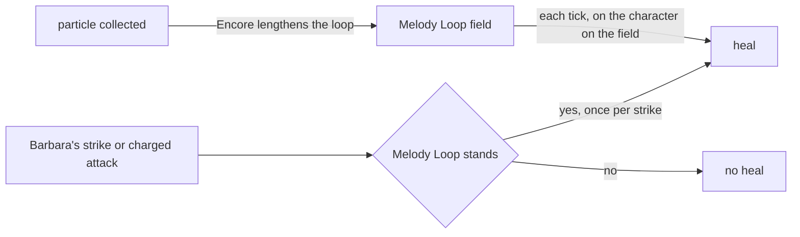

# Barbara

Barbara's kit is its record and one behaviour module, `createBarbaraKitBehaviour`, avatar 10000014: four strikes, a charged attack, a collision and two plunges, as Hydro catalyst hits, Let the Show Begin♪'s two droplets (`{data-root}/cache/genshin-wiki/Category_Barbara_Talents.json`) and its Melody Loop, and Shining Miracle♪'s heal. Her multipliers are read from proud skill groups 1431, 1432 and 1439, and match the wiki's Whisper of Water, Let the Show Begin♪ and Shining Miracle♪ values to two decimal places (`{data-root}/cache/genshin-wiki/Category_Barbara_Talents.json`); the loop's heals and duration, the skill's cooldown, and the burst's heal, cooldown and cost are read from the same groups: group 1432 holds the loop's 4% and 385 at indices 0 and 1, its 15 seconds at 5 and the skill's 32-second cooldown at 6 (`{data-root}/genshin-dump-backup-6.6/ExcelBinOutput/ProudSkillExcelConfigData.json`, and `{data-root}/cache/gcsim-v2.47.2/internal/characters/barbara/skill.go` line 91), and group 1439 holds the burst's 17.6% and 1694 at 0 and 1 (`{data-root}/genshin-dump-backup-6.6/ExcelBinOutput/ProudSkillExcelConfigData.json`), its 20-second cooldown at 2 (`{data-root}/cache/gcsim-v2.47.2/internal/characters/barbara/burst.go` line 34) and its 80 energy at 3. The droplets are a summon, and the Melody Loop and the burst's heal are fields with no edge, built as the shared effects below, with the loop's party heal on her strikes and charged attack, and Vitality Burst's cooldown cut and Hydro DMG Bonus from two constellations. Encore, her Ascension 4 passive (`{data-root}/cache/genshin-wiki/Category_Barbara_Talents.json`), is built, as a status that counts the seconds it has lengthened the loop by. Gleeful Songs' energy every 10 seconds (`{data-root}/cache/gcsim-v2.47.2/internal/characters/barbara/cons.go` line 15) is a clock her status arms on each step she stands in the party, and its expiry gives the energy. Attentiveness Be My Power's energy per enemy struck is counted across one charged attack, which its start clears, so each attack gives up to five (`{data-root}/cache/gcsim-v2.47.2/internal/characters/barbara/charge.go` lines 68 to 70). Dedicating Everything to You's revive is built from six constellations: the fall's `HealthChanged` event, a fifteen-minute status (`{data-root}/cache/gcsim-v2.47.2/internal/characters/barbara/cons.go` line 61), and the downed member's HP set to all of it, while Barbara is off the field. gcsim sets it to 1 HP (`{data-root}/cache/gcsim-v2.47.2/internal/characters/barbara/cons.go` lines 57 to 58), so the all-of-its-HP share is open, see [not built](#not-built). The burst's heal on the off-field members, the loop's Wet, Glorious Season and her other constellations are not built.

## Decisions

- **The Melody Loop is a field with no edge.** It rings the character on the field wherever it moves, so its circle is unbounded and each tick reaches the character on the field: the regeneration of 4% of Barbara's Max HP plus 385 at level 1 (`{data-root}/cache/genshin-wiki/Category_Barbara_Talents.json`), at 3 frames as the loop starts (`{data-root}/cache/gcsim-v2.47.2/internal/characters/barbara/skill.go` line 18) and every 5 seconds after (`{data-root}/cache/gcsim-v2.47.2/internal/characters/barbara/skill.go` lines 129 to 132). The loop lasts the group's 15 seconds and gcsim's extra frame (`{data-root}/cache/gcsim-v2.47.2/internal/characters/barbara/skill.go` line 16), so its fourth heal, 15 seconds after the first, still falls within it, the four the wiki's notes count (`{data-root}/cache/genshin-wiki/Category_Barbara_Talents.json`). Shining Miracle♪'s heal of 17.6% of her Max HP plus 1694 is an unbounded field too, ticking once at 77 frames (`{data-root}/cache/genshin-wiki/Category_Barbara_Talents.json`, and `{data-root}/cache/gcsim-v2.47.2/internal/characters/barbara/burst.go` line 31).

- **A party heal may scale with its striker's Max HP.** The loop's heal on each hit is `healKitParty`'s, with a Max HP share beside its ATK and DEF shares: 0.75% of Barbara's Max HP plus 72 to each member at level 1 (group 1432's indices 2 and 3, `{data-root}/genshin-dump-backup-6.6/ExcelBinOutput/ProudSkillExcelConfigData.json`, and `{data-root}/cache/genshin-wiki/Category_Barbara_Talents.json`), and four times that from her charged attack (`{data-root}/cache/gcsim-v2.47.2/internal/characters/barbara/charge.go` lines 50 to 55), unshielded. It is certain while a field of hers that ticks on the loop's 5 seconds stands and never otherwise, so her burst's single-tick field does not open it. A strike heals once whatever number of enemies it reaches, as gcsim's does (`{data-root}/cache/gcsim-v2.47.2/internal/characters/barbara/attack.go` lines 66 to 78).
- **Shining Miracle♪ reaches one character.** The wiki heals every party member (`{data-root}/cache/genshin-wiki/Category_Barbara_Talents.json`), but the kit's tick is given one target, the active combatant, and heals only that character: the burst's tick passes `tick.activeCombatant` to the heal. This is the kit's decision and departs from the wiki. The off-field members' heal waits on a tick carrying the team's combatants. gcsim's `Target: -1` heal is not cited for either reading, see [not built](#not-built).
- **Barbara's strikes count under the Normal Attack internal cooldown.** The wiki tags them "Barbara Hydro DMG", which no other hit of hers carries (`{data-root}/cache/genshin-wiki/Category_Barbara_Talents.json`), and a cooldown is keyed by character and tag, so a tag of her own would count the same hits. Her charged attack and plunges are under none, as the wiki gives (`{data-root}/cache/genshin-wiki/Category_Barbara_Talents.json`).
- **Barbara's charged attack follows a strike.** gcsim skips 14 frames of its windup after a normal attack (`{data-root}/cache/gcsim-v2.47.2/internal/characters/barbara/charge.go` line 79), so it lands at 41 frames (`{data-root}/cache/gcsim-v2.47.2/internal/characters/barbara/charge.go` line 14, 55 less the windup) and ends at 75 (`{data-root}/cache/gcsim-v2.47.2/internal/characters/barbara/charge.go` line 17, 89 less the windup, and line 94), as Lisa's does. Its circle of 3 metres round a point 5 metres ahead (`{data-root}/cache/gcsim-v2.47.2/internal/characters/barbara/charge.go` line 85) is priced as the 8-metre circle round her body, and her strikes round her body.
- **Vitality Burst's Hydro DMG Bonus skips Barbara.** From two constellations, the loop's first tick gives every other member of the deployed team a 15% Hydro DMG Bonus for the loop's seconds (`{data-root}/cache/gcsim-v2.47.2/internal/characters/barbara/barbara.go` line 32 for the 15%, `{data-root}/cache/gcsim-v2.47.2/internal/characters/barbara/cons.go` lines 18 to 27 for the members, and `{data-root}/cache/gcsim-v2.47.2/internal/characters/barbara/skill.go` lines 84 to 88 for the cast), and her skill's cooldown is multiplied by 0.85 through `getSkillCooldownMultiplier` (`{data-root}/cache/gcsim-v2.47.2/internal/characters/barbara/skill.go` line 89). The wiki's constellation page gives the bonus to "your active character", which is open, as that page is not cached; gcsim gives it to each member but Barbara, which the kit follows, so an off-field member's summon reads it too.
- **Encore is a status that counts its own seconds.** From Ascension 4, each skill cast starts a status holding the loop's full duration, and each particle the character on the field collects lengthens both the loop and the status by a second, until the status has added five (`{data-root}/cache/genshin-wiki/Category_Barbara_Talents.json`). The loop's own field is found by its interval, as the heal is, so a loop that has ended takes nothing. The status adds at most five seconds, as gcsim's `{data-root}/cache/gcsim-v2.47.2/internal/characters/barbara/asc.go` lines 21 and 30 do.

## Not built

- **The revive's HP is open.** The page says the downed member is revived to all of its HP, but gcsim revives to 1 HP (`{data-root}/cache/gcsim-v2.47.2/internal/characters/barbara/cons.go` lines 57 to 58), and the wiki's Dedicating Everything to You text is not in the cache, so neither is confirmed.
- **Shining Miracle♪'s reach against gcsim is open.** gcsim's `Target: -1` heal is not cited for either reading: its files sit under `{data-root}/cache`, which is not in this checkout, so which reading gcsim's code gives cannot be settled here.
- **The constellation wording on the wiki is open.** The bonus's "your active character" reading is not in the cache, and gcsim's per-member reading is the one the kit follows.
- **Glorious Season and the Melody Loop's Wet are not built.** Glorious Season's 12% stamina cut is not applied: every spend reads the pool's consumption multiplier ([character controller](../../character-controller/design.md)), but the one `useWorldCombat` builds the pool with reads only Impetuous Winds, and no kit effect adds a factor to it while the Melody Loop is up. Star of Tomorrow and The Purest Companionship raise talent levels, which the [talents](../../talents/design.md) page holds. The loop's Wet is left too: a party member holds no aura, and the ring's Hydro on each enemy it touches follows the body, where a summon stands where it is cast or travels ahead. The interval of that Hydro is open: the cached wiki gives an interval only for the Wet on the active character and co-op members, every 5 seconds (`{data-root}/cache/genshin-wiki/Category_Barbara_Talents.json`).

## Key files

| File                                                               | Role                                                                                                                              |
| :----------------------------------------------------------------- | :-------------------------------------------------------------------------------------------------------------------------------- |
| `packages/genshin-world/src/services/kit/characters/barbaraKit.ts` | `createBarbaraKitBehaviour`, Barbara's kit with the droplets, the Melody Loop's field and party heal, and Shining Miracle♪'s heal |

## Sources

- [Whisper of Water](https://genshin-impact.fandom.com/wiki/Whisper_of_Water), [Let the Show Begin♪](https://genshin-impact.fandom.com/wiki/Let_the_Show_Begin%E2%99%AA) and [Shining Miracle♪](https://genshin-impact.fandom.com/wiki/Shining_Miracle%E2%99%AA), Genshin Impact Wiki: Barbara's strikes', charged attack's and plunges' gauges, internal cooldown tags and poise, the droplets' gauge, internal cooldown and poise, the Melody Loop's heals, its four regenerations and its Wet, and the burst's heal on every party member.
- [Glorious Season](https://genshin-impact.fandom.com/wiki/Glorious_Season), [Encore](https://genshin-impact.fandom.com/wiki/Encore), [Gleeful Songs](https://genshin-impact.fandom.com/wiki/Gleeful_Songs), [Vitality Burst](https://genshin-impact.fandom.com/wiki/Vitality_Burst), [Attentiveness Be My Power](https://genshin-impact.fandom.com/wiki/Attentiveness_Be_My_Power) and [Dedicating Everything to You](https://genshin-impact.fandom.com/wiki/Dedicating_Everything_to_You), Genshin Impact Wiki: Barbara's passives and constellations.
- [gcsim v2.47.2](https://github.com/genshinsim/gcsim/tree/v2.47.2/internal/characters/barbara), MIT: the kit's hitmarks, cancel frames and areas, the Melody Loop's start, ticks and extra frame, the strikes' heal once a strike, and Vitality Burst's bonus and cooldown.
