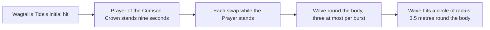

# Candace

Candace's kit is its record and one behaviour module, `createCandaceKitBehaviour`, on avatar 10000072 (`packages/genshin-world/src/services/kit/characters/candaceKit.ts`): four strikes (`{data-root}/cache/gcsim-v2.47.2/internal/characters/candace/attack.go:16`), a charged attack, a collision and two plunges; Sacred Rite: Heron's Sanctum, a tap and a charged hold that each set a shield on the team and deal a share of her Max HP as flat DMG; and Sacred Rite: Wagtail's Tide, whose initial hit sets the Prayer of the Crimson Crown going for nine seconds. `{data-root}/cache/gcsim-v2.47.2/internal/characters/candace/plunge.go:57`, `:107` and `:156` (gcsim) hold the two plunges and the collision. Her multipliers come from proud skill groups 7231, 7232 and 7239 at level 1 (`{data-root}/genshin-dump-backup-6.6/ExcelBinOutput/ProudSkillExcelConfigData.json`). The tap's cooldown is 6 seconds and the charged hold's 9, the burst's cooldown 15 seconds and its cost 60 energy, and the charged attack's stamina 25 (the same dump file, groups 7232, 7239 and 7231). Ascension 1 and Constellations 1, 2, 4 and 6 are built. Ascension 4, the Prayer's DMG Bonus on the team's normal attacks, and the talent levels of Constellations 3 and 5 are not, as the sections below give.

## How it works

## Decisions

- **Ascension 1's Aegis of Crossed Arrows completes her hold's charge on a strike.** While she holds Heron's Sanctum, a strike on her completes the charge, so its release plays the charged hold whatever she held for, through the shared [held-charge mechanism](../README.md). A strike is an HP loss on her with no kit as its source, or a shield on her absorbing one; a drown reads the same as the HP loss, as the record gives it no cause. The passive's text is the cached Genshin Impact Wiki page for Aegis of Crossed Arrows (`{data-root}/cache/genshin-wiki/Category_Candace_Talents.json`), which says a hit on her during the Hold finishes the charge instantly, and gcsim leaves the passive as a TODO (`{data-root}/cache/gcsim-v2.47.2/internal/characters/candace/asc.go:12`). `packages/genshin-world/src/services/kit/characters/candaceKit.ts`
- **Heron's Sanctum's damage is a share of Max HP carried as flat DMG.** Each of the tap's and the charged hit's talent multipliers is zero, and the additive base DMG Bonus is her Max HP times the table's share, 0.12 for the tap and 0.1904 for the charged hit at level 1. The dump's group `7232` (`{data-root}/genshin-dump-backup-6.6/ExcelBinOutput/ProudSkillExcelConfigData.json`) holds 0.12 at index 2 for the tap and 0.1904 at index 3 for the charged hit. The tap reads the table's slot 2, which equals the shield's share at every level (index 0), where gcsim reads its tap at the shield's slot; the slot is a best estimate, as the number matches gcsim's. `packages/genshin-world/src/services/kit/characters/candaceKit.ts`
- **Each shield lasts until its hit lands.** gcsim sets the shield's expiry at the hitmark, "treated as frame when attack hits" (`{data-root}/cache/gcsim-v2.47.2/internal/characters/candace/skill.go:98`), so the tap's shield stands for 16 frames (`{data-root}/cache/gcsim-v2.47.2/internal/characters/candace/skill.go:107`, the 16-frame hitmark at `{data-root}/cache/gcsim-v2.47.2/internal/characters/candace/skill.go:15`) and the charged hold's for 36, its 91-frame hitmark less the 55-frame windup a perfect release takes (`{data-root}/cache/gcsim-v2.47.2/internal/characters/candace/skill.go:40` to `:46`, `:63`, `:107`). Its health is a share of Max HP from the table plus a flat amount, 1155.56 at level 1 (group `7232`'s index 1), and it is Hydro (`{data-root}/cache/gcsim-v2.47.2/internal/characters/candace/skill.go:106`). `packages/genshin-world/src/services/kit/characters/candaceKit.ts`
- **The charged hold starts at half a second of holding.** gcsim takes the hold as a parameter with no threshold, and no table or wiki page gives one, so the framework's half second stands. The roadmap asks whether the game agrees. `packages/genshin-world/src/services/kit/characters/candaceKit.ts`
- **The Prayer of the Crimson Crown is a field that stands wherever the body is.** It starts with the burst at the 33-frame hitmark (`{data-root}/cache/gcsim-v2.47.2/internal/characters/candace/burst.go:18`) and runs nine seconds, twelve from Constellation 1 (`{data-root}/cache/gcsim-v2.47.2/internal/characters/candace/burst.go:54` to `:56`, the dump's `7239` at 9). Every 30 frames it infuses the party member on the field with Hydro for one second (`{data-root}/cache/gcsim-v2.47.2/internal/characters/candace/burst.go:100`), if that member wields a sword, claymore or polearm, and a swap infuses the one coming on at once. `{data-root}/cache/gcsim-v2.47.2/internal/characters/candace/burst.go:95` (gcsim) gives the infusion 60 frames, a second. `packages/genshin-world/src/services/kit/characters/candaceKit.ts`
- **Each swap while the Prayer stands sets off a wave round the body, three at most.** A wave is a circle of radius 3.5 metres round the body (`{data-root}/cache/gcsim-v2.47.2/internal/characters/candace/burst.go:129`), struck one frame on (`{data-root}/cache/gcsim-v2.47.2/internal/characters/candace/burst.go:21`), for 6.6% of her Max HP as flat Hydro DMG, the table's wave share (group `7239`'s index 0, 0.066104). The wave count is a status that each burst restarts, as gcsim resets it on each cast (`{data-root}/cache/gcsim-v2.47.2/internal/characters/candace/burst.go:33`, with the three-wave cap at `{data-root}/cache/gcsim-v2.47.2/internal/characters/candace/burst.go:111`). `packages/genshin-world/src/services/kit/characters/candaceKit.ts`
- **Constellation 6 sets off a wave on a party member's elemental normal attack.** While the Prayer stands, a `DamageTaken` event for a normal attack of the character on the field, by another member and with an element, sets off a wave for 15% of her Max HP. It waits 2.3 seconds, as gcsim's cooldown does (`{data-root}/cache/gcsim-v2.47.2/internal/characters/candace/cons.go:59`, 138 frames), and its 15% is gcsim's `{data-root}/cache/gcsim-v2.47.2/internal/characters/candace/cons.go:69` at 0.15 of her Max HP. The event carries the striker and its element, so the check is the one gcsim makes. `packages/genshin-world/src/services/kit/characters/candaceKit.ts`
- **Constellation 2's Max HP is a buff her own hit starts.** Each Heron's Sanctum hit on an enemy, tap or charged, gives her a 20% Max HP buff for 15 seconds (`{data-root}/cache/gcsim-v2.47.2/internal/characters/candace/cons.go:19`, `:21`) under its own source, so the next hit restarts it, as gcsim's stat-modifier call under one key does (`{data-root}/cache/gcsim-v2.47.2/internal/characters/candace/cons.go:20`). It is read from the hit's `onStrike` on the skill and on the hold, which runs once for each enemy the hit lands on, as gcsim's callback does. The buff reaches her shields and her damage through her Max HP. `packages/genshin-world/src/services/kit/characters/candaceKit.ts`
- **Constellation 4's hold cooldown is cut at the hold's start.** The hold's cooldown is the hold's own nine seconds, which the start adds to her party cooldown; at Constellation 4 the hold's `onStart` cuts it by the difference from the tap's six (gcsim's `{data-root}/cache/gcsim-v2.47.2/internal/characters/candace/skill.go:110` to `:112`, which takes the tap's cooldown from Constellation 4), as `changeKitSkillCooldown` does for Alhaitham's first constellation. gcsim gives its 1.2-second cut on a projection hit (cited in [Alhaitham's kit](../alhaitham/design.md)), and `packages/genshin-world/src/services/kit/characters/alhaithamKit.ts:237` makes the call. The cut is taken in seconds, so a cooldown multiplier that a field or a resonance applies to the hold's start is not applied to it; it is exact while none is active. `packages/genshin-world/src/services/kit/characters/candaceKit.ts`

## Not built

- **Ascension 4's DMG and the Prayer's 20% DMG Bonus on the team's normal attacks are not built.** The hook is a party buff read by another member's normal attack, as `getStrikeDamageBonus` reads only the kit's own strikes.

## Key files

| File                                                               | Role                                                                                                                                                                                |
| :----------------------------------------------------------------- | :---------------------------------------------------------------------------------------------------------------------------------------------------------------------------------- |
| `packages/genshin-world/src/services/kit/characters/candaceKit.ts` | `createCandaceKitBehaviour`, Candace's kit with her strikes, charged attack and plunges, Sacred Rite: Heron's Sanctum's shields, and Sacred Rite: Wagtail's Tide's Prayer and waves |

## Sources

- [gcsim (MIT)](https://github.com/genshinsim/gcsim/tree/v2.47.2/internal/characters/candace): the strikes' hitmarks, cancel frames, reaches and poise, the charged attack and the plunges' frames, radii and poise, Heron's Sanctum's frames, hitboxes, shields and cooldowns, Wagtail's Tide's hitmark, duration, infusion and waves, and Constellations 1, 2, 4 and 6.
- The Genshin Impact Wiki's Aegis of Crossed Arrows page, cached at `{data-root}/cache/genshin-wiki/Category_Candace_Talents.json`: Ascension 1's text.
- The Candace talent pages in the same cache: the tap's 6-second and the hold's 9-second cooldowns, 25 stamina for the charged attack, and the Prayer's 9 seconds, which the dump's groups confirm at level 1.
- The proud skill groups 7231, 7232 and 7239 in the hosted game data: each multiplier's index, the shield's share and flat HP, the cooldowns, the burst's seconds, wave count, cooldown and energy cost, read at talent level 1.

## Open

- [ ] **the tap's slot 2 equals the shield's share at every level, and gcsim reads the tap at the shield's slot** — no source yet: only level 1 of group `7232` was opened, and gcsim's tap slot line was not located.
- [ ] **a charged hold starts at half a second of holding** — no source yet: no table or wiki page was opened for the threshold, as the page itself says.
