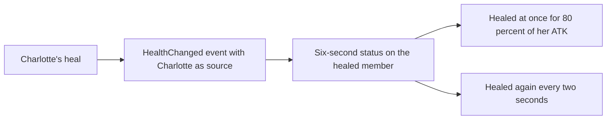

# Charlotte

Charlotte's kit is its record and one behaviour module, `createCharlotteKitBehaviour` (`packages/genshin-world/src/services/kit/characters/charlotteKit.ts`), on avatar 10000088 (`{data-root}/genshin-dump-backup-6.6/ExcelBinOutput/AvatarExcelConfigData.json`): three Cryo strikes, a charged attack that sets off Spiritbreath Thorn, a collision and two plunges, Framing's press and Still Photo. Her multipliers are read from proud skill groups 8831, 8832 and 8839, which the game's `ProudSkillExcelConfigData` holds (`{data-root}/genshin-dump-backup-6.6/ExcelBinOutput/ProudSkillExcelConfigData.json`; `packages/genshin-world/src/data/kits/charlotte.json` names the group and index each reads). The charged attack's stamina, the press's cooldown, and the burst's cooldown and energy cost are read from the labels of the talent groups her talents use (`scripts/src/services/genshinAssets/kits/tables/getTableKitCandidates.ts`); the wiki gives 50 stamina, a 12-second press cooldown, a 20-second burst cooldown and 80 energy (`{data-root}/cache/genshin-wiki/Category_Charlotte_Talents.json`, Attribute Scaling), and the cooldowns match gcsim's `{data-root}/cache/gcsim-v2.47.2/internal/characters/charlotte/skill.go` line 44 (720 frames) and `{data-root}/cache/gcsim-v2.47.2/internal/characters/charlotte/burst.go` line 24 (1200 frames).

Framing's press is a Cryo box 4 metres wide and 8 long from the body (gcsim `{data-root}/cache/gcsim-v2.47.2/internal/characters/charlotte/skill.go` lines 38-39). Each enemy it strikes gets a Snappy Silhouette mark for 6.8 seconds (`{data-root}/cache/gcsim-v2.47.2/internal/characters/charlotte/skill.go` line 175, 360 plus 0.8 times 60 frames), which ticks a single-target Cryo hit every 1.5 seconds (`{data-root}/cache/gcsim-v2.47.2/internal/characters/charlotte/skill.go` lines 176 and 221), the hit landing at the tick itself, as gcsim queues it with no delay at `{data-root}/cache/gcsim-v2.47.2/internal/characters/charlotte/skill.go` line 220 (its reader's 90 frames are the tick's interval from the mark, which the mark's status gives), and a press marks no more than five enemies (`{data-root}/cache/gcsim-v2.47.2/internal/characters/charlotte/skill.go` line 158). Spiritbreath Thorn strikes 30 frames after the charged attack's hit (`{data-root}/cache/gcsim-v2.47.2/internal/characters/charlotte/charge.go` line 60), a circle of radius 2.5 (`{data-root}/cache/gcsim-v2.47.2/internal/characters/charlotte/charge.go` line 17) round the point the target stood at when the charged attack started, as gcsim takes it at `{data-root}/cache/gcsim-v2.47.2/internal/characters/charlotte/charge.go` line 57, not where the target stands at the hit, and its six-second cooldown starts when it strikes (`{data-root}/cache/gcsim-v2.47.2/internal/characters/charlotte/charge.go` lines 73-76). Still Photo strikes a circle of radius 6 4.5 metres ahead of the body at 53 frames (`{data-root}/cache/gcsim-v2.47.2/internal/characters/charlotte/burst.go` lines 18-22 and 54), and its cast heals every member of the party (`{data-root}/cache/gcsim-v2.47.2/internal/characters/charlotte/burst.go` line 75, targeting every member) by a flat amount and a share of Charlotte's ATK. Kamera strikes the same circle eight times (`{data-root}/cache/gcsim-v2.47.2/internal/characters/charlotte/burst.go` line 14), and each tick heals whoever is on the field by a flat amount plus a share of her ATK while it stands within 7 metres of the cast point (`{data-root}/cache/gcsim-v2.47.2/internal/characters/charlotte/burst.go` lines 20, 84 and 89).

Not built yet:

- **Framing's hold and Focused Impression.** Its hit falls a held duration after the press, and a skill's hold levels are fixed, so it waits on a hold whose hitmark follows the seconds held (gcsim `skill.go` line 108 sets the hitmark to the hold plus a 111-frame constant, declared at line 47).
- **Ascension 1**, which cuts the press's cooldown by 2 seconds when an enemy marked by Focused Impression dies (gcsim `asc.go` lines 19-34 gates it on that hold mark, not on the press's), waits on an enemy-death kit event and on the hold.
- **Ascension 4's Healing Bonus and Cryo DMG Bonus by region are built.** Each other member from Fontaine adds 5% Healing Bonus to Charlotte, and each other member from outside it adds 5% Cryo DMG Bonus, from the deployed combatants and their `regionId`, as gcsim v2.47.2 (MIT) `{data-root}/cache/gcsim-v2.47.2/internal/characters/charlotte/asc.go` lines 40-66 give them, which read each member's zone where this page reads its region (`packages/genshin-world/src/services/kit/characters/charlotteKit.ts`). The `regionId` is the catalogue region the character's association names.
- **Constellation 6**, the summation strike and heal on hold-marked enemies, waits on Focused Impression's mark (gcsim `cons.go` line 122 gates it on that mark).

Constellations 1, 2 and 4 are built on the events and hits the framework has. Constellation 1 starts on each `HealthChanged` event whose source is Charlotte, which `changeKitMemberHealth` (`packages/genshin-world/src/services/kit/effects/changeKitMemberHealth.ts`) records for each of her heals: the member it lands on gets a six-second status, one at a time through `startKitCooldown` (`packages/genshin-world/src/services/kit/effects/startKitCooldown.ts`), is healed at once for 80% of her ATK, and is healed again every two seconds from a `schedulePeriodicKitTask` (`packages/genshin-world/src/services/kit/effects/schedulePeriodicKitTask.ts`), as gcsim's Constellation 1 heal does (`{data-root}/cache/gcsim-v2.47.2/internal/characters/charlotte/cons.go` lines 24-39, and the subscription at lines 41-54 with its six-second status). Constellation 2 counts the press's hits on enemies, up to three, from the press's own start, and raises her ATK by 10% for each count as a buff under one source for 12 seconds, so each hit restarts it (`{data-root}/cache/gcsim-v2.47.2/internal/characters/charlotte/cons.go` lines 58-82). Constellation 4 counts the burst's hits, Still Photo's and Kamera's, on an enemy the press marked: the count is the stacks of a status that starts with the first counted hit and runs 20 seconds, each counted hit gives 2 energy, and `getStrikeDamageBonus` (`packages/genshin-world/src/services/kit/characters/charlotteKit.ts`) raises those hits' DMG by 10% while fewer than five are counted (`{data-root}/cache/gcsim-v2.47.2/internal/characters/charlotte/cons.go` lines 83-112). gcsim's Constellations 2 and 4 also read the hold's hits and Focused Impression mark, which are not built, so both read the press alone here.

Gcsim gives her strikes, charged attack and plunges no poise (none is set anywhere in its charlotte package), so each takes the wiki's (`{data-root}/cache/genshin-wiki/Category_Charlotte_Talents.json`, Advanced Properties): 8.133 to 12.113 on the three strikes, 80 on the charged attack, 5 on the collision, and 50 and 100 on the low and high plunges. Her Snappy Silhouette mark's hit takes the wiki's 20, as gcsim gives it none too. The charged attack's stamina is the table's flat value at index 4 (the wiki's Attribute Scaling order puts the stamina fifth, `stamina=50`), which gcsim does not give. Each is provisional until a recording settles it.

## How it works

## Key files

| File                                                                 | Role                                                                                                                                                                                          |
| :------------------------------------------------------------------- | :-------------------------------------------------------------------------------------------------------------------------------------------------------------------------------------------- |
| `packages/genshin-world/src/services/kit/characters/charlotteKit.ts` | `createCharlotteKitBehaviour`, Charlotte's kit with her strikes, charged attack and Spiritbreath Thorn, plunges, Framing's press and its marks, and Still Photo with its cast heal and Kamera |

## Sources

- [gcsim](https://github.com/genshinsim/gcsim/tree/v2.47.2/internal/characters/charlotte), MIT: her strikes' hitmarks, cancel frames and radii, the charged attack and Spiritbreath Thorn, the plunges' frames and radii, Framing's press and its marks, and Still Photo's hit, heals and Kamera's ticks, and Constellations 1, 2 and 4. The line numbers above are its files at v2.47.2 (`{data-root}/cache/gcsim-v2.47.2/internal/characters/charlotte/`).
- The wiki's Charlotte talent page (`{data-root}/cache/genshin-wiki/Category_Charlotte_Talents.json`): the poise of each hit, the Attribute Scaling table's stamina, and the cooldowns and energy cost.
- The game's `ProudSkillExcelConfigData` (`{data-root}/genshin-parity/text/ExcelBinOutput`), which holds proud skill groups 8831, 8832 and 8839.
