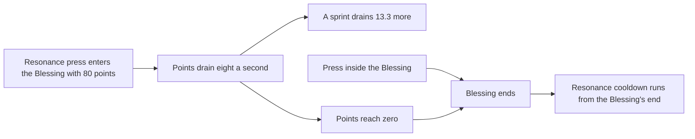

# Chasca

Chasca's kit is its record and one behaviour module, `createChascaKitBehaviour`, on avatar 10000104 (`{data-root}/genshin-dump-backup-6.6/ExcelBinOutput/AvatarExcelConfigData.json`): four normal attacks with the third of two hits, the fully-charged Aimed Shot, a collision and a low plunge, Spirit Reins' Resonance, and Galesplitting Soulseeker Shell's first hit. Her multipliers are read from proud skill groups 10431, 10432 and 10439 (the game's `{data-root}/genshin-dump-backup-6.6/ExcelBinOutput/ProudSkillExcelConfigData.json`, level 1 checked here), and at level 1 they match gcsim's tables in `{data-root}/cache/gcsim-v2.47.2/internal/characters/chasca/zz_chasca.dm.go` (lines 39, 73, 109, 127, 163, 181, 252, 270 and 288) to the game's six decimals; the higher levels were not compared on this page.

## How it works

## Decisions

- **Her normal attacks are the kit's four strikes.** Each is a box of 0.1 by 1 metre centred on the primary target, its spawn half a metre back toward her, the Sethos box, as gcsim's N1 to N4 hitboxes place it (`{data-root}/cache/gcsim-v2.47.2/internal/characters/chasca/attack.go` lines 76-84: a box on the primary target, offset half a metre, 0.1 by 1), priced as the circle to its farthest corner, under the kits README's Boxes are circles rule, so the offset's sign reaches no value. Her third attack is two hits at 14 and 20 frames, and her fourth one hit at 39, as gcsim queues it (`{data-root}/cache/gcsim-v2.47.2/internal/characters/chasca/attack.go` line 16, its hitmark list), although the game's table names three hits for the fourth (the wiki's Normal Attack 4-Hit A, B and C, `{data-root}/cache/genshin-wiki/Category_Chasca_Talents.json`). Her strike animations are gcsim's cancel frames: its walk cancels are 27, 29 and 53 for the first three strikes and 62 for the fourth, whose cancel into the first strike is 73 (`{data-root}/cache/gcsim-v2.47.2/internal/characters/chasca/attack.go` lines 28-31 and 36).
- **Her charged attack is the fully-charged Aimed Shot.** It lands at 86 frames of its 96-frame animation (`{data-root}/cache/gcsim-v2.47.2/internal/characters/chasca/aimed.go` lines 27 and 49-50), an Anemo hit on the same box as her strikes (`{data-root}/cache/gcsim-v2.47.2/internal/characters/chasca/aimed.go` lines 103-108), with the wiki's 20 poise (the wiki's Fully-Charged Aimed Shot poise, `{data-root}/cache/genshin-wiki/Category_Chasca_Talents.json`). Its stamina is 0 by the rule the gcsim candidate builder applies to every aimed charged attack (`scripts/src/services/genshinAssets/kits/gcsim/addGcsimChargedAttackCandidates.ts` line 58), which is not a game value: the wiki's table has no stamina row for her, so the 0 is open (see Not built).
- **Her collision and low plunge are gcsim's.** The collision lands at 44 frames (`{data-root}/cache/gcsim-v2.47.2/internal/characters/chasca/plunge.go` line 18, a hitmark of 50 less 6), a circle of radius 1.5 on her (`{data-root}/cache/gcsim-v2.47.2/internal/characters/chasca/plunge.go` line 83). The low plunge lands at 50 frames of 80 (`{data-root}/cache/gcsim-v2.47.2/internal/characters/chasca/plunge.go` lines 17 and 22), with the plunge radius of 3 (`{data-root}/cache/gcsim-v2.47.2/internal/characters/chasca/plunge.go` line 60).
- **Galesplitting Soulseeker Shell is the burst's first hit, at 96 frames of its 114.** It is an Anemo circle of radius 6 on the primary target (`{data-root}/cache/gcsim-v2.47.2/internal/characters/chasca/burst.go` lines 22, 27, 50 and 55). Its cost is 60 energy and its cooldown 15 seconds, both from the table: the game's group 10439 at level 1 holds 15 and 60 (`{data-root}/genshin-dump-backup-6.6/ExcelBinOutput/ProudSkillExcelConfigData.json`, paramList indices 3 and 4), the wiki's Galesplitting table (`{data-root}/cache/genshin-wiki/Category_Chasca_Talents.json`) gives `energyCost=60` and `cd=15s`, and gcsim sets the cooldown at `{data-root}/cache/gcsim-v2.47.2/internal/characters/chasca/burst.go` line 96.
- **Spirit Reins' Resonance lands at 3 frames, a circle of radius 5.5 round her** (`{data-root}/cache/gcsim-v2.47.2/internal/characters/chasca/skill.go` line 19 sets the 3 frames, and lines 143-148 the circle). Its press lets the next action start 6 frames later, gcsim's earliest cancel (`{data-root}/cache/gcsim-v2.47.2/internal/characters/chasca/skill.go` line 25 sets the attack's frames to 6), and its cooldown is the table's 6.5 seconds (the wiki's `cd=6.5s`, and the game's group 10432 at level 1 holds 6.5 at paramList index 5). gcsim runs that cooldown from the end of the Blessing (`{data-root}/cache/gcsim-v2.47.2/internal/characters/chasca/skill.go` line 103, in the Blessing's exit), and the kit holds it there (`packages/genshin-world/src/services/kit/characters/chascaKit.ts`): the press sets it, and the kit's step gives back the seconds the team's cooldowns take while the Blessing lasts, so it runs from the Blessing's end whether she leaves by a press or her points drain to none, to within the step the points drain on.
- **Spirit Reins' press enters the Nightsoul Blessing with 80 points** (`{data-root}/cache/gcsim-v2.47.2/internal/characters/chasca/skill.go` line 70, the entry at 80 points, and the game's group 10432 at level 1, paramList index 4, in `{data-root}/genshin-dump-backup-6.6/ExcelBinOutput/ProudSkillExcelConfigData.json`). They drain eight a second, 0.8 each six frames (`{data-root}/cache/gcsim-v2.47.2/internal/characters/chasca/skill.go` lines 114-115), and a sprint in the Blessing drains 13.3 more once, as the sprint starts (`{data-root}/cache/gcsim-v2.47.2/internal/characters/chasca/dash.go` line 18). The points ending at zero end the Blessing, as gcsim's points check does (`{data-root}/cache/gcsim-v2.47.2/internal/characters/chasca/skill.go` lines 46-47), which the step does. The Blessing's values are gcsim's Blessing entry and point drain (`{data-root}/cache/gcsim-v2.47.2/internal/characters/chasca/skill.go`) and its sprint drain is `{data-root}/cache/gcsim-v2.47.2/internal/characters/chasca/dash.go`.
- **The press that leaves the Blessing strikes nothing.** gcsim's press in the Blessing leaves it with no strike (`{data-root}/cache/gcsim-v2.47.2/internal/characters/chasca/skill.go` lines 121-131, which return before the Resonance hit is queued), so the skill's state-ending check starts the press with none of the skill's hits, off any cooldown, and the cooldown the entering press set runs from the exit.
- **The high plunge is provisional and open.** gcsim gives its multiplier but no high-plunge hit at all (`{data-root}/cache/gcsim-v2.47.2/internal/characters/chasca/plunge.go` has the collision and the low plunge only), so its landing is the low plunge's 50 frames in a radius of 5. The record tags both as unsourced (`plunges.high.hits.0.area` and `plunges.high.hits.0.hitmarkFrames` in `packages/genshin-world/src/data/kits/chasca.json`), so the radius and the frame wait on a recording. The [roadmap](../../../../changes/genshin-roadmap/tasks.md) asks whether it lands there.

## Not built

- **The Blessing's flight and its Shadowhunt Shells are not built.** While in the Blessing she flies and fires Shadowhunt Shells at her aim. The framework's locomotion has OnFoot, Jump, Fall, Glide and Plunge but no flight state (the [character controller](../../character-controller/design.md) states, lines 46-52), so the flight and the shells wait on a flight hook.
- **The five shells after Galesplitting are not built.** Each of the burst's Soulseeker and Radiant Shells is Anemo or the party's element, the Radiant ones taking the team's elements in turn, and each strikes one enemy round-robin (`{data-root}/cache/gcsim-v2.47.2/internal/characters/chasca/burst.go` lines 69 to 91, where the Radiant shell takes the element and the Soulseeker shell is Anemo, each a single-target hit). The kit can read the party's elements and the builder reads gcsim's secondary hitmark list, so the shells' hitmarks are in the record. What holds the shells back is that a kit hit strikes every enemy in its area, not one enemy in turn.
- **Ascension passives and constellations are not built.** They are the passives of the [character kits proposal](../../../../changes/genshin-character-kits/design.md) and the [constellations](../../../../changes/genshin-constellations/design.md) page's. The kit's own comments say so (`packages/genshin-world/src/services/kit/characters/chascaKit.ts`, lines 42-46), and gcsim's `{data-root}/cache/gcsim-v2.47.2/internal/characters/chasca/cons.go` and `{data-root}/cache/gcsim-v2.47.2/internal/characters/chasca/asc.go` hold the rules it leaves out.
- **Charged attack stamina is open.** Her Aimed Shot's stamina of 0 is the candidate builder's rule for an aimed charge, not a value the game or the wiki gives her, so it stays open until the game's value is read.
- **The four-decimal match is checked at level 1 only.** The higher levels of groups 10431, 10432 and 10439 were not compared against gcsim's tables.

## Key files

| File                                                              | Role                                                                                                                                                                     |
| :---------------------------------------------------------------- | :----------------------------------------------------------------------------------------------------------------------------------------------------------------------- |
| `packages/genshin-world/src/services/kit/characters/chascaKit.ts` | `createChascaKitBehaviour`, Chasca's kit with her strikes, fully-charged Aimed Shot, plunges, Resonance, the Nightsoul Blessing it enters, and Galesplitting's first hit |

## Sources

- [gcsim](https://github.com/genshinsim/gcsim/tree/v2.47.2/internal/characters/chasca), MIT: the kit's hitmarks, animations, reach and the plunges' radii, and the proud group indices behind each multiplier.
- [gcsim skill.go and dash.go](https://github.com/genshinsim/gcsim/tree/v2.47.2/internal/characters/chasca), MIT: the Blessing's 80 points, its drain and its sprint drain.
- [Hosted game data](../../hosted-game-data/design.md): the avatar's talent groups 10431, 10432 and 10439, read from the talent and skill kit tables. Checked here against the game's `{data-root}/genshin-dump-backup-6.6/ExcelBinOutput/ProudSkillExcelConfigData.json` at level 1.
- The line numbers above are gcsim v2.47.2's files in `{data-root}/cache/gcsim-v2.47.2/internal/characters/chasca/`, and the wiki's Chasca talent page is `{data-root}/cache/genshin-wiki/Category_Chasca_Talents.json`.
